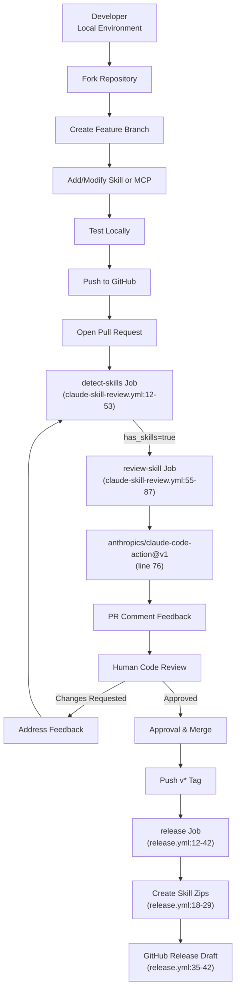
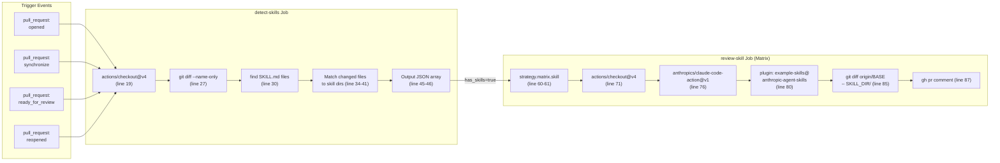
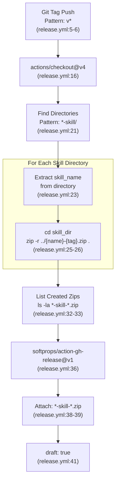

<!-- source: DeepWiki mcp.deepwiki.com · repo anthropics/healthcare · page 6 Developer Guide · fetched 2026-10-26 -->

# Developer Guide

<details>
<summary>Relevant source files</summary>

The following files were used as context for generating this wiki page:

- [.claude-plugin/marketplace.json](.claude-plugin/marketplace.json)
- [.github/workflows/claude-skill-review.yml](.github/workflows/claude-skill-review.yml)
- [.github/workflows/release.yml](.github/workflows/release.yml)
- [README.md](README.md)
- [icd10-codes/.claude-plugin/plugin.json](icd10-codes/.claude-plugin/plugin.json)

</details>


This guide is for developers who want to contribute skills or MCP servers to the healthcare marketplace, modify the marketplace configuration, or understand the development and release workflow. 

For detailed instructions on creating individual skills, see [Creating a New Skill](#6.1). For MCP server integration, see [Adding an MCP Server](#6.2). For testing guidance, see [Testing and Quality Assurance](#6.3). For an overview of the marketplace architecture, see [Marketplace Architecture](#2).

---

## Repository Structure

The healthcare marketplace repository follows a standardized directory structure that separates skills, MCP servers, and infrastructure:

```
anthropics/healthcare/
├── .claude-plugin/
│   └── marketplace.json              # Central registry of all plugins
├── .github/
│   └── workflows/
│       ├── claude-skill-review.yml   # Automated skill review
│       ├── claude-code-review.yml    # General code review
│       └── release.yml               # Release packaging
├── clinical-trial-protocol-skill/
│   ├── SKILL.md                      # Skill definition
│   ├── references/                   # Knowledge artifacts
│   └── scripts/                      # Helper scripts
├── prior-auth-review-skill/
│   ├── SKILL.md
│   └── assets/
├── fhir-developer-skill/
│   ├── SKILL.md
│   ├── references/
│   └── scripts/
├── cms-coverage/
│   └── .claude-plugin/
│       └── plugin.json               # MCP server configuration
├── npi-registry/
│   └── .claude-plugin/
│       └── plugin.json
├── pubmed/
│   └── .claude-plugin/
│       └── plugin.json
├── icd10-codes/
│   └── .claude-plugin/
│       └── plugin.json
└── README.md
```

### Directory Conventions

| Component Type | Directory Pattern | Required Files | Purpose |
|---------------|------------------|----------------|---------|
| **Skill** | `*-skill/` | `SKILL.md` | Contains skill definition and supporting artifacts |
| **MCP Server** | `*/` (no suffix) | `.claude-plugin/plugin.json` | Points to external HTTP MCP endpoint |
| **Marketplace** | `.claude-plugin/` | `marketplace.json` | Central registry for discovery |
| **CI/CD** | `.github/workflows/` | `*.yml` | Automated workflows |

**Sources:** [.claude-plugin/marketplace.json:1-74](), [icd10-codes/.claude-plugin/plugin.json:1-15]()

---

## Development Workflow

The development lifecycle follows a structured pull request workflow with automated quality gates:



**Sources:** [.github/workflows/claude-skill-review.yml:1-88](), [.github/workflows/release.yml:1-43]()

### Step-by-Step Workflow

**1. Fork and Clone**
```bash
git clone https://github.com/YOUR_USERNAME/healthcare.git
cd healthcare
git remote add upstream https://github.com/anthropics/healthcare.git
```

**2. Create Feature Branch**
```bash
git checkout -b add-my-skill
```

**3. Make Changes**
- Add skill directory with `SKILL.md` (for skills)
- Add MCP directory with `.claude-plugin/plugin.json` (for MCP servers)
- Update `.claude-plugin/marketplace.json` to register the plugin

**4. Test Locally**
- Install skill using local marketplace path
- Verify skill behavior matches expected outcomes
- Test MCP server connectivity (for MCP additions)

**5. Submit Pull Request**
```bash
git add .
git commit -m "Add: my-skill description"
git push origin add-my-skill
# Open PR on GitHub
```

**6. Automated Review Triggers**
The PR automatically triggers the `claude-skill-review` workflow which:
- Detects changed skills using [.github/workflows/claude-skill-review.yml:23-53]()
- Reviews each skill via Claude using [.github/workflows/claude-skill-review.yml:75-87]()
- Posts feedback as PR comments

**7. Address Feedback and Merge**
- Respond to Claude's automated review
- Make requested changes
- Obtain human approval
- Merge to main branch

**8. Release**
- Create and push version tag: `git tag v1.0.0 && git push --tags`
- Release workflow automatically packages skills into zip files
- GitHub release draft is created with artifacts

**Sources:** [.github/workflows/claude-skill-review.yml:1-88](), [.github/workflows/release.yml:1-43]()

---

## Automated Skill Review System

The most critical quality gate is the `claude-skill-review.yml` workflow, which uses Claude itself to review healthcare skills.



### Skill Detection Algorithm

The `detect-skills` job identifies which skills were modified in a PR:

**Algorithm Flow:**
1. **Fetch Changed Files** - Uses `git diff --name-only` to compare PR branch against base branch [.github/workflows/claude-skill-review.yml:27]()
2. **Find Skill Directories** - Locates all directories containing `SKILL.md` files [.github/workflows/claude-skill-review.yml:30]()
3. **Match Changes to Skills** - Iterates through skill directories and checks if any changed files fall under each skill path [.github/workflows/claude-skill-review.yml:34-41]()
4. **Output JSON Array** - Converts affected skills to JSON array for matrix strategy [.github/workflows/claude-skill-review.yml:45-46]()

**Example Detection:**
```bash
# Changed files: clinical-trial-protocol-skill/SKILL.md
# Skill directories: clinical-trial-protocol-skill/, prior-auth-review-skill/
# Output: skills=["clinical-trial-protocol-skill"]
# has_skills=true
```

**Sources:** [.github/workflows/claude-skill-review.yml:23-53]()

### Claude Review Process

The `review-skill` job uses a matrix strategy to review each detected skill in parallel:

**Configuration:**
- **Matrix Variable:** `matrix.skill` contains skill directory path [.github/workflows/claude-skill-review.yml:60-61]()
- **Claude Action:** `anthropics/claude-code-action@v1` [.github/workflows/claude-skill-review.yml:76]()
- **Plugin Marketplace:** `https://github.com/anthropics/skills.git` [.github/workflows/claude-skill-review.yml:79]()
- **Active Plugin:** `example-skills@anthropic-agent-skills` (skill-creator skill) [.github/workflows/claude-skill-review.yml:80]()
- **Allowed Tools:** `Bash(gh pr comment:*)`, `Bash(git:*)`, `Read`, `Glob`, `Grep`, `Skill` [.github/workflows/claude-skill-review.yml:81]()

**Review Prompt Template:**
```
Use the skill-creator skill to review the **{matrix.skill}** skill in PR #{pr_number}.

Use `git diff origin/{base_ref} -- {matrix.skill}/` to see what changed.
If this is a new skill, provide a full review.
If it's changes to an existing skill, focus on the changes.

Post your feedback as a comment using `gh pr comment`.
Use the skill title in the header.
```

Claude analyzes the skill definition, supporting artifacts, and changes, then posts structured feedback directly to the PR.

**Sources:** [.github/workflows/claude-skill-review.yml:55-88]()

---

## Release Packaging

The `release.yml` workflow automates skill packaging when version tags are pushed:



### Packaging Logic

The release job scans for skill directories and creates zip archives:

**Directory Pattern:** `*-skill/` [.github/workflows/release.yml:21]()

**Naming Convention:** `{skill-name}-{tag-version}.zip`
- Example: `clinical-trial-protocol-skill-v1.0.0.zip`

**Contents:** All files within the skill directory are included in the zip

**Release Mode:** Draft releases are created automatically, requiring manual publishing [.github/workflows/release.yml:41]()

**Sources:** [.github/workflows/release.yml:1-43]()

---

## Marketplace Registration

All skills and MCP servers must be registered in `.claude-plugin/marketplace.json`:

### Skill Registration Schema

```json
{
  "name": "skill-identifier",
  "source": "./",
  "description": "Brief description",
  "category": "healthcare",
  "tags": ["tag1", "tag2"],
  "strict": false,
  "skills": [
    "./skill-directory-name"
  ]
}
```

**Key Fields:**
| Field | Required | Description |
|-------|----------|-------------|
| `name` | Yes | Plugin identifier used in install commands |
| `source` | Yes | Relative path to skill source (use `./` for inline skills) |
| `description` | Yes | User-facing description shown in marketplace |
| `category` | Yes | Category for organization (use `"healthcare"`) |
| `tags` | No | Searchable tags |
| `strict` | No | Skill strictness mode (typically `false`) |
| `skills` | Yes | Array of skill directory paths |

**Sources:** [.claude-plugin/marketplace.json:12-43]()

### MCP Server Registration Schema

```json
{
  "name": "mcp-identifier",
  "source": "./mcp-directory",
  "description": "MCP server description",
  "category": "healthcare",
  "tags": ["tag1", "tag2"]
}
```

MCP servers reference a subdirectory containing `.claude-plugin/plugin.json` which defines the HTTP endpoint:

```json
{
  "name": "mcp-name",
  "version": "1.0.0",
  "description": "Server description",
  "author": {
    "name": "Organization",
    "url": "https://example.com"
  },
  "mcpServers": {
    "Server Name": {
      "type": "http",
      "url": "https://example.com/mcp/endpoint"
    }
  }
}
```

**Sources:** [.claude-plugin/marketplace.json:45-72](), [icd10-codes/.claude-plugin/plugin.json:1-15]()

---

## Prerequisites and Setup

### Required Tools

| Tool | Purpose | Installation |
|------|---------|--------------|
| **Git** | Version control | `brew install git` or https://git-scm.com/ |
| **GitHub CLI** | PR operations (used by workflows) | `brew install gh` or https://cli.github.com/ |
| **Claude Code** | Local testing of skills | Install Claude desktop app |
| **Python 3.8+** | For skills with Python scripts | https://www.python.org/ |

### Local Testing Setup

**1. Clone Repository:**
```bash
git clone https://github.com/anthropics/healthcare.git
cd healthcare
```

**2. Install Skills Locally:**
```bash
# Add marketplace using local path
/plugin marketplace add file:///path/to/healthcare

# Install specific skill
/plugin install skill-name@healthcare
```

**3. Test Skill Functionality:**
- Invoke the skill in Claude Code
- Verify expected behavior
- Check that MCP servers are accessible (if applicable)
- Review generated outputs

**4. Validate Marketplace Configuration:**
```bash
# Verify JSON syntax
cat .claude-plugin/marketplace.json | python -m json.tool

# Check skill directories exist
ls -la *-skill/
```

### Permissions Required

For contributing to the repository:
- **Fork Permission:** Ability to fork the repository
- **PR Creation:** Ability to open pull requests against `anthropics/healthcare`

For automated workflows (GitHub secrets):
- `CLAUDE_CODE_OAUTH_TOKEN` - Required for `claude-code-action` in skill reviews [.github/workflows/claude-skill-review.yml:8-9]()

**Sources:** [.github/workflows/claude-skill-review.yml:1-88](), [README.md:1-63]()

---

## Code Review Workflow

In addition to automated skill reviews, the repository supports on-demand code reviews via `@claude` mentions:

**Trigger:** Mention `@claude` in a PR comment
**Workflow:** `.github/workflows/claude-code-review.yml`
**Plugin:** `code-review` plugin

This provides general code review capabilities beyond skill-specific validation.

For details on the skill review workflow, see [Skill Review Workflow](#5.1). For release workflow details, see [Release Workflow](#5.3).

**Sources:** [.github/workflows/claude-skill-review.yml:1-88]()

---

## Contributing Guidelines

### Skill Contributions

1. **Review Existing Skills** - Examine `clinical-trial-protocol-skill/`, `prior-auth-review-skill/`, and `fhir-developer-skill/` for examples
2. **Follow Directory Pattern** - Use `{skill-name}-skill/` naming convention
3. **Create SKILL.md** - Define skill using the SKILL.md format
4. **Add Supporting Files** - Include reference materials in `references/`, scripts in `scripts/`, and assets in `assets/`
5. **Register in Marketplace** - Add entry to `.claude-plugin/marketplace.json`
6. **Test Locally** - Verify skill works as expected before submitting PR

See [Creating a New Skill](#6.1) for detailed instructions.

### MCP Server Contributions

1. **Create MCP Directory** - Use descriptive directory name (no `-skill` suffix)
2. **Add plugin.json** - Create `.claude-plugin/plugin.json` with HTTP endpoint configuration
3. **Verify Endpoint** - Ensure MCP server is accessible and operational
4. **Register in Marketplace** - Add entry to `.claude-plugin/marketplace.json`
5. **Document Usage** - Update README.md with server description and installation commands

See [Adding an MCP Server](#6.2) for detailed instructions.

### Pull Request Best Practices

| Practice | Recommendation |
|----------|----------------|
| **Branch Naming** | Use descriptive names: `add-radiology-skill`, `fix-fhir-template` |
| **Commit Messages** | Follow conventional commits: `Add:`, `Fix:`, `Update:`, `Docs:` |
| **PR Description** | Explain what changed, why, and how to test |
| **Skill Changes** | One skill per PR for cleaner reviews |
| **Breaking Changes** | Document in PR description and update version |

**Sources:** [.github/workflows/claude-skill-review.yml:1-88](), [README.md:1-63]()

---

