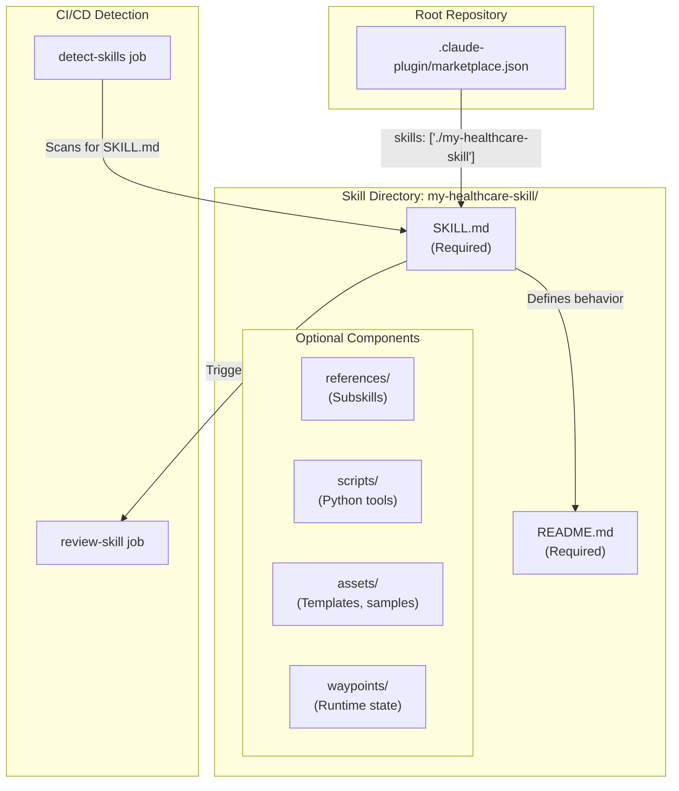
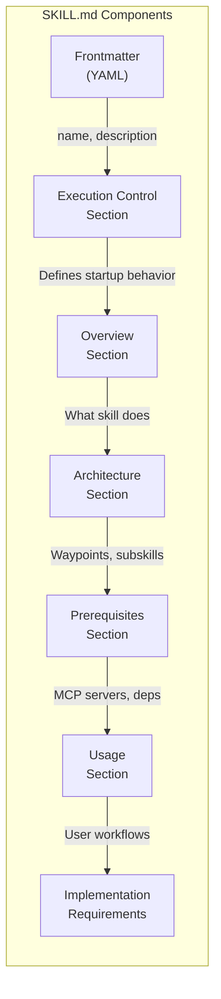
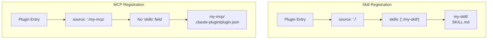
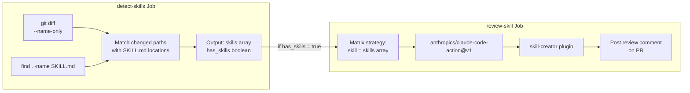
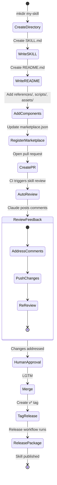

<!-- source: DeepWiki mcp.deepwiki.com · repo anthropics/healthcare · page 6.1 Creating a New Skill · fetched 2026-10-26 -->

# Creating a New Skill

<details>
<summary>Relevant source files</summary>

The following files were used as context for generating this wiki page:

- [.claude-plugin/marketplace.json](.claude-plugin/marketplace.json)
- [clinical-trial-protocol-skill/README.md](clinical-trial-protocol-skill/README.md)
- [clinical-trial-protocol-skill/SKILL.md](clinical-trial-protocol-skill/SKILL.md)
- [clinical-trial-protocol-skill/scripts/sample_size_calculator.py](clinical-trial-protocol-skill/scripts/sample_size_calculator.py)
- [icd10-codes/.claude-plugin/plugin.json](icd10-codes/.claude-plugin/plugin.json)
- [prior-auth-review-skill/README.md](prior-auth-review-skill/README.md)

</details>


This guide provides step-by-step instructions for creating a new Claude Code skill and integrating it into the healthcare marketplace. Skills are AI-powered capabilities that orchestrate complex healthcare workflows by combining Claude's reasoning with external data sources and tools.

For information about the distinction between Skills and MCP Servers, see [Skills vs MCP Servers](#2.1). For testing and quality assurance guidance, see [Testing and Quality Assurance](#6.3). For understanding how skills are automatically reviewed, see [Skill Review Workflow](#5.1).

---

## Skill Architecture Overview

Skills in the healthcare marketplace follow a standardized structure that enables automated discovery, review, and distribution. Each skill is a self-contained directory with specific required files.

### Skill Directory Structure



**Sources:** [.claude-plugin/marketplace.json:1-74](), [clinical-trial-protocol-skill/SKILL.md:1-10]()

---

## Step 1: Create Skill Directory

Create a new directory following the naming convention `{skill-name}-skill/`. The suffix `-skill` is important for automated detection.

```bash
mkdir prior-auth-review-skill
cd prior-auth-review-skill
```

The directory name should be:
- **Descriptive**: Clearly indicates the skill's purpose
- **Kebab-case**: Use hyphens, not underscores or spaces
- **Suffixed**: End with `-skill` for consistency

**Sources:** [.claude-plugin/marketplace.json:20-21](), [.claude-plugin/marketplace.json:30-31]()

---

## Step 2: Create SKILL.md (Required)

The `SKILL.md` file is the skill's execution specification. It defines how Claude should behave when the skill is invoked.

### SKILL.md Structure



**Sources:** [clinical-trial-protocol-skill/SKILL.md:1-508]()

### Required Frontmatter

Every `SKILL.md` must begin with YAML frontmatter:

```yaml
---
name: my-healthcare-skill
description: Brief description of when this skill should be used. Include trigger phrases like "Create a [X]", "Help me [Y]", or specific healthcare use cases.
---
```

**Frontmatter Fields:**
- `name`: Must match the directory name (without `-skill` suffix)
- `description`: Should include natural language triggers that help Claude decide when to invoke this skill

**Sources:** [clinical-trial-protocol-skill/SKILL.md:1-4]()

### Execution Control Section

Immediately after the frontmatter, define how Claude should execute the skill:

```markdown
## ⚠️ EXECUTION CONTROL - READ THIS FIRST

**CRITICAL: This skill follows a [PATTERN] approach:**

1. **Display welcome message FIRST**
2. **Collect required inputs**
3. **Execute workflow steps sequentially**
4. **DO NOT pre-read subskill files** - Load on-demand only

**Why this matters:**
- Pre-reading wastes context and memory
- Subskills load only when actually needed
- Workflow handles resuming from existing waypoints
```

This section prevents Claude from loading all dependencies upfront, which would waste context window.

**Sources:** [clinical-trial-protocol-skill/SKILL.md:8-21]()

### Waypoint-Based Architecture

If your skill uses multi-step workflows, define waypoint files for state persistence:

```markdown
### Waypoint-Based Design

All analysis data is stored in `waypoints/` directory:

\`\`\`
waypoints/
├── intervention_metadata.json    # Initial inputs and status
├── 01_research_summary.json      # Step 1 outputs
├── 02_protocol_draft.md          # Step 2 outputs
└── 03_final_document.md          # Step 3 outputs
\`\`\`
```

**Waypoint Benefits:**
- **Resumability**: Users can stop and restart without losing progress
- **Transparency**: All intermediate data is visible and editable
- **Debugging**: Each step's outputs can be inspected independently

**Sources:** [clinical-trial-protocol-skill/SKILL.md:43-59]()

### Prerequisites Section

Document all external dependencies:

```markdown
## Prerequisites

### 1. MCP Server Dependencies

**cms-coverage MCP Server:**
- Purpose: Access Medicare coverage policies
- Tools used: `search_coverage_policies`, `get_policy_details`
- Installation: `claude mcp add-from-marketplace anthropics/healthcare/cms-coverage`

### 2. Python Dependencies

**Installation:**
\`\`\`bash
pip install -r requirements.txt
\`\`\`

**Required packages:**
- scipy >= 1.11.0
- numpy >= 1.24.0
```

**Sources:** [clinical-trial-protocol-skill/SKILL.md:85-135]()

### Implementation Requirements

End with explicit execution instructions:

```markdown
## Implementation Requirements

When this skill is invoked:

1. **Display welcome message** with mode selection
2. **Wait for user confirmation** before proceeding
3. **Execute steps sequentially:**
   - Read subskill file only when step is ready to execute
   - Do NOT read files in advance
   - Execute all instructions within the subskill
4. **Handle errors gracefully:**
   - Offer retry or exit options
   - Save progress in waypoints
5. **Track progress:**
   - Update metadata after each step
   - Show progress indicators
```

**Sources:** [clinical-trial-protocol-skill/SKILL.md:460-508]()

---

## Step 3: Create README.md (Required)

The `README.md` provides user-facing documentation. It should be clear and concise, focusing on what the skill does and how to use it.

### README.md Structure

```markdown
# [Skill Name]

[One-sentence description of what the skill does]

## Overview

**Target Users:** [Who should use this skill]

**Key Features:**
- Feature 1
- Feature 2
- Feature 3

## Disclaimers

> **[IMPORTANT DISCLAIMER]**
>
> [Clearly state limitations, when human review is required, etc.]

## Workflow Steps

| Step | Name | Description | Output |
| ---- | ---- | ----------- | ------ |
| 0 | [Step name] | [What it does] | `waypoint_file.json` |
| 1 | [Step name] | [What it does] | `waypoint_file.md` |

## Requirements

- **Python Dependencies** - `package1`, `package2`
- **MCP Servers** - [Required MCP servers]

## Getting Started

See [SKILL.md](SKILL.md) for complete installation and usage instructions.
```

**Sources:** [clinical-trial-protocol-skill/README.md:1-55](), [prior-auth-review-skill/README.md:1-78]()

---

## Step 4: Register in Marketplace

Add your skill to [.claude-plugin/marketplace.json:11-44]() in the `plugins` array:

```json
{
  "name": "my-healthcare-skill",
  "source": "./",
  "description": "Brief description matching SKILL.md frontmatter",
  "category": "healthcare",
  "tags": ["tag1", "tag2", "tag3"],
  "strict": false,
  "skills": [
    "./my-healthcare-skill"
  ]
}
```

### Marketplace Registration Fields

| Field | Required | Description |
|-------|----------|-------------|
| `name` | Yes | Unique identifier, should match directory name without `-skill` suffix |
| `source` | Yes | Always `"./"` for skills (indicates repository root) |
| `description` | Yes | User-facing description, shown in skill listings |
| `category` | Yes | Always `"healthcare"` for this marketplace |
| `tags` | Yes | Array of searchable tags (e.g., `["fhir", "api", "interoperability"]`) |
| `strict` | Yes | Always `false` for skills (allows flexible invocation) |
| `skills` | Yes | Array with single path: `["./my-healthcare-skill"]` |

**Sources:** [.claude-plugin/marketplace.json:11-44]()

### Skill vs MCP Registration



**Key Difference:** Skills have a `skills` array pointing to skill directories; MCP servers do not.

**Sources:** [.claude-plugin/marketplace.json:11-72]()

---

## Step 5: Add Optional Components

### Subskills (references/ directory)

For multi-step workflows, create modular subskills in the `references/` directory:

```
my-healthcare-skill/
└── references/
    ├── 00-initialize.md
    ├── 01-research.md
    ├── 02-analysis.md
    └── 03-generate.md
```

**Subskill Pattern:**
- Each subskill is a standalone markdown file
- Loaded on-demand by the orchestrator (SKILL.md)
- Contains specific instructions for one workflow step
- Reads from and writes to waypoint files

**Example subskill structure:**
```markdown
# Step 1: Research Phase

## Input
- Read from: `waypoints/metadata.json`

## Process
1. Perform X using Y tool
2. Extract Z data
3. Summarize findings

## Output
- Write to: `waypoints/01_research.json`
- Format: {...}
```

**Sources:** [clinical-trial-protocol-skill/SKILL.md:65-76]()

### Scripts (scripts/ directory)

Add Python or shell scripts for computational tasks:

```python
# scripts/sample_size_calculator.py
"""
Statistical calculations for clinical trial sample sizing.
"""

def calculate_continuous_sample_size(
    effect_size: float,
    std_dev: float,
    alpha: float = 0.05,
    power: float = 0.80
) -> Dict[str, Any]:
    # Implementation...
```

**Script Guidelines:**
- Include docstrings and type hints
- Provide CLI interface with argparse
- Output JSON for easy parsing by Claude
- Include requirements.txt if dependencies needed

**Sources:** [clinical-trial-protocol-skill/scripts/sample_size_calculator.py:1-459]()

### Assets (assets/ directory)

Store templates, samples, or reference documents:

```
assets/
├── templates/
│   └── protocol-template.md
├── samples/
│   └── sample-case.json
└── references/
    └── fda-guidance.md
```

**Sources:** [clinical-trial-protocol-skill/SKILL.md:118-122]()

---

## Step 6: Skill Detection and Review Integration

### How Skills Are Detected

The CI/CD system automatically detects new or modified skills:



**Detection Logic:**
1. Get changed files from `git diff` between PR base and head
2. Find all `SKILL.md` files in repository
3. Extract skill directory (parent of `SKILL.md`)
4. Check if skill directory appears in changed files
5. Output skill name (directory name) if changes detected

**Sources:** High-level diagrams (Diagram 2), inferred from workflow descriptions

### Skill Review Criteria

The automated review checks:
- **SKILL.md completeness**: Frontmatter, sections, implementation requirements
- **README.md clarity**: User-facing documentation, disclaimers
- **Marketplace registration**: Proper JSON format, required fields
- **Dependencies**: MCP servers listed, Python packages documented
- **Waypoint usage**: State management, resumability

For detailed review process, see [Skill Review Workflow](#5.1).

**Sources:** High-level diagrams (Diagram 2, Diagram 5)

---

## Complete Skill Creation Workflow



**Sources:** High-level diagrams (Diagram 5)

---

## Best Practices

### Context Window Management

**Problem:** Skills with many subskills can exceed Claude's context window.

**Solution:** Use lazy loading:
```markdown
## Implementation Requirements

4. **For each step execution (LAZY LOADING):**
   - ONLY when a step is ready to execute, read the corresponding subskill file
   - Do NOT read subskill files in advance
   - Execute all instructions within the subskill before proceeding
```

**Sources:** [clinical-trial-protocol-skill/SKILL.md:479-486]()

### State Persistence

**Always use waypoint files for:**
- User inputs collected in early steps
- Intermediate analysis results
- Configuration and metadata
- Step completion tracking

**Waypoint file naming:**
- JSON for structured data: `metadata.json`, `config.json`
- Markdown for documents: `01_research.md`, `02_draft.md`
- Prefix with step number for clarity: `00_init.json`, `01_data.json`

**Sources:** [clinical-trial-protocol-skill/SKILL.md:48-59]()

### Human-in-the-Loop Design

For sensitive decisions (medical, regulatory, financial):
```markdown
**Human Decision Point:** After [step/analysis] is generated, the professional reviews the AI recommendation before proceeding to the next phase.
```

Example from prior authorization skill:
- Subskill 1 generates recommendation
- Human reviews and confirms/rejects
- Subskill 2 finalizes decision only after human approval

**Sources:** [prior-auth-review-skill/README.md:45-66]()

### Error Handling

```markdown
## Error Handling

### MCP Server Unavailable
- Detected in: Step [X]
- Action: Display error with installation instructions
- Allow user to retry after installing

### Step Fails
- Display error message from subskill
- Ask user: "Retry step? (Yes/No)"
- Save current state for resume capability
```

**Sources:** [clinical-trial-protocol-skill/SKILL.md:417-435]()

---

## Testing Your Skill Locally

Before submitting a pull request:

1. **Validate JSON syntax:**
   ```bash
   python -m json.tool .claude-plugin/marketplace.json
   ```

2. **Test SKILL.md frontmatter:**
   ```python
   import yaml
   with open('my-skill/SKILL.md') as f:
       content = f.read()
       frontmatter = content.split('---')[1]
       parsed = yaml.safe_load(frontmatter)
       assert 'name' in parsed
       assert 'description' in parsed
   ```

3. **Invoke skill in Claude Code:**
   - Install marketplace locally
   - Test each workflow path
   - Verify waypoint files are created correctly
   - Check error handling

4. **Review generated artifacts:**
   - Check waypoint files for completeness
   - Verify output files are properly formatted
   - Test resume capability (interrupt and restart)

**Sources:** Inferred from best practices and workflow descriptions

---

## Example: Minimal Skill Implementation

Here's a minimal but complete skill:

### Directory Structure
```
simple-diagnosis-skill/
├── SKILL.md
└── README.md
```

### SKILL.md
```markdown
---
name: simple-diagnosis-skill
description: Generate differential diagnosis lists. Use when user says "Help me with differential diagnosis for [symptoms]" or "What could cause [symptoms]".
---

# Simple Diagnosis Skill

## ⚠️ EXECUTION CONTROL

1. Display welcome message
2. Collect patient symptoms
3. Generate differential diagnosis
4. Display results

## Overview

This skill helps generate differential diagnosis lists based on patient symptoms.

## How to Use

When invoked:
1. Ask user for: chief complaint, symptoms, duration, severity
2. Generate differential diagnosis list (most to least likely)
3. Include red flags and suggested workup

## Implementation Requirements

When this skill is invoked:
1. Greet user and explain the skill
2. Collect symptoms using structured questions
3. Generate diagnosis list with:
   - Likelihood (high/medium/low)
   - Key distinguishing features
   - Recommended workup
4. Emphasize limitations: AI-generated, requires clinical judgment
```

### README.md
```markdown
# Simple Diagnosis Skill

Generate differential diagnosis lists based on patient symptoms.

## Overview

**Target Users:** Medical students, clinicians

**Key Features:**
- Structured symptom collection
- Evidence-based diagnosis suggestions
- Workup recommendations

## Disclaimer

> **NOT MEDICAL ADVICE:** This tool provides educational differential diagnosis suggestions only. All clinical decisions require professional judgment and patient-specific context.

## Getting Started

See [SKILL.md](SKILL.md) for usage instructions.
```

### Marketplace Entry
```json
{
  "name": "simple-diagnosis",
  "source": "./",
  "description": "Generate differential diagnosis lists for clinical symptoms",
  "category": "healthcare",
  "tags": ["diagnosis", "clinical-reasoning", "education"],
  "strict": false,
  "skills": [
    "./simple-diagnosis-skill"
  ]
}
```

**Sources:** Example synthesized from patterns in [clinical-trial-protocol-skill/SKILL.md:1-508]() and [.claude-plugin/marketplace.json:11-44]()

---

## Summary Checklist

Before submitting your skill for review:

- [ ] **Directory created** with `-skill` suffix
- [ ] **SKILL.md exists** with valid YAML frontmatter
- [ ] **SKILL.md has** execution control, overview, architecture, prerequisites, implementation sections
- [ ] **README.md exists** with overview, disclaimers, getting started
- [ ] **Marketplace entry added** to `.claude-plugin/marketplace.json`
- [ ] **All fields required** in marketplace entry (name, source, description, category, tags, strict, skills)
- [ ] **Dependencies documented** (MCP servers, Python packages)
- [ ] **Waypoint files used** for state persistence (if multi-step)
- [ ] **Error handling included** in SKILL.md
- [ ] **Disclaimers present** for medical/regulatory content
- [ ] **Tested locally** in Claude Code environment

**Sources:** Synthesized from all referenced files

---

