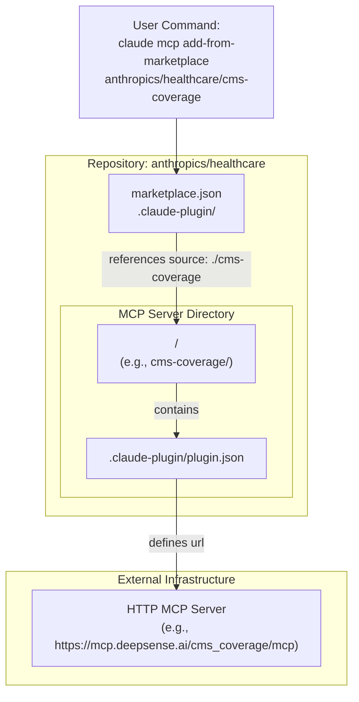
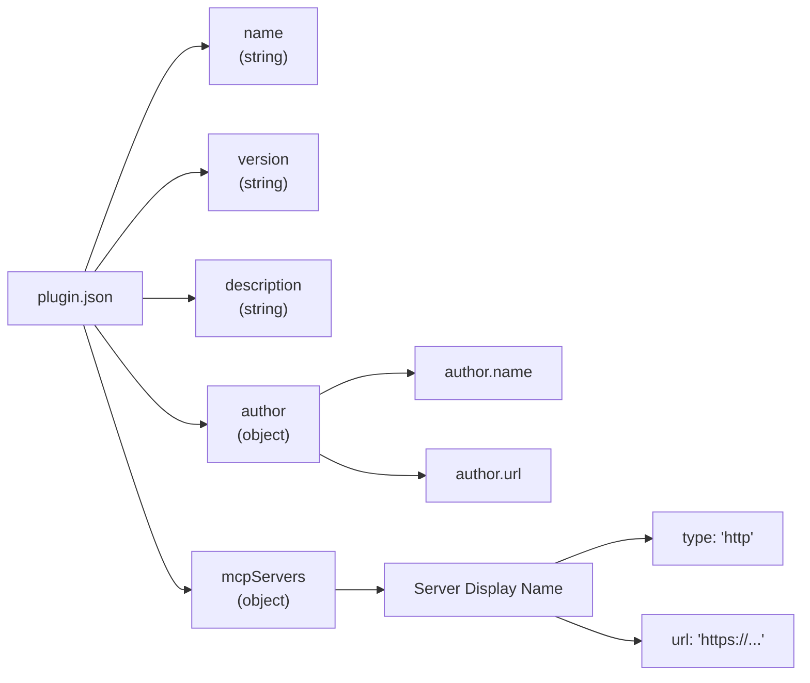
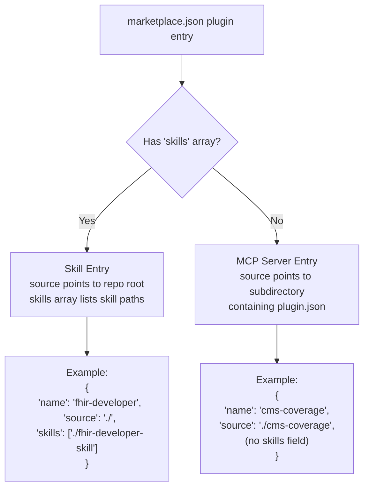
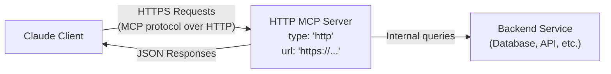
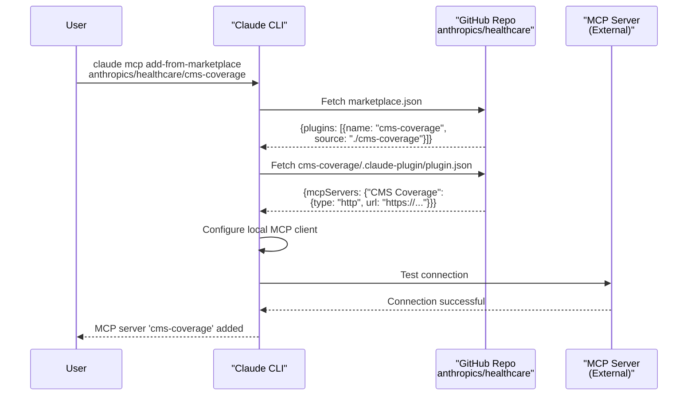
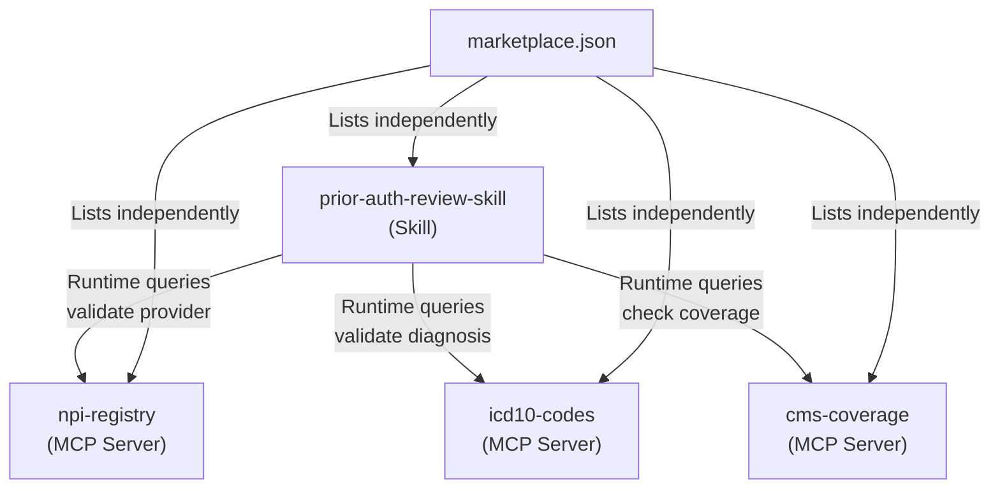

<!-- source: DeepWiki mcp.deepwiki.com · repo anthropics/healthcare · page 6.2 Adding an MCP Server · fetched 2026-10-26 -->

# Adding an MCP Server

<details>
<summary>Relevant source files</summary>

The following files were used as context for generating this wiki page:

- [.claude-plugin/marketplace.json](.claude-plugin/marketplace.json)
- [cms-coverage/.claude-plugin/plugin.json](cms-coverage/.claude-plugin/plugin.json)
- [icd10-codes/.claude-plugin/plugin.json](icd10-codes/.claude-plugin/plugin.json)
- [npi-registry/.claude-plugin/plugin.json](npi-registry/.claude-plugin/plugin.json)
- [pubmed/.claude-plugin/plugin.json](pubmed/.claude-plugin/plugin.json)

</details>


## Purpose and Scope

This document provides a step-by-step guide for integrating a new external data source as an MCP (Model Context Protocol) server into the healthcare marketplace. It covers the directory structure requirements, `plugin.json` configuration format, and registration in `marketplace.json`.

For information about creating skills that consume MCP servers, see [Creating a New Skill](#6.1). For understanding the conceptual differences between skills and MCP servers, see [Skills vs MCP Servers](#2.1).

## MCP Server Architecture Overview

MCP servers in the healthcare marketplace use a two-tier configuration system that separates marketplace metadata from server implementation details. This architecture enables distributed hosting where the marketplace registry resides in the repository while actual MCP servers run on external infrastructure.

### Two-Tier Configuration Model



**Sources:** [.claude-plugin/marketplace.json:1-74](), [cms-coverage/.claude-plugin/plugin.json:1-15]()

The marketplace entry in `marketplace.json` contains only discovery metadata (name, description, tags), while the `plugin.json` file in the server's subdirectory specifies the actual server endpoint and connection details.

## Directory Structure Requirements

An MCP server must follow this exact directory layout:

```
<mcp-server-name>/
└── .claude-plugin/
    └── plugin.json
```

The directory name becomes the server's identifier in the marketplace and must match the `source` field in `marketplace.json`. For example:

| Directory Name | Source in marketplace.json | User-facing name |
|---------------|---------------------------|------------------|
| `cms-coverage` | `"source": "./cms-coverage"` | `cms-coverage` |
| `npi-registry` | `"source": "./npi-registry"` | `npi-registry` |
| `pubmed` | `"source": "./pubmed"` | `pubmed` |
| `icd10-codes` | `"source": "./icd10-codes"` | `icd10-codes` |

**Sources:** [.claude-plugin/marketplace.json:46-72](), [cms-coverage/.claude-plugin/plugin.json:1-15]()

The `.claude-plugin` subdirectory is mandatory and must contain exactly one file: `plugin.json`.

## Creating plugin.json

The `plugin.json` file defines the MCP server's connection configuration and metadata. It must be placed at `<mcp-server-name>/.claude-plugin/plugin.json`.

### Required Fields



**Sources:** [icd10-codes/.claude-plugin/plugin.json:1-15](), [cms-coverage/.claude-plugin/plugin.json:1-15]()

### Configuration Template

The following template shows the complete structure with all required fields:

```json
{
  "name": "mcp-server-name",
  "version": "1.0.0",
  "description": "Brief description of what this MCP server provides",
  "author": {
    "name": "Organization Name",
    "url": "https://example.com"
  },
  "mcpServers": {
    "Display Name": {
      "type": "http",
      "url": "https://your-mcp-server.example.com/mcp"
    }
  }
}
```

**Sources:** [icd10-codes/.claude-plugin/plugin.json:1-15](), [npi-registry/.claude-plugin/plugin.json:1-15]()

### Field Specifications

| Field | Type | Purpose | Example |
|-------|------|---------|---------|
| `name` | string | Identifier matching directory name | `"icd10-codes"` |
| `version` | string | Semantic version | `"1.0.0"` |
| `description` | string | Human-readable explanation of server capabilities | `"Access ICD-10-CM and ICD-10-PCS code sets"` |
| `author.name` | string | Organization or individual providing the server | `"deepsense.ai"` |
| `author.url` | string | Website URL for the provider | `"https://deepsense.ai"` |
| `mcpServers` | object | Dictionary of server configurations (typically one entry) | See below |

**Sources:** [icd10-codes/.claude-plugin/plugin.json:1-15](), [cms-coverage/.claude-plugin/plugin.json:1-15]()

### mcpServers Configuration

The `mcpServers` object contains one or more server definitions. Each key is a human-readable display name, and the value specifies connection details:

```json
"mcpServers": {
  "ICD10 Codes": {
    "type": "http",
    "url": "https://mcp.deepsense.ai/icd10_codes/mcp"
  }
}
```

**Current Implementation Patterns:**

All four existing MCP servers use `"type": "http"` with HTTPS endpoints:

| MCP Server | Display Name | URL Pattern |
|-----------|--------------|-------------|
| `icd10-codes` | `"ICD10 Codes"` | `https://mcp.deepsense.ai/icd10_codes/mcp` |
| `cms-coverage` | `"CMS Coverage"` | `https://mcp.deepsense.ai/cms_coverage/mcp` |
| `npi-registry` | `"NPI Registry"` | `https://mcp.deepsense.ai/npi_registry/mcp` |
| `pubmed` | `"PubMed"` | `https://pubmed.mcp.claude.com/mcp` |

**Sources:** [icd10-codes/.claude-plugin/plugin.json:9-14](), [cms-coverage/.claude-plugin/plugin.json:9-14](), [npi-registry/.claude-plugin/plugin.json:9-14](), [pubmed/.claude-plugin/plugin.json:9-14]()

The `/mcp` suffix in URLs is a convention used by the existing servers but not technically required.

## Registering in marketplace.json

After creating the `plugin.json` file, register the MCP server in the marketplace registry at [.claude-plugin/marketplace.json:1-74]().

### Marketplace Entry Structure

Add a new entry to the `plugins` array:

```json
{
  "name": "your-mcp-name",
  "source": "./your-mcp-name",
  "description": "User-facing description",
  "category": "healthcare",
  "tags": ["tag1", "tag2", "tag3"]
}
```

**Sources:** [.claude-plugin/marketplace.json:45-72]()

### Field Requirements

| Field | Required | Purpose | Notes |
|-------|----------|---------|-------|
| `name` | Yes | Unique identifier | Must match directory name |
| `source` | Yes | Relative path to MCP directory | Must be `"./<directory-name>"` |
| `description` | Yes | User-visible summary | Keep under 200 characters |
| `category` | Yes | Marketplace category | Use `"healthcare"` for this marketplace |
| `tags` | Yes | Searchable keywords | Array of lowercase strings |
| `skills` | No | **Omit for MCP servers** | Only present for skill entries |
| `strict` | No | **Omit for MCP servers** | Only relevant for skills |

**Sources:** [.claude-plugin/marketplace.json:45-72]()

### Distinguishing MCP Server Entries from Skill Entries

The critical difference between skill entries and MCP server entries in `marketplace.json` is the presence of the `skills` array:



**Sources:** [.claude-plugin/marketplace.json:11-72]()

MCP server entries must:
- **Not** include a `skills` array
- **Not** include a `strict` field
- Use `source` pointing to a subdirectory (e.g., `"./cms-coverage"`)

Skill entries must:
- Include a `skills` array with at least one path
- Use `source` pointing to repository root (`"./"`)
- May include a `strict` field

### Example MCP Server Registration

Here is the complete marketplace entry for the ICD-10 MCP server:

```json
{
  "name": "icd10-codes",
  "source": "./icd10-codes",
  "description": "Access ICD-10-CM and ICD-10-PCS code sets",
  "category": "healthcare",
  "tags": ["icd-10", "diagnosis", "procedure", "billing", "medical-coding"]
}
```

**Sources:** [.claude-plugin/marketplace.json:66-72]()

Note the absence of `skills`, `strict`, and other skill-specific fields.

## MCP Server Types

The MCP protocol supports multiple transport types. The healthcare marketplace currently uses only the HTTP type.

### HTTP Type

All existing MCP servers use `"type": "http"` with HTTPS endpoints hosted on external infrastructure:



**Sources:** [icd10-codes/.claude-plugin/plugin.json:10-13](), [cms-coverage/.claude-plugin/plugin.json:10-13]()

The HTTP type requires:
- A publicly accessible HTTPS endpoint
- MCP protocol implementation at the endpoint
- No local process management (server runs independently)

### Infrastructure Hosting Patterns

Current MCP servers are hosted on two infrastructure providers:

| Provider | Servers | URL Pattern |
|----------|---------|-------------|
| DeepSense.ai | `cms-coverage`, `npi-registry`, `icd10-codes` | `https://mcp.deepsense.ai/<server>/mcp` |
| Claude Infrastructure | `pubmed` | `https://pubmed.mcp.claude.com/mcp` |

**Sources:** [cms-coverage/.claude-plugin/plugin.json:12](), [npi-registry/.claude-plugin/plugin.json:12](), [icd10-codes/.claude-plugin/plugin.json:12](), [pubmed/.claude-plugin/plugin.json:12]()

When adding a new MCP server, you must:
1. Deploy the MCP server implementation to accessible infrastructure
2. Obtain an HTTPS endpoint
3. Configure the endpoint in `plugin.json`

## Discovery and Installation Flow

Users install MCP servers using the Claude CLI command. The installation flow resolves the two-tier configuration:



**Sources:** [.claude-plugin/marketplace.json:45-51](), [cms-coverage/.claude-plugin/plugin.json:1-15]()

The installation process:
1. Parses `marketplace.json` to find the entry matching `cms-coverage`
2. Uses the `source` field to locate `./cms-coverage/.claude-plugin/plugin.json`
3. Reads the `mcpServers` configuration from `plugin.json`
4. Configures the local MCP client with the HTTP endpoint
5. Tests connectivity to the external server

## Complete Example: Adding a New MCP Server

To add a hypothetical "FDA Drugs" MCP server that provides access to the FDA drug database:

### Step 1: Create Directory Structure

```
fda-drugs/
└── .claude-plugin/
    └── plugin.json
```

### Step 2: Create plugin.json

```json
{
  "name": "fda-drugs",
  "version": "1.0.0",
  "description": "Access FDA-approved drug information including indications, dosing, and safety data.",
  "author": {
    "name": "FDA Data Provider",
    "url": "https://example-fda-provider.com"
  },
  "mcpServers": {
    "FDA Drugs": {
      "type": "http",
      "url": "https://mcp.example.com/fda_drugs/mcp"
    }
  }
}
```

**Sources:** Template derived from [icd10-codes/.claude-plugin/plugin.json:1-15]()

### Step 3: Register in marketplace.json

Add to the `plugins` array in [.claude-plugin/marketplace.json:11-73]():

```json
{
  "name": "fda-drugs",
  "source": "./fda-drugs",
  "description": "Access FDA-approved drug information",
  "category": "healthcare",
  "tags": ["fda", "drugs", "medications", "pharmacology", "prescribing"]
}
```

**Sources:** Template derived from [.claude-plugin/marketplace.json:66-72]()

### Step 4: Commit and Deploy

1. Commit both files to the repository
2. Ensure the MCP server at `https://mcp.example.com/fda_drugs/mcp` is operational
3. Users can now install with: `claude mcp add-from-marketplace anthropics/healthcare/fda-drugs`

## Validation Checklist

Before submitting a new MCP server, verify:

| Check | Location | Requirement |
|-------|----------|-------------|
| Directory name matches | Directory, `marketplace.json`, `plugin.json` | All three must use identical naming |
| `.claude-plugin` subdirectory exists | `<mcp-name>/.claude-plugin/` | Exact spelling, lowercase |
| `plugin.json` is valid JSON | `<mcp-name>/.claude-plugin/plugin.json` | Syntax must be correct |
| All required fields present | `plugin.json` | `name`, `version`, `description`, `author`, `mcpServers` |
| MCP server URL is HTTPS | `plugin.json` `mcpServers.<name>.url` | Must use `https://` |
| No `skills` array in marketplace entry | `marketplace.json` | MCP servers omit this field |
| `source` points to subdirectory | `marketplace.json` | Must be `"./<mcp-name>"` |
| Tags are relevant and lowercase | `marketplace.json` | Improves discoverability |

**Sources:** [.claude-plugin/marketplace.json:45-72](), [icd10-codes/.claude-plugin/plugin.json:1-15]()

## Integration with Skills

Skills can declare dependencies on MCP servers in their `SKILL.md` files. However, the marketplace configuration does not enforce these dependencies - skills dynamically discover available MCP servers at runtime.

For example, the Prior Authorization Review skill uses three MCP servers but does not declare them in configuration files:



**Sources:** Derived from architecture diagrams and [.claude-plugin/marketplace.json:23-72]()

Skills and MCP servers remain decoupled in the marketplace configuration, allowing:
- Independent versioning and deployment
- Skills to work with subset of available MCP servers
- MCP servers to be reused across multiple skills
- Users to install only the components they need

## Testing Your MCP Server

After configuration, test the MCP server using:

1. **Syntax validation:** Validate both JSON files using `jq` or similar tools
2. **Marketplace parsing:** Verify Claude CLI can parse the marketplace entry
3. **Server connectivity:** Ensure the HTTPS endpoint responds to MCP protocol requests
4. **Skill integration:** Test with skills that will consume the MCP server

The automated skill review workflow ([claude-skill-review.yml]()), documented in [Skill Review Workflow](#5.1), does not validate MCP server configurations. Manual testing is required.

**Sources:** Context from system architecture diagrams

---

**Related Documentation:**
- For creating skills that use MCP servers, see [Creating a New Skill](#6.1)
- For understanding when to create an MCP server vs a skill, see [Skills vs MCP Servers](#2.1)
- For the complete list of available MCP servers, see [MCP Servers and External Data](#4)

---

