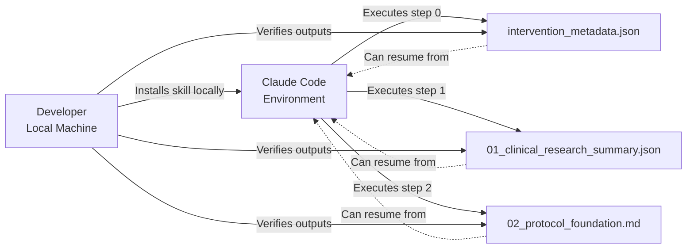
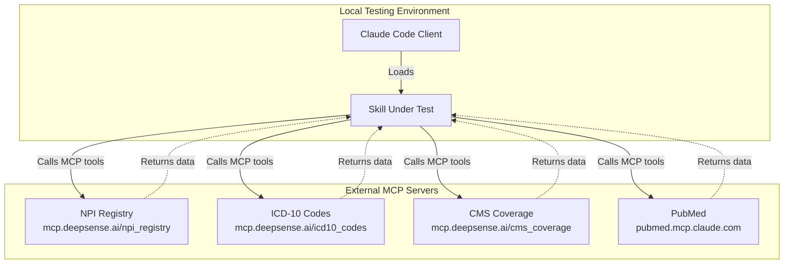
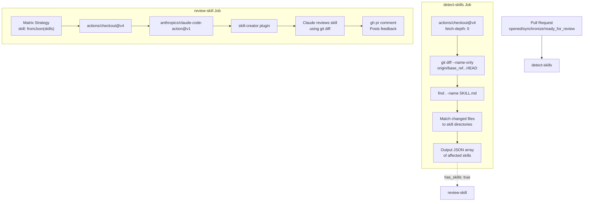
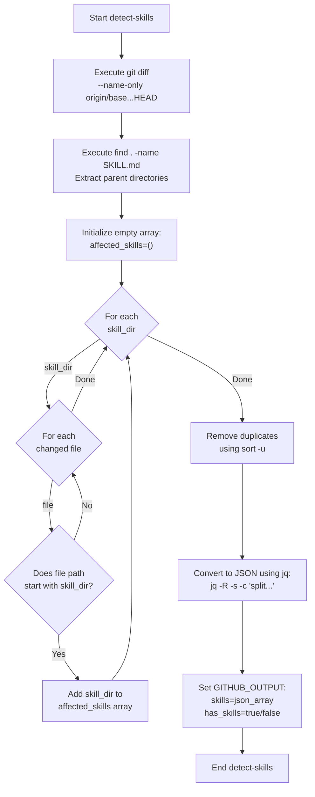
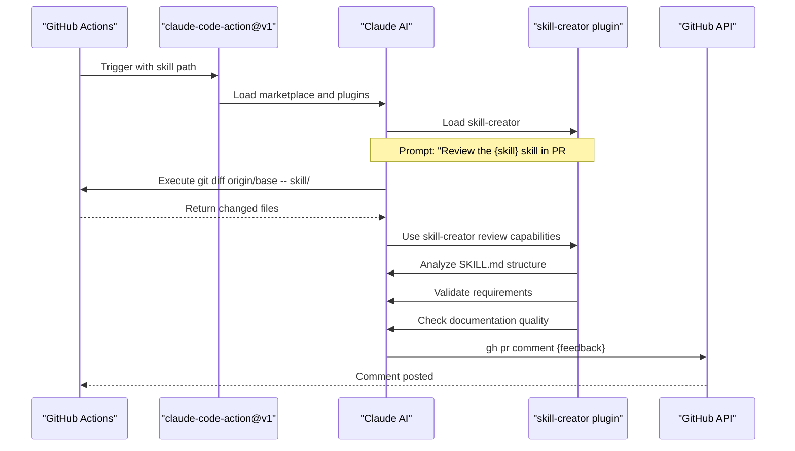
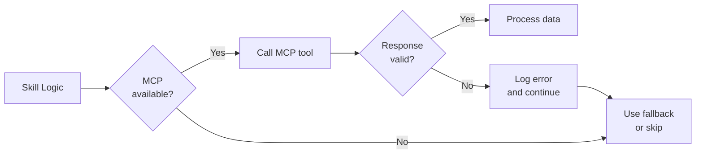

<!-- source: DeepWiki mcp.deepwiki.com · repo anthropics/healthcare · page 6.3 Testing and Quality Assurance · fetched 2026-10-26 -->

# Testing and Quality Assurance

<details>
<summary>Relevant source files</summary>

The following files were used as context for generating this wiki page:

- [.github/workflows/claude-skill-review.yml](.github/workflows/claude-skill-review.yml)
- [clinical-trial-protocol-skill/README.md](clinical-trial-protocol-skill/README.md)
- [prior-auth-review-skill/README.md](prior-auth-review-skill/README.md)

</details>


## Purpose and Scope

This document explains the testing and quality assurance processes for contributing to the Healthcare Marketplace. It covers local testing practices for skills and the automated review system that ensures quality before merge. 

For information about creating new skills, see [Creating a New Skill](#6.1). For details on the complete CI/CD pipeline including releases, see [CI/CD and Automation](#5).

---

## Local Testing

Before submitting a pull request, developers should validate their skills locally to ensure functionality and compliance with marketplace standards.

### Testing Skill Functionality

Skills should be tested within the Claude Code environment to verify their behavior matches the documented workflow:

**For Skills with Sequential Steps (e.g., Clinical Trial Protocol)**

Test each waypoint in the workflow by executing steps individually and verifying the output files are created correctly. The clinical trial protocol skill creates intermediate waypoints like `intervention_metadata.json`, `01_clinical_research_summary.json`, and various markdown sections [clinical-trial-protocol-skill/README.md:36-44]().



**For Skills with Subskills (e.g., Prior Authorization Review)**

Test each subskill independently, including human decision points. The prior authorization skill requires testing both automated assessment (Subskill 1) and human-confirmed decision finalization (Subskill 2) [prior-auth-review-skill/README.md:27-66]().

**For Skills with Sample Data**

Use provided sample files when available. The prior authorization skill includes sample cases in `assets/sample/` that skip certain MCP lookups while executing the full workflow [prior-auth-review-skill/README.md:71-77]().

Sources: [clinical-trial-protocol-skill/README.md](), [prior-auth-review-skill/README.md]()

### Validating SKILL.md Format

The `SKILL.md` file must follow marketplace conventions:

| Requirement | Description | Example |
|------------|-------------|---------|
| **Front Matter** | YAML metadata block with skill metadata | `name`, `description`, `tags`, `requirements` |
| **Installation Section** | Commands to install the skill | `/plugin install skill-name@healthcare` |
| **Usage Section** | Step-by-step usage instructions | Numbered workflow steps |
| **Disclaimers** | Required warnings for healthcare skills | Regulatory disclaimers, professional review requirements |

All skills containing healthcare decision support must include disclaimers stating that:
- Generated outputs are preliminary/draft only
- Professional review is required
- The tool does not substitute for medical/legal/regulatory advice

Sources: [clinical-trial-protocol-skill/README.md:19-34](), [prior-auth-review-skill/README.md:17-26]()

### Testing with MCP Servers

Skills that integrate MCP servers should be tested with actual MCP connections:



Verify that:
- MCP server connections are established successfully
- Tool calls return expected data formats
- Error handling works when MCP servers are unavailable
- Skills gracefully handle missing or incomplete MCP data

Sources: [prior-auth-review-skill/README.md:33-41](), [clinical-trial-protocol-skill/README.md:47-50]()

---

## Automated Quality Assurance

The marketplace uses automated skill reviews powered by Claude to ensure quality before merging changes. This system is implemented in the `claude-skill-review.yml` workflow.

### Workflow Overview

The skill review workflow executes on pull request events and consists of two jobs that run sequentially:



Sources: [.github/workflows/claude-skill-review.yml:1-88]()

### The detect-skills Job

The `detect-skills` job identifies which skills have been modified in a pull request [.github/workflows/claude-skill-review.yml:12-53]().

**Skill Detection Algorithm:**

1. **Get Changed Files** - Uses `git diff` to list all files modified between the base branch and PR HEAD [.github/workflows/claude-skill-review.yml:27]()
2. **Discover Skills** - Finds all directories containing a `SKILL.md` file using `find` command [.github/workflows/claude-skill-review.yml:30]()
3. **Match Changes** - Iterates through skill directories and checks if any changed files belong to each skill [.github/workflows/claude-skill-review.yml:33-41]()
4. **Output JSON Array** - Produces a JSON array of affected skill paths and a boolean flag [.github/workflows/claude-skill-review.yml:44-52]()



**Job Outputs:**

| Output | Type | Purpose |
|--------|------|---------|
| `skills` | JSON array | List of skill directory paths (e.g., `["clinical-trial-protocol-skill"]`) |
| `has_skills` | boolean | Whether any skills were modified (gates the review-skill job) |

Sources: [.github/workflows/claude-skill-review.yml:12-53]()

### The review-skill Job

The `review-skill` job executes Claude-powered reviews for each affected skill using a matrix strategy [.github/workflows/claude-skill-review.yml:55-88]().

**Matrix Strategy Configuration:**

```yaml
strategy:
  matrix:
    skill: ${{ fromJson(needs.detect-skills.outputs.skills) }}
  fail-fast: false
```

This configuration creates parallel jobs for each skill, allowing multiple skills to be reviewed simultaneously without blocking each other [.github/workflows/claude-skill-review.yml:59-62]().

**Claude Code Action Integration:**

The job uses `anthropics/claude-code-action@v1` with the following configuration [.github/workflows/claude-skill-review.yml:75-87]():

| Parameter | Value | Purpose |
|-----------|-------|---------|
| `claude_code_oauth_token` | Secret | Authenticates with Claude Code service |
| `plugin_marketplaces` | `https://github.com/anthropics/skills.git` | Loads skill-creator plugin marketplace |
| `plugins` | `example-skills@anthropic-agent-skills` | Installs skill-creator plugin |
| `claude_args` | Allowed tools configuration | Permits Bash, Read, Glob, Grep, Skill tools |
| `prompt` | Review instructions | Directs Claude to review the specific skill |

**Review Process:**



**Allowed Tools:**

The workflow grants Claude access to specific tools [.github/workflows/claude-skill-review.yml:81]():

- **Bash(gh pr comment:*)** - Post comments to the pull request
- **Bash(git:*)** - Execute git commands to inspect changes
- **Read** - Read file contents
- **Glob** - Find files matching patterns
- **Grep** - Search file contents
- **Skill** - Use the skill-creator plugin for review

**Permissions:**

The job requires the following GitHub permissions [.github/workflows/claude-skill-review.yml:63-67]():

```yaml
permissions:
  contents: read
  pull-requests: write
  issues: write
  id-token: write
```

Sources: [.github/workflows/claude-skill-review.yml:55-88]()

---

## Interpreting Review Feedback

Claude posts review feedback as pull request comments with the skill name in the header. Feedback typically covers:

### Structure and Format

- **SKILL.md completeness** - Presence of required sections (installation, usage, requirements)
- **Front matter validity** - YAML metadata format and required fields
- **Markdown syntax** - Proper heading hierarchy, code blocks, tables

### Documentation Quality

- **Clarity** - Instructions are clear and unambiguous
- **Completeness** - All workflow steps are documented
- **Accuracy** - Requirements match actual dependencies
- **Disclaimers** - Healthcare skills include necessary warnings

### Technical Correctness

- **MCP integration** - Proper use of MCP server tools
- **File paths** - References to scripts, templates, and waypoint files are correct
- **Dependencies** - Python packages, external services listed accurately

### Best Practices

- **Modularity** - Skills follow waypoint or subskill patterns for resumability
- **Error handling** - Skills handle missing data or failed MCP calls gracefully
- **Human oversight** - Decision points are clearly marked for skills involving clinical judgment

**Responding to Feedback:**

1. **Address all comments** - Make requested changes or explain why changes aren't needed
2. **Re-push commits** - The workflow automatically re-reviews on new commits
3. **Request clarification** - Use PR comments to ask questions about feedback
4. **Resolve conversations** - Mark GitHub conversations as resolved once addressed

Sources: [.github/workflows/claude-skill-review.yml:82-87]()

---

## Quality Standards and Best Practices

### Documentation Standards

| Standard | Requirement | Example |
|----------|-------------|---------|
| **Disclaimers** | All healthcare decision support skills must include regulatory disclaimers | "PRELIMINARY PROTOCOL ONLY", "HUMAN REVIEW REQUIRED" |
| **Professional Review** | Must state that professional consultation is required | "Professional consultation with clinical trial experts... is essential" |
| **Not Medical Advice** | Must clarify the tool does not substitute professional advice | "Generated protocols do not substitute for professional biostatistician review" |
| **Requirements** | List all dependencies clearly | Python packages, MCP servers, external services |

### Workflow Design Standards

**Waypoint Pattern (for multi-step processes):**

Skills with long workflows should use waypoints to enable resumption and avoid token limits:

- Each step produces a named output file (JSON or Markdown)
- Steps can be executed independently
- Workflow can resume from any waypoint
- Waypoint files use consistent naming (e.g., `00_`, `01_`, `02_` prefixes)

Example: Clinical Trial Protocol skill [clinical-trial-protocol-skill/README.md:36-44]()

**Subskill Pattern (for human-in-the-loop processes):**

Skills requiring human decisions should separate automated analysis from decision execution:

- Subskill 1: Automated assessment, generates recommendation
- Human decision point: Review and confirm
- Subskill 2: Execute decision, generate outputs

Example: Prior Authorization Review skill [prior-auth-review-skill/README.md:27-66]()

### MCP Integration Standards

When integrating MCP servers:

1. **Document requirements** - List all MCP servers in SKILL.md requirements section
2. **Validate data** - Check MCP responses for required fields before using
3. **Handle errors** - Gracefully handle MCP unavailability or incomplete data
4. **Batch operations** - Use batch validation when processing multiple codes (e.g., ICD-10)



### Testing Before Submission

Complete the following checklist before submitting a pull request:

- [ ] Skill executes successfully in Claude Code environment
- [ ] All workflow steps produce expected outputs
- [ ] SKILL.md includes all required sections
- [ ] Healthcare disclaimers are present and prominent
- [ ] MCP server dependencies are listed in requirements
- [ ] Sample data (if applicable) works correctly
- [ ] Waypoint files use consistent naming
- [ ] Human decision points are clearly documented
- [ ] Skill is registered in `.claude-plugin/marketplace.json`

Sources: [clinical-trial-protocol-skill/README.md](), [prior-auth-review-skill/README.md](), [.github/workflows/claude-skill-review.yml]()