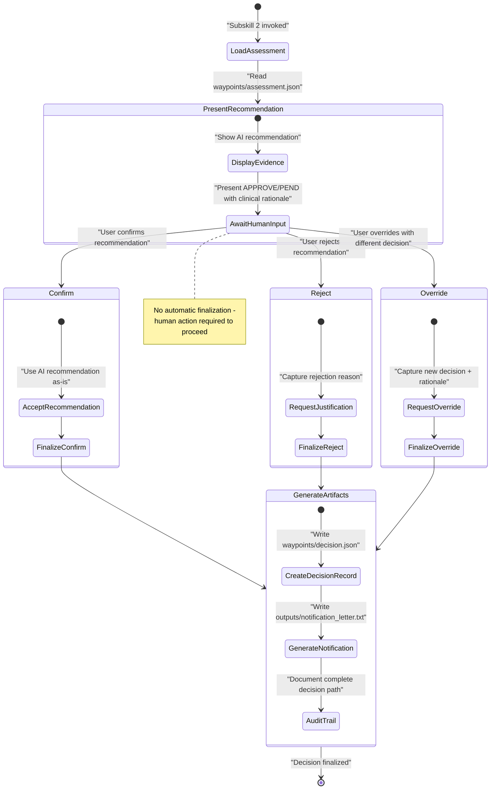
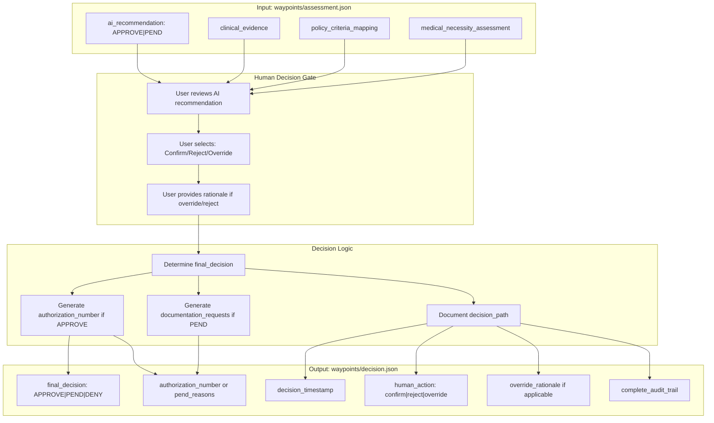
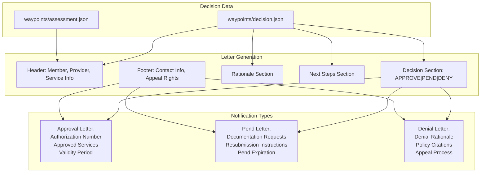
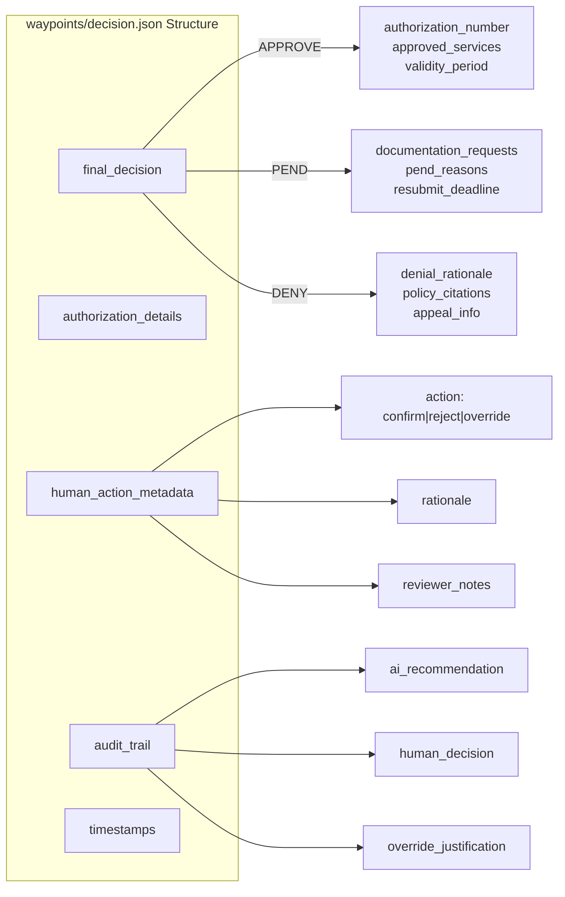
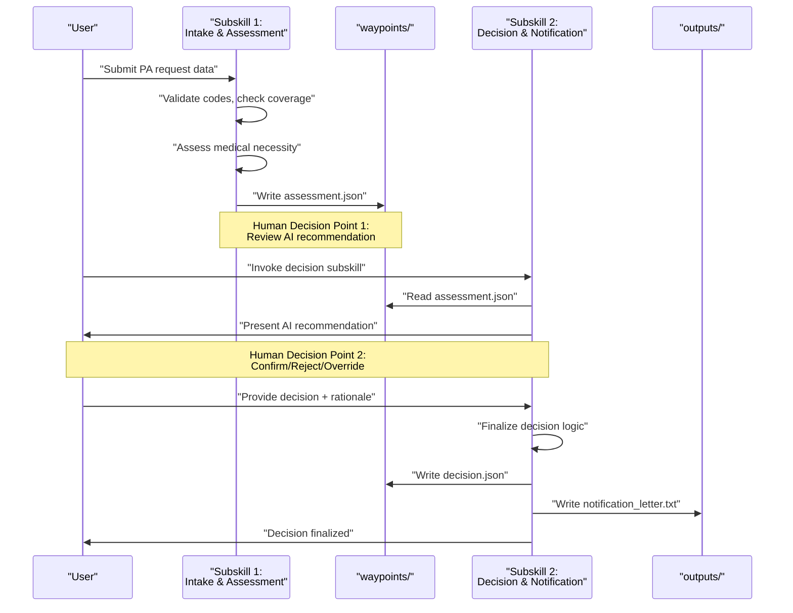

<!-- source: DeepWiki mcp.deepwiki.com · repo anthropics/healthcare · extra page Decision & Notification Subskill · fetched 2026-10-26 -->

# Decision & Notification Subskill

Relevant source files

The following files were used as context for generating this wiki page:

- [.github/workflows/release.yml](.github/workflows/release.yml)
- [README.md](README.md)
- [clinical-trial-protocol-skill/README.md](clinical-trial-protocol-skill/README.md)
- [prior-auth-review-skill/README.md](prior-auth-review-skill/README.md)

## Purpose and Scope

This document describes **Subskill 2** of the Prior Authorization Review skill, which handles the decision finalization and provider notification stages of the prior authorization workflow. This subskill enforces human oversight requirements by requiring explicit confirmation of AI-generated recommendations before finalizing authorization decisions and generating provider notifications.

For documentation of the initial assessment and recommendation generation, see [Intake & Assessment Subskill](#3.2.1). For general information about the Prior Auth Review skill's architecture, see [Prior Authorization Review](#3.2).

**Sources:** [prior-auth-review-skill/README.md:47-66]()

---

## Overview

Subskill 2 operates as a **human-in-the-loop decision gate** that prevents automatic authorization decisions. The subskill loads the assessment generated by Subskill 1, presents the AI recommendation to a human reviewer, captures their explicit decision (confirm, reject, or override), and generates the appropriate provider notification documentation.

This design ensures that all authorization decisions remain under human control while leveraging AI to structure the review process and documentation.

**Key Characteristics:**

| Characteristic | Description |
|----------------|-------------|
| **Input Artifact** | `waypoints/assessment.json` from Subskill 1 |
| **Human Interaction** | Required - no automatic decision finalization |
| **Decision Options** | Confirm, Reject, or Override AI recommendation |
| **Output Artifacts** | `waypoints/decision.json`, `outputs/notification_letter.txt` |
| **Audit Trail** | Complete documentation of decision rationale |

**Sources:** [prior-auth-review-skill/README.md:47-66]()

---

## Decision Workflow

The subskill implements a strict human-confirmation workflow that requires active user input before any decision is finalized.

**Sources:** [prior-auth-review-skill/README.md:47-66]()

---

## Human Decision Point Requirements

The subskill enforces a **mandatory human decision gate** that distinguishes it from fully automated systems. No authorization decision is finalized without explicit human action.

### Decision Options

| Decision | Description | When Used | Documentation Required |
|----------|-------------|-----------|----------------------|
| **Confirm** | Accept AI recommendation as-is | Reviewer agrees with AI assessment and supporting evidence | Standard decision record with AI rationale |
| **Reject** | Decline to authorize based on AI recommendation | Reviewer determines the recommendation should not be followed | Rejection reason and alternative action |
| **Override** | Change AI recommendation to different decision | Reviewer has additional clinical context or policy knowledge | Override justification with clinical/policy rationale |

### Audit Trail Capture

Every decision path creates a complete audit trail documenting:

- **Original AI Recommendation:** APPROVE or PEND decision from Subskill 1
- **Human Action:** Confirm, Reject, or Override with timestamp
- **Final Decision:** The actual authorization determination
- **Rationale:** Clinical reasoning, policy citations, or override justification
- **Reviewer Identity:** Professional responsible for decision (implementation-specific)

**Sources:** [prior-auth-review-skill/README.md:47-66]()

---

## Decision Finalization Process

Once the human reviewer provides their input, the subskill generates the decision artifacts and supporting documentation.

### Approval Path

For **APPROVE** decisions (confirmed or overridden to approve):

1. Generate unique authorization number
2. Record approved service details (CPT codes, quantities, dates)
3. Document authorization validity period
4. Create decision record linking to supporting evidence

### Pend Path

For **PEND** decisions (additional information needed):

1. Generate list of required documentation
2. Specify clinical information gaps from policy criteria
3. Set pend expiration date
4. Create instructions for provider resubmission

### Denial Path

For **DENY** decisions (overridden to deny):

1. Document denial rationale with policy citations
2. Reference specific policy criteria not met
3. Include appeal rights information
4. Create structured denial reasoning

**Note:** The AI does not recommend DENY by default - denial decisions require human override with documented justification.

**Sources:** [prior-auth-review-skill/README.md:19-24](), [prior-auth-review-skill/README.md:47-66]()

---

## Notification Letter Generation

After the decision is finalized, the subskill generates a provider notification letter in `outputs/notification_letter.txt`.

### Notification Structure

### Notification Content Elements

**Approval Notifications:**
- Authorization number and effective dates
- Approved CPT/HCPCS codes and quantities
- Service location and frequency limits
- Provider instructions for claim submission

**Pend Notifications:**
- Specific documentation requirements
- Clinical information gaps identified
- Resubmission deadline
- Contact information for questions

**Denial Notifications:**
- Policy-based denial rationale
- Clinical criteria not met
- Appeal rights and process
- Reconsideration options

**Sources:** [prior-auth-review-skill/README.md:60-64]()

---

## Output Artifacts

Subskill 2 produces two primary output files that document the decision and provide provider communication.

### Decision Record: waypoints/decision.json

**File Location:** `waypoints/decision.json`

**Purpose:** Structured decision record for audit, compliance, and system integration

**Key Fields:**
- `final_decision`: APPROVE, PEND, or DENY
- `human_action`: confirm, reject, or override
- `authorization_number`: Generated for approvals
- `override_rationale`: Required for overrides
- `complete_audit_trail`: Links back to assessment.json

**Sources:** [prior-auth-review-skill/README.md:60-64]()

### Provider Notification: outputs/notification_letter.txt

**File Location:** `outputs/notification_letter.txt`

**Purpose:** Human-readable provider communication in standard letter format

**Characteristics:**
- Plain text format for easy transmission
- Professional medical communication style
- Includes all regulatory required elements
- Ready for provider portal or fax delivery

**Sources:** [prior-auth-review-skill/README.md:60-64]()

---

## Integration with Subskill 1

Subskill 2 operates as the second stage of a two-phase workflow, consuming the output of Subskill 1.

### Data Flow Between Subskills

| Artifact | Producer | Consumer | Purpose |
|----------|----------|----------|---------|
| `waypoints/assessment.json` | Subskill 1 | Subskill 2 | AI recommendation with supporting evidence |
| `waypoints/decision.json` | Subskill 2 | External systems | Final decision record with audit trail |
| `outputs/notification_letter.txt` | Subskill 2 | Provider portal | Provider communication |

### Workflow Continuity

**Sources:** [prior-auth-review-skill/README.md:27-66]()

---

## Compliance and Audit Considerations

The subskill's design supports regulatory compliance through comprehensive documentation and human accountability.

### Audit Trail Completeness

Every decision contains:

1. **AI Component:** Original recommendation with confidence assessment
2. **Human Component:** Reviewer action and rationale
3. **Final Determination:** Actual authorization decision
4. **Temporal Record:** Timestamps for each stage
5. **Policy Citations:** Coverage criteria applied

### Regulatory Alignment

| Requirement | Implementation |
|-------------|----------------|
| **Human Decision Authority** | No automatic finalization - all decisions require human action |
| **Explainability** | AI recommendation includes clinical reasoning and policy mapping |
| **Override Documentation** | All overrides require documented justification |
| **Appeal Support** | Complete decision record supports appeal review |
| **Data Integrity** | Immutable waypoint files preserve decision history |

**Sources:** [prior-auth-review-skill/README.md:17-26]()

---

## Limitations and Disclaimers

### Coverage Policy Scope

The skill uses Medicare LCDs/NCDs from the CMS Coverage MCP Connector. For commercial or Medicare Advantage plans, payer-specific policies may differ and are not automatically applied. Organizations must configure the skill to use their own coverage criteria.

### AI Decision Behavior

By default, the AI recommends only APPROVE or PEND decisions - it does not recommend DENY. This prevents automatic denials and ensures that any denial decision requires explicit human judgment with documented rationale.

**Note:** Decision logic is configurable through the skill's internal rubric, but the human-in-the-loop requirement remains mandatory regardless of configuration.

**Sources:** [prior-auth-review-skill/README.md:17-26]()

---

## Summary

Subskill 2 implements the **decision finalization and provider notification** phases of the prior authorization workflow with mandatory human oversight. Key design principles include:

- **No Automatic Decisions:** Human confirmation required for all finalizations
- **Flexible Decision Options:** Confirm, reject, or override AI recommendations
- **Complete Audit Trail:** Comprehensive documentation of decision rationale
- **Structured Outputs:** Machine-readable decision records and human-readable notifications
- **Compliance Support:** Design supports regulatory requirements for transparency and accountability

The subskill ensures that AI serves as a decision support tool rather than an autonomous decision-maker, preserving human judgment while improving workflow efficiency and documentation quality.

**Sources:** [prior-auth-review-skill/README.md:1-78](), [README.md:28-35]()

---

