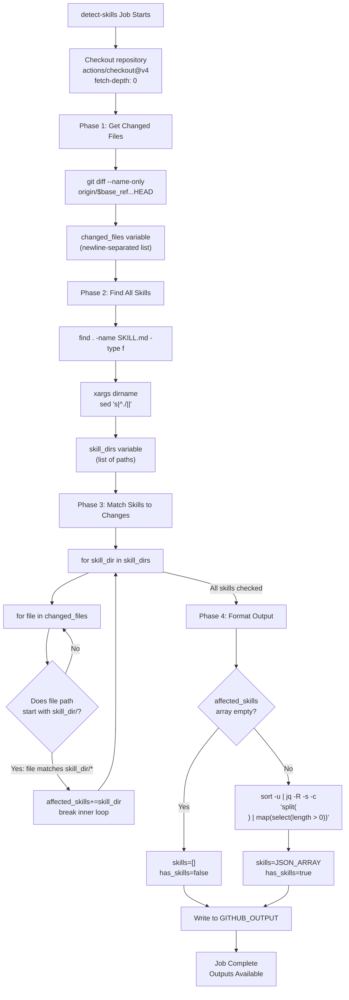
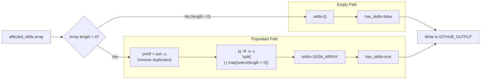
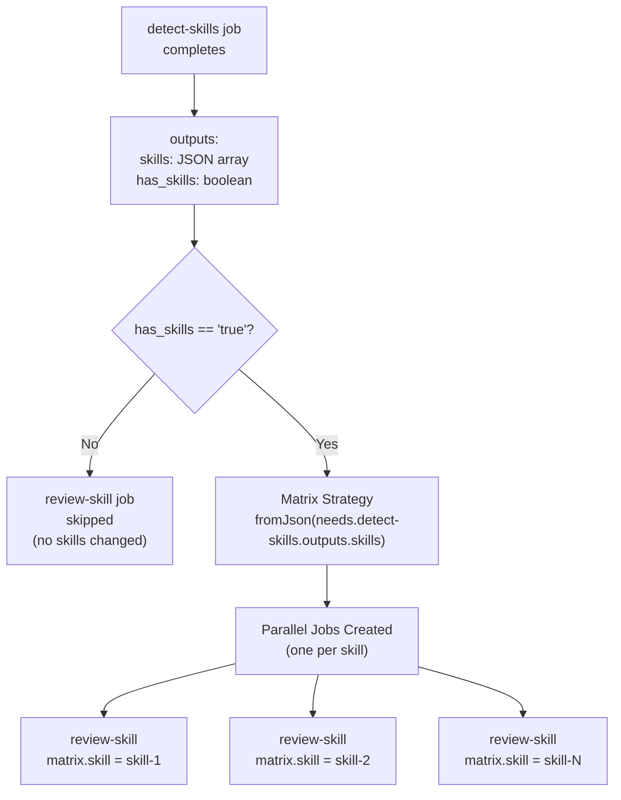

<!-- source: DeepWiki mcp.deepwiki.com · repo anthropics/healthcare · extra page Skill Detection Algorithm · fetched 2026-10-26 -->

# Skill Detection Algorithm

<details>
<summary>Relevant source files</summary>

The following files were used as context for generating this wiki page:

- [.github/workflows/claude-skill-review.yml](.github/workflows/claude-skill-review.yml)

</details>


## Purpose and Scope

This document details the **detect-skills** job implementation in the Claude Skill Review workflow, which identifies which skills have been modified in a pull request. The algorithm uses git diff analysis combined with SKILL.md file discovery to produce a filtered list of affected skills for review.

For information about how the detected skills are reviewed in parallel, see [Matrix Review Strategy](#5.1.2). For the overall skill review workflow architecture, see [Skill Review Workflow](#5.1).

---

## Overview

The `detect-skills` job serves as a **filtering stage** in the skill review pipeline. It prevents unnecessary reviews by identifying only the skills that have changed in a pull request, enabling the downstream `review-skill` job to execute reviews in parallel only for affected skills.

**Key Responsibilities:**
- Identify all skill directories in the repository
- Determine which files changed in the PR
- Match changed files to skill directories
- Output a JSON array of affected skill paths
- Set a boolean flag indicating whether any skills were affected

The job runs on every pull request event ([.github/workflows/claude-skill-review.yml:3-5]()) and produces outputs consumed by the matrix review job.

Sources: [.github/workflows/claude-skill-review.yml:12-53]()

---

## Detection Algorithm Flow

The detection algorithm executes in three sequential phases: **changed file identification**, **skill directory discovery**, and **intersection matching**. The following diagram illustrates the complete detection flow:

### Algorithm Execution Flow



Sources: [.github/workflows/claude-skill-review.yml:23-53]()

---

## Phase 1: Changed File Identification

The algorithm begins by identifying all files modified in the pull request using `git diff`:

```bash
git diff --name-only origin/${{ github.base_ref }}...HEAD
```

**Key Parameters:**
- `--name-only`: Returns only file paths, not diff content
- `origin/${{ github.base_ref }}`: The target branch (typically `main`)
- `...HEAD`: Three-dot notation compares the merge base to the PR branch head
- Result stored in `changed_files` variable

This command produces a newline-separated list of file paths relative to the repository root, such as:

```
clinical-trial-protocol-skill/SKILL.md
clinical-trial-protocol-skill/scripts/sample_size_calculator.py
prior-auth-review-skill/assets/template.md
```

Sources: [.github/workflows/claude-skill-review.yml:26-27]()

---

## Phase 2: Skill Directory Discovery

The algorithm identifies all valid skill directories by locating `SKILL.md` files:

```bash
find . -name "SKILL.md" -type f | xargs -I {} dirname {} | sed 's|^\./||'
```

**Pipeline Breakdown:**

| Command | Purpose | Example Output |
|---------|---------|---------------|
| `find . -name "SKILL.md" -type f` | Locate all SKILL.md files recursively | `./clinical-trial-protocol-skill/SKILL.md` |
| `xargs -I {} dirname {}` | Extract parent directory of each file | `./clinical-trial-protocol-skill` |
| `sed 's\|^\./\|\|'` | Remove leading `./` prefix | `clinical-trial-protocol-skill` |

The result is stored in the `skill_dirs` variable as a space-separated list of skill directory paths.

**Why SKILL.md?** The presence of a `SKILL.md` file is the authoritative marker that a directory contains a skill definition. This convention ensures the algorithm only processes valid skills, not arbitrary directories.

Sources: [.github/workflows/claude-skill-review.yml:29-30]()

---

## Phase 3: Intersection Matching

The algorithm uses nested loops to match changed files against skill directories:

```bash
affected_skills=()
for skill_dir in $skill_dirs; do
  for file in $changed_files; do
    if [[ "$file" == "$skill_dir/"* ]] || [[ "$file" == "$skill_dir" ]]; then
      affected_skills+=("$skill_dir")
      break
    fi
  done
done
```

**Matching Logic:**

The pattern `[[ "$file" == "$skill_dir/"* ]]` uses bash string matching to check if a changed file path **starts with** the skill directory path followed by a forward slash. This ensures:
- Files directly in the skill directory match (e.g., `clinical-trial-protocol-skill/SKILL.md`)
- Files in subdirectories match (e.g., `clinical-trial-protocol-skill/scripts/calculator.py`)
- Files in sibling directories do not match (e.g., `prior-auth-review-skill/` does not match `clinical-trial-protocol-skill/`)

The alternative condition `[[ "$file" == "$skill_dir" ]]` handles the edge case where the skill directory itself is listed as changed (rare but possible in some git operations).

**Performance Optimization:** The `break` statement exits the inner loop immediately after matching, preventing redundant checks once a skill is identified as affected.

Sources: [.github/workflows/claude-skill-review.yml:32-41]()

---

## Phase 4: Output Formatting

The final phase converts the detected skills into structured outputs for the GitHub Actions workflow:

### Output Generation Logic



### JSON Transformation Pipeline

For non-empty results, the script uses a Unix pipeline to produce valid JSON:

```bash
unique_skills=$(printf '%s\n' "${affected_skills[@]}" | sort -u | jq -R -s -c 'split("\n") | map(select(length > 0))')
```

**Transformation Steps:**

1. **`printf '%s\n' "${affected_skills[@]}"`**: Expand bash array to newline-separated strings
2. **`sort -u`**: Remove duplicate entries (deduplication)
3. **`jq -R -s -c`**: Read raw strings (`-R`), slurp into single input (`-s`), compact output (`-c`)
4. **`'split("\n") | map(select(length > 0))'`**: Split on newlines, filter empty strings

**Example Output:**
```json
["clinical-trial-protocol-skill","prior-auth-review-skill"]
```

Sources: [.github/workflows/claude-skill-review.yml:44-53]()

---

## Output Schema

The `detect-skills` job produces two outputs defined at [.github/workflows/claude-skill-review.yml:14-16]():

| Output Name | Type | Purpose | Example Value |
|------------|------|---------|---------------|
| `skills` | JSON Array (string) | List of affected skill directory paths | `["clinical-trial-protocol-skill"]` |
| `has_skills` | Boolean (string) | Flag indicating whether any skills were affected | `"true"` or `"false"` |

**GitHub Actions Output Mechanism:**

Outputs are written to the special `$GITHUB_OUTPUT` file using the format:
```bash
echo "skills=$unique_skills" >> $GITHUB_OUTPUT
echo "has_skills=true" >> $GITHUB_OUTPUT
```

These outputs are accessible to downstream jobs via the `needs` context:
```yaml
needs.detect-skills.outputs.skills
needs.detect-skills.outputs.has_skills
```

Sources: [.github/workflows/claude-skill-review.yml:14-16, 46-47, 50-51]()

---

## Integration with Review Job

The `review-skill` job consumes the `detect-skills` outputs to determine execution behavior:

### Conditional Execution and Matrix Strategy



**Integration Points:**

1. **Conditional Execution** ([.github/workflows/claude-skill-review.yml:57]()):
   ```yaml
   if: needs.detect-skills.outputs.has_skills == 'true'
   ```
   The `review-skill` job only runs if at least one skill was affected.

2. **Matrix Strategy** ([.github/workflows/claude-skill-review.yml:59-61]()):
   ```yaml
   strategy:
     matrix:
       skill: ${{ fromJson(needs.detect-skills.outputs.skills) }}
   ```
   The `skills` JSON array is deserialized using `fromJson()` and used to create a matrix dimension, spawning one review job per skill.

3. **Skill Context** ([.github/workflows/claude-skill-review.yml:83]()):
   ```yaml
   prompt: |
     Use the skill-creator skill to review the **${{ matrix.skill }}** skill...
   ```
   Each matrix job receives a specific `matrix.skill` value (e.g., `clinical-trial-protocol-skill`) used to target the review.

This integration enables efficient, parallel reviews while avoiding unnecessary computation for unchanged skills.

Sources: [.github/workflows/claude-skill-review.yml:55-62, 83]()

---

## Edge Cases and Error Handling

### Empty Skill Changes

When no skills are affected, the algorithm outputs:
```bash
echo "skills=[]" >> $GITHUB_OUTPUT
echo "has_skills=false" >> $GITHUB_OUTPUT
echo "No skill changes detected"
```

This causes the `review-skill` job to be skipped entirely, as shown in the conditional `if: needs.detect-skills.outputs.has_skills == 'true'`.

### New Skill Addition

When a pull request adds a new skill directory:
1. `find . -name "SKILL.md"` discovers the new `SKILL.md` file
2. All files in the new directory match the skill path pattern
3. The new skill appears in the `skills` output
4. A full review is triggered (no previous state exists for diff comparison)

### Duplicate Prevention

The `sort -u` command ensures that even if multiple files in the same skill directory are modified, the skill only appears once in the output array. This prevents duplicate review jobs from being spawned.

### Repository Depth

The `fetch-depth: 0` parameter ([.github/workflows/claude-skill-review.yml:21]()) ensures the full git history is fetched, allowing `git diff` to accurately compare against the base branch even for deep commit histories.

Sources: [.github/workflows/claude-skill-review.yml:18-21, 44-53]()

---

## Performance Characteristics

| Metric | Complexity | Notes |
|--------|-----------|-------|
| **Time Complexity** | O(S × F) | S = number of skills, F = number of changed files |
| **Space Complexity** | O(S + F) | Storage for skill list and changed files list |
| **Worst Case** | All skills modified | Still completes in <5 seconds for typical repos |
| **Best Case** | No skills modified | Job completes immediately, downstream reviews skipped |

The nested loop approach is acceptable because:
- Healthcare marketplace has a small number of skills (currently 3)
- PRs typically modify a limited number of files (<50)
- Early `break` statement optimizes the common case

For repositories with hundreds of skills, alternative approaches (e.g., hash-based matching) might be necessary.

Sources: [.github/workflows/claude-skill-review.yml:32-41]()

---

