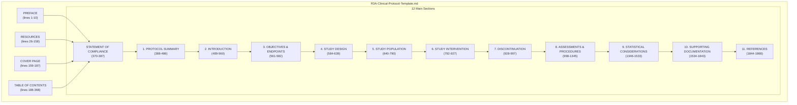
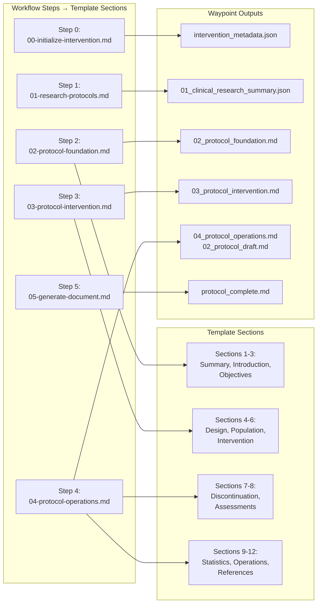
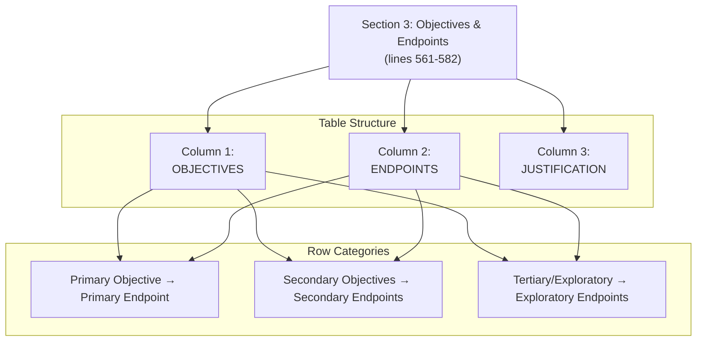
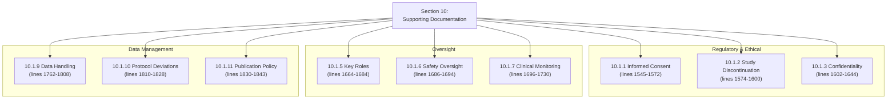

<!-- source: DeepWiki mcp.deepwiki.com · repo anthropics/healthcare · extra page FDA Protocol Template · fetched 2026-10-26 -->

# FDA Protocol Template

<details>
<summary>Relevant source files</summary>

The following files were used as context for generating this wiki page:

- [clinical-trial-protocol-skill/SKILL.md](clinical-trial-protocol-skill/SKILL.md)
- [clinical-trial-protocol-skill/assets/FDA-Clinical-Protocol-Template.md](clinical-trial-protocol-skill/assets/FDA-Clinical-Protocol-Template.md)
- [clinical-trial-protocol-skill/scripts/sample_size_calculator.py](clinical-trial-protocol-skill/scripts/sample_size_calculator.py)

</details>


## Purpose and Scope

This page documents the FDA-Clinical-Protocol-Template.md file, which serves as the structural and content reference guide for generating clinical trial protocols. The template is based on NIH/FDA standards for Phase 2 and 3 clinical trials conducted under an IND (Investigational New Drug) or IDE (Investigational Device Exemption).

For information about how the template is used in the protocol generation workflow, see [Workflow Steps and Waypoints](#3.1.1). For details on protocol generation execution, see [Clinical Trial Protocol Generator](#3.1).

## Template Overview

The FDA Protocol Template is a comprehensive, 1,800+ line markdown document that defines the complete structure and content requirements for clinical trial protocols compliant with ICH-E6 Good Clinical Practice guidelines.

**Location**: [clinical-trial-protocol-skill/assets/FDA-Clinical-Protocol-Template.md:1-1869]()

**Purpose**: 
- Provide standardized protocol structure meeting FDA/NIH requirements
- Guide content development for each protocol section
- Ensure regulatory compliance and completeness
- Support transparent reporting per CONSORT standards

**Detection**: The skill automatically detects any `.md` files in the `assets/` directory and uses them as templates during protocol generation ([clinical-trial-protocol-skill/SKILL.md:118-122]()).

Sources: [clinical-trial-protocol-skill/assets/FDA-Clinical-Protocol-Template.md:1-27](), [clinical-trial-protocol-skill/SKILL.md:117-122]()

## Template Document Structure

The template consists of four primary components arranged hierarchically:



Sources: [clinical-trial-protocol-skill/assets/FDA-Clinical-Protocol-Template.md:1-187](), [clinical-trial-protocol-skill/assets/FDA-Clinical-Protocol-Template.md:188-368]()

## Instructional Conventions

The template uses distinct text formatting to differentiate between instructions and example content:

| Convention | Purpose | Action Required |
|------------|---------|-----------------|
| **Italicized text** | Instructional/explanatory guidance | DELETE before finalizing protocol |
| `[Regular bracketed text]` | Example text that can be adapted | MODIFY to fit study specifics or DELETE if not applicable |
| `<Angle brackets>` | Placeholder for specific information | REPLACE with actual study details |
| Section headers with "No text to be entered" | Organizational structure only | KEEP header, populate subsections |
| Footnotes | Additional context for instructions | DELETE with instruction text |

**Critical Rule**: All sections must be included in the protocol in the same order. If a section is not applicable, include the header with "Not applicable" notation ([clinical-trial-protocol-template.md:11-13]()).

**Version Control**: Each revision must update the version number and date in the footer, with amendments tracked in Section 10.4 Protocol Amendment History ([clinical-trial-protocol-template.md:23-24]()).

Sources: [clinical-trial-protocol-skill/assets/FDA-Clinical-Protocol-Template.md:11-24]()

## Template Sections Mapped to Workflow Steps

The template sections align with the skill's 6-step protocol generation workflow:



| Workflow Step | Template Sections Referenced | Output Waypoint |
|---------------|------------------------------|-----------------|
| Step 0 (Initialize) | Cover page, intervention description | `intervention_metadata.json` |
| Step 1 (Research) | Section 2.2 (Background), regulatory references | `01_clinical_research_summary.json` |
| Step 2 (Foundation) | Sections 1-6 (Summary, Introduction, Objectives, Design, Population) | `02_protocol_foundation.md` |
| Step 3 (Intervention) | Sections 6-7 (Study Intervention, Discontinuation) | `03_protocol_intervention.md` |
| Step 4 (Operations) | Sections 8-12 (Assessments, Statistics, Supporting Documentation) | `04_protocol_operations.md` |
| Step 5 (Generate) | All sections concatenated with proper formatting | `protocol_complete.md` |

Sources: [clinical-trial-protocol-skill/SKILL.md:66-76](), [clinical-trial-protocol-skill/SKILL.md:321-325]()

## Key Template Sections Detail

### Section 1: Protocol Summary (Lines 388-486)

Contains the high-level study overview required for ClinicalTrials.gov registration:

**Key Components**:
- **Synopsis** (Section 1.1): Structured table with title, description, objectives, endpoints, population, phase, sites, intervention, duration ([lines 392-410]())
- **Schema** (Section 1.2): Visual diagram showing study flow and randomization ([lines 411-450]())
- **Schedule of Activities** (Section 1.3): Detailed visit schedule table with procedures and timepoints ([lines 451-486]())

**Template Features**:
- Provides example tables and flow diagrams
- Aligns terminology with ClinicalTrials.gov fields
- Includes footnote formatting for special conditions

Sources: [clinical-trial-protocol-skill/assets/FDA-Clinical-Protocol-Template.md:388-486]()

### Section 2: Introduction (Lines 489-560)

Establishes scientific rationale and safety profile:

**Subsections**:
- **2.1 Study Rationale** ([lines 495-499]()): Problem statement and reason for trial
- **2.2 Background** ([lines 501-515]()): Nonclinical findings, clinical research history, literature review
- **2.3 Risk/Benefit Assessment** ([lines 517-560]()): Known risks, potential benefits, overall assessment

**Usage in Workflow**: Step 2 populates this section using data from:
- Clinical research summary (Step 1 output)
- FDA guidance documents
- Similar trial designs and outcomes

Sources: [clinical-trial-protocol-skill/assets/FDA-Clinical-Protocol-Template.md:489-560]()

### Section 3: Objectives and Endpoints (Lines 561-582)

Defines study goals and measurements in a structured table format:



**Critical Alignment**: Objectives must align with "Primary Purpose" in ClinicalTrials.gov, and endpoints must align with "Outcome Measures" ([line 563]()).

**Guidance Provided**:
- Primary endpoints should measure clinically meaningful therapeutic effect ([line 575]())
- Secondary endpoints should be short list to preserve statistical power ([line 577]())
- Exploratory endpoints require explicit labeling ([lines 579-581]())

Sources: [clinical-trial-protocol-skill/assets/FDA-Clinical-Protocol-Template.md:561-582]()

### Section 5: Study Population (Lines 640-790)

Defines eligibility criteria and recruitment strategy:

**Critical Subsections**:
- **5.1 Inclusion Criteria** ([lines 662-689]()): Must satisfy NIH Policy on Inclusion of Women and Minorities
- **5.2 Exclusion Criteria** ([lines 691-720]()): Requires justification for excluding specific populations; limited English proficiency cannot be exclusion
- **5.5 Strategies for Recruitment and Retention** ([lines 760-790]()): Must include target enrollment by gender, race, ethnicity

**Special Considerations**:
- Same criterion cannot be both inclusion AND exclusion ([line 654]())
- Reproductive status requires specific contraception requirements ([line 658]())
- Vulnerable populations require additional safeguards ([line 786]())

Sources: [clinical-trial-protocol-skill/assets/FDA-Clinical-Protocol-Template.md:640-790]()

### Section 9: Statistical Considerations (Lines 1346-1533)

Provides framework for statistical analysis plan:

**Key Subsections**:

| Subsection | Lines | Purpose |
|------------|-------|---------|
| 9.1 Statistical Hypotheses | 1354-1365 | Formal null/alternative hypotheses for primary and secondary endpoints |
| 9.2 Sample Size Determination | 1367-1394 | Power calculations with assumptions and justifications |
| 9.3 Populations for Analyses | 1396-1410 | ITT, modified ITT, per-protocol, safety datasets |
| 9.4.2 Primary Endpoint Analysis | 1433-1454 | Statistical procedures, covariates, missing data handling |
| 9.4.6 Planned Interim Analyses | 1497-1512 | Halting guidelines, DSMB review, Type I error adjustment |

**Integration with Sample Size Calculator**: Section 9.2 sample size requirements are calculated using [scripts/sample_size_calculator.py:1-459]() during Step 2 of protocol generation. The calculator outputs are stored in `waypoints/02_sample_size_calculation.json` and referenced in the protocol.

Sources: [clinical-trial-protocol-skill/assets/FDA-Clinical-Protocol-Template.md:1346-1533](), [clinical-trial-protocol-skill/scripts/sample_size_calculator.py:1-161]()

### Section 10: Supporting Documentation (Lines 1534-1843)

Covers regulatory, ethical, and operational requirements:

**Major Subsections**:



**Compliance Requirements**:
- Informed consent must comply with 45 CFR Part 46, 21 CFR Part 50, 21 CFR Part 56 ([line 1550]())
- Data handling must follow 21 CFR Part 11 (Electronic Records) ([line 1792]())
- Publication must comply with NIH Public Access Policy and FDAAA ([lines 1834-1843]())

Sources: [clinical-trial-protocol-skill/assets/FDA-Clinical-Protocol-Template.md:1534-1843]()

## Regulatory Resources Section

The template includes extensive regulatory references (lines 26-158) that are removed before finalization but used during protocol development:

**Key Resource Categories**:

| Category | Examples | Lines |
|----------|----------|-------|
| CFR Regulations | 21 CFR Part 11, 50, 56, 312, 812; 45 CFR Part 46 | 33-56 |
| FDA Guidance | ICH-E6 GCP, E9 Statistics, Electronic Source Data | 57-80 |
| NIH Policies | Data Sharing, Inclusion of Women/Minorities, Financial COI | 104-130 |
| OHRP Guidelines | IRBs, Informed Consent, Vulnerable Populations | 132-146 |
| Standards | CONSORT Statement, ISO 14155:2011, ICMJE Recommendations | 148-157 |

**Usage**: Step 1 (research protocols) uses these resources to identify applicable FDA guidance documents and regulatory pathways for the specific intervention type.

Sources: [clinical-trial-protocol-skill/assets/FDA-Clinical-Protocol-Template.md:26-157]()

## Template Usage in Protocol Generation

The template serves multiple functions throughout the protocol generation workflow:

### 1. Structural Reference
Each subskill references the template to determine:
- Required sections and subsections
- Ordering and hierarchy
- Section dependencies

### 2. Content Guidance
Instructions within each section guide content development:
- What information to include
- How to format tables and lists
- Required regulatory language

### 3. Regulatory Compliance
The template ensures protocols include all elements required by:
- ICH-E6 Good Clinical Practice guidelines
- FDA 21 CFR Part 312 (IND) or 21 CFR Part 812 (IDE)
- NIH policies on data sharing, inclusion, and publication

### 4. Quality Assurance
Template structure enables automated validation:
- All required sections present
- Proper section numbering
- Complete table of contents

Sources: [clinical-trial-protocol-skill/SKILL.md:117-122](), [clinical-trial-protocol-skill/assets/FDA-Clinical-Protocol-Template.md:1-27]()

## Example Text Patterns

The template provides reusable example text for common protocol elements:

### Consent Process Example (Lines 1569-1571)
```
[Informed consent is a process that is initiated prior to the individual's 
agreeing to participate in the study and continues throughout the individual's 
study participation...]
```

### Study Discontinuation Example (Lines 1582-1598)
```
[This study may be temporarily suspended or prematurely terminated if there 
is sufficient reasonable cause. Written notification, documenting the reason 
for study suspension or termination, will be provided...]
```

### Safety Monitoring Example (Lines 1691-1693)
```
[Safety oversight will be under the direction of a Data and Safety Monitoring 
Board (DSMB) composed of individuals with the appropriate expertise...]
```

These examples can be adapted by replacing placeholders (e.g., `<specify name>`, `<insert timeline>`) with study-specific details during Steps 2-4 of protocol generation.

Sources: [clinical-trial-protocol-skill/assets/FDA-Clinical-Protocol-Template.md:1569-1571](), [clinical-trial-protocol-skill/assets/FDA-Clinical-Protocol-Template.md:1582-1598](), [clinical-trial-protocol-skill/assets/FDA-Clinical-Protocol-Template.md:1691-1693]()

---

