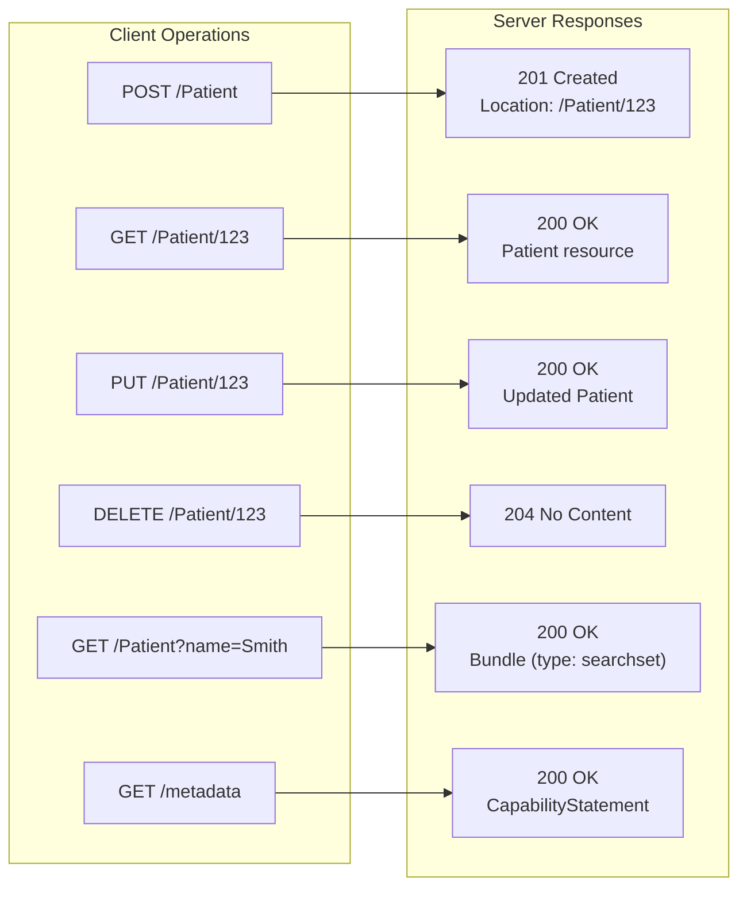
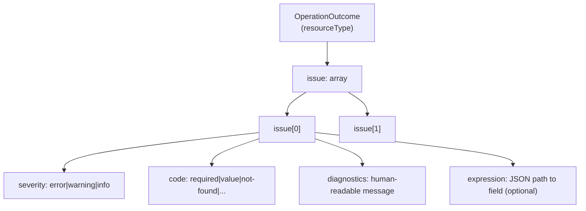
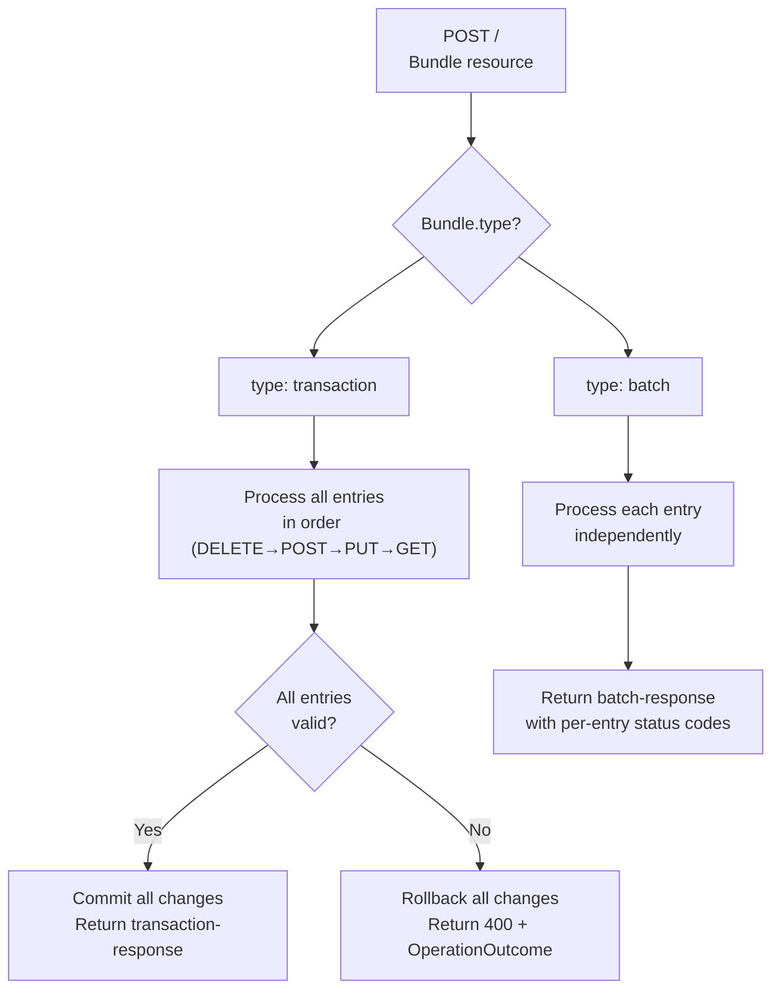
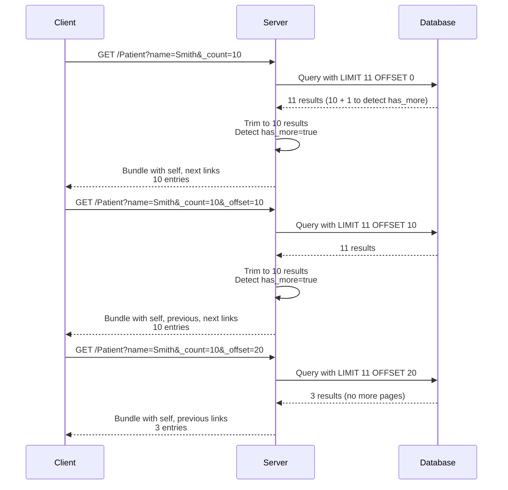

<!-- source: DeepWiki mcp.deepwiki.com · repo anthropics/healthcare · extra page FHIR API Patterns · fetched 2026-10-26 -->

# FHIR API Patterns

<details>
<summary>Relevant source files</summary>

The following files were used as context for generating this wiki page:

- [fhir-developer-skill/SKILL.md](fhir-developer-skill/SKILL.md)
- [fhir-developer-skill/references/bundles.md](fhir-developer-skill/references/bundles.md)
- [fhir-developer-skill/references/pagination.md](fhir-developer-skill/references/pagination.md)
- [fhir-developer-skill/references/resource-examples.md](fhir-developer-skill/references/resource-examples.md)
- [fhir-developer-skill/references/smart-auth.md](fhir-developer-skill/references/smart-auth.md)

</details>


## Purpose and Scope

This page documents the RESTful API patterns used in FHIR R4 implementations, including HTTP endpoint conventions, status code selection, error handling with OperationOutcome, Bundle transaction/batch semantics, pagination, and conditional operations. These patterns apply when building FHIR servers that expose Patient, Observation, Encounter, Condition, and other healthcare resources via HTTP.

For FHIR resource field requirements and value sets, see [FHIR R4 Resource Structures](#3.3.1). For OAuth 2.0 authorization flows and scope enforcement, see [SMART on FHIR Authorization](#3.3.3). For FastAPI project scaffolding, see [FHIR Project Scaffolding Tool](#3.3.4).

---

## RESTful Endpoint Structure

FHIR follows a resource-oriented REST architecture with standardized endpoint patterns. All endpoints are relative to a FHIR base URL (e.g., `https://fhir.example.org/`).

### Standard CRUD Endpoints



**Diagram: FHIR REST Endpoint Mappings**

Sources: [fhir-developer-skill/SKILL.md:235-245]()

### Endpoint Pattern Reference

| HTTP Method | Endpoint Pattern | Operation | Success Status |
|-------------|-----------------|-----------|----------------|
| `POST` | `/[ResourceType]` | Create new resource | `201 Created` |
| `GET` | `/[ResourceType]/[id]` | Read by ID | `200 OK` |
| `PUT` | `/[ResourceType]/[id]` | Update existing | `200 OK` |
| `DELETE` | `/[ResourceType]/[id]` | Delete resource | `204 No Content` |
| `GET` | `/[ResourceType]?param=value` | Search | `200 OK` (Bundle) |
| `GET` | `/metadata` | Server capabilities | `200 OK` (CapabilityStatement) |
| `POST` | `/` | Bundle transaction/batch | `200 OK` (Bundle response) |

The `POST /` endpoint handles Bundle submissions for atomic transactions or batch operations (see [Bundle Operations](#bundle-operations-transaction-vs-batch) below).

Sources: [fhir-developer-skill/SKILL.md:235-245]()

---

## HTTP Status Code Selection

FHIR servers must return precise HTTP status codes to distinguish between malformed requests, validation errors, authentication failures, and business rule violations.

### Status Code Decision Tree

```mermaid
graph TD
    REQUEST["Incoming Request"]
    
    REQUEST --> AUTH_CHECK{"Valid OAuth<br/>Token?"}
    AUTH_CHECK -->|No token or expired| AUTH_401["401 Unauthorized<br/>WWW-Authenticate header"]
    AUTH_CHECK -->|Valid token| SCOPE_CHECK{"Sufficient<br/>Scopes?"}
    
    SCOPE_CHECK -->|No| AUTH_403["403 Forbidden<br/>OperationOutcome"]
    SCOPE_CHECK -->|Yes| PARSE_CHECK{"Valid JSON<br/>& resourceType?"}
    
    PARSE_CHECK -->|No| BAD_400["400 Bad Request<br/>OperationOutcome"]
    PARSE_CHECK -->|Yes| EXISTS_CHECK{"Resource<br/>Exists?"}
    
    EXISTS_CHECK -->|No (for GET/PUT/DELETE)| NOT_FOUND["404 Not Found<br/>OperationOutcome"]
    EXISTS_CHECK -->|Yes or N/A| ETAG_CHECK{"If-Match<br/>header?"}
    
    ETAG_CHECK -->|Mismatch| PRECOND_412["412 Precondition Failed<br/>OperationOutcome"]
    ETAG_CHECK -->|Match or absent| VALIDATE{"Required fields<br/>& enum values?"}
    
    VALIDATE -->|Invalid| UNPROC_422["422 Unprocessable Entity<br/>OperationOutcome"]
    VALIDATE -->|Valid| SUCCESS["200 OK / 201 Created<br/>/ 204 No Content"]
```

**Diagram: HTTP Status Code Decision Flow**

Sources: [fhir-developer-skill/SKILL.md:18-28]()

### Status Code Reference

| Code | When to Use | Example Scenario |
|------|-------------|------------------|
| `200 OK` | Successful read, update, or search | `GET /Patient/123` returns existing patient |
| `201 Created` | Successful resource creation | `POST /Observation` creates new vital sign |
| `204 No Content` | Successful deletion | `DELETE /Patient/123` removes patient |
| `400 Bad Request` | Malformed JSON, wrong resourceType | `POST /Patient` with `{"resourceType": "Observ"}` |
| `401 Unauthorized` | Missing, expired, revoked, malformed token | Missing `Authorization` header |
| `403 Forbidden` | Valid token but insufficient scopes | Token has `patient/Patient.rs` but client attempts `POST /Patient` |
| `404 Not Found` | Resource doesn't exist | `GET /Patient/999` when ID 999 not found |
| `412 Precondition Failed` | If-Match ETag mismatch | Update with `If-Match: W/"1"` but current version is 2 |
| `422 Unprocessable Entity` | Missing required fields, invalid enum values, business rules | `POST /Observation` without `status` field |

**Critical Distinction**: Use `400` for syntax errors (malformed JSON, wrong resourceType), but `422` for semantic validation failures (missing required fields, invalid enum values). Use `412` (not `400`) for ETag mismatches on conditional updates.

Sources: [fhir-developer-skill/SKILL.md:18-28](), [fhir-developer-skill/SKILL.md:209-216]()

---

## OperationOutcome Error Handling

All error responses (4xx and 5xx status codes) MUST include an `OperationOutcome` resource in the response body. This provides structured, machine-readable error information.

### OperationOutcome Structure



**Diagram: OperationOutcome Resource Structure**

Sources: [fhir-developer-skill/references/resource-examples.md:130-159]()

### Implementation Pattern

The skill provides a helper function pattern for generating OperationOutcome responses:

[fhir-developer-skill/SKILL.md:103-107]()

```python
def operation_outcome(severity: str, code: str, diagnostics: str):
    return {
        "resourceType": "OperationOutcome",
        "issue": [{"severity": severity, "code": code, "diagnostics": diagnostics}]
    }
```

### Common Error Codes

| Code | Meaning | HTTP Status |
|------|---------|-------------|
| `required` | Missing required field | 422 |
| `value` | Invalid enum value or data type | 422 |
| `not-found` | Resource ID doesn't exist | 404 |
| `invalid` | Malformed request syntax | 400 |
| `conflict` | Version conflict (concurrent update) | 409 |
| `processing` | Server processing error | 500 |
| `security` | Authorization failure | 401/403 |
| `business-rule` | Domain-specific validation failure | 422 |

### Multiple Validation Errors

OperationOutcome can include multiple issues in a single response. The `expression` field uses FHIRPath or JSON path syntax to identify the problematic field:

[fhir-developer-skill/references/resource-examples.md:151-159]()

```json
{
  "resourceType": "OperationOutcome",
  "issue": [
    {
      "severity": "error",
      "code": "required",
      "diagnostics": "Observation.status is required",
      "expression": ["Observation.status"]
    },
    {
      "severity": "error",
      "code": "required",
      "diagnostics": "Observation.code is required",
      "expression": ["Observation.code"]
    }
  ]
}
```

Sources: [fhir-developer-skill/SKILL.md:103-124](), [fhir-developer-skill/references/resource-examples.md:130-159]()

---

## Bundle Operations: Transaction vs Batch

FHIR supports submitting multiple operations in a single HTTP request via Bundle resources posted to the base URL (`POST /`). The `type` field determines atomicity semantics.

### Transaction vs Batch Semantics



**Diagram: Bundle Processing Flow**

Sources: [fhir-developer-skill/references/bundles.md:1-161]()

### Comparison Table

| Feature | Transaction | Batch |
|---------|-------------|-------|
| **Atomicity** | All-or-nothing (atomic) | Independent entries |
| **Failure Handling** | Entire bundle fails, all rolled back | Partial success allowed |
| **Response Type** | `transaction-response` | `batch-response` |
| **HTTP Status** | 200 (success) or 400 (any failure) | 200 (always, even with partial failures) |
| **Use Case** | Related data that must succeed together | Independent operations |
| **Processing Order** | DELETE → POST → PUT/PATCH → GET | Entry order preserved |

### Transaction Example

Transactions ensure that a Patient and related Observation are created together or not at all. References within the bundle use temporary URNs (`urn:uuid:...`) that are resolved during processing.

[fhir-developer-skill/references/bundles.md:23-54]()

**Request:**
```json
{
  "resourceType": "Bundle",
  "type": "transaction",
  "entry": [
    {
      "fullUrl": "urn:uuid:patient-1",
      "resource": {
        "resourceType": "Patient",
        "name": [{"family": "Smith", "given": ["John"]}]
      },
      "request": {"method": "POST", "url": "Patient"}
    },
    {
      "fullUrl": "urn:uuid:observation-1",
      "resource": {
        "resourceType": "Observation",
        "status": "final",
        "code": {"coding": [{"system": "http://loinc.org", "code": "8480-6"}]},
        "subject": {"reference": "urn:uuid:patient-1"}
      },
      "request": {"method": "POST", "url": "Observation"}
    }
  ]
}
```

If the Observation is invalid (e.g., missing `status`), the server returns `400 Bad Request` with an OperationOutcome, and the Patient is NOT created.

[fhir-developer-skill/references/bundles.md:82-93]()

### Batch Example

Batches allow mixed read/write operations with independent outcomes. Each entry in the response has its own status code.

[fhir-developer-skill/references/bundles.md:99-150]()

**Request:**
```json
{
  "resourceType": "Bundle",
  "type": "batch",
  "entry": [
    {"request": {"method": "GET", "url": "Patient/123"}},
    {"request": {"method": "GET", "url": "Patient/999"}},
    {
      "resource": {
        "resourceType": "Observation",
        "status": "final",
        "code": {"coding": [{"system": "http://loinc.org", "code": "8480-6"}]}
      },
      "request": {"method": "POST", "url": "Observation"}
    }
  ]
}
```

**Response (200 OK with mixed results):**
```json
{
  "resourceType": "Bundle",
  "type": "batch-response",
  "entry": [
    {
      "resource": {"resourceType": "Patient", "id": "123"},
      "response": {"status": "200 OK"}
    },
    {
      "response": {
        "status": "404 Not Found",
        "outcome": {
          "resourceType": "OperationOutcome",
          "issue": [{"severity": "error", "code": "not-found"}]
        }
      }
    },
    {
      "response": {
        "status": "201 Created",
        "location": "Observation/789/_history/1"
      }
    }
  ]
}
```

### Transaction Processing Order

Transactions process entries in a specific order regardless of their position in the entry array. This ensures references resolve correctly:

1. **DELETE** operations
2. **POST** (create) operations
3. **PUT/PATCH** (update) operations
4. **GET** (read) operations

This ordering allows a transaction to delete an old resource, create a new one with the same identifier, and then read it back in a single atomic operation.

Sources: [fhir-developer-skill/references/bundles.md:1-161]()

---

## Pagination Patterns

All search endpoints MUST support pagination to prevent performance issues with large result sets. Search results are returned as Bundle resources with `type: "searchset"` and navigation links.

### Pagination Flow



**Diagram: Pagination Request/Response Cycle**

Sources: [fhir-developer-skill/references/pagination.md:1-106]()

### Pagination Parameters

| Parameter | Description | Default | Example |
|-----------|-------------|---------|---------|
| `_count` | Results per page | Server-defined (10-100) | `_count=25` |
| `_offset` | Starting index (0-based) | 0 | `_offset=50` |
| `_page` | Page number (1-based, alternative to offset) | 1 | `_page=3` |

### Link Relations

Every paginated Bundle includes a `link` array with navigation URIs:

| Relation | Present When | Description |
|----------|--------------|-------------|
| `self` | Always | Current page URL with all parameters |
| `first` | Optional | First page of results |
| `previous` | Offset > 0 | Previous page |
| `next` | More results exist | Next page |
| `last` | Optional | Last page (requires total count) |

### Implementation Pattern

The skill demonstrates pagination using the "query limit + 1" technique to detect whether more results exist without a separate count query:

[fhir-developer-skill/references/pagination.md:59-95]()

```python
@app.get("/Patient")
async def search_patients(
    name: str = None,
    _count: int = 10,
    _offset: int = 0
):
    # Query with limit + 1 to detect if there are more results
    results = db.query_patients(name=name, limit=_count + 1, offset=_offset)
    has_more = len(results) > _count
    results = results[:_count]  # Trim to requested count

    base_url = f"{BASE_URL}/Patient"
    params = f"name={name}&_count={_count}" if name else f"_count={_count}"

    links = [
        {"relation": "self", "url": f"{base_url}?{params}&_offset={_offset}"}
    ]

    if _offset > 0:
        prev_offset = max(0, _offset - _count)
        links.append({"relation": "previous", "url": f"{base_url}?{params}&_offset={prev_offset}"})

    if has_more:
        links.append({"relation": "next", "url": f"{base_url}?{params}&_offset={_offset + _count}"})

    return {
        "resourceType": "Bundle",
        "type": "searchset",
        "total": db.count_patients(name=name),
        "link": links,
        "entry": [
            {"fullUrl": f"{base_url}/{p['id']}", "resource": p, "search": {"mode": "match"}}
            for p in results
        ]
    }
```

### Bundle Structure

[fhir-developer-skill/references/pagination.md:14-37]()

```json
{
  "resourceType": "Bundle",
  "type": "searchset",
  "total": 150,
  "link": [
    {"relation": "self", "url": "https://fhir.example.org/Patient?name=Smith&_count=10"},
    {"relation": "next", "url": "https://fhir.example.org/Patient?name=Smith&_count=10&_offset=10"}
  ],
  "entry": [
    {
      "fullUrl": "https://fhir.example.org/Patient/123",
      "resource": {"resourceType": "Patient", "id": "123"},
      "search": {"mode": "match"}
    }
  ]
}
```

### Additional Search Parameters

| Parameter | Description | Example |
|-----------|-------------|---------|
| `_sort` | Sort by field (prefix `-` for descending) | `_sort=-date,name` |
| `_elements` | Return only specified fields | `_elements=name,birthDate` |
| `_summary` | Return summary view | `_summary=true` |
| `_include` | Include referenced resources | `_include=Observation:patient` |
| `_revinclude` | Include resources that reference this | `_revinclude=Observation:patient` |

Sources: [fhir-developer-skill/references/pagination.md:1-106]()

---

## Conditional Operations

FHIR supports conditional operations using HTTP headers to implement optimistic locking and conditional creation patterns.

### If-Match: Optimistic Locking

The `If-Match` header enables optimistic concurrency control. Clients include the resource's ETag to ensure they're updating the version they expect.

```mermaid
graph TB
    CLIENT_READ["Client: GET /Patient/123"]
    SERVER_RESP["Server: 200 OK<br/>ETag: W/\"1\"<br/>versionId: 1"]
    
    CLIENT_UPDATE["Client: PUT /Patient/123<br/>If-Match: W/\"1\""]
    VERSION_CHECK{"Current version<br/>still 1?"}
    
    SUCCESS["Server: 200 OK<br/>ETag: W/\"2\"<br/>Updated resource"]
    CONFLICT["Server: 412 Precondition Failed<br/>OperationOutcome"]
    
    CLIENT_READ --> SERVER_RESP
    SERVER_RESP --> CLIENT_UPDATE
    CLIENT_UPDATE --> VERSION_CHECK
    VERSION_CHECK -->|Yes| SUCCESS
    VERSION_CHECK -->|No (someone else updated)| CONFLICT
```

**Diagram: If-Match Conditional Update Flow**

Sources: [fhir-developer-skill/SKILL.md:249-258]()

**Pattern:**
- Client sends: `If-Match: W/"1"`
- ETag matches current version → update succeeds (200 OK)
- ETag mismatch → return `412 Precondition Failed` (NOT 400)

The `W/` prefix indicates a "weak" ETag, which is standard for FHIR resources.

### If-None-Exist: Conditional Create

The `If-None-Exist` header allows clients to create a resource only if a matching resource doesn't already exist, based on business identifiers.

**Pattern:**
- Client sends: `If-None-Exist: identifier=http://hospital.org/mrn|12345`
- Match exists → return existing resource (200 OK) without creating
- No match → create new resource (201 Created)

Example:
```http
POST /Patient
If-None-Exist: identifier=http://hospital.org/mrn|12345
Content-Type: application/fhir+json

{
  "resourceType": "Patient",
  "identifier": [{"system": "http://hospital.org/mrn", "value": "12345"}],
  "name": [{"family": "Smith"}]
}
```

This prevents duplicate Patient records when the same MRN is submitted multiple times.

Sources: [fhir-developer-skill/SKILL.md:249-258]()

---

## HTTP Headers and Content Negotiation

FHIR servers must implement specific HTTP header conventions for proper interoperability.

### Required Response Headers

| Header | When | Value | Purpose |
|--------|------|-------|---------|
| `Content-Type` | All responses | `application/fhir+json` | Indicates FHIR JSON format |
| `Location` | 201 Created | `/Patient/{id}` | URI of newly created resource |
| `ETag` | All resource reads/updates | `W/"{versionId}"` | Supports optimistic locking |
| `Last-Modified` | Optional | HTTP date | Resource last update time |
| `WWW-Authenticate` | 401 Unauthorized | `Bearer realm="..."` | OAuth token requirements (RFC 6750) |

### Content-Type Header

All FHIR responses MUST set `Content-Type: application/fhir+json`. Some servers also accept `application/json`, but the FHIR-specific media type is preferred for strict conformance.

[fhir-developer-skill/SKILL.md:275]()

Example in FastAPI:
```python
return JSONResponse(
    status_code=422,
    content=operation_outcome("error", "required", "Observation.status is required"),
    media_type="application/fhir+json"
)
```

### Location Header

Create operations (201 Created) MUST include a `Location` header with the full URI of the created resource, including the server-assigned ID.

[fhir-developer-skill/SKILL.md:277]()

Example:
```http
HTTP/1.1 201 Created
Location: https://fhir.example.org/Patient/abc123
Content-Type: application/fhir+json
```

### ETag Header and Versioning

All read and update operations should return an `ETag` header and include `meta.versionId` and `meta.lastUpdated` in the resource:

[fhir-developer-skill/SKILL.md:276-278]()

```http
HTTP/1.1 200 OK
ETag: W/"3"
Content-Type: application/fhir+json

{
  "resourceType": "Patient",
  "id": "123",
  "meta": {
    "versionId": "3",
    "lastUpdated": "2024-01-15T14:30:00Z"
  },
  ...
}
```

The `versionId` increments with each update, enabling version history and optimistic locking via If-Match.

### Implementation Checklist

The skill provides a checklist for ensuring correct HTTP patterns:

[fhir-developer-skill/SKILL.md:273-283]()

1. Set `Content-Type: application/fhir+json` on all responses
2. Return `meta.versionId` and `meta.lastUpdated` on resources
3. Return `Location` header on create: `/Patient/{id}`
4. Return `ETag` header: `W/"{versionId}"`
5. Use OperationOutcome for all error responses
6. Validate required fields → 422 for missing
7. Validate enum values → 422 for invalid
8. Search returns Bundle with `type: "searchset"`

Sources: [fhir-developer-skill/SKILL.md:18-28](), [fhir-developer-skill/SKILL.md:249-258](), [fhir-developer-skill/SKILL.md:273-283]()

---

