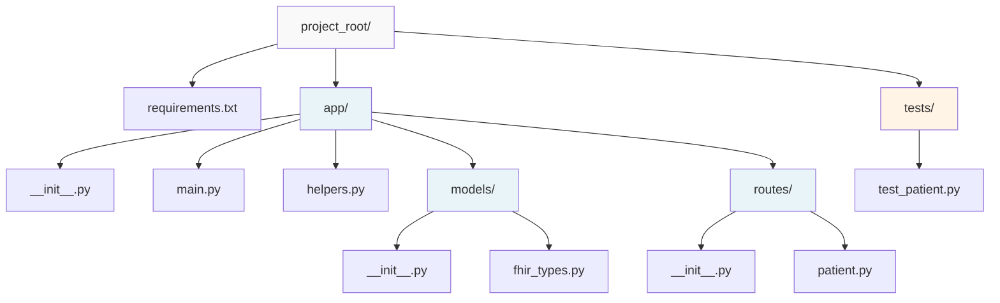
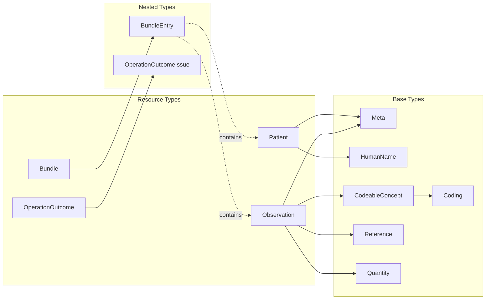
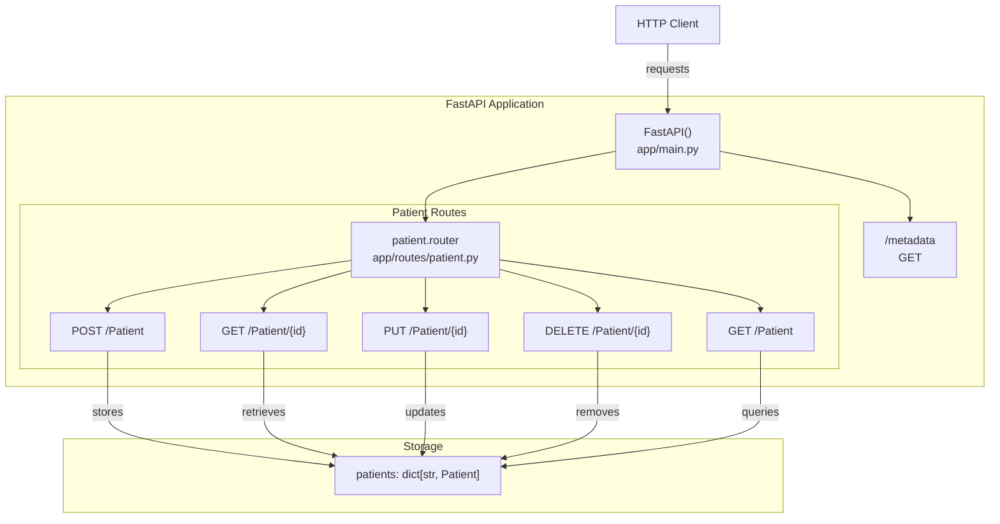
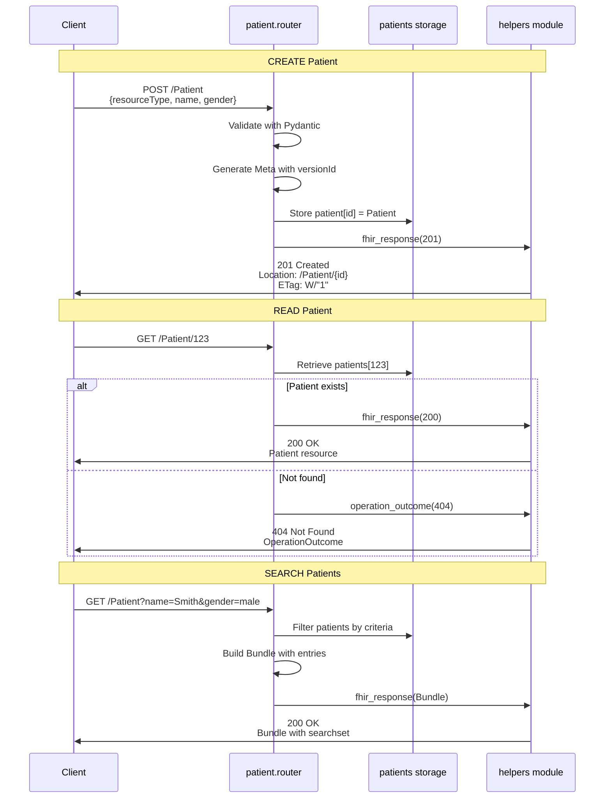
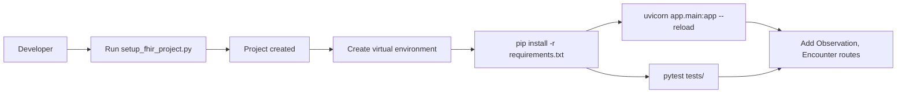

<!-- source: DeepWiki mcp.deepwiki.com · repo anthropics/healthcare · extra page FHIR Project Scaffolding Tool · fetched 2026-10-26 -->

# FHIR Project Scaffolding Tool

<details>
<summary>Relevant source files</summary>

The following files were used as context for generating this wiki page:

- [fhir-developer-skill/SKILL.md](fhir-developer-skill/SKILL.md)
- [fhir-developer-skill/references/bundles.md](fhir-developer-skill/references/bundles.md)
- [fhir-developer-skill/references/pagination.md](fhir-developer-skill/references/pagination.md)
- [fhir-developer-skill/scripts/setup_fhir_project.py](fhir-developer-skill/scripts/setup_fhir_project.py)

</details>


## Purpose and Scope

This document covers the `setup_fhir_project.py` script, a command-line tool that generates a complete, production-ready FHIR R4 API server using FastAPI and Pydantic v2. The script creates a working project structure with correct FHIR patterns, validation logic, and error handling.

For detailed information about the FHIR resource structures and validation rules implemented by the generated code, see [FHIR R4 Resource Structures](#3.3.1). For FHIR API endpoint patterns and HTTP semantics, see [FHIR API Patterns](#3.3.2).

**Sources:** [fhir-developer-skill/SKILL.md:286-294](), [fhir-developer-skill/scripts/setup_fhir_project.py:1-10]()

---

## Quick Start

The scaffolding tool is located at `scripts/setup_fhir_project.py` and requires Python 3.10+. It accepts a single argument specifying the project directory name.

**Basic Usage:**
```bash
python scripts/setup_fhir_project.py my_fhir_api
cd my_fhir_api
python -m venv venv && source venv/bin/activate
pip install -r requirements.txt
uvicorn app.main:app --reload
```

After running these commands, the API server is accessible at `http://localhost:8000` with interactive documentation at `http://localhost:8000/docs`.

**Sources:** [fhir-developer-skill/scripts/setup_fhir_project.py:228-232](), [fhir-developer-skill/SKILL.md:290-294]()

---

## Generated Project Structure

The script creates a complete FastAPI project with the following directory layout:



**Directory Structure:**

| Path | Purpose | Key Contents |
|------|---------|--------------|
| `requirements.txt` | Python dependencies | fastapi, uvicorn, pydantic, httpx, pytest |
| `app/main.py` | FastAPI application entry point | `FastAPI` app instance, `/metadata` endpoint |
| `app/helpers.py` | FHIR response utilities | `operation_outcome()`, `fhir_response()` |
| `app/models/fhir_types.py` | Pydantic v2 FHIR models | `Patient`, `Observation`, `Bundle`, `OperationOutcome` |
| `app/routes/patient.py` | Patient resource endpoints | CRUD operations, search functionality |
| `tests/test_patient.py` | Pytest test suite | Create, read, search test cases |

**Sources:** [fhir-developer-skill/scripts/setup_fhir_project.py:12-15]()

---

## Core Components

### Requirements and Dependencies

The generated `requirements.txt` specifies version-pinned dependencies:

```
fastapi>=0.100.0
uvicorn>=0.23.0
pydantic>=2.0.0
httpx>=0.24.0
pytest>=7.0.0
```

These versions ensure Pydantic v2 compatibility, which is critical for the `Literal` type syntax used throughout the models.

**Sources:** [fhir-developer-skill/scripts/setup_fhir_project.py:17-20]()

---

### FHIR Data Models



The `app/models/fhir_types.py` module defines Pydantic v2 models with correct FHIR R4 patterns:

**Key Model Features:**

| Model | Required Fields | Literal Types | Special Behaviors |
|-------|----------------|---------------|-------------------|
| `Patient` | *(none)* | `resourceType="Patient"`, `gender` enum | Auto-generated UUID ID |
| `Observation` | `status`, `code` | `resourceType="Observation"`, `status` enum | Required status validation |
| `Bundle` | `type` | `resourceType="Bundle"`, `type` enum | Contains list of `BundleEntry` |
| `OperationOutcome` | `issue` | `resourceType="OperationOutcome"` | Error response structure |

**Pydantic v2 Pattern:**
The models use `Literal` types for enumerations and `Field(default_factory=...)` for auto-generated values, following Pydantic v2 syntax:

```python
# Example from generated code
class Patient(BaseModel):
    resourceType: Literal["Patient"] = "Patient"
    id: str | None = Field(default_factory=lambda: str(uuid.uuid4()))
    gender: Literal["male", "female", "other", "unknown"] | None = None
```

**Sources:** [fhir-developer-skill/scripts/setup_fhir_project.py:27-97](), [fhir-developer-skill/SKILL.md:144-153]()

---

### Helper Functions

The `app/helpers.py` module provides two utility functions for FHIR-compliant responses:

**`operation_outcome(status_code, severity, code, diagnostics)`**

Returns a FHIR OperationOutcome error response with the correct `application/fhir+json` content type. Used for all error scenarios (404, 422, etc.).

**`fhir_response(content, status_code, headers)`**

Returns a successful FHIR JSON response with the correct content type and optional headers (e.g., `Location`, `ETag`).

Both functions ensure responses always set `Content-Type: application/fhir+json`, a critical FHIR requirement.

**Sources:** [fhir-developer-skill/scripts/setup_fhir_project.py:99-122]()

---

### FastAPI Application



The generated `app/main.py` creates a FastAPI application with:

1. **Capability Statement Endpoint** (`/metadata`): Returns a FHIR CapabilityStatement describing server capabilities, FHIR version (4.0.1), and supported resources.

2. **Router Integration**: Includes the Patient router using `app.include_router(patient.router)`, enabling modular route organization.

The application follows a standard FastAPI pattern where each FHIR resource type can be implemented in a separate router module.

**Sources:** [fhir-developer-skill/scripts/setup_fhir_project.py:124-144]()

---

### Patient CRUD Endpoints

The `app/routes/patient.py` module implements complete CRUD operations for the Patient resource:

**HTTP Request Flow:**



**Endpoint Implementation Details:**

| Endpoint | Method | Response | Headers | Storage Operation |
|----------|--------|----------|---------|-------------------|
| `/Patient` | POST | 201 Created | `Location`, `ETag` | `patients[id] = patient` |
| `/Patient/{id}` | GET | 200 OK / 404 | *(none)* | `patients[id]` lookup |
| `/Patient/{id}` | PUT | 200 OK / 404 | *(none)* | `patients[id] = updated`, increment `versionId` |
| `/Patient/{id}` | DELETE | 204 No Content / 404 | *(none)* | `del patients[id]` |
| `/Patient?name=&gender=` | GET | 200 OK Bundle | *(none)* | Filter `patients.values()` |

The search endpoint supports two query parameters: `name` (substring match on `HumanName.family`) and `gender` (exact match). Results are returned as a Bundle with `type="searchset"`.

**Sources:** [fhir-developer-skill/scripts/setup_fhir_project.py:146-195]()

---

### Test Suite

The generated `tests/test_patient.py` provides basic test coverage using FastAPI's `TestClient`:

**Test Cases:**

1. **`test_create_patient()`**: Verifies POST returns 201 status and includes `Location` header
2. **`test_read_not_found()`**: Verifies GET for nonexistent resource returns 404 with OperationOutcome
3. **`test_search()`**: Verifies search returns 200 with Bundle resourceType

These tests demonstrate the correct testing pattern for FHIR APIs and can be extended for additional resources and validation scenarios.

**Sources:** [fhir-developer-skill/scripts/setup_fhir_project.py:197-218]()

---

## Usage Workflow



**Step-by-Step Workflow:**

1. **Generate Project:**
   ```bash
   python scripts/setup_fhir_project.py my_fhir_api
   ```

2. **Setup Environment:**
   ```bash
   cd my_fhir_api
   python -m venv venv
   source venv/bin/activate  # On Windows: venv\Scripts\activate
   ```

3. **Install Dependencies:**
   ```bash
   pip install -r requirements.txt
   ```

4. **Run Development Server:**
   ```bash
   uvicorn app.main:app --reload
   ```
   The server starts at `http://localhost:8000` with auto-reload on file changes.

5. **Access API Documentation:**
   - Swagger UI: `http://localhost:8000/docs`
   - ReDoc: `http://localhost:8000/redoc`
   - Capability Statement: `http://localhost:8000/metadata`

6. **Run Tests:**
   ```bash
   pytest tests/
   ```

**Sources:** [fhir-developer-skill/scripts/setup_fhir_project.py:220-226]()

---

## Key Design Patterns

### Pydantic v2 Compliance

The scaffolding tool generates models using Pydantic v2 syntax exclusively:

- **`Literal` for Enums:** `gender: Literal["male", "female", "other", "unknown"]` instead of deprecated `const=True`
- **Union Types:** `str | None` instead of `Optional[str]`
- **Field Factories:** `Field(default_factory=lambda: str(uuid.uuid4()))` for auto-generated values
- **`model_dump()`:** Replaces `dict()` for serialization

This ensures compatibility with FastAPI 0.100+ and Pydantic 2.0+.

**Sources:** [fhir-developer-skill/scripts/setup_fhir_project.py:28-96](), [fhir-developer-skill/SKILL.md:144-153]()

---

### FHIR-Compliant Error Handling

All error responses use OperationOutcome resources with appropriate HTTP status codes:

| Error Scenario | Status Code | OperationOutcome Code | Example |
|----------------|-------------|----------------------|---------|
| Resource not found | 404 | `not-found` | `Patient/999 not found` |
| Missing required field | 422 | `required` | `Observation.status is required` |
| Invalid enum value | 422 | `value` | `Invalid status 'invalid'` |

The `operation_outcome()` helper ensures consistent error response structure across all endpoints.

**Sources:** [fhir-developer-skill/scripts/setup_fhir_project.py:104-112](), [fhir-developer-skill/SKILL.md:103-124]()

---

### HTTP Header Management

The generated code correctly implements FHIR HTTP header requirements:

1. **Content-Type:** All responses include `Content-Type: application/fhir+json`
2. **Location Header:** POST responses include `Location: /Patient/{id}`
3. **ETag Header:** Create responses include `ETag: W/"{versionId}"` for versioning support

These headers enable proper HTTP caching, conditional requests, and client-side resource location tracking.

**Sources:** [fhir-developer-skill/scripts/setup_fhir_project.py:159-161]()

---

## Extensibility

The scaffolded project provides a foundation for adding additional FHIR resources:

**Adding a New Resource Type:**

1. **Add Model:** Define the resource in `app/models/fhir_types.py` (e.g., `Encounter`, `Condition`)
2. **Create Router:** Add `app/routes/encounter.py` following the Patient router pattern
3. **Register Router:** Include in `app/main.py` with `app.include_router(encounter.router)`
4. **Update Capability Statement:** Add resource to `/metadata` response
5. **Add Tests:** Create `tests/test_encounter.py`

The modular architecture allows independent development of each resource type without cross-dependencies.

**Sources:** [fhir-developer-skill/scripts/setup_fhir_project.py:127-143]()

---

## Relationship to FHIR Developer Skill

The scaffolding tool is one of two primary outputs of the FHIR Developer Skill (see [FHIR Developer Guide](#3.3)):

- **SKILL.md Knowledge Base:** Provides reference documentation for FHIR R4 structures, validation rules, and coding systems
- **`setup_fhir_project.py` Script:** Generates working code implementing those patterns

Together, these components enable developers to quickly bootstrap FHIR-compliant APIs with correct validation logic, error handling, and RESTful semantics.

**Sources:** [fhir-developer-skill/SKILL.md:1-11](), [fhir-developer-skill/SKILL.md:286-294]()

---

