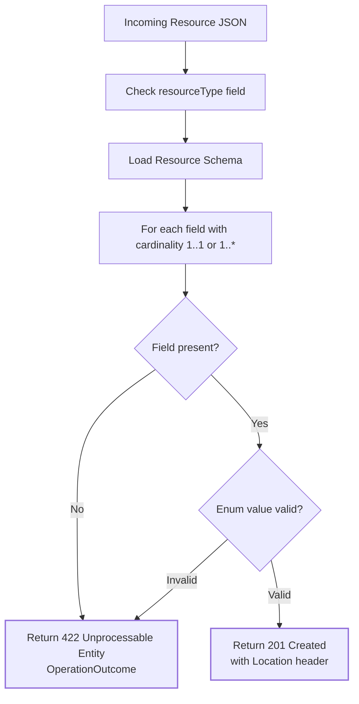
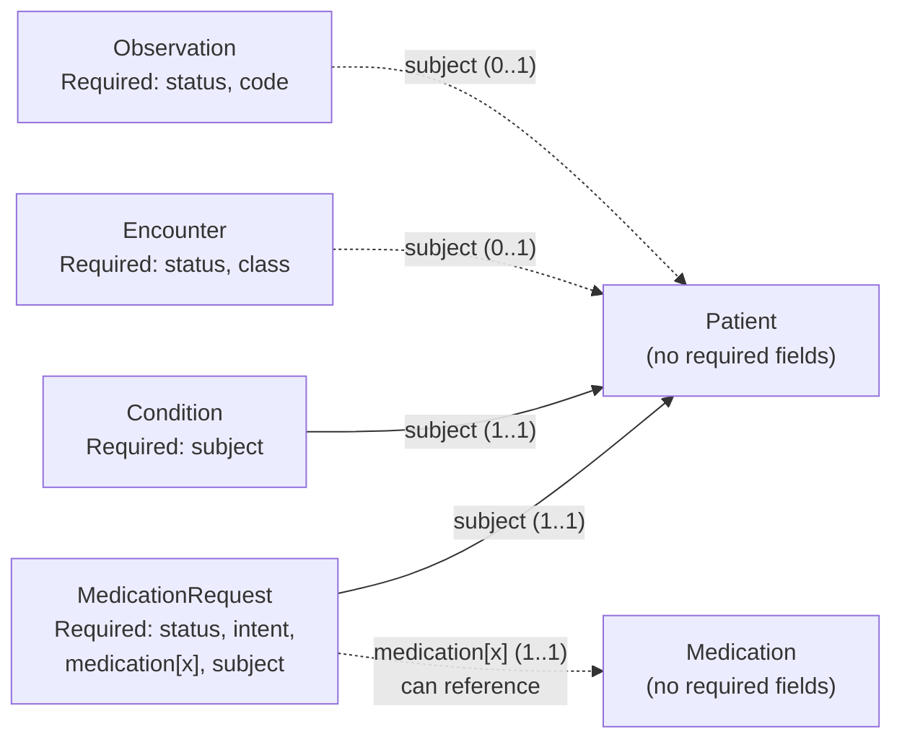
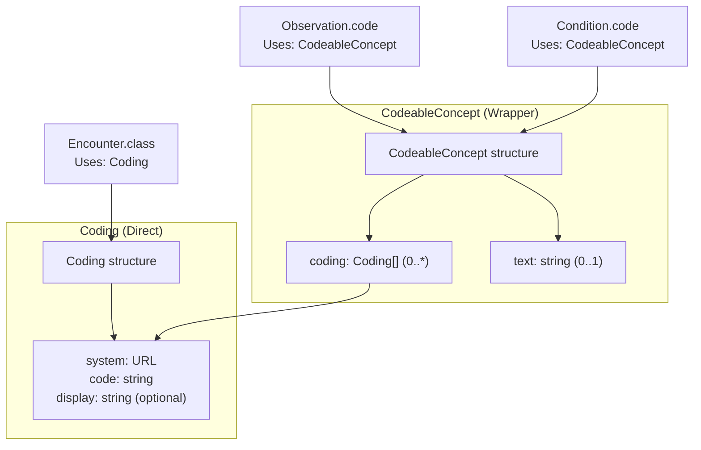
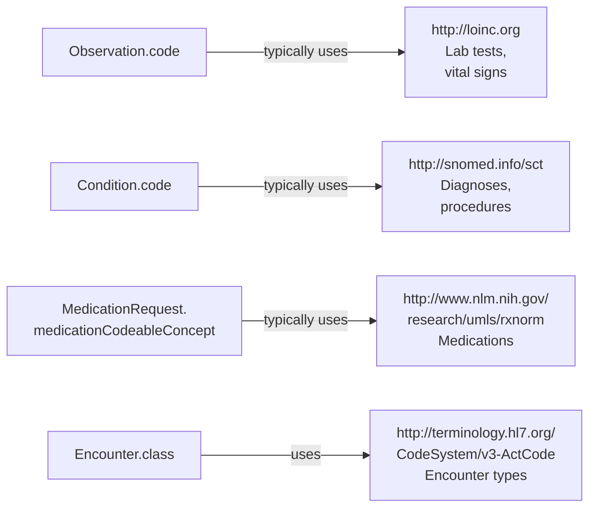
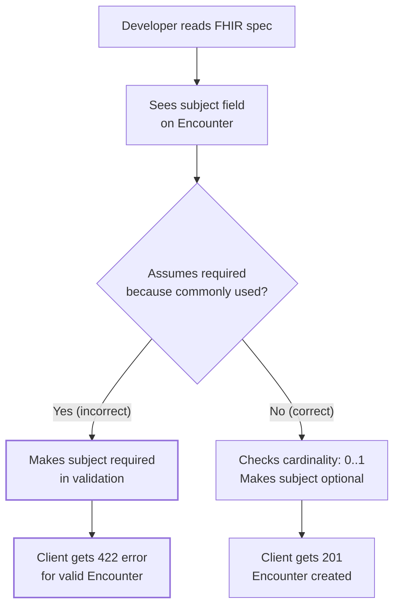

<!-- source: DeepWiki mcp.deepwiki.com · repo anthropics/healthcare · extra page FHIR R4 Resource Structures · fetched 2026-10-26 -->

# FHIR R4 Resource Structures

<details>
<summary>Relevant source files</summary>

The following files were used as context for generating this wiki page:

- [fhir-developer-skill/SKILL.md](fhir-developer-skill/SKILL.md)
- [fhir-developer-skill/references/bundles.md](fhir-developer-skill/references/bundles.md)
- [fhir-developer-skill/references/pagination.md](fhir-developer-skill/references/pagination.md)
- [fhir-developer-skill/references/resource-examples.md](fhir-developer-skill/references/resource-examples.md)
- [fhir-developer-skill/references/smart-auth.md](fhir-developer-skill/references/smart-auth.md)

</details>


## Purpose and Scope

This document provides technical specifications for FHIR R4 resource structures, including required/optional fields, data types, value sets, and coding systems. It covers the structural elements of FHIR resources themselves—what fields exist, which are mandatory, and what values they accept.

For information about RESTful API endpoints, HTTP methods, and pagination, see [FHIR API Patterns](#3.3.2). For OAuth flows and scope enforcement, see [SMART on FHIR Authorization](#3.3.3). For project scaffolding tools, see [FHIR Project Scaffolding Tool](#3.3.4).

## Cardinality and Required Fields

FHIR uses cardinality notation to specify whether fields are required or optional. The validation logic must enforce only fields with cardinality starting with "1".

| Cardinality | Required | Validation |
|-------------|----------|------------|
| `0..1` | NO | Field is optional, may appear once |
| `0..*` | NO | Field is optional, may appear multiple times |
| `1..1` | YES | Field is required, must appear exactly once |
| `1..*` | YES | Field is required, must appear at least once |

**Critical Rule**: Only validate fields with cardinality `1..1` or `1..*` as required. A common mistake is making `subject` or `period` required on `Encounter` when they are `0..1` (optional).

Sources: [fhir-developer-skill/SKILL.md:43-53]()

### Cardinality Enforcement Pattern



Sources: [fhir-developer-skill/SKILL.md:94-124]()

## Core Resource Types

### Resource Required Fields Matrix

The following table summarizes which fields are actually required (cardinality `1..1` or `1..*`) for each major resource type:

| Resource | Required Fields | Optional Fields (Examples) |
|----------|----------------|---------------------------|
| `Patient` | *(none)* | `identifier`, `name`, `gender`, `birthDate` |
| `Observation` | `status`, `code` | `subject`, `effectiveDateTime`, `value[x]` |
| `Encounter` | `status`, `class` | `subject`, `period`, `participant` |
| `Condition` | `subject` | `code`, `clinicalStatus`, `verificationStatus` |
| `MedicationRequest` | `status`, `intent`, `medication[x]`, `subject` | `dosageInstruction`, `authoredOn` |
| `Medication` | *(none)* | `code`, `form`, `ingredient` |
| `Bundle` | `type` | `entry`, `total`, `link` |
| `OperationOutcome` | `issue` (1..*) | N/A |

Sources: [fhir-developer-skill/SKILL.md:30-39](), [fhir-developer-skill/references/resource-examples.md:1-197]()

### Resource Dependency Graph



Sources: [fhir-developer-skill/references/resource-examples.md:15-128]()

## Patient Resource Structure

`Patient` has no required fields. All elements are optional (cardinality `0..1` or `0..*`).

**Key Fields**:
- `identifier` (0..*): External identifiers (MRN, SSN, etc.)
- `name` (0..*): HumanName elements with `family`, `given`
- `gender` (0..1): Enum - see [Value Sets](#value-sets-and-enumerations)
- `birthDate` (0..1): ISO 8601 date format

**Example Structure**:
```json
{
  "resourceType": "Patient",
  "id": "example",
  "meta": {"versionId": "1", "lastUpdated": "2024-01-15T10:30:00Z"},
  "identifier": [{"system": "http://hospital.example.org/mrn", "value": "12345"}],
  "name": [{"family": "Smith", "given": ["John"]}],
  "gender": "male",
  "birthDate": "1990-05-15"
}
```

Sources: [fhir-developer-skill/SKILL.md:33](), [fhir-developer-skill/references/resource-examples.md:15-29]()

## Observation Resource Structure

`Observation` requires `status` (1..1) and `code` (1..1). All other fields are optional.

**Required Fields**:
- `status` (1..1): Observation status enum
- `code` (1..1): CodeableConcept describing what was measured

**Common Optional Fields**:
- `subject` (0..1): Reference to Patient
- `effectiveDateTime` (0..1): When observation was made
- `valueQuantity` (0..1): Measured value with units
- `category` (0..*): Classification (e.g., vital-signs)

**Example Structure**:
```json
{
  "resourceType": "Observation",
  "status": "final",
  "category": [{"coding": [{"system": "http://terminology.hl7.org/CodeSystem/observation-category", "code": "vital-signs"}]}],
  "code": {"coding": [{"system": "http://loinc.org", "code": "8480-6", "display": "Systolic blood pressure"}]},
  "subject": {"reference": "Patient/123"},
  "effectiveDateTime": "2024-01-15T10:30:00Z",
  "valueQuantity": {"value": 120, "unit": "mmHg", "system": "http://unitsofmeasure.org", "code": "mm[Hg]"}
}
```

Sources: [fhir-developer-skill/SKILL.md:34](), [fhir-developer-skill/references/resource-examples.md:31-45]()

## Encounter Resource Structure

`Encounter` requires `status` (1..1) and `class` (1..1). **Important**: `subject` and `period` are `0..1` (optional), not required.

**Required Fields**:
- `status` (1..1): Encounter status enum
- `class` (1..1): **Coding** (not CodeableConcept) - see [Data Type Patterns](#data-type-patterns)

**Common Optional Fields**:
- `subject` (0..1): Reference to Patient
- `period` (0..1): Start and end times
- `participant` (0..*): Practitioners involved

**Critical Note**: `class` uses `Coding` directly, not wrapped in `CodeableConcept`.

**Example Structure**:
```json
{
  "resourceType": "Encounter",
  "status": "in-progress",
  "class": {"system": "http://terminology.hl7.org/CodeSystem/v3-ActCode", "code": "AMB", "display": "ambulatory"},
  "subject": {"reference": "Patient/123"},
  "period": {"start": "2024-01-15T09:00:00Z"}
}
```

Sources: [fhir-developer-skill/SKILL.md:35,52](), [fhir-developer-skill/references/resource-examples.md:47-61]()

## Condition Resource Structure

`Condition` requires only `subject` (1..1). Notably, `code` and `clinicalStatus` are optional despite being commonly used.

**Required Fields**:
- `subject` (1..1): Reference to Patient

**Common Optional Fields**:
- `code` (0..1): SNOMED CT diagnosis code
- `clinicalStatus` (0..1): active | inactive | resolved
- `verificationStatus` (0..1): confirmed | unconfirmed
- `onsetDateTime` (0..1): When condition started

**Example Structure**:
```json
{
  "resourceType": "Condition",
  "clinicalStatus": {"coding": [{"system": "http://terminology.hl7.org/CodeSystem/condition-clinical", "code": "active"}]},
  "verificationStatus": {"coding": [{"system": "http://terminology.hl7.org/CodeSystem/condition-ver-status", "code": "confirmed"}]},
  "code": {"coding": [{"system": "http://snomed.info/sct", "code": "73211009", "display": "Diabetes mellitus"}]},
  "subject": {"reference": "Patient/123"},
  "onsetDateTime": "2020-03-15"
}
```

Sources: [fhir-developer-skill/SKILL.md:36](), [fhir-developer-skill/references/resource-examples.md:63-78]()

## MedicationRequest Resource Structure

`MedicationRequest` requires `status` (1..1), `intent` (1..1), `medication[x]` (1..1), and `subject` (1..1).

**Required Fields**:
- `status` (1..1): active | on-hold | cancelled | completed
- `intent` (1..1): proposal | plan | order
- `medication[x]` (1..1): Either `medicationCodeableConcept` or `medicationReference`
- `subject` (1..1): Reference to Patient

**Common Optional Fields**:
- `authoredOn` (0..1): When prescription was written
- `dosageInstruction` (0..*): Dosing details

**Choice Type Pattern**: The `medication[x]` field demonstrates FHIR's choice type pattern - exactly one of `medicationCodeableConcept` or `medicationReference` must be present.

**Example with CodeableConcept**:
```json
{
  "resourceType": "MedicationRequest",
  "status": "active",
  "intent": "order",
  "medicationCodeableConcept": {
    "coding": [{"system": "http://www.nlm.nih.gov/research/umls/rxnorm", "code": "1049502", "display": "Acetaminophen 325 MG"}]
  },
  "subject": {"reference": "Patient/456"}
}
```

**Example with Reference**:
```json
{
  "resourceType": "MedicationRequest",
  "status": "active",
  "intent": "order",
  "medicationReference": {"reference": "Medication/123"},
  "subject": {"reference": "Patient/456"}
}
```

Sources: [fhir-developer-skill/SKILL.md:37](), [fhir-developer-skill/references/resource-examples.md:80-111]()

## Bundle Resource Structure

`Bundle` requires only `type` (1..1). It serves as a container for collections of resources.

**Required Fields**:
- `type` (1..1): Bundle type enum (see [Value Sets](#bundle-type-values))

**Common Optional Fields**:
- `entry` (0..*): Resources contained in bundle
- `total` (0..1): Total matching results (for searchset)
- `link` (0..*): Navigation links (for pagination)

**Bundle Types**: `transaction`, `batch`, `searchset`, `history`, `collection`, `document`, `message`

For transaction vs batch semantics, see [FHIR API Patterns](#3.3.2).

Sources: [fhir-developer-skill/SKILL.md:39](), [fhir-developer-skill/references/bundles.md:1-161]()

## OperationOutcome Resource Structure

`OperationOutcome` is used for all error responses. It requires `issue` (1..*) - at least one issue must be present.

**Required Fields**:
- `issue` (1..*): Array of issue elements, each containing:
  - `severity` (1..1): fatal | error | warning | information
  - `code` (1..1): Error code from defined value set

**Common Optional Fields**:
- `issue.diagnostics` (0..1): Human-readable description
- `issue.expression` (0..*): FHIRPath to problematic field

**Example with Single Issue**:
```json
{
  "resourceType": "OperationOutcome",
  "issue": [{
    "severity": "error",
    "code": "not-found",
    "diagnostics": "Patient/999 not found"
  }]
}
```

**Example with Multiple Issues**:
```json
{
  "resourceType": "OperationOutcome",
  "issue": [
    {"severity": "error", "code": "required", "diagnostics": "Observation.status is required", "expression": ["Observation.status"]},
    {"severity": "error", "code": "required", "diagnostics": "Observation.code is required", "expression": ["Observation.code"]}
  ]
}
```

Sources: [fhir-developer-skill/SKILL.md:103-107](), [fhir-developer-skill/references/resource-examples.md:130-159]()

## Data Type Patterns

### Coding vs CodeableConcept

FHIR uses two distinct patterns for coded values. Understanding the difference is critical.



**Coding** - Direct structure with single code:
```json
{"system": "http://terminology.hl7.org/CodeSystem/v3-ActCode", "code": "AMB"}
```

**CodeableConcept** - Wrapper allowing multiple codings plus text:
```json
{
  "coding": [
    {"system": "http://loinc.org", "code": "8480-6"},
    {"system": "http://snomed.info/sct", "code": "271649006"}
  ],
  "text": "Systolic BP"
}
```

**Usage by Resource**:
- `Encounter.class` uses **Coding** directly
- `Observation.code` uses **CodeableConcept**
- `Condition.code` uses **CodeableConcept**
- Most other coded fields use **CodeableConcept**

Sources: [fhir-developer-skill/SKILL.md:183-193,212]()

### Reference Type

`Reference` creates links between resources.

**Structure**:
```json
{
  "reference": "Patient/123",
  "display": "John Smith",
  "type": "Patient"
}
```

**Fields**:
- `reference` (0..1): Literal reference (relative or absolute URL)
- `display` (0..1): Human-readable description
- `type` (0..1): Resource type being referenced
- `identifier` (0..1): Logical identifier when reference unknown

Sources: [fhir-developer-skill/SKILL.md:195-198]()

### Identifier Type

`Identifier` represents external business identifiers (MRN, SSN, NPI, etc.).

**Structure**:
```json
{
  "system": "http://hospital.example.org/mrn",
  "value": "12345",
  "type": {"coding": [{"system": "http://terminology.hl7.org/CodeSystem/v2-0203", "code": "MR"}]},
  "period": {"start": "2020-01-01"}
}
```

**Fields**:
- `system` (0..1): Namespace for the identifier
- `value` (0..1): The actual identifier value
- `type` (0..1): CodeableConcept describing identifier type
- `period` (0..1): Time period when identifier is valid

Sources: [fhir-developer-skill/SKILL.md:200-203]()

### Quantity Type

`Quantity` represents measured values with units.

**Structure**:
```json
{
  "value": 120,
  "unit": "mmHg",
  "system": "http://unitsofmeasure.org",
  "code": "mm[Hg]"
}
```

**Fields**:
- `value` (0..1): Numeric value
- `unit` (0..1): Human-readable unit
- `system` (0..1): System defining coded unit (typically UCUM)
- `code` (0..1): Coded form of unit

Sources: [fhir-developer-skill/references/resource-examples.md:43]()

## Value Sets and Enumerations

Value sets define the allowed string values for enum-like fields. Invalid values must return `422 Unprocessable Entity`.

### Patient.gender Values

`male | female | other | unknown`

Sources: [fhir-developer-skill/SKILL.md:60-61]()

### Observation.status Values

`registered | preliminary | final | amended | corrected | cancelled | entered-in-error | unknown`

**Validation Pattern** from [fhir-developer-skill/SKILL.md:109-122]():
```python
VALID_OBS_STATUS = {"registered", "preliminary", "final", "amended",
                    "corrected", "cancelled", "entered-in-error", "unknown"}

if data["status"] not in VALID_OBS_STATUS:
    return JSONResponse(status_code=422, content=operation_outcome(
        "error", "value", f"Invalid status '{data['status']}'"
    ))
```

Sources: [fhir-developer-skill/SKILL.md:63-64]()

### Encounter.status Values

`planned | arrived | triaged | in-progress | onleave | finished | cancelled | entered-in-error | unknown`

Sources: [fhir-developer-skill/SKILL.md:66-67]()

### Encounter.class Common Codes

| Code | Display | Use Case |
|------|---------|----------|
| `AMB` | ambulatory | Outpatient visits |
| `IMP` | inpatient encounter | Hospital admissions |
| `EMER` | emergency | Emergency department |
| `VR` | virtual | Telehealth |

**System**: `http://terminology.hl7.org/CodeSystem/v3-ActCode`

Sources: [fhir-developer-skill/SKILL.md:69-75]()

### Condition.clinicalStatus Values

`active | recurrence | relapse | inactive | remission | resolved`

**System**: `http://terminology.hl7.org/CodeSystem/condition-clinical`

Sources: [fhir-developer-skill/SKILL.md:77-78]()

### Condition.verificationStatus Values

`unconfirmed | provisional | differential | confirmed | refuted | entered-in-error`

**System**: `http://terminology.hl7.org/CodeSystem/condition-ver-status`

Sources: [fhir-developer-skill/SKILL.md:80-81]()

### MedicationRequest.status Values

`active | on-hold | cancelled | completed | entered-in-error | stopped | draft | unknown`

Sources: [fhir-developer-skill/SKILL.md:83-84]()

### MedicationRequest.intent Values

`proposal | plan | order | original-order | reflex-order | filler-order | instance-order | option`

Sources: [fhir-developer-skill/SKILL.md:86-87]()

### Bundle.type Values

`document | message | transaction | transaction-response | batch | batch-response | history | searchset | collection`

**Common Usage**:
- `transaction`: All-or-nothing atomic operations
- `batch`: Independent operations with partial success
- `searchset`: Search results with pagination
- `history`: Resource version history

Sources: [fhir-developer-skill/SKILL.md:89-90]()

## Coding Systems

FHIR uses standard medical coding systems identified by canonical URLs.

### Coding System URLs

| System | URL | Purpose |
|--------|-----|---------|
| LOINC | `http://loinc.org` | Lab tests and observations |
| SNOMED CT | `http://snomed.info/sct` | Clinical terminology |
| RxNorm | `http://www.nlm.nih.gov/research/umls/rxnorm` | Medications |
| ICD-10 | `http://hl7.org/fhir/sid/icd-10` | Diagnoses and procedures |
| v3-ActCode | `http://terminology.hl7.org/CodeSystem/v3-ActCode` | Encounter classes |
| Observation Category | `http://terminology.hl7.org/CodeSystem/observation-category` | Observation classifications |
| Condition Clinical | `http://terminology.hl7.org/CodeSystem/condition-clinical` | Condition clinical status |
| Condition Ver Status | `http://terminology.hl7.org/CodeSystem/condition-ver-status` | Condition verification |

Sources: [fhir-developer-skill/SKILL.md:157-168]()

### Common LOINC Codes (Vital Signs)

| Code | Description |
|------|-------------|
| `8867-4` | Heart rate |
| `8480-6` | Systolic blood pressure |
| `8462-4` | Diastolic blood pressure |
| `8310-5` | Body temperature |
| `2708-6` | Oxygen saturation (SpO2) |

**Example Usage**:
```json
{
  "code": {
    "coding": [{
      "system": "http://loinc.org",
      "code": "8480-6",
      "display": "Systolic blood pressure"
    }],
    "text": "Systolic BP"
  }
}
```

Sources: [fhir-developer-skill/SKILL.md:170-177]()

### Coding System Usage Diagram



Sources: [fhir-developer-skill/SKILL.md:157-168]()

## Validation Implementation Patterns

### Python/FastAPI Validation

The skill provides a complete validation pattern using FastAPI and Pydantic v2.

**OperationOutcome Helper** from [fhir-developer-skill/SKILL.md:103-107]():
```python
def operation_outcome(severity: str, code: str, diagnostics: str):
    return {
        "resourceType": "OperationOutcome",
        "issue": [{"severity": severity, "code": code, "diagnostics": diagnostics}]
    }
```

**Required Field Validation** from [fhir-developer-skill/SKILL.md:112-124]():
```python
@app.post("/Observation", status_code=201)
async def create_observation(data: dict):
    if not data.get("status"):
        return JSONResponse(status_code=422, content=operation_outcome(
            "error", "required", "Observation.status is required"
        ), media_type="application/fhir+json")

    if data["status"] not in VALID_OBS_STATUS:
        return JSONResponse(status_code=422, content=operation_outcome(
            "error", "value", f"Invalid status '{data['status']}'"
        ), media_type="application/fhir+json")
    # ... create resource
```

Sources: [fhir-developer-skill/SKILL.md:94-124]()

### Pydantic v2 Models

**Critical**: Use `Literal` for enums, not deprecated `const=True`.

**Example** from [fhir-developer-skill/SKILL.md:144-153]():
```python
from typing import Literal
from pydantic import BaseModel

class Patient(BaseModel):
    resourceType: Literal["Patient"] = "Patient"
    id: str | None = None
    gender: Literal["male", "female", "other", "unknown"] | None = None
```

This pattern:
- Uses `Literal` for resourceType to ensure exact match
- Uses `Literal` for gender enum values
- Uses `| None` for optional fields (Python 3.10+ syntax)

Sources: [fhir-developer-skill/SKILL.md:144-153]()

### TypeScript/Express Validation

**Example** from [fhir-developer-skill/SKILL.md:126-142]():
```typescript
const VALID_OBS_STATUS = new Set(['registered', 'preliminary', 'final', 'amended',
  'corrected', 'cancelled', 'entered-in-error', 'unknown']);

app.post('/Observation', (req, res) => {
  if (!req.body.status) {
    return res.status(422).contentType('application/fhir+json')
      .json(operationOutcome('error', 'required', 'Observation.status is required'));
  }
  if (!VALID_OBS_STATUS.has(req.body.status)) {
    return res.status(422).contentType('application/fhir+json')
      .json(operationOutcome('error', 'value', `Invalid status '${req.body.status}'`));
  }
  // ... create resource
});
```

Sources: [fhir-developer-skill/SKILL.md:126-142]()

## Common Mistakes

### Mistake Matrix

| Mistake | Correct Approach | Status Code |
|---------|------------------|-------------|
| Making `subject` or `period` required on Encounter | Both are 0..1 (optional). Only `status` and `class` required | 422 if validated incorrectly |
| Using CodeableConcept for `Encounter.class` | `class` uses Coding directly: `{"system": "...", "code": "AMB"}` | N/A |
| Returning 400 for ETag mismatch | Use `412 Precondition Failed` for If-Match failures | 412, not 400 |
| Returning 400 for invalid enum values | Use `422 Unprocessable Entity` for validation errors | 422, not 400 |
| Forgetting Content-Type header | Always set `Content-Type: application/fhir+json` | N/A |
| Missing Location header on create | Return `Location: /Patient/{id}` with 201 Created | N/A |
| Using Pydantic v1 `const=True` | Use `Literal["Patient"]` in Pydantic v2 | N/A |

Sources: [fhir-developer-skill/SKILL.md:207-216]()

### Field Requirement Confusion



Sources: [fhir-developer-skill/SKILL.md:52,211]()

## Resource Examples Reference

Complete JSON examples for all resource types are available in [fhir-developer-skill/references/resource-examples.md:1-197](). This includes:

- **Patient** [lines 15-29](): No required fields example
- **Observation** [lines 31-45](): Vital signs with LOINC codes
- **Encounter** [lines 47-61](): Ambulatory visit with Coding class
- **Condition** [lines 63-78](): Diabetes with SNOMED CT
- **MedicationRequest** [lines 80-111](): Two patterns (CodeableConcept and Reference)
- **Medication** [lines 113-128](): RxNorm medication code
- **OperationOutcome** [lines 130-159](): Single and multiple issues
- **CapabilityStatement** [lines 161-197](): Server metadata

Sources: [fhir-developer-skill/SKILL.md:220-232](), [fhir-developer-skill/references/resource-examples.md:1-197]()

---

