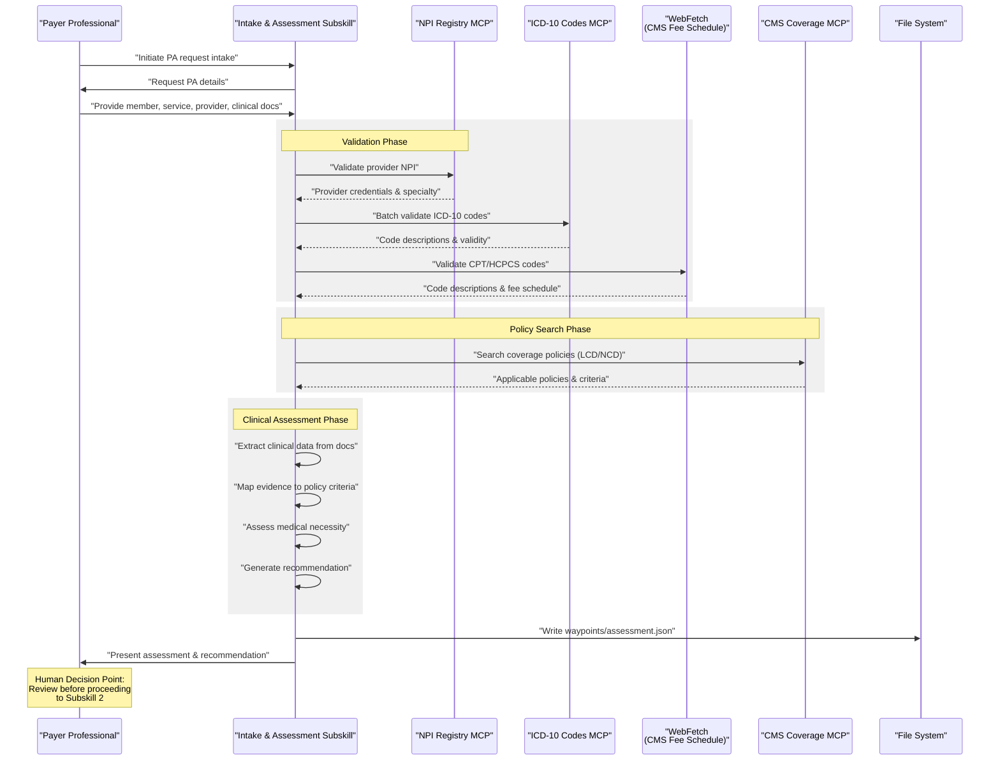
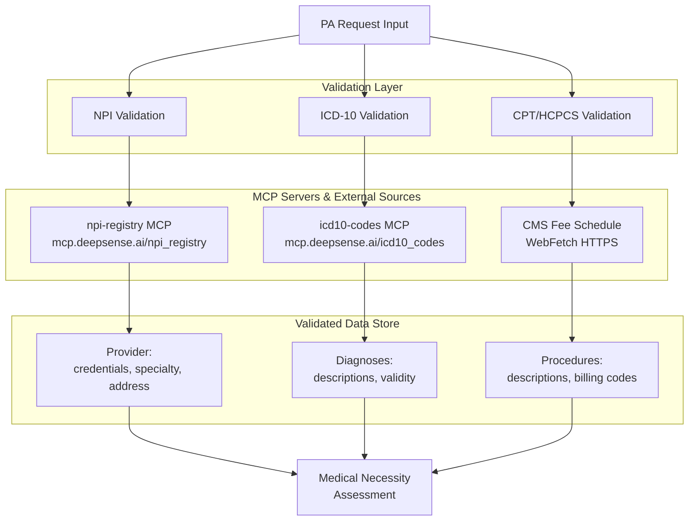
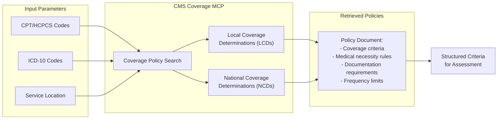
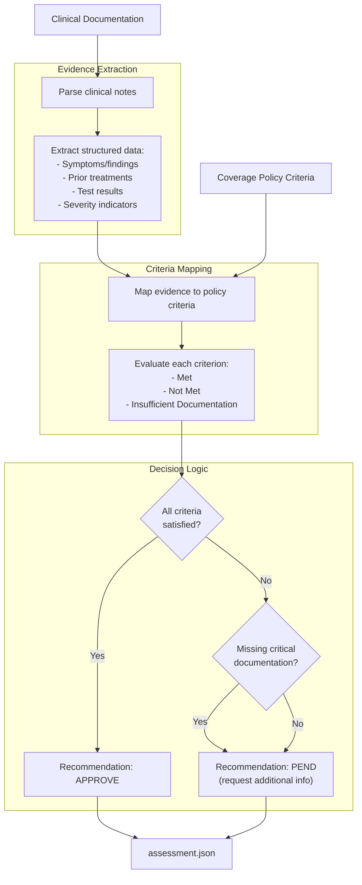
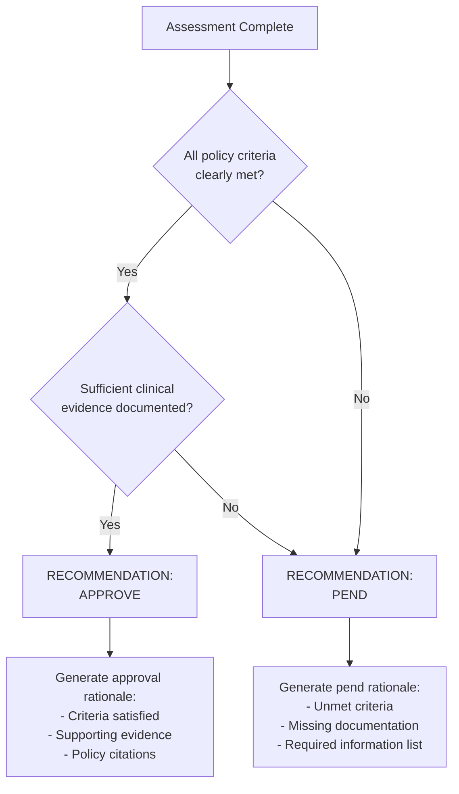
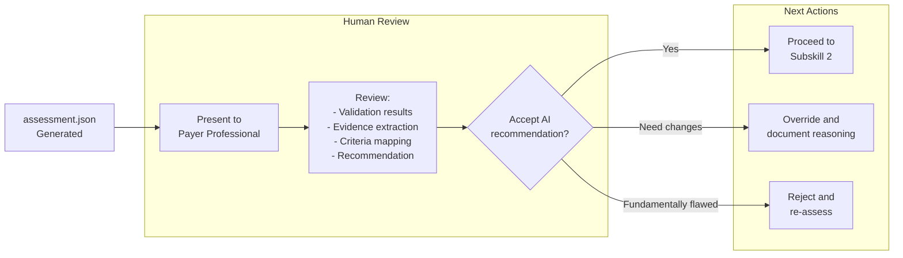

<!-- source: DeepWiki mcp.deepwiki.com · repo anthropics/healthcare · extra page Intake & Assessment Subskill · fetched 2026-10-26 -->

# Intake & Assessment Subskill

<details>
<summary>Relevant source files</summary>

The following files were used as context for generating this wiki page:

- [.github/workflows/release.yml](.github/workflows/release.yml)
- [README.md](README.md)
- [clinical-trial-protocol-skill/README.md](clinical-trial-protocol-skill/README.md)
- [prior-auth-review-skill/README.md](prior-auth-review-skill/README.md)

</details>


## Purpose and Scope

This page documents **Subskill 1: Intake & Assessment** of the Prior Authorization Review skill. This subskill automates the initial intake, validation, and clinical assessment phases of a prior authorization (PA) request workflow for health insurance payers.

The Intake & Assessment subskill collects PA request information, validates all identifiers and codes through external data sources, searches applicable coverage policies, performs medical necessity assessment, and generates a preliminary recommendation. It produces a structured assessment document that requires human review before proceeding to the decision phase.

For information about finalizing the authorization decision and generating provider notifications, see [Decision & Notification Subskill](#3.2.2). For overall context on the Prior Authorization Review skill architecture, see [Prior Authorization Review](#3.2).

**Sources:** [prior-auth-review-skill/README.md:27-45]()

---

## Workflow Overview

The Intake & Assessment subskill follows a sequential validation and analysis pipeline, integrating multiple MCP servers to verify data integrity before performing clinical assessment.

### End-to-End Process Flow



**Sources:** [prior-auth-review-skill/README.md:27-45]()

---

## Input Collection

The subskill collects comprehensive information about the prior authorization request through interactive prompts or file ingestion.

### Required Data Elements

| Category | Data Elements | Purpose |
|----------|---------------|---------|
| **Member Information** | Member ID, Name, Date of Birth, Plan Type | Identify beneficiary and applicable coverage |
| **Service Details** | CPT/HCPCS codes, ICD-10 diagnosis codes, Requested quantity/frequency | Define requested service and medical indication |
| **Provider Information** | NPI number, Name, Specialty, Facility | Validate ordering provider credentials |
| **Clinical Documentation** | Progress notes, test results, prior treatment history | Support medical necessity assessment |

### Sample Data Mode

When processing demonstration cases from `assets/sample/`, the skill operates in a modified mode:

- **NPI Lookup Bypass**: Skips NPI MCP validation for pre-configured sample providers
- **Full MCP Execution**: ICD-10 and CMS Coverage MCPs execute normally
- **Demo Workflow**: Demonstrates complete assessment pipeline with lung biopsy case

**Sources:** [prior-auth-review-skill/README.md:72-78]()

---

## Validation Pipeline

The subskill performs three types of validation using external data sources to ensure data integrity before clinical assessment.

### Validation Architecture



**Sources:** [prior-auth-review-skill/README.md:34-37]()

### Provider Credential Validation

The NPI (National Provider Identifier) validation confirms the requesting provider's credentials and specialty.

**Process:**
1. Extract NPI number from PA request
2. Query NPI Registry MCP via `npi-registry` connector
3. Retrieve provider taxonomy, specialty, practice location
4. Verify provider is authorized to request the service type

**MCP Integration:** Uses the `npi-registry` MCP server (see [NPI Registry](#4.2) for server details)

**Sources:** [prior-auth-review-skill/README.md:34](), [README.md:49]()

### ICD-10 Code Validation

Diagnosis codes are validated in batch mode to ensure they are current and properly formed.

**Process:**
1. Extract all ICD-10 codes from PA request (typically 1-4 codes)
2. Submit batch validation request to ICD-10 MCP
3. Receive code descriptions and validity status
4. Flag any invalid or deprecated codes for manual review

**Batch Processing:** Multiple codes validated in a single MCP call for efficiency

**MCP Integration:** Uses the `icd10-codes` MCP server (see [ICD-10 Codes](#4.4) for server details)

**Sources:** [prior-auth-review-skill/README.md:35]()

### CPT/HCPCS Code Validation

Procedure and service codes are validated against the CMS Fee Schedule via WebFetch.

**Process:**
1. Extract CPT/HCPCS codes from PA request
2. Fetch code definitions from CMS Physician Fee Schedule (HTTPS endpoint)
3. Verify codes are billable and retrieve RVU values
4. Confirm codes match service description

**Data Source:** CMS Physician Fee Schedule (MPFS) published tables

**Sources:** [prior-auth-review-skill/README.md:36]()

---

## Coverage Policy Search

After validation, the subskill searches for applicable Medicare coverage policies that govern the requested service.

### Policy Retrieval Process



**Sources:** [prior-auth-review-skill/README.md:37]()

### Coverage Determination Hierarchy

1. **National Coverage Determinations (NCDs)**: Federal Medicare policies that apply nationwide
2. **Local Coverage Determinations (LCDs)**: MAC-specific policies for particular jurisdictions
3. **Priority**: NCDs take precedence over LCDs when both exist for the same service

**MCP Integration:** Uses the `cms-coverage` MCP server (see [CMS Coverage Database](#4.1) for server details)

**Important Limitation:** Policies retrieved are Medicare LCDs/NCDs only. Commercial payer and Medicare Advantage plan-specific policies may differ and are not applied by this skill.

**Sources:** [prior-auth-review-skill/README.md:25-26]()

---

## Medical Necessity Assessment

The core clinical reasoning phase maps submitted evidence against policy criteria to determine whether the request meets medical necessity standards.

### Assessment Workflow



**Sources:** [prior-auth-review-skill/README.md:38-41]()

### Clinical Evidence Extraction

The subskill extracts structured clinical data from unstructured documentation:

**Extracted Elements:**
- **Clinical Findings**: Symptoms, exam findings, imaging results
- **Prior Treatments**: Medications tried, therapies completed, surgical history
- **Severity Indicators**: Functional impairment, pain scales, quality of life measures
- **Timeline**: Onset, progression, acute vs. chronic status

### Criteria Matching Logic

Each coverage policy criterion is evaluated against extracted evidence:

| Criterion Status | Definition | Example |
|------------------|------------|---------|
| **Met** | Evidence clearly satisfies requirement | "Failed 3 months conservative therapy" documented when policy requires conservative treatment failure |
| **Not Met** | Evidence contradicts or fails to satisfy requirement | No documentation of prior imaging when policy requires it |
| **Insufficient** | Ambiguous or incomplete documentation | Mentions "prior treatment" but doesn't specify type or duration |

**Sources:** [prior-auth-review-skill/README.md:38-39]()

---

## Recommendation Generation

Based on medical necessity assessment, the subskill generates one of two recommendations following a conservative decision logic.

### Decision Logic Behavior



**Sources:** [prior-auth-review-skill/README.md:40-41]()

### AI Decision Constraints

**Default Behavior:** The skill recommends only `APPROVE` or `PEND`, never `DENY`

**Rationale:**
- Conservative approach ensures human review of negative determinations
- Prevents AI from making potentially harmful denial decisions
- Allows payer organization to maintain full control over denials

**Configurability:** Decision logic can be modified in the skill's `rubric.md` file for organization-specific requirements

**Sources:** [prior-auth-review-skill/README.md:23]()

### Recommendation Components

Each recommendation includes:

1. **Decision**: APPROVE or PEND
2. **Rationale**: Detailed explanation linking evidence to policy
3. **Policy Citations**: Specific LCD/NCD sections applied
4. **Evidence Summary**: Key clinical findings that support the decision
5. **Next Steps**: 
   - If APPROVE: Proceed to Subskill 2 for finalization
   - If PEND: List of required additional documentation

**Sources:** [prior-auth-review-skill/README.md:40-41]()

---

## Output Format

The subskill generates a structured JSON assessment document stored in the waypoint directory.

### Assessment Document Structure

**File Path:** `waypoints/assessment.json`

**Document Schema:**

```json
{
  "request_metadata": {
    "member_id": "string",
    "member_name": "string",
    "service_date": "YYYY-MM-DD",
    "requesting_provider_npi": "string"
  },
  "validation_results": {
    "provider": {
      "npi_valid": true,
      "name": "string",
      "specialty": "string"
    },
    "diagnosis_codes": [
      {
        "code": "string",
        "description": "string",
        "valid": true
      }
    ],
    "procedure_codes": [
      {
        "code": "string",
        "description": "string",
        "valid": true
      }
    ]
  },
  "coverage_policies": [
    {
      "policy_type": "LCD | NCD",
      "policy_number": "string",
      "title": "string",
      "criteria": ["array of strings"]
    }
  ],
  "clinical_assessment": {
    "extracted_evidence": {
      "symptoms": ["array of strings"],
      "prior_treatments": ["array of strings"],
      "test_results": ["array of strings"]
    },
    "criteria_evaluation": [
      {
        "criterion": "string",
        "status": "Met | Not Met | Insufficient",
        "evidence": "string"
      }
    ]
  },
  "recommendation": {
    "decision": "APPROVE | PEND",
    "rationale": "string",
    "policy_citations": ["array of strings"],
    "next_steps": "string"
  }
}
```

**Sources:** [prior-auth-review-skill/README.md:43]()

### Waypoint Architecture

The assessment document serves as a **waypoint** in the Prior Authorization workflow:

- **Purpose**: Enable workflow resumption and provide audit trail
- **Persistence**: Stored to disk for recovery from interruptions
- **Handoff**: Consumed by Subskill 2 (Decision & Notification) after human review
- **Audit**: Complete record of validation, evidence, and reasoning

**Sources:** [prior-auth-review-skill/README.md:43]()

---

## Human Decision Point

Upon completion of the assessment, the workflow pauses for mandatory human review before proceeding to the decision phase.

### Review Requirements



**Sources:** [prior-auth-review-skill/README.md:45]()

### Professional Responsibilities

The reviewing professional must:

1. **Verify Validation**: Confirm NPI, ICD-10, and CPT/HCPCS validations are correct
2. **Review Evidence Extraction**: Ensure clinical data was accurately extracted from documentation
3. **Assess Criteria Mapping**: Validate that evidence was correctly mapped to policy criteria
4. **Evaluate Recommendation**: Determine if the APPROVE/PEND recommendation is appropriate
5. **Document Decision**: If overriding, document the professional's reasoning

**No Auto-Approval:** The skill never finalizes a decision autonomously. Human confirmation is always required before proceeding to Subskill 2.

**Sources:** [prior-auth-review-skill/README.md:20-22](), [prior-auth-review-skill/README.md:45]()

---

## Integration with MCP Servers

The Intake & Assessment subskill integrates with three MCP servers and one web data source to perform validation and policy retrieval.

### MCP Dependency Map

| MCP Server | Purpose | API Called | Data Retrieved |
|------------|---------|------------|----------------|
| **NPI Registry** | Provider validation | `npi-registry` MCP | Provider credentials, taxonomy, specialty, location |
| **ICD-10 Codes** | Diagnosis validation | `icd10-codes` MCP (batch mode) | Code descriptions, validity status |
| **CMS Coverage** | Policy search | `cms-coverage` MCP | LCDs, NCDs, coverage criteria |
| **WebFetch** | CPT/HCPCS validation | HTTPS to CMS Fee Schedule | Procedure descriptions, billing codes |

**Installation:** All MCP servers must be installed prior to using this subskill (see [Installation and Usage](#2.2))

**Sources:** [prior-auth-review-skill/README.md:34-37](), [README.md:44-58]()

---

## Error Handling and Edge Cases

The subskill implements defensive error handling for common validation and assessment issues.

### Validation Failures

| Error Condition | Handling Strategy | User Impact |
|-----------------|-------------------|-------------|
| **Invalid NPI** | Flag provider validation failure, allow manual override | Professional must confirm provider manually |
| **Unknown ICD-10 Code** | Flag code as invalid, request clarification | Pend request until valid diagnosis provided |
| **CPT Not in Fee Schedule** | Flag code validation failure | Pend request or manual code verification |
| **No Coverage Policy Found** | Flag missing policy, allow manual policy attachment | Professional must provide policy or approve based on clinical judgment |

### Assessment Edge Cases

- **Incomplete Documentation**: Generates PEND recommendation with specific documentation requests
- **Conflicting Evidence**: Highlights contradictions for professional review
- **Multiple Applicable Policies**: Evaluates all policies, uses most restrictive criteria
- **Experimental/Investigational Services**: Flags for manual review (coverage policies may exclude)

**Sources:** [prior-auth-review-skill/README.md:40-41]()

---

## Summary

The Intake & Assessment subskill automates the data-intensive phases of prior authorization review, performing validation, policy search, and medical necessity assessment to generate a preliminary recommendation. It integrates with NPI Registry, ICD-10 Codes, and CMS Coverage MCP servers to ensure data integrity, then applies clinical reasoning to map evidence against policy criteria. The output is a structured assessment document that requires human review before proceeding to the decision phase in Subskill 2.

**Key Characteristics:**
- **Conservative Decision Logic**: Only recommends APPROVE or PEND, never DENY
- **Multi-Source Validation**: Leverages three MCP servers plus web data
- **Structured Output**: JSON waypoint format enables audit trail and workflow resumption
- **Human Oversight**: Mandatory review gate before decision finalization

**Sources:** [prior-auth-review-skill/README.md:27-45]()

---

