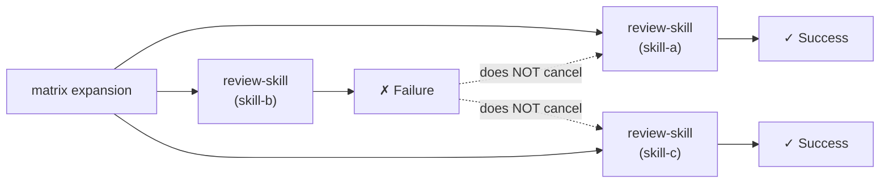
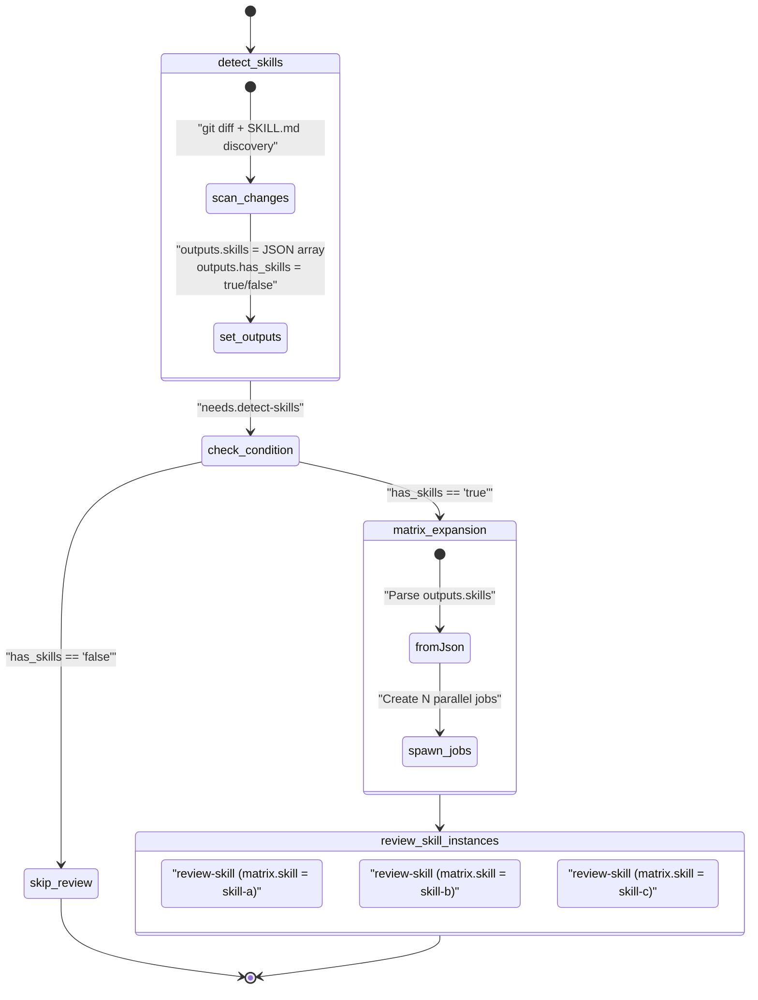
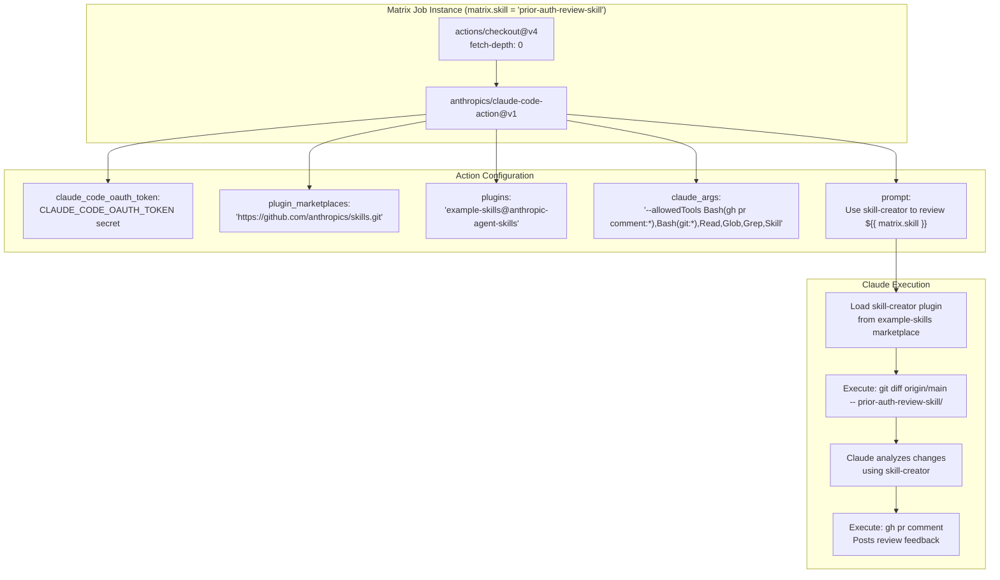
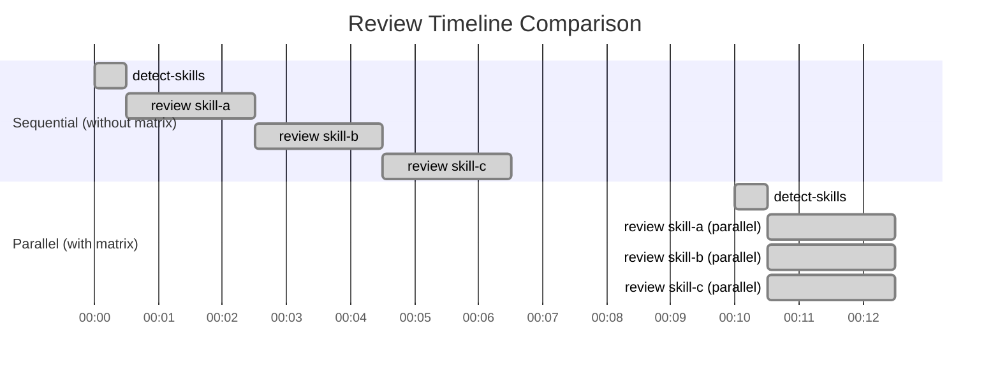

<!-- source: DeepWiki mcp.deepwiki.com · repo anthropics/healthcare · extra page Matrix Review Strategy · fetched 2026-10-26 -->

# Matrix Review Strategy

<details>
<summary>Relevant source files</summary>

The following files were used as context for generating this wiki page:

- [.github/workflows/claude-skill-review.yml](.github/workflows/claude-skill-review.yml)

</details>


## Purpose and Scope

This document explains how the `review-skill` job in the Claude Skill Review workflow uses GitHub Actions matrix strategy to parallelize skill reviews across multiple changed skills. For information about how skills are detected before the matrix strategy runs, see [Skill Detection Algorithm](#5.1.1). For the overall workflow architecture, see [Skill Review Workflow](#5.1).

The matrix strategy enables the workflow to review multiple skills concurrently, scaling from zero to many skill reviews based on what changed in a pull request. Each skill receives an independent Claude-powered review posted as a separate PR comment.

---

## Matrix Strategy Configuration

The `review-skill` job uses GitHub Actions' matrix strategy to dynamically create parallel jobs for each detected skill:

```yaml
strategy:
  matrix:
    skill: ${{ fromJson(needs.detect-skills.outputs.skills) }}
  fail-fast: false
```

**Sources:** [.github/workflows/claude-skill-review.yml:59-62]()

### Dynamic Matrix Population

The matrix is populated from the `detect-skills` job output using the `fromJson()` function:

| Component | Value | Purpose |
|-----------|-------|---------|
| `needs.detect-skills.outputs.skills` | JSON array (e.g., `["clinical-trial-protocol-skill", "prior-auth-review-skill"]`) | List of skill directories with changes |
| `fromJson()` | GitHub Actions function | Converts JSON string to array for matrix expansion |
| `matrix.skill` | Individual skill path | Available as a variable in each matrix job |

The matrix strategy creates one job instance per skill in the array. If the `skills` output is `["skill-a", "skill-b", "skill-c"]`, GitHub Actions spawns three parallel `review-skill` jobs with `matrix.skill` set to `skill-a`, `skill-b`, and `skill-c` respectively.

**Sources:** [.github/workflows/claude-skill-review.yml:60-61]()

### Fail-Fast Disabled

The `fail-fast: false` configuration ensures that all skill reviews complete even if one fails:



**Diagram: Independent Job Execution with fail-fast: false**

Without `fail-fast: false`, a failure in one skill review would cancel all other in-progress reviews. This configuration allows developers to receive feedback on all changed skills, even if one skill has issues.

**Sources:** [.github/workflows/claude-skill-review.yml:62]()

---

## Matrix Expansion and Job Execution

### Job Conditional Logic

The `review-skill` job only runs when skills are detected:

```yaml
review-skill:
  needs: detect-skills
  if: needs.detect-skills.outputs.has_skills == 'true'
```

**Sources:** [.github/workflows/claude-skill-review.yml:55-57]()

This creates a dependency chain:



**Diagram: Conditional Matrix Execution Flow**

**Sources:** [.github/workflows/claude-skill-review.yml:55-57]()

### Concrete Execution Example

Consider a pull request that modifies three files:
- `clinical-trial-protocol-skill/SKILL.md`
- `prior-auth-review-skill/assets/template.md`
- `README.md`

The execution proceeds as follows:

| Step | Job | Action | Output |
|------|-----|--------|--------|
| 1 | `detect-skills` | Runs git diff, finds SKILL.md files | `skills = ["clinical-trial-protocol-skill", "prior-auth-review-skill"]`<br/>`has_skills = "true"` |
| 2 | Matrix expansion | Parses JSON array | Creates 2 job instances |
| 3a | `review-skill` (matrix.skill = clinical-trial-protocol-skill) | Runs Claude review | Posts PR comment for clinical trial skill |
| 3b | `review-skill` (matrix.skill = prior-auth-review-skill) | Runs Claude review | Posts PR comment for prior auth skill |

Steps 3a and 3b execute in parallel. The `README.md` change does not trigger a skill review.

**Sources:** [.github/workflows/claude-skill-review.yml:23-53]()

---

## Claude Code Action Integration

Each matrix job invokes the `anthropics/claude-code-action@v1` with skill-specific parameters:



**Diagram: Claude Code Action Execution Flow per Matrix Job**

**Sources:** [.github/workflows/claude-skill-review.yml:70-87]()

### Action Parameters

The action is configured with the following parameters:

```yaml
- name: Run Claude Skill Review
  uses: anthropics/claude-code-action@v1
  with:
    claude_code_oauth_token: ${{ secrets.CLAUDE_CODE_OAUTH_TOKEN }}
    plugin_marketplaces: 'https://github.com/anthropics/skills.git'
    plugins: 'example-skills@anthropic-agent-skills'
    claude_args: '--allowedTools "Bash(gh pr comment:*),Bash(git:*),Read,Glob,Grep,Skill"'
    prompt: |
      Use the skill-creator skill to review the **${{ matrix.skill }}** skill in PR #${{ github.event.pull_request.number }}.
      
      Use `git diff origin/${{ github.base_ref }} -- ${{ matrix.skill }}/` to see what changed.
      If this is a new skill, provide a full review. If it's changes to an existing skill, focus on the changes.
      
      Post your feedback as a comment using `gh pr comment`. Use the skill title in the header.
```

**Sources:** [.github/workflows/claude-skill-review.yml:75-87]()

| Parameter | Value | Purpose |
|-----------|-------|---------|
| `claude_code_oauth_token` | `${{ secrets.CLAUDE_CODE_OAUTH_TOKEN }}` | Authenticates with Claude API |
| `plugin_marketplaces` | `https://github.com/anthropics/skills.git` | Loads the anthropic-agent-skills marketplace |
| `plugins` | `example-skills@anthropic-agent-skills` | Installs the skill-creator skill |
| `claude_args` | `--allowedTools "Bash(gh pr comment:*),Bash(git:*),Read,Glob,Grep,Skill"` | Grants Claude permission to run git, gh CLI, file operations, and skills |
| `prompt` | Dynamic prompt with `${{ matrix.skill }}` | Instructs Claude to review the specific skill |

### Prompt Template Substitution

The prompt template uses GitHub Actions context variables to customize each matrix job:

- `${{ matrix.skill }}`: Replaced with the skill directory (e.g., `clinical-trial-protocol-skill`)
- `${{ github.event.pull_request.number }}`: The PR number being reviewed
- `${{ github.base_ref }}`: The base branch (typically `main`)

For a matrix job reviewing `prior-auth-review-skill` in PR #42 against the `main` branch, the prompt becomes:

```
Use the skill-creator skill to review the **prior-auth-review-skill** skill in PR #42.

Use `git diff origin/main -- prior-auth-review-skill/` to see what changed.
If this is a new skill, provide a full review. If it's changes to an existing skill, focus on the changes.

Post your feedback as a comment using `gh pr comment`. Use the skill title in the header.
```

**Sources:** [.github/workflows/claude-skill-review.yml:82-87]()

---

## Permissions and Security

The `review-skill` job requires specific GitHub permissions to interact with the repository and pull request:

```yaml
permissions:
  contents: read
  pull-requests: write
  issues: write
  id-token: write
```

**Sources:** [.github/workflows/claude-skill-review.yml:63-67]()

| Permission | Scope | Usage |
|------------|-------|-------|
| `contents: read` | Repository files | Checkout code, read SKILL.md files, run git diff |
| `pull-requests: write` | PR comments | Post skill review feedback via `gh pr comment` |
| `issues: write` | Issue comments | Required for PR commenting (PRs are a type of issue) |
| `id-token: write` | OIDC tokens | Enable GitHub Actions OIDC authentication if needed by the action |

### Security Boundary

The `claude_args` parameter restricts which tools Claude can invoke:

```
--allowedTools "Bash(gh pr comment:*),Bash(git:*),Read,Glob,Grep,Skill"
```

This whitelist ensures Claude can only:
- Run `gh pr comment` commands (post PR comments)
- Run `git` commands (analyze changes)
- Read files (`Read`, `Glob`, `Grep`)
- Use skills (`Skill`)

Claude cannot execute arbitrary bash commands, modify files, or push commits.

**Sources:** [.github/workflows/claude-skill-review.yml:81]()

---

## Parallel Review Timeline

When multiple skills change in a single PR, the matrix strategy significantly reduces review time:



**Diagram: Sequential vs Parallel Review Timeline**

In this example:
- **Sequential approach**: 6 minutes 30 seconds total (detect + 3 × 2-minute reviews)
- **Matrix approach**: 2 minutes 30 seconds total (detect + 2-minute longest review)

The actual time savings depend on the number of skills and GitHub Actions runner availability.

**Sources:** [.github/workflows/claude-skill-review.yml:59-62]()

---

## Matrix Strategy Code Reference

The complete matrix strategy configuration appears in the workflow file:

```yaml
review-skill:
  needs: detect-skills
  if: needs.detect-skills.outputs.has_skills == 'true'
  runs-on: ubuntu-latest
  strategy:
    matrix:
      skill: ${{ fromJson(needs.detect-skills.outputs.skills) }}
    fail-fast: false
  permissions:
    contents: read
    pull-requests: write
    issues: write
    id-token: write
  
  steps:
    - name: Checkout repository
      uses: actions/checkout@v4
      with:
        fetch-depth: 0
    
    - name: Run Claude Skill Review
      uses: anthropics/claude-code-action@v1
      with:
        claude_code_oauth_token: ${{ secrets.CLAUDE_CODE_OAUTH_TOKEN }}
        plugin_marketplaces: 'https://github.com/anthropics/skills.git'
        plugins: 'example-skills@anthropic-agent-skills'
        claude_args: '--allowedTools "Bash(gh pr comment:*),Bash(git:*),Read,Glob,Grep,Skill"'
        prompt: |
          Use the skill-creator skill to review the **${{ matrix.skill }}** skill in PR #${{ github.event.pull_request.number }}.
          
          Use `git diff origin/${{ github.base_ref }} -- ${{ matrix.skill }}/` to see what changed.
          If this is a new skill, provide a full review. If it's changes to an existing skill, focus on the changes.
          
          Post your feedback as a comment using `gh pr comment`. Use the skill title in the header.
```

**Sources:** [.github/workflows/claude-skill-review.yml:55-88]()

---

## Summary

The matrix review strategy enables scalable, parallel skill reviews:

1. **Dynamic Matrix**: Populated from `detect-skills` job output via `fromJson()`
2. **Parallel Execution**: Each skill reviewed independently in a separate job
3. **Fail-Safe**: `fail-fast: false` ensures all reviews complete
4. **Scoped Reviews**: Each matrix job receives a skill-specific prompt using `matrix.skill`
5. **Security**: Restricted permissions and tool allowlist prevent unauthorized actions

This architecture allows the workflow to scale from zero to many skill reviews without manual configuration, providing automated quality feedback for every skill change.

**Sources:** [.github/workflows/claude-skill-review.yml:55-88]()

---

