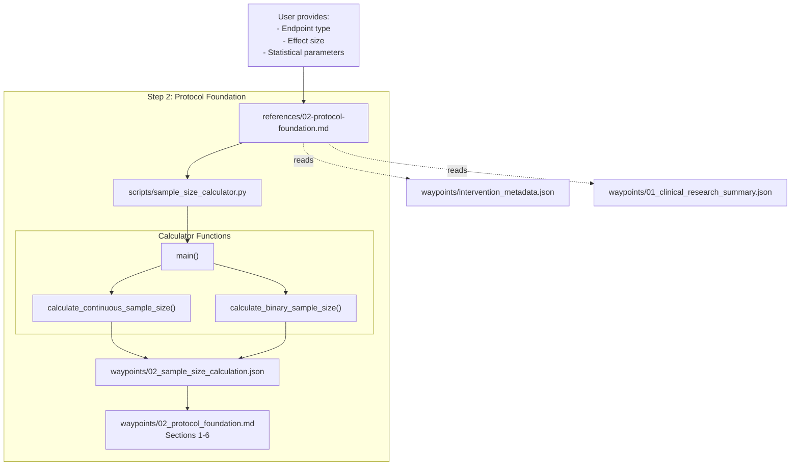
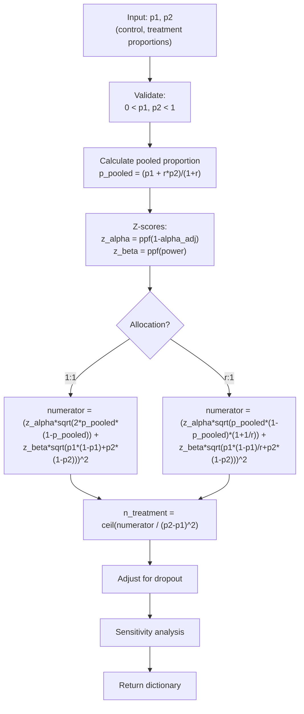
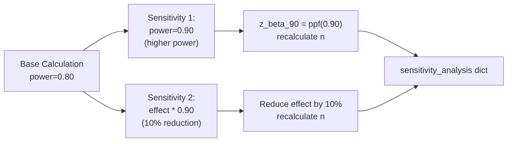
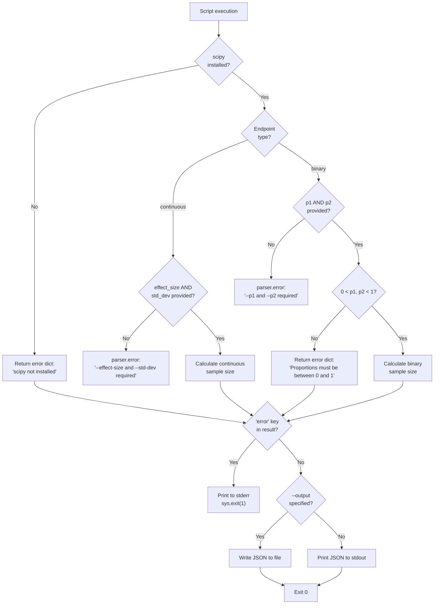

<!-- source: DeepWiki mcp.deepwiki.com · repo anthropics/healthcare · extra page Sample Size Calculator · fetched 2026-10-26 -->

# Sample Size Calculator

<details>
<summary>Relevant source files</summary>

The following files were used as context for generating this wiki page:

- [clinical-trial-protocol-skill/README.md](clinical-trial-protocol-skill/README.md)
- [clinical-trial-protocol-skill/SKILL.md](clinical-trial-protocol-skill/SKILL.md)
- [clinical-trial-protocol-skill/scripts/sample_size_calculator.py](clinical-trial-protocol-skill/scripts/sample_size_calculator.py)
- [prior-auth-review-skill/README.md](prior-auth-review-skill/README.md)

</details>


## Purpose and Scope

This document describes the `sample_size_calculator.py` script, a statistical power analysis tool that calculates sample sizes for clinical trial protocols. The calculator supports both continuous and binary primary endpoints using validated statistical methods.

For information about the overall Clinical Trial Protocol Generator workflow, see [Clinical Trial Protocol Generator](#3.1). For details on how the calculator integrates into the protocol generation steps, see [Workflow Steps and Waypoints](#3.1.1).

**Sources:** [clinical-trial-protocol-skill/README.md:1-55](), [clinical-trial-protocol-skill/SKILL.md:1-85]()

---

## Overview

The sample size calculator is a standalone Python utility that performs statistical power calculations to determine the number of participants needed for a clinical trial. It is invoked during Step 2 (Protocol Foundation) of the Clinical Trial Protocol Generator workflow.

**Key Capabilities:**
- Two-sample t-test calculations for continuous endpoints
- Two-proportion z-test calculations for binary endpoints
- Support for superiority and non-inferiority study designs
- Unequal allocation ratio support (e.g., 2:1 treatment:control)
- Dropout rate adjustment
- Sensitivity analysis (90% power and 10% effect size reduction)

**Dependencies:**
- `scipy >= 1.11.0` - Statistical distributions and calculations
- `numpy >= 1.24.0` - Numerical operations

**Sources:** [clinical-trial-protocol-skill/scripts/sample_size_calculator.py:1-15](), [clinical-trial-protocol-skill/README.md:46-51]()

---

## Integration with Clinical Trial Protocol Workflow

The calculator is invoked during Step 2 of the waypoint-based protocol generation workflow. Results are stored in `waypoints/02_sample_size_calculation.json` for use in protocol sections.



**Workflow Integration Details:**

| Aspect | Description |
|--------|-------------|
| **Execution Point** | Step 2 - Protocol Foundation generation |
| **Input Source** | Interactive user prompts during protocol development |
| **Output Location** | `waypoints/02_sample_size_calculation.json` |
| **Referenced By** | Protocol Sections 3 (Study Design), 9 (Statistical Analysis) |
| **Resumable** | Yes - calculation results persist in waypoint file |

**Sources:** [clinical-trial-protocol-skill/SKILL.md:46-60](), [clinical-trial-protocol-skill/README.md:36-44]()

---

## Calculation Methods

### Continuous Endpoints

The `calculate_continuous_sample_size()` function implements two-sample t-test power calculations for continuous outcomes (e.g., blood pressure change, tumor size reduction).

```mermaid
graph LR
    Input["Input Parameters"] --> Validate["Validate scipy<br/>availability"]
    
    Validate --> CalcD["Calculate Cohen's d<br/>d = effect_size / std_dev"]
    
    CalcD --> Sidedness{"Study Design?"}
    Sidedness -->|superiority| TwoSided["alpha_adj = alpha/2<br/>Two-sided test"]
    Sidedness -->|"non-inferiority"| OneSided["alpha_adj = alpha<br/>One-sided test"]
    
    TwoSided --> ZScores["Calculate Z-scores<br/>z_alpha = ppf(1-alpha_adj)<br/>z_beta = ppf(power)"]
    OneSided --> ZScores
    
    ZScores --> SampleCalc["n = 2*(z_alpha+z_beta)^2 / d^2<br/>(or adjusted for allocation)"]
    
    SampleCalc --> Dropout["Adjust for dropout<br/>n_total = n / (1-dropout_rate)"]
    
    Dropout --> Sensitivity["Sensitivity analysis:<br/>- 90% power<br/>- 10% reduced effect"]
    
    Sensitivity --> Result["Return dictionary<br/>with sample sizes"]
```



**Formula Implementation:**

For equal allocation (1:1):
```
n_per_arm = 2 * (z_alpha + z_beta)² / d²
```

For unequal allocation (r:1):
```
n_per_arm = ((1 + 1/r)² * (z_alpha + z_beta)²) / d²
```

Where:
- `d` = Cohen's d effect size (effect_size / std_dev)
- `z_alpha` = Z-score for Type I error rate
- `z_beta` = Z-score for power (1 - Type II error)
- `r` = allocation_ratio (treatment:control)

**Sources:** [clinical-trial-protocol-skill/scripts/sample_size_calculator.py:16-161]()

---

### Binary Endpoints

The `calculate_binary_sample_size()` function implements two-proportion z-test power calculations for binary outcomes (e.g., response rate, event occurrence).



**Formula Implementation:**

For equal allocation:
```
numerator = [z_alpha * sqrt(2*p_pooled*(1-p_pooled)) + 
             z_beta * sqrt(p1*(1-p1) + p2*(1-p2))]²
n_treatment = numerator / (p2 - p1)²
```

For unequal allocation:
```
numerator = [z_alpha * sqrt(p_pooled*(1-p_pooled)*(1+1/r)) + 
             z_beta * sqrt(p1*(1-p1)/r + p2*(1-p2))]²
n_treatment = numerator / (p2 - p1)²
```

**Sources:** [clinical-trial-protocol-skill/scripts/sample_size_calculator.py:164-321]()

---

## Input Parameters

### Command-Line Interface

The calculator accepts parameters via command-line arguments through the `argparse` interface defined in `main()`.

**Common Parameters (Both Endpoint Types):**

| Parameter | Type | Default | Description |
|-----------|------|---------|-------------|
| `--type` | choice | *required* | Endpoint type: `"continuous"` or `"binary"` |
| `--alpha` | float | 0.05 | Type I error rate (significance level) |
| `--power` | float | 0.80 | Statistical power (1 - Type II error) |
| `--dropout` | float | 0.15 | Expected dropout rate (15%) |
| `--allocation` | float | 1.0 | Allocation ratio treatment:control (1.0 = equal) |
| `--design` | choice | "superiority" | Study design: `"superiority"` or `"non-inferiority"` |
| `--output` | str | None | Output JSON file path (stdout if not specified) |

**Continuous Endpoint Parameters:**

| Parameter | Type | Required | Description |
|-----------|------|----------|-------------|
| `--effect-size` | float | Yes | Expected mean difference between groups |
| `--std-dev` | float | Yes | Standard deviation (pooled or common) |

**Binary Endpoint Parameters:**

| Parameter | Type | Required | Description |
|-----------|------|----------|-------------|
| `--p1` | float | Yes | Expected proportion in control group (0 < p1 < 1) |
| `--p2` | float | Yes | Expected proportion in treatment group (0 < p2 < 1) |

**Sources:** [clinical-trial-protocol-skill/scripts/sample_size_calculator.py:324-410]()

---

## Output Format

Both calculation functions return a structured dictionary with comprehensive results and metadata. The output is serialized to JSON format.

### Continuous Endpoint Output Structure

```json
{
  "endpoint_type": "continuous",
  "study_design": "superiority",
  "statistical_test": "Two-sample t-test (two-sided)",
  "effect_size": 5.0,
  "standard_deviation": 15.0,
  "cohens_d": 0.333,
  "alpha": 0.05,
  "power": 0.80,
  "allocation_ratio": "1:1",
  "dropout_rate": 0.15,
  "sample_size": {
    "treatment_arm": 142,
    "control_arm": 142,
    "total": 284,
    "total_with_dropout": 334,
    "treatment_with_dropout": 167,
    "control_with_dropout": 167
  },
  "sensitivity_analysis": {
    "power_90_percent": {
      "total": 380,
      "total_with_dropout": 448
    },
    "effect_size_reduced_10_percent": {
      "total": 350,
      "total_with_dropout": 412
    }
  },
  "assumptions": [...],
  "disclaimers": [...]
}
```

**Sources:** [clinical-trial-protocol-skill/scripts/sample_size_calculator.py:120-161]()

---

### Binary Endpoint Output Structure

```json
{
  "endpoint_type": "binary",
  "study_design": "superiority",
  "statistical_test": "Two-proportion z-test (two-sided)",
  "control_proportion": 0.60,
  "treatment_proportion": 0.75,
  "effect_size": 0.15,
  "alpha": 0.05,
  "power": 0.80,
  "allocation_ratio": "1:1",
  "dropout_rate": 0.15,
  "sample_size": {
    "treatment_arm": 146,
    "control_arm": 146,
    "total": 292,
    "total_with_dropout": 344,
    "treatment_with_dropout": 172,
    "control_with_dropout": 172
  },
  "sensitivity_analysis": {...},
  "assumptions": [...],
  "disclaimers": [...]
}
```

**Key Output Fields:**

| Field | Description |
|-------|-------------|
| `sample_size.total` | Total sample size needed (before dropout adjustment) |
| `sample_size.total_with_dropout` | Total sample size adjusted for expected dropout |
| `sample_size.treatment_arm` | Participants needed in treatment arm |
| `sample_size.control_arm` | Participants needed in control arm |
| `sensitivity_analysis.power_90_percent` | Sample size for 90% power (vs. default 80%) |
| `sensitivity_analysis.effect_size_reduced_10_percent` | Sample size if effect is 10% smaller |
| `assumptions` | List of statistical assumptions made |
| `disclaimers` | Professional review requirements |

**Sources:** [clinical-trial-protocol-skill/scripts/sample_size_calculator.py:280-321]()

---

## Usage Examples

### Example 1: Continuous Endpoint (Blood Pressure Reduction)

Calculate sample size for a device that reduces systolic blood pressure by 5 mmHg on average, with a standard deviation of 15 mmHg.

```bash
python scripts/sample_size_calculator.py \
  --type continuous \
  --effect-size 5.0 \
  --std-dev 15.0 \
  --alpha 0.05 \
  --power 0.80 \
  --dropout 0.15 \
  --output waypoints/02_sample_size_calculation.json
```

**Expected Output:** ~334 total participants (167 per arm with 15% dropout)

---

### Example 2: Binary Endpoint (Response Rate)

Calculate sample size for a drug expected to increase response rate from 60% (control) to 75% (treatment).

```bash
python scripts/sample_size_calculator.py \
  --type binary \
  --p1 0.60 \
  --p2 0.75 \
  --alpha 0.05 \
  --power 0.80 \
  --dropout 0.15
```

**Expected Output:** ~344 total participants (172 per arm with 15% dropout)

---

### Example 3: Unequal Allocation (2:1 Ratio)

Calculate sample size with 2:1 allocation favoring treatment arm (common in Phase 2 trials).

```bash
python scripts/sample_size_calculator.py \
  --type continuous \
  --effect-size 5.0 \
  --std-dev 15.0 \
  --allocation 2.0 \
  --power 0.80 \
  --dropout 0.15
```

**Expected Output:** Different sample sizes for treatment vs. control arms

**Sources:** [clinical-trial-protocol-skill/scripts/sample_size_calculator.py:328-339]()

---

## Statistical Foundations

### Two-Sample T-Test (Continuous Endpoints)

The calculator implements the standard power calculation formula for comparing two means:

**Statistical Test:** Two-sample t-test with equal variances assumption

**Effect Size Metric:** Cohen's d
```
d = (μ₁ - μ₂) / σ
```

Where:
- μ₁, μ₂ = population means for treatment and control
- σ = pooled standard deviation

**Sample Size Formula:**
```
n = 2 * (z_α + z_β)² / d²
```

**Assumptions:**
- Normally distributed continuous outcome
- Equal variances between groups
- Independent observations
- Effect size is clinically meaningful and realistic

**Implementation:** [clinical-trial-protocol-skill/scripts/sample_size_calculator.py:49-76]()

---

### Two-Proportion Z-Test (Binary Endpoints)

The calculator implements power calculations for comparing two proportions.

**Statistical Test:** Two-proportion z-test using normal approximation

**Effect Size:** Absolute difference in proportions
```
Δ = p₂ - p₁
```

**Pooled Proportion:**
```
p_pooled = (p₁ + r*p₂) / (1 + r)
```

**Sample Size Formula:**
```
numerator = [z_α * sqrt(p_pooled*(1-p_pooled)*(1+1/r)) + 
             z_β * sqrt(p₁*(1-p₁)/r + p₂*(1-p₂))]²
n_treatment = numerator / (p₂ - p₁)²
```

**Assumptions:**
- Binary outcome (success/failure, event/no event)
- Independent observations
- Large enough sample for normal approximation (n*p > 5 and n*(1-p) > 5)
- Effect size is clinically meaningful and realistic

**Implementation:** [clinical-trial-protocol-skill/scripts/sample_size_calculator.py:210-239]()

---

## Sensitivity Analysis

Both calculation functions include two sensitivity analyses to help assess robustness of sample size estimates.



**Sensitivity 1: Higher Power (90%)**
- Rationale: Assess sample size needed for greater statistical power
- Typical Use: Conservative planning or high-stakes trials
- Implementation: [clinical-trial-protocol-skill/scripts/sample_size_calculator.py:93-104]()

**Sensitivity 2: Effect Size Reduced by 10%**
- Rationale: Assess robustness if true effect is smaller than expected
- Typical Use: Account for optimistic effect size estimates
- Implementation: [clinical-trial-protocol-skill/scripts/sample_size_calculator.py:107-118]()

**Sources:** [clinical-trial-protocol-skill/scripts/sample_size_calculator.py:93-118](), [clinical-trial-protocol-skill/scripts/sample_size_calculator.py:246-278]()

---

## Dropout Rate Adjustment

All sample size calculations include adjustment for expected participant dropout.

**Formula:**
```
n_with_dropout = ceil(n_calculated / (1 - dropout_rate))
```

**Default Dropout Rate:** 15% (0.15)

**Rationale:** Clinical trials typically experience participant dropout due to:
- Loss to follow-up
- Withdrawal of consent
- Protocol violations
- Adverse events
- Death (in long-term studies)

**Application:** Dropout adjustment is applied to:
- Total sample size
- Treatment arm sample size
- Control arm sample size
- All sensitivity analysis results

**Example:**
```
Base calculation: 284 participants needed
Dropout rate: 15%
Adjusted sample size: 284 / (1 - 0.15) = 334 participants
```

**Implementation:** [clinical-trial-protocol-skill/scripts/sample_size_calculator.py:88-90](), [clinical-trial-protocol-skill/scripts/sample_size_calculator.py:242-244]()

---

## Error Handling

The calculator implements robust error handling for common issues.



**Error Conditions:**

| Condition | Error Message | Exit Code |
|-----------|---------------|-----------|
| `scipy` not installed | "scipy not installed. Run: pip install scipy statsmodels numpy" | 1 |
| Missing required args (continuous) | "--effect-size and --std-dev required for continuous endpoints" | 2 |
| Missing required args (binary) | "--p1 and --p2 required for binary endpoints" | 2 |
| Invalid proportions | "Proportions must be between 0 and 1 (exclusive)" | 1 |

**Sources:** [clinical-trial-protocol-skill/scripts/sample_size_calculator.py:42-47](), [clinical-trial-protocol-skill/scripts/sample_size_calculator.py:197-199](), [clinical-trial-protocol-skill/scripts/sample_size_calculator.py:410-444]()

---

## Validation and Disclaimers

The calculator output includes standardized assumptions and disclaimers emphasizing the preliminary nature of calculations.

**Assumptions Array:**

For continuous endpoints:
- Normally distributed continuous outcome
- Equal variances between groups
- Independent observations
- Effect size is clinically meaningful and realistic

For binary endpoints:
- Binary outcome (success/failure, event/no event)
- Independent observations
- Large enough sample for normal approximation
- Effect size is clinically meaningful and realistic

**Disclaimers Array:**
- Sample size calculation is preliminary and based on assumptions
- Final sample size requires biostatistician review and validation
- FDA Pre-Submission meeting may require adjustments
- Consider pilot study to validate assumptions

**Regulatory Context:**

Sample size calculations generated by this tool are **preliminary estimates only**. Before proceeding with a clinical trial, the following professional reviews are required:

1. **Biostatistician Review:** Independent validation of sample size, power calculations, and statistical methods
2. **FDA Pre-Submission Meeting:** Q-Submission (devices) or Pre-IND (drugs) to discuss study design and sample size
3. **IRB Review:** Institutional Review Board assessment of risk/benefit ratio relative to sample size
4. **Regulatory Consultant:** Specialized expertise for specific indication and regulatory pathway

**Sources:** [clinical-trial-protocol-skill/scripts/sample_size_calculator.py:149-160](), [clinical-trial-protocol-skill/scripts/sample_size_calculator.py:309-320](), [clinical-trial-protocol-skill/README.md:27-34]()

---

## Code Entity Reference

**Primary Functions:**

| Function | Lines | Purpose |
|----------|-------|---------|
| `calculate_continuous_sample_size()` | [clinical-trial-protocol-skill/scripts/sample_size_calculator.py:16-161]() | Two-sample t-test power calculation |
| `calculate_binary_sample_size()` | [clinical-trial-protocol-skill/scripts/sample_size_calculator.py:164-321]() | Two-proportion z-test power calculation |
| `main()` | [clinical-trial-protocol-skill/scripts/sample_size_calculator.py:324-458]() | CLI argument parsing and execution |

**Key Dependencies:**

| Module | Usage |
|--------|-------|
| `scipy.stats` | `norm.ppf()` for Z-score calculations |
| `math` | `ceil()` for rounding up sample sizes, `sqrt()` for variance calculations |
| `argparse` | Command-line interface |
| `json` | Output serialization |

**Sources:** [clinical-trial-protocol-skill/scripts/sample_size_calculator.py:1-458]()

---

