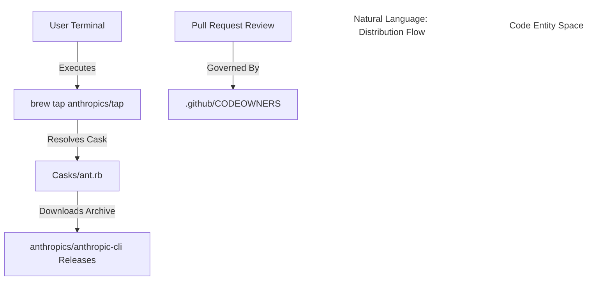
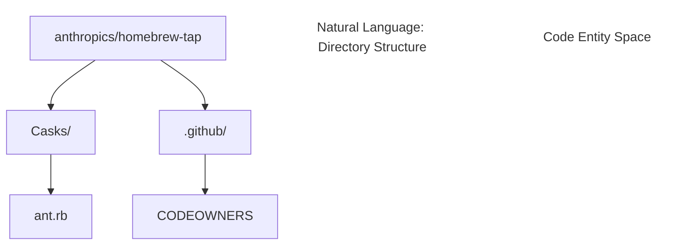

<!-- source: DeepWiki mcp.deepwiki.com · repo anthropics/homebrew-tap · page 1 Overview · fetched 2026-10-26 -->

# Overview

Relevant source files

The following files were used as context for generating this wiki page:

- [.github/CODEOWNERS](.github/CODEOWNERS)
- [Casks/ant.rb](Casks/ant.rb)

The `anthropics/homebrew-tap` repository is the official Homebrew tap for distributing the `ant` command-line interface, which provides developer tooling and access to the Claude Platform [Casks/ant.rb:28](). This repository acts as a bridge between upstream releases of the `anthropics/anthropic-cli` project and local developer environments via the Homebrew package manager. 

As a parent page, this document outlines the high-level architecture of the tap repository, user installation pathways, and the repository layout. For deeper technical specifics, refer to the child pages linked throughout this document.

*Sources: [Casks/ant.rb:1-43](), [.github/CODEOWNERS:1-6]()*

---

## 1.1. Installing the ant CLI

Users interact with this tap to install, update, and manage the `ant` binary on supported macOS and Linux environments. The installation workflow relies on standard Homebrew mechanics: tapping the repository and installing the managed cask [Casks/ant.rb:2-43]().

For detailed user guides, platform compatibility matrices (Intel vs. Apple Silicon, Linux `amd64`/`arm64`), verification of installed binaries, manpages, and shell completions (`bash`, `fish`, `zsh`), see [Installing the ant CLI](#1.1).

*Sources: [Casks/ant.rb:2-43]()*

---

## 1.2. Repository Layout

The repository maintains a minimal and structured layout designed specifically for automated cask generation and supply-chain security governance. It contains two primary structural components:

- `Casks/`: Houses the Homebrew cask definitions, specifically `Casks/ant.rb`, which dictates download URLs, cryptographic checksums (`sha256`), and post-install artifacts [Casks/ant.rb:1-43]().
- `.github/`: Contains automation workflows and governance configurations, including `.github/CODEOWNERS`, which enforces required code reviews from `@anthropics/sdk` [.github/CODEOWNERS:1-6]().

For detailed breakdowns of each directory's internal composition and operational mechanics, see [Repository Layout](#1.2).

*Sources: [Casks/ant.rb:1-43](), [.github/CODEOWNERS:1-6]()*

---

