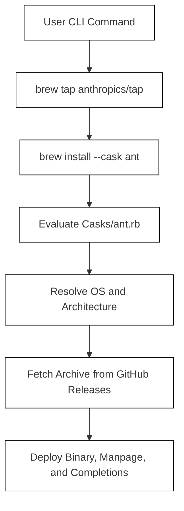
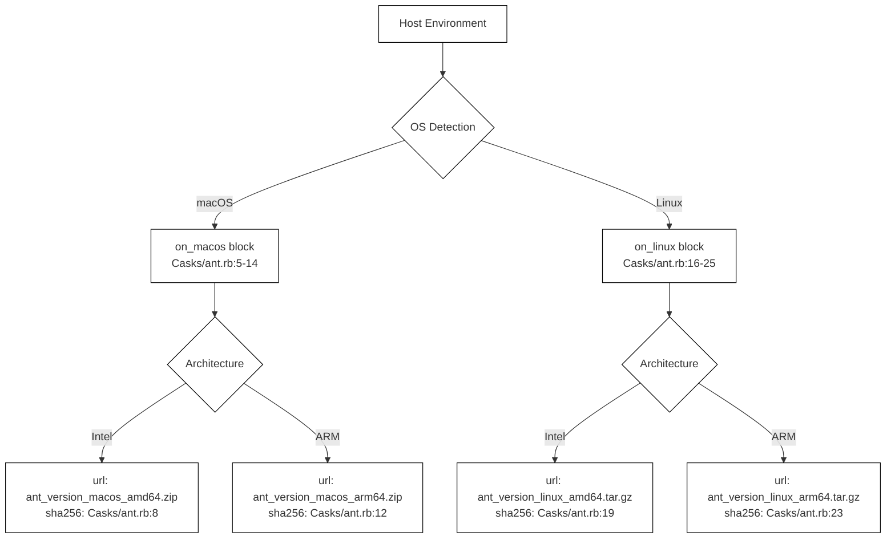

<!-- source: DeepWiki mcp.deepwiki.com · repo anthropics/homebrew-tap · page 1.1 Installing the ant CLI · fetched 2026-10-26 -->

# Installing the ant CLI

<details>
<summary>Relevant source files</summary>

The following files were used as context for generating this wiki page:

- [Casks/ant.rb](Casks/ant.rb)

</details>


## Purpose and Scope

This document serves as the technical user-facing guide for installing the `ant` command-line interface for the Claude Platform using Homebrew. It outlines the installation commands, the underlying platform and architecture resolution performed by `Casks/ant.rb`, and the specific artifacts deployed to the host environment.

Sources: [Casks/ant.rb:1-43]()

---

## Installation Commands

To install the `ant` CLI on a supported workstation, users execute standard Homebrew tap and cask installation commands. Homebrew fetches the cask definition from `anthropics/homebrew-tap` and evaluates the platform stanzas defined in `Casks/ant.rb`.

```bash
# Add the Anthropics Homebrew tap
brew tap anthropics/tap

# Install the ant CLI cask
brew install --cask ant
```

### Installation Flow Diagram

Title: "Homebrew Installation Data Flow to Cask Definition"



Sources: [Casks/ant.rb:1-43]()

---

## Supported Platforms and Architecture Resolution

During the execution of `brew install --cask ant`, Homebrew inspects the host operating system and CPU architecture, matching them against conditional blocks declared in `Casks/ant.rb`. The cask supports macOS and Linux across both Intel (`amd64`) and ARM (`arm64`) architectures.

| Operating System | Architecture | Archive Format | Download URL Pattern |
|------------------|--------------|----------------|----------------------|
| macOS (`on_macos`) | Intel (`on_intel`) | `.zip` | `https://github.com/anthropics/anthropic-cli/releases/download/v#{version}/ant_#{version}_macos_amd64.zip` [Casks/ant.rb:5-9]() |
| macOS (`on_macos`) | ARM (`on_arm`) | `.zip` | `https://github.com/anthropics/anthropic-cli/releases/download/v#{version}/ant_#{version}_macos_arm64.zip` [Casks/ant.rb:10-14]() |
| Linux (`on_linux`) | Intel (`on_intel`) | `.tar.gz` | `https://github.com/anthropics/anthropic-cli/releases/download/v#{version}/ant_#{version}_linux_amd64.tar.gz` [Casks/ant.rb:16-20]() |
| Linux (`on_linux`) | ARM (`on_arm`) | `.tar.gz` | `https://github.com/anthropics/anthropic-cli/releases/download/v#{version}/ant_#{version}_linux_arm64.tar.gz` [Casks/ant.rb:21-25]() |

Each download path is verified cryptographically using the associated `sha256` checksum hardcoded in the respective block [Casks/ant.rb:8-23]().

### Platform Resolution Architecture

Title: "Cask Platform and Architecture Mapping"



Sources: [Casks/ant.rb:1-25]()

---

## Installed Artifacts

Once the correct archive is downloaded and extracted, Homebrew links and installs specific system artifacts defined in `Casks/ant.rb`:

1. **Binary**: The primary executable `ant` is installed into the Homebrew prefix bin path [Casks/ant.rb:35-35]().
2. **Manpage**: The compressed manual page `ant.1.gz` is installed into the manual page hierarchy [Casks/ant.rb:36-36]().
3. **Shell Completions**: Native auto-completions are provisioned for three major shells [Casks/ant.rb:37-39]():
   - Bash: `completions/ant.bash` [Casks/ant.rb:37-37]()
   - Fish: `completions/ant.fish` [Casks/ant.rb:38-38]()
   - Zsh: `completions/ant.zsh` [Casks/ant.rb:39-39]()

Sources: [Casks/ant.rb:35-40]()

---

