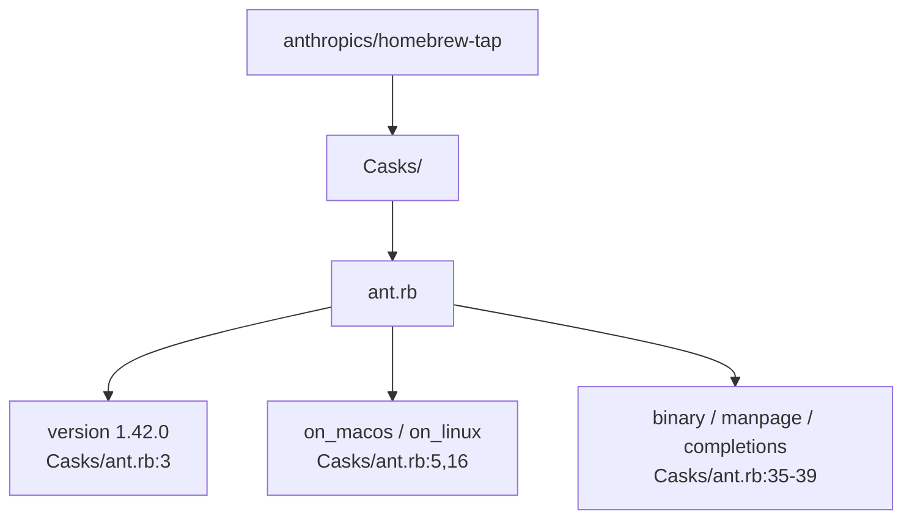
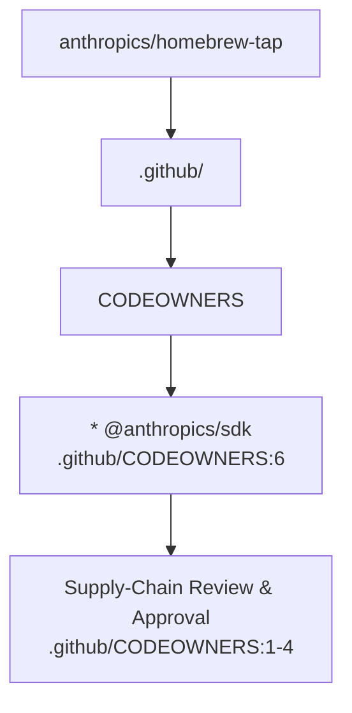

<!-- source: DeepWiki mcp.deepwiki.com · repo anthropics/homebrew-tap · page 1.2 Repository Layout · fetched 2026-10-26 -->

# Repository Layout

Relevant source files

The following files were used as context for generating this wiki page:

- [.github/CODEOWNERS](.github/CODEOWNERS)
- [Casks/ant.rb](Casks/ant.rb)

The `anthropics/homebrew-tap` repository utilizes a minimal, specialized directory structure tailored for Homebrew taps and automated release publishing via GoReleaser. The repository layout is partitioned into two functional directories: `Casks/`, which stores the Homebrew cask definitions for the `ant` CLI, and `.github/`, which houses repository governance and security policies.

Sources: [Casks/ant.rb:1-43](), [.github/CODEOWNERS:1-6]()

---

## The `Casks/` Directory

The `Casks/` directory contains Ruby-based Homebrew cask definition files. Casks instruct Homebrew on how to download, verify, install, and manage binary applications outside of traditional formula packages.

* **`Casks/ant.rb`**: The primary cask definition for the `ant` CLI [Casks/ant.rb:2-43](). It defines architecture-specific download URLs and SHA-256 checksums for macOS and Linux [Casks/ant.rb:5-25](), binary deployment paths [Casks/ant.rb:35](), manpages [Casks/ant.rb:36](), and shell completions [Casks/ant.rb:37-39](). 

Because this file is automatically generated by the upstream release pipeline, it includes an explicit warning comment disallowing manual edits [Casks/ant.rb:1]().

Sources: [Casks/ant.rb:1-43]()

---

## The `.github/` Directory

The `.github/` directory configures GitHub Actions workflows, repository settings, and code governance controls.

* **`.github/CODEOWNERS`**: Establishes mandatory review requirements for all modifications pushed to the repository [.github/CODEOWNERS:1-6](). Because cask files dictate executable binary installation paths and supply-chain dependencies via cryptographic checksums, the `CODEOWNERS` file assigns global ownership to `@anthropics/sdk` [.github/CODEOWNERS:6]() to align tap governance with upstream `anthropic-cli` release gating [.github/CODEOWNERS:1-4]().

Sources: [.github/CODEOWNERS:1-6]()

---

