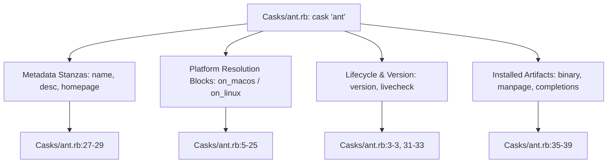
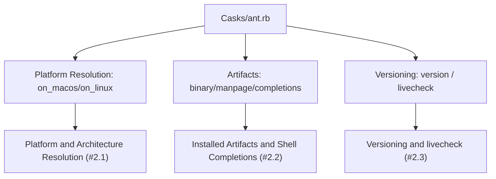

<!-- source: DeepWiki mcp.deepwiki.com · repo anthropics/homebrew-tap · page 2 The ant Cask Definition · fetched 2026-10-26 -->

# The ant Cask Definition

Relevant source files

The following files were used as context for generating this wiki page:

- [Casks/ant.rb](Casks/ant.rb)

The purpose of this page is to provide a high-level architectural overview of `Casks/ant.rb`, the Homebrew cask definition file for the `ant` CLI tool [Casks/ant.rb:1-43](). This document outlines the core structural blocks of the cask, including metadata stanzas, platform conditional blocks, artifact installations, and version pinning, while delegating detailed breakdowns to the child pages.

## Overview of `Casks/ant.rb` Structure

The `Casks/ant.rb` file is a standard Homebrew Ruby DSL cask definition that instructs the `brew` client on how to download, verify, and install the `ant` CLI across supported operating systems and CPU architectures [Casks/ant.rb:2-43](). At the root level, the cask defines general metadata such as `name "ant"`, `desc "CLI for the Claude Platform"`, and `homepage "anthropic.com"` [Casks/ant.rb:27-29](). 

The file is strictly governed by automated tooling: line 1 explicitly marks the file as auto-generated by GoReleaser and forbids manual edits [Casks/ant.rb:1-1]().

*Sources: Casks/ant.rb:1-43*

---

## 2.1. Platform and Architecture Resolution

The cask resolves target binaries dynamically depending on the host operating system and instruction set architecture [Casks/ant.rb:5-25](). It uses nested `on_macos`/`on_linux` and `on_intel`/`on_arm` blocks to map specific download URLs and cryptographic `sha256` checksums to the correct platform variant [Casks/ant.rb:5-25](). 

For detailed information on how archive formats (`.zip` vs `.tar.gz`) and platform-specific URLs are structured, see [Platform and Architecture Resolution](#2.1).

*Sources: Casks/ant.rb:5-25*

---

## 2.2. Installed Artifacts and Shell Completions

Once the appropriate platform archive is downloaded and verified, Homebrew unpacks it and installs the associated workspace components [Casks/ant.rb:35-39](). The cask specifies a primary executable via the `binary` stanza, documentation via `manpage`, and autocompletion scripts for three major shells (`bash`, `fish`, and `zsh`) [Casks/ant.rb:35-39](). Notably, the file omits a `zap` stanza because the CLI does not generate persistent state or configuration files requiring automated cleanup [Casks/ant.rb:41-41]().

For detailed information on individual file paths and cleanup behaviors, see [Installed Artifacts and Shell Completions](#2.2).

*Sources: Casks/ant.rb:35-42*

---

## 2.3. Versioning and livecheck

The version of the `ant` cask is statically pinned to a release string (e.g., `version "1.42.0"`) [Casks/ant.rb:3-3](). Because updates are managed via automated upstream publishing workflows, native Homebrew version checking is disabled via a `livecheck` block containing `skip "Auto-generated on release."` [Casks/ant.rb:31-33](). 

For detailed information on the GoReleaser contract and version synchronization, see [Versioning and livecheck](#2.3).

*Sources: Casks/ant.rb:1-3, Casks/ant.rb:31-33*

---

*Sources: Casks/ant.rb:1-43*

---

