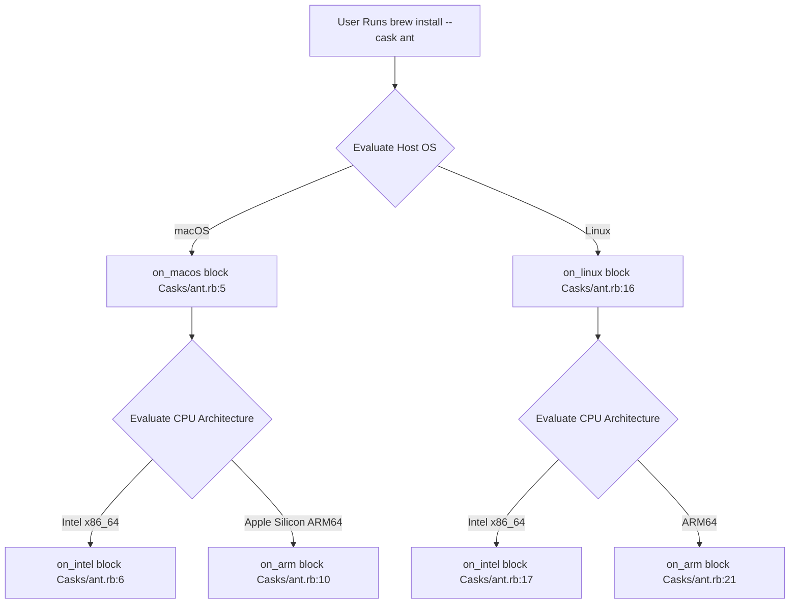
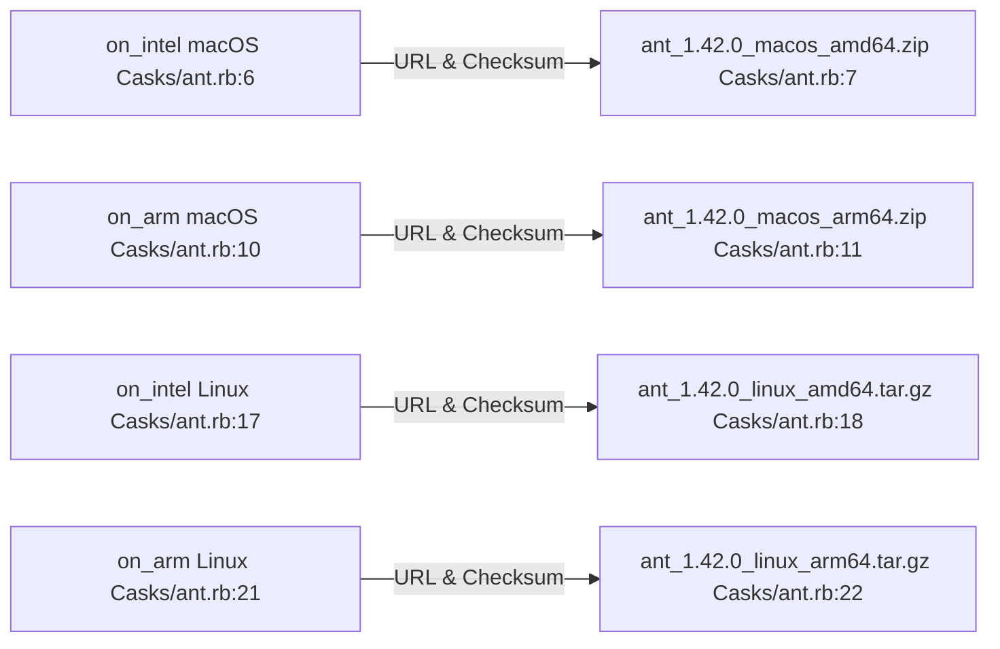

<!-- source: DeepWiki mcp.deepwiki.com · repo anthropics/homebrew-tap · page 2.1 Platform and Architecture Resolution · fetched 2026-10-26 -->

# Platform and Architecture Resolution

Relevant source files

The following files were used as context for generating this wiki page:

- [Casks/ant.rb](Casks/ant.rb)

## Purpose and Scope

This page details how the `ant` Homebrew cask (`Casks/ant.rb`) resolves the host operating system and CPU architecture to fetch, verify, and extract the correct binary distribution from the upstream `anthropics/anthropic-cli` GitHub Releases repository. It covers the Homebrew DSL conditional blocks (`on_macos`, `on_linux`, `on_intel`, `on_arm`), archive format variations, and cryptographic checksum validation.

Sources: [Casks/ant.rb:1-43]()

---

## Platform and Architecture Resolution Flow

The following diagram illustrates how Homebrew evaluates the host environment against the conditional blocks defined in the cask file, mapping user systems to specific code execution paths.

Sources: [Casks/ant.rb:5-25]()

---

## Conditional DSL Blocks

Homebrew casks use Ruby DSL helper methods to restrict stanzas to specific operating systems and hardware architectures. In `Casks/ant.rb`, the configuration is wrapped in nested conditional blocks to ensure target isolation.

### Operating System Blocks
* `on_macos`: Executes the enclosed block when the host operating system is macOS [Casks/ant.rb:5-14]().
* `on_linux`: Executes the enclosed block when the host operating system is Linux [Casks/ant.rb:16-25]().

### Architecture Blocks
Nested within each OS block are architecture specifiers:
* `on_intel`: Matches `x86_64` / `amd64` processors [Casks/ant.rb:6,17]().
* `on_arm`: Matches `arm64` / Apple Silicon processors [Casks/ant.rb:10,21]().

Sources: [Casks/ant.rb:5-25]()

---

## Artifact Mapping and Checksum Resolution Matrix

Depending on the resolved platform and architecture combination, Homebrew assigns a specific download URL pattern and a corresponding `sha256` checksum string.

Sources: [Casks/ant.rb:6-24]()

### Download URLs and Archive Formats

The release binaries are hosted on GitHub Releases under `anthropics/anthropic-cli`. The URL incorporates the interpolated `version` variable [Casks/ant.rb:3]():

| Platform | Architecture | Archive Format | URL Pattern Example |
| :--- | :--- | :--- | :--- |
| macOS | Intel (`amd64`) | `.zip` [Casks/ant.rb:7]() | `https://github.com/anthropics/anthropic-cli/releases/download/v1.42.0/ant_1.42.0_macos_amd64.zip` [Casks/ant.rb:7]() |
| macOS | ARM (`arm64`) | `.zip` [Casks/ant.rb:11]() | `https://github.com/anthropics/anthropic-cli/releases/download/v1.42.0/ant_1.42.0_macos_arm64.zip` [Casks/ant.rb:11]() |
| Linux | Intel (`amd64`) | `.tar.gz` [Casks/ant.rb:18]() | `https://github.com/anthropics/anthropic-cli/releases/download/v1.42.0/ant_1.42.0_linux_amd64.tar.gz` [Casks/ant.rb:18]() |
| Linux | ARM (`arm64`) | `.tar.gz` [Casks/ant.rb:22]() | `https://github.com/anthropics/anthropic-cli/releases/download/v1.42.0/ant_1.42.0_linux_arm64.tar.gz` [Casks/ant.rb:22]() |

Sources: [Casks/ant.rb:3-24]()

---

## Cryptographic Checksums (sha256)

To guarantee binary integrity and supply-chain security, each download stanza pairs with a hardcoded `sha256` checksum directive. Homebrew verifies the downloaded archive against this hash before proceeding with extraction and artifact linking.

* **macOS Intel Checksum**: `c0082b29f289c44ad6c810fb6bcc0b1739447dd49c3d4f4fe71ce2539ae386fe` [Casks/ant.rb:8]()
* **macOS ARM Checksum**: `4746a4bf44625849ac69e267f34548f41c287666a8705d631cdfe8c2e44b8ae4` [Casks/ant.rb:12]()
* **Linux Intel Checksum**: `f048cb6b274cff5c67b4fec6f9d96c5f4e7edbb32e4ff5b6d4eea20862827c9a` [Casks/ant.rb:19]()
* **Linux ARM Checksum**: `31f18f0b1eda4c2c4fe2b822b5ef8f362672304b01e922e6cbb427297452e45e` [Casks/ant.rb:23]()

Sources: [Casks/ant.rb:8-24]()

---

