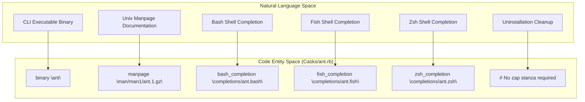
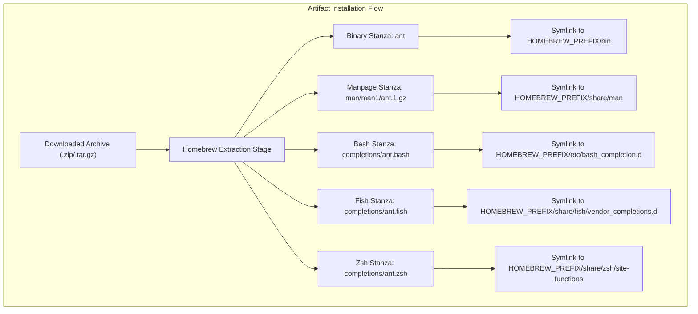

<!-- source: DeepWiki mcp.deepwiki.com · repo anthropics/homebrew-tap · page 2.2 Installed Artifacts and Shell Completions · fetched 2026-10-26 -->

# Installed Artifacts and Shell Completions

<details>
<summary>Relevant source files</summary>

The following files were used as context for generating this wiki page:

- [Casks/ant.rb](Casks/ant.rb)

</details>


This section details the specific artifact stanzas declared within `Casks/ant.rb` [Casks/ant.rb:1-43](), which instruct Homebrew on how to symlink and position binaries, manual pages, and shell completion scripts upon installation. It also examines the rationale behind the omission of a `zap` uninstallation stanza.

Sources: [Casks/ant.rb:1-43]()

---

## Artifact Mapping and Stanzas

When Homebrew processes the `ant` cask, it extracts the downloaded archive and evaluates the artifact stanzas. These stanzas map files from the extracted archive root or relative subpaths into Homebrew's prefix hierarchy (e.g., bin, share/man, and shell completion directories).

The following diagram bridges the natural language concept of installed components to the exact Ruby stanzas defined in the cask file:



Sources: [Casks/ant.rb:35-42]()

---

## Binary and Manpage Configuration

The core executable and its corresponding system manual page are declared via the `binary` and `manpage` DSL methods:

* **Binary Stanza**: `binary "ant"` [Casks/ant.rb:35-35]() tells Homebrew to take the extracted `ant` executable and symlink it into Homebrew's global binary directory, making it directly accessible in the user's `PATH`.
* **Manpage Stanza**: `manpage "man/man1/ant.1.gz"` [Casks/ant.rb:36-36]() specifies the pre-compressed manpage located within the archive layout, ensuring it is linked into the system man path so that `man ant` functions correctly.

Sources: [Casks/ant.rb:35-36]()

---

## Shell Completions

To support command-line auto-completion across major shells, the cask defines three completion stanzas:

```ruby
  bash_completion "completions/ant.bash"
  fish_completion "completions/ant.fish"
  zsh_completion "completions/ant.zsh"
```
* **Bash**: `bash_completion` [Casks/ant.rb:37-37]() links `completions/ant.bash` to Homebrew's bash completion directories.
* **Fish**: `fish_completion` [Casks/ant.rb:38-38]() links `completions/ant.fish` to the Fish functions/completions path.
* **Zsh**: `zsh_completion` [Casks/ant.rb:39-39]() links `completions/ant.zsh` to the Zsh function path (commonly `_ant`).

The data flow for how GoReleaser bundles these artifacts and how Homebrew installs them is illustrated below:



Sources: [Casks/ant.rb:35-39]()

---

## Absence of the Zap Stanza

The cask explicitly contains the comment:
```ruby
  # No zap stanza required
```
[Casks/ant.rb:41-41]()

In Homebrew Cask development, a `zap` stanza provides aggressive, state-removing uninstallation instructions (such as deleting configuration directories, local databases, or cached files in `~/Library/Application Support/`). Because the `ant` CLI operates without storing persistent state, configuration files, or local caches outside of standard transient process execution, a `zap` block is unnecessary. Standard `brew uninstall ant` removal of the symlinked binary, manpage, and completion files is fully sufficient to clean up the installation.

Sources: [Casks/ant.rb:41-42]()

---

