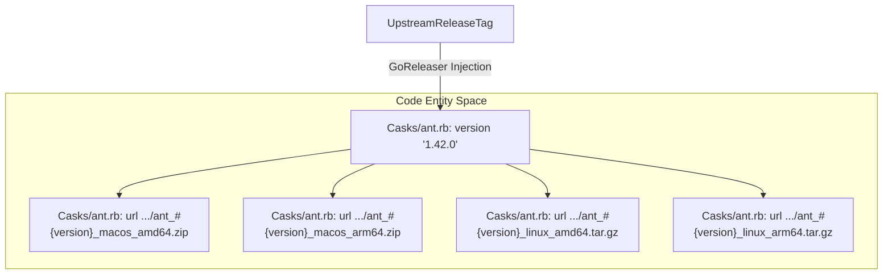
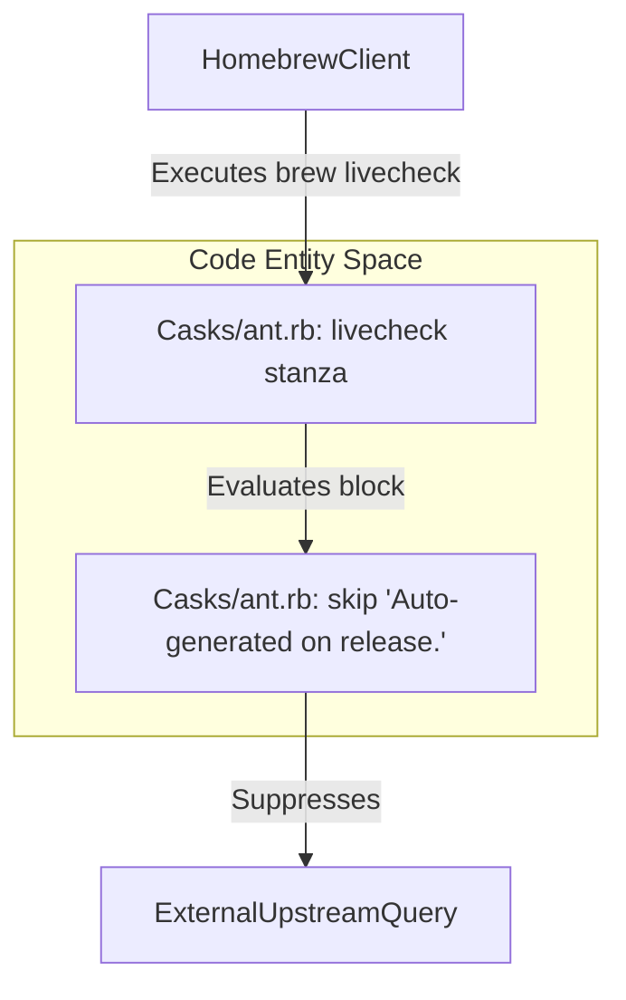

<!-- source: DeepWiki mcp.deepwiki.com · repo anthropics/homebrew-tap · page 2.3 Versioning and livecheck · fetched 2026-10-26 -->

# Versioning and livecheck

<details>
<summary>Relevant source files</summary>

The following files were used as context for generating this wiki page:

- [Casks/ant.rb](Casks/ant.rb)

</details>


## Purpose and Scope
This page details the versioning mechanics, livecheck omission strategy, and the strict immutability contract enforced on the Homebrew cask definition file `[Casks/ant.rb:1-43]()`. It explains how static version pinning replaces dynamic runtime checks to align with upstream release pipelines.

Sources: `[Casks/ant.rb:1-43]()`

---

## Version Pinning Mechanics
The version of the `ant` CLI is statically pinned within `[Casks/ant.rb:3-3]()` using a explicit string assignment. This version string serves as a single source of truth for all architecture-specific download URLs and checksum validations across macOS and Linux platforms `[Casks/ant.rb:5-25]()`.

When GoReleaser runs during an upstream release, it interpolates the tag version directly into the `version` stanza and propagates it to all artifact URL strings (e.g., `v#{version}`) `[Casks/ant.rb:7-22]()`.


*Title: Version Pinning and URL Interpolation Data Flow*

Sources: `[Casks/ant.rb:3-25]()`

---

## Livecheck Skipping Strategy
Homebrew utilizes a feature called `livecheck` to scan upstream repositories for newer versions independently of tap updates. However, in `[Casks/ant.rb:31-33]()`, `livecheck` is explicitly configured to skip automated checks.

```ruby
  livecheck do
    skip "Auto-generated on release."
  end
```
*(Source: `[Casks/ant.rb:31-33]()`)*

### Rationale for Skipping Livecheck
1. **Automation Boundary**: The tap does not manage its own releases; it is strictly an output target of the `anthropics/anthropic-cli` publishing pipeline. 
2. **Race Condition Prevention**: If Homebrew's `livecheck` queried GitHub independently, it might flag new GitHub tags before GoReleaser has successfully regenerated and pushed the updated `[Casks/ant.rb:1-43]()` file, leading to checksum mismatches or deployment desynchronization.


*Title: Livecheck Suppression Architecture*

Sources: `[Casks/ant.rb:31-33]()`, `[Casks/ant.rb:1-43]()`

---

## The GoReleaser "DO NOT EDIT" Contract
The first line of `[Casks/ant.rb:1-1]()` establishes a machine-written and human-restricted contract:

```ruby
# This file was generated by GoReleaser. DO NOT EDIT.
```
*(Source: `[Casks/ant.rb:1-1]()`)*

### Operational Rules of the Contract
* **No Manual Patches**: Developers must never manually edit `[Casks/ant.rb:1-43]()` to bump versions or modify checksums. All changes must flow through the upstream release automation.
* **Overwriting Behavior**: Any manual changes made to `[Casks/ant.rb:1-43]()` will be systematically overwritten the next time GoReleaser triggers a publishing event from `anthropics/anthropic-cli`.

Sources: `[Casks/ant.rb:1-1](), [Casks/ant.rb:1-43]()`

---

