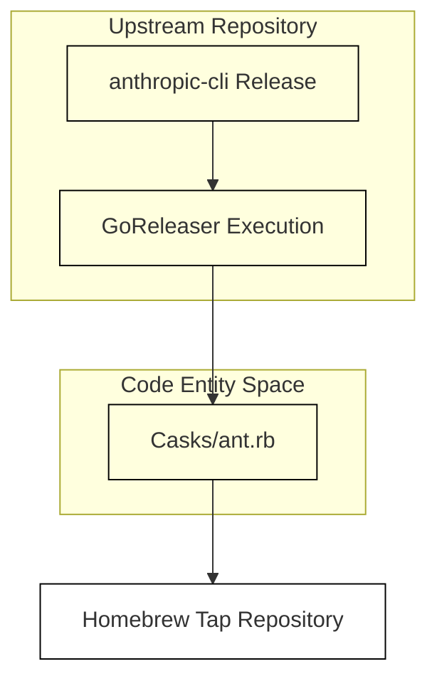
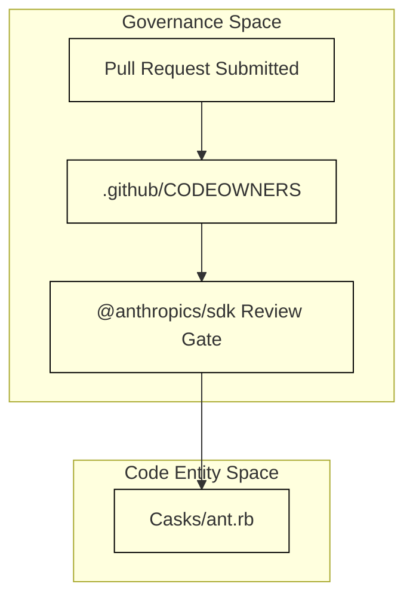

<!-- source: DeepWiki mcp.deepwiki.com · repo anthropics/homebrew-tap · page 3 Release Automation and Governance · fetched 2026-10-26 -->

# Release Automation and Governance

Relevant source files

The following files were used as context for generating this wiki page:

- [.github/CODEOWNERS](.github/CODEOWNERS)
- [Casks/ant.rb](Casks/ant.rb)

The release automation and governance model for `anthropics/homebrew-tap` ensures that binaries distributed to Homebrew users remain tightly synchronized with upstream releases of the Claude Platform CLI (`anthropic-cli`). Because Homebrew casks execute third-party scripts and install binary artifacts directly onto user systems, the lifecycle of `Casks/ant.rb` is strictly automated via upstream CI tooling [Casks/ant.rb:1-1]() and governed by mandatory code review policies [.github/CODEOWNERS:1-4](). 

This section provides a high-level overview of the publishing workflow and supply-chain governance. For detailed technical breakdowns, see the child pages below:
- **GoReleaser Publishing Flow**: See [GoReleaser Publishing Flow](#3.1)
- **Code Ownership and Supply-Chain Review**: See [Code Ownership and Supply-Chain Review](#3.2)

---

## 3.1. GoReleaser Publishing Flow

The `Casks/ant.rb` file is not hand-written or manually maintained for every release. Instead, it is automatically generated and pushed to this repository by GoReleaser during the release pipeline of the upstream `anthropics/anthropic-cli` project. 

Because of this automation contract, any manual modifications made directly to `Casks/ant.rb` will be overwritten or invalidated the next time an upstream release is cut. The file explicitly warns maintainers of this constraint at its entry point [Casks/ant.rb:1-1]().

For details on how GoReleaser constructs the version pins, multi-platform URLs, and cryptographic `sha256` checksums [Casks/ant.rb:3-25](), see [GoReleaser Publishing Flow](#3.1).

*Figure 3.1: Upstream publishing flow mapping GoReleaser execution to the target cask entity.*

**Sources:** [Casks/ant.rb:1-43](), [.github/CODEOWNERS:1-4]()

---

## 3.2. Code Ownership and Supply-Chain Review

Because Homebrew casks dictate arbitrary code execution and binary installation on end-user machines, changes to the tap represent a critical supply-chain attack surface. To mitigate this risk, global repository governance is enforced via [.github/CODEOWNERS](), which requires explicit approval from the `@anthropics/sdk` team for all pull requests [.github/CODEOWNERS:1-6]().

This security gate ensures that any updates to installation URLs or cryptographic checksums [Casks/ant.rb:7-24]() are reviewed by the same engineering team responsible for gating the upstream releases of `anthropic-cli` [.github/CODEOWNERS:1-4](). 

For a comprehensive analysis of the `.github/CODEOWNERS` configuration and why cryptographic integrity checks matter, see [Code Ownership and Supply-Chain Review](#3.2).

*Figure 3.2: Review workflow mapping pull requests against the `.github/CODEOWNERS` entity rule.*

**Sources:** [Casks/ant.rb:7-24](), [.github/CODEOWNERS:1-6]()

---

