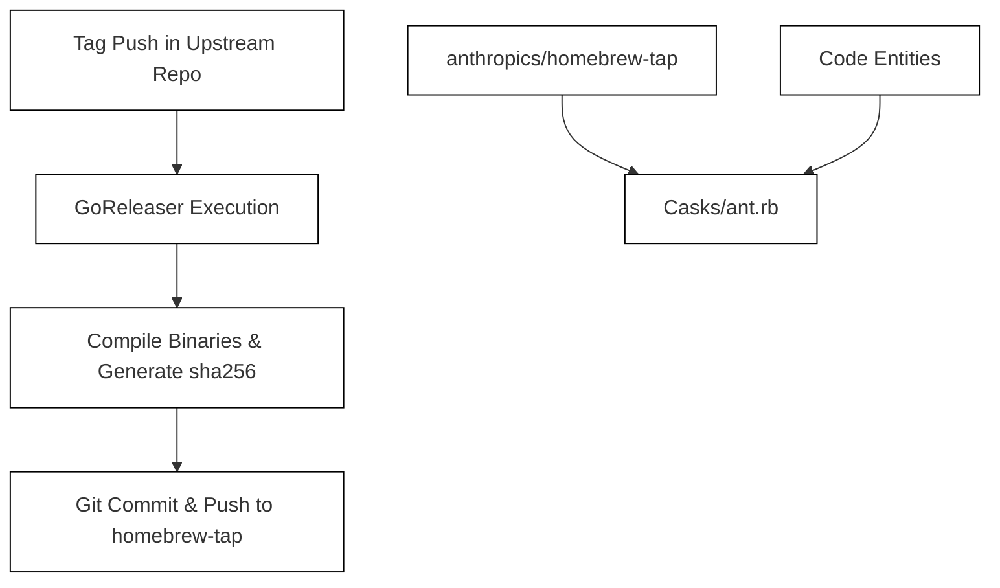
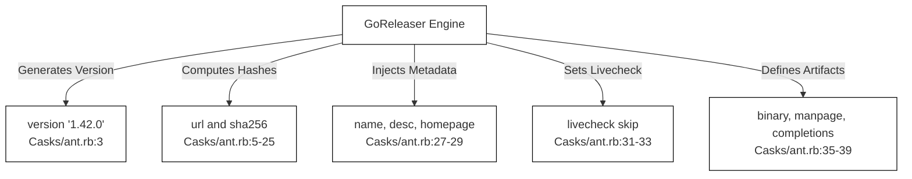

<!-- source: DeepWiki mcp.deepwiki.com · repo anthropics/homebrew-tap · page 3.1 GoReleaser Publishing Flow · fetched 2026-10-26 -->

# GoReleaser Publishing Flow

Relevant source files

The following files were used as context for generating this wiki page:

- [Casks/ant.rb](Casks/ant.rb)

## Purpose and Scope

This page details the automated publishing flow driven by GoReleaser for the `anthropics/homebrew-tap` repository. Specifically, it examines how the upstream `anthropics/anthropic-cli` project programmatically generates, updates, and pushes the cask definition (`Casks/ant.rb`), and outlines the operational implications of this automated pipeline on manual maintenance and local edits [Casks/ant.rb:1-1]()].

---

## 1. Upstream Release Pipeline and Cask Generation

The publication of Homebrew cask updates is decoupled from manual pull requests within this repository. Instead, GoReleaser executes within the upstream `anthropics/anthropic-cli` repository release workflow. When a new version tag (e.g., `v1.42.0`) is published upstream, GoReleaser compiles binaries across multiple platforms, computes their cryptographic hashes, and updates the cask file structure.

The generated cask file maps the release version to platform-specific artifacts [Casks/ant.rb:3-25]():
- **macOS Intel (`amd64`) and ARM (`arm64`)**: Downloads zipped packages (`.zip`) from the GitHub release assets [Casks/ant.rb:5-14]().
- **Linux Intel (`amd64`) and ARM (`arm64`)**: Downloads tarball packages (`.tar.gz`) from the GitHub release assets [Casks/ant.rb:16-25]().

The following diagram illustrates the integration between the upstream release pipeline, GoReleaser execution, and the resulting artifact ingestion into `Casks/ant.rb`.

*Figure 1: Upstream publishing flow leading to `Casks/ant.rb` updates.*

Sources: [Casks/ant.rb:1-43]()

---

## 2. The "DO NOT EDIT" Contract

The first line of the cask definition enforces a strict governance constraint: `# This file was generated by GoReleaser. DO NOT EDIT.` [Casks/ant.rb:1-1](). 

Because `Casks/ant.rb` is an automatically synthesized artifact, any manual changes applied directly to this file within `anthropics/homebrew-tap` introduce severe synchronization risks:
1. **Overwritten Changes**: Subsequent upstream releases will execute GoReleaser, overwriting the entire file contents, including any manual version bumps, checksum updates, or stanza additions [Casks/ant.rb:1-43]().
2. **Skipped Livecheck**: The `livecheck` block is explicitly configured to skip automated checks because versioning is entirely bound to the upstream GoReleaser release cycle (`skip "Auto-generated on release."`) [Casks/ant.rb:31-33]().
3. **Checksum Desynchronization**: Manually altering URLs or hashes without a corresponding upstream binary build will cause `brew install --cask ant` to fail due to cryptographic hash mismatches against entries like `sha256 "c0082b29f289c44ad6c810fb6bcc0b1739447dd49c3d4f4fe71ce2539ae386fe"` [Casks/ant.rb:8-8]().

The code entity relationship between the GoReleaser automation engine and the generated cask stanzas is detailed below.

*Figure 2: Mapping GoReleaser output generation to specific stanzas inside `Casks/ant.rb`.*

Sources: [Casks/ant.rb:1-43]()

---

