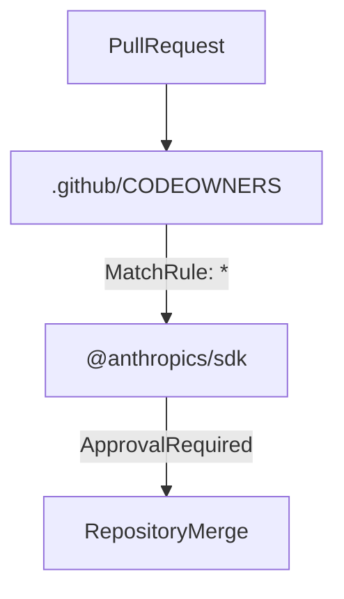
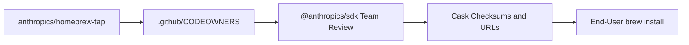

<!-- source: DeepWiki mcp.deepwiki.com · repo anthropics/homebrew-tap · page 3.2 Code Ownership and Supply-Chain Review · fetched 2026-10-26 -->

# Code Ownership and Supply-Chain Review

<details>
<summary>Relevant source files</summary>

The following files were used as context for generating this wiki page:

- [.github/CODEOWNERS](.github/CODEOWNERS)

</details>


## Purpose and Scope
This section details the governance and supply-chain security model implemented in the `anthropics/homebrew-tap` repository. Specifically, it examines how the global repository review policy defined in `.github/CODEOWNERS` enforces mandatory oversight by the SDK engineering team for all modifications affecting formula definitions, download URLs, and binary cryptographic checksums [.github/CODEOWNERS:1-7].

Sources:
- [.github/CODEOWNERS:1-6]()

---

## Code Ownership Configuration

The repository utilizes GitHub's native code ownership features to automate review routing and enforce security gates. The configuration resides entirely within the repository root [.github/CODEOWNERS:1-7].

```
.github/
└── CODEOWNERS
```

The configuration uses a single global wildcard rule to ensure that any pull request modifying files within the repository requires explicit approval from the `@anthropics/sdk` GitHub team [.github/CODEOWNERS:6]. 

```text
# Require @anthropics/sdk approval on all changes. The cask formulae here
# control which binaries Homebrew installs (download URL + checksum), so
# changes should be reviewed by the same team that gates the upstream
# release in anthropic-cli.

* @anthropics/sdk
```
*Cited from [.github/CODEOWNERS:1-6]*

### Ownership Routing Flow


*Sources: [.github/CODEOWNERS:1-6]*

Sources:
- [.github/CODEOWNERS:1-6]()

---

## Supply-Chain Security Rationale

Homebrew taps operate by executing remote instructions and downloading compiled binaries directly onto end-user development environments. Consequently, the files contained within a tap represent a critical supply-chain attack surface.

### Why Checksum and URL Review Matters
1. **Binary Execution Context**: The formulae and casks managed in this repository dictate the exact download locations (`url`) and expected cryptographic integrity hashes (`sha256`) for the `ant` CLI.
2. **Upstream Alignment**: Because the cask definitions dictate which binaries are installed by Homebrew clients, an unauthorized or malicious modification to a download URL or checksum could redirect users to compromised binaries [.github/CODEOWNERS:2-4].
3. **Cross-Team Governance**: By routing all modifications through the `@anthropics/sdk` team — the same engineering group responsible for gating upstream releases in `anthropic-cli` — the repository ensures that automated or manual changes to distribution manifests are tightly synchronized with legitimate software releases [.github/CODEOWNERS:3-4].

### Supply-Chain Trust Verification Flow


*Sources: [.github/CODEOWNERS:1-6]*

Sources:
- [.github/CODEOWNERS:1-6]()

---

