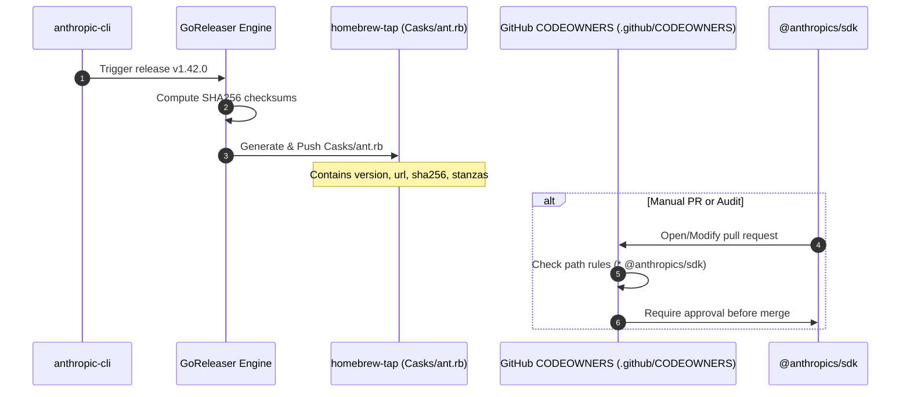

<!-- source: DeepWiki mcp.deepwiki.com · repo anthropics/homebrew-tap · page 4 Glossary · fetched 2026-10-26 -->

# Glossary

<details>
<summary>Relevant source files</summary>

The following files were used as context for generating this wiki page:

- [.github/CODEOWNERS](.github/CODEOWNERS)
- [Casks/ant.rb](Casks/ant.rb)

</details>


This page provides definitions for the key terminology, data structures, and architectural components used throughout the `anthropics/homebrew-tap` repository. It serves as a technical reference linking high-level Homebrew and release engineering concepts to their concrete implementations within `Casks/ant.rb` and `.github/CODEOWNERS`.

---

## Terminology Reference

### Tap
A Homebrew tap is a third-party Git repository containing custom formula and cask definitions. By running `brew tap anthropics/tap`, users add this repository to their local Homebrew installation, allowing them to install packages not hosted in Homebrew's core repository.

### Cask
A Homebrew Cask is a Ruby-based domain-specific language (DSL) script used to install macOS and Linux binary applications, fonts, and other non-formula software. In this repository, `Casks/ant.rb` defines the installation routine for the `ant` CLI tool [Casks/ant.rb:2-43]().

### Stanza
A stanza is an individual configuration block or command line within a Homebrew Cask DSL file (e.g., `version`, `url`, `sha256`, `binary`, `livecheck`). Stanzas declare the metadata and installation artifacts associated with a package [Casks/ant.rb:3-40]().

### Livecheck
The `livecheck` stanza instructs Homebrew's version-checking engine on how to detect newer upstream versions. In `Casks/ant.rb`, livecheck is explicitly skipped because updates are handled via automated upstream release gating [Casks/ant.rb:31-33]().

### Zap
The `zap` stanza defines uninstallation behavior, cleaning up user data, configuration files, and caches left behind by an application. `Casks/ant.rb` omits a `zap` stanza [Casks/ant.rb:41]().

### SHA256
A cryptographic hash function used to verify the integrity of downloaded release archives. Each platform block in `Casks/ant.rb` specifies a `sha256` checksum string to prevent supply-chain tampering [Casks/ant.rb:8-23]().

### GoReleaser
An open-source release automation tool for Go projects. GoReleaser is responsible for building binaries across platforms, generating the Homebrew cask definition (`Casks/ant.rb`), and pushing updates directly to this tap repository [Casks/ant.rb:1]().

### CODEOWNERS
A GitHub governance mechanism located at `.github/CODEOWNERS` that defines which teams or users must review pull requests affecting specific file paths [.github/CODEOWNERS:1-6]().

### AMD64 / ARM64
Hardware architecture identifiers. `amd64` refers to 64-bit x86 processors (Intel), while `arm64` refers to 64-bit ARM processors (such as Apple Silicon or ARM-based Linux servers) [Casks/ant.rb:5-24]().

### Manpage
Unix manual pages documenting command-line utilities. The cask installs a compressed manual page via the `manpage` stanza [Casks/ant.rb:36]().

### Completions
Shell-specific scripts providing auto-completion for commands and flags. The repository includes shell completion stanzas for `bash`, `fish`, and `zsh` [Casks/ant.rb:37-39]().

### Upstream Release Gating
The automated pipeline policy where releases are built and pushed from the core `anthropics/anthropic-cli` repository, ensuring that only validated artifacts reach the Homebrew tap.

---

## Architectural Mapping

The following diagram bridges the natural language concepts defined above to their exact code entities within `Casks/ant.rb` and `.github/CODEOWNERS`.

```mermaid
graph TD
    sub5["Code Entity Space"]
        CaskFile["Casks/ant.rb"]
        CodeOwners[".github/CODEOWNERS"]
        VersionBlock["version \"1.42.0\"\nCasks/ant.rb:3"]
        PlatformBlocks["on_macos / on_linux\nCasks/ant.rb:5-25"]
        ArtifactBlocks["binary / manpage / completions\nCasks/ant.rb:35-39"]
        LivecheckBlock["livecheck skip\nCasks/ant.rb:31-33"]
        OwnerRule["* @anthropics/sdk\n.github/CODEOWNERS:6"]

    sub6["Natural Language Space"]
        TapConcept["Homebrew Tap"]
        CaskConcept["Cask Definition"]
        StanzaConcept["Stanzas (url, sha256)"]
        SecurityConcept["CODEOWNERS / Supply-Chain"]
        ReleaseConcept["GoReleaser Automation"]

    TapConcept --> CaskFile
    CaskConcept --> CaskFile
    StanzaConcept --> VersionBlock
    StanzaConcept --> PlatformBlocks
    StanzaConcept --> ArtifactBlocks
    StanzaConcept --> LivecheckBlock
    SecurityConcept --> CodeOwners
    SecurityConcept --> OwnerRule
    ReleaseConcept --> CaskFile

    click CaskFile "https://github.com/anthropics/homebrew-tap/blob/main/Casks/ant.rb"
    click CodeOwners "https://github.com/anthropics/homebrew-tap/blob/main/.github/CODEOWNERS"

    style CaskFile stroke:#333,stroke-width:2px
    style CodeOwners stroke:#333,stroke-width:2px
```

Sources: [Casks/ant.rb:1-43](), [.github/CODEOWNERS:1-6]()

---

## Implementation Data Flow

The following sequence diagram illustrates how GoReleaser interacts with `Casks/ant.rb` and how GitHub enforces governance via `.github/CODEOWNERS` when manual edits or automated PRs occur.



Sources: [Casks/ant.rb:1-43](), [.github/CODEOWNERS:1-6]()

---
Sources: [Casks/ant.rb:1-43](), [.github/CODEOWNERS:1-6]()