# Page: Overview

# Overview

<details>
<summary>Relevant source files</summary>

The following files were used as context for generating this wiki page:

- [.github/CODEOWNERS](.github/CODEOWNERS)
- [Casks/ant.rb](Casks/ant.rb)

</details>


The `anthropics/homebrew-tap` repository is the official Homebrew tap for distributing the `ant` command-line interface, which provides developer tooling and access to the Claude Platform [Casks/ant.rb:28](). This repository acts as a bridge between upstream releases of the `anthropics/anthropic-cli` project and local developer environments via the Homebrew package manager. 

As a parent page, this document outlines the high-level architecture of the tap repository, user installation pathways, and the repository layout. For deeper technical specifics, refer to the child pages linked throughout this document.

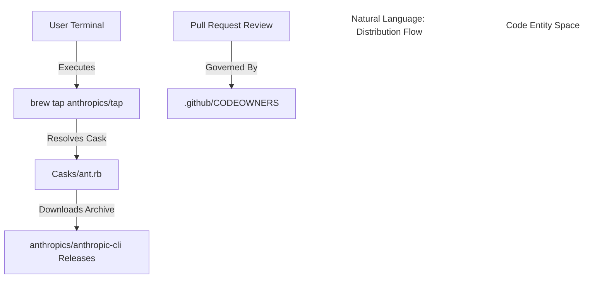
*Sources: [Casks/ant.rb:1-43](), [.github/CODEOWNERS:1-6]()*

---

## 1.1. Installing the ant CLI

Users interact with this tap to install, update, and manage the `ant` binary on supported macOS and Linux environments. The installation workflow relies on standard Homebrew mechanics: tapping the repository and installing the managed cask [Casks/ant.rb:2-43]().

For detailed user guides, platform compatibility matrices (Intel vs. Apple Silicon, Linux `amd64`/`arm64`), verification of installed binaries, manpages, and shell completions (`bash`, `fish`, `zsh`), see [Installing the ant CLI](#1.1).

*Sources: [Casks/ant.rb:2-43]()*

---

## 1.2. Repository Layout

The repository maintains a minimal and structured layout designed specifically for automated cask generation and supply-chain security governance. It contains two primary structural components:

- `Casks/`: Houses the Homebrew cask definitions, specifically `Casks/ant.rb`, which dictates download URLs, cryptographic checksums (`sha256`), and post-install artifacts [Casks/ant.rb:1-43]().
- `.github/`: Contains automation workflows and governance configurations, including `.github/CODEOWNERS`, which enforces required code reviews from `@anthropics/sdk` [.github/CODEOWNERS:1-6]().

For detailed breakdowns of each directory's internal composition and operational mechanics, see [Repository Layout](#1.2).

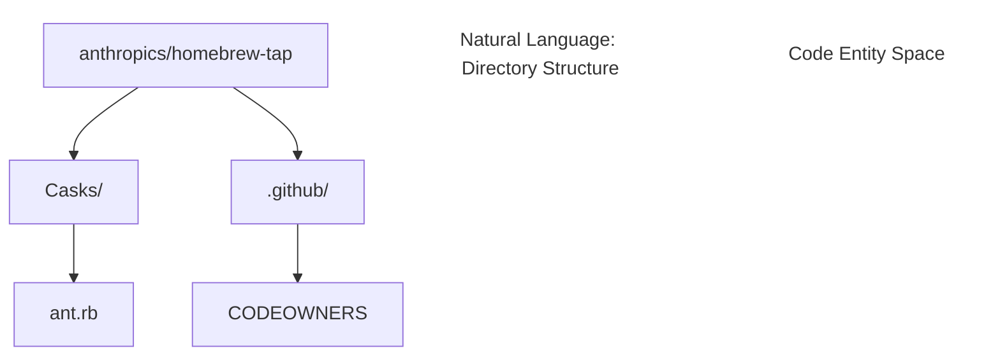
*Sources: [Casks/ant.rb:1-43](), [.github/CODEOWNERS:1-6]()*

---

# Page: Installing the ant CLI

# Installing the ant CLI

<details>
<summary>Relevant source files</summary>

The following files were used as context for generating this wiki page:

- [Casks/ant.rb](Casks/ant.rb)

</details>


## Purpose and Scope

This document serves as the technical user-facing guide for installing the `ant` command-line interface for the Claude Platform using Homebrew. It outlines the installation commands, the underlying platform and architecture resolution performed by `Casks/ant.rb`, and the specific artifacts deployed to the host environment.

Sources: [Casks/ant.rb:1-43]()

---

## Installation Commands

To install the `ant` CLI on a supported workstation, users execute standard Homebrew tap and cask installation commands. Homebrew fetches the cask definition from `anthropics/homebrew-tap` and evaluates the platform stanzas defined in `Casks/ant.rb`.

```bash
# Add the Anthropics Homebrew tap
brew tap anthropics/tap

# Install the ant CLI cask
brew install --cask ant
```

### Installation Flow Diagram

Title: "Homebrew Installation Data Flow to Cask Definition"

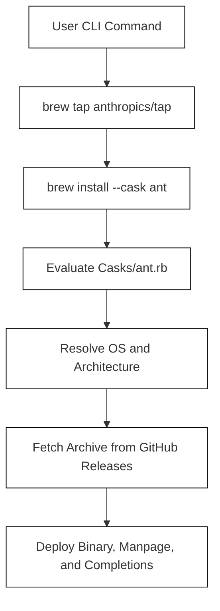

Sources: [Casks/ant.rb:1-43]()

---

## Supported Platforms and Architecture Resolution

During the execution of `brew install --cask ant`, Homebrew inspects the host operating system and CPU architecture, matching them against conditional blocks declared in `Casks/ant.rb`. The cask supports macOS and Linux across both Intel (`amd64`) and ARM (`arm64`) architectures.

| Operating System | Architecture | Archive Format | Download URL Pattern |
|------------------|--------------|----------------|----------------------|
| macOS (`on_macos`) | Intel (`on_intel`) | `.zip` | `https://github.com/anthropics/anthropic-cli/releases/download/v#{version}/ant_#{version}_macos_amd64.zip` [Casks/ant.rb:5-9]() |
| macOS (`on_macos`) | ARM (`on_arm`) | `.zip` | `https://github.com/anthropics/anthropic-cli/releases/download/v#{version}/ant_#{version}_macos_arm64.zip` [Casks/ant.rb:10-14]() |
| Linux (`on_linux`) | Intel (`on_intel`) | `.tar.gz` | `https://github.com/anthropics/anthropic-cli/releases/download/v#{version}/ant_#{version}_linux_amd64.tar.gz` [Casks/ant.rb:16-20]() |
| Linux (`on_linux`) | ARM (`on_arm`) | `.tar.gz` | `https://github.com/anthropics/anthropic-cli/releases/download/v#{version}/ant_#{version}_linux_arm64.tar.gz` [Casks/ant.rb:21-25]() |

Each download path is verified cryptographically using the associated `sha256` checksum hardcoded in the respective block [Casks/ant.rb:8-23]().

### Platform Resolution Architecture

Title: "Cask Platform and Architecture Mapping"

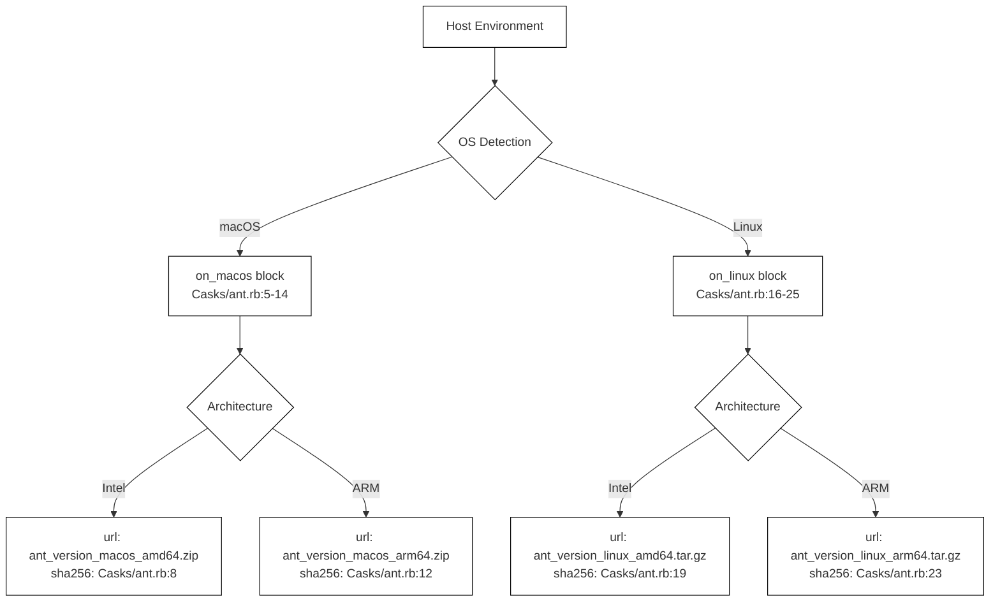

Sources: [Casks/ant.rb:1-25]()

---

## Installed Artifacts

Once the correct archive is downloaded and extracted, Homebrew links and installs specific system artifacts defined in `Casks/ant.rb`:

1. **Binary**: The primary executable `ant` is installed into the Homebrew prefix bin path [Casks/ant.rb:35-35]().
2. **Manpage**: The compressed manual page `ant.1.gz` is installed into the manual page hierarchy [Casks/ant.rb:36-36]().
3. **Shell Completions**: Native auto-completions are provisioned for three major shells [Casks/ant.rb:37-39]():
   - Bash: `completions/ant.bash` [Casks/ant.rb:37-37]()
   - Fish: `completions/ant.fish` [Casks/ant.rb:38-38]()
   - Zsh: `completions/ant.zsh` [Casks/ant.rb:39-39]()

Sources: [Casks/ant.rb:35-40]()

---

# Page: Repository Layout

# Repository Layout

<details>
<summary>Relevant source files</summary>

The following files were used as context for generating this wiki page:

- [.github/CODEOWNERS](.github/CODEOWNERS)
- [Casks/ant.rb](Casks/ant.rb)

</details>


The `anthropics/homebrew-tap` repository utilizes a minimal, specialized directory structure tailored for Homebrew taps and automated release publishing via GoReleaser. The repository layout is partitioned into two functional directories: `Casks/`, which stores the Homebrew cask definitions for the `ant` CLI, and `.github/`, which houses repository governance and security policies.

Sources: [Casks/ant.rb:1-43](), [.github/CODEOWNERS:1-6]()

---

## The `Casks/` Directory

The `Casks/` directory contains Ruby-based Homebrew cask definition files. Casks instruct Homebrew on how to download, verify, install, and manage binary applications outside of traditional formula packages.

* **`Casks/ant.rb`**: The primary cask definition for the `ant` CLI [Casks/ant.rb:2-43](). It defines architecture-specific download URLs and SHA-256 checksums for macOS and Linux [Casks/ant.rb:5-25](), binary deployment paths [Casks/ant.rb:35](), manpages [Casks/ant.rb:36](), and shell completions [Casks/ant.rb:37-39](). 

Because this file is automatically generated by the upstream release pipeline, it includes an explicit warning comment disallowing manual edits [Casks/ant.rb:1]().

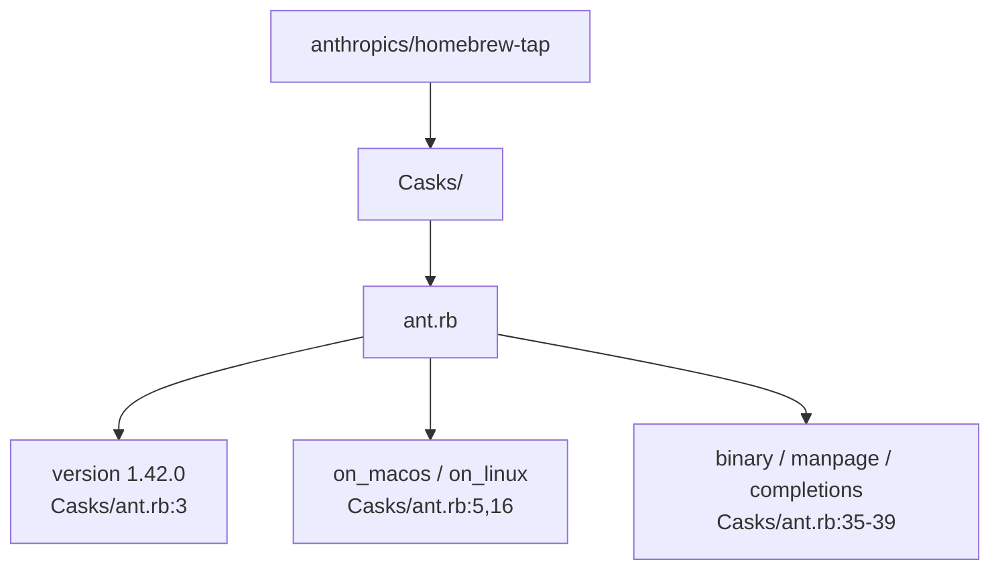

Sources: [Casks/ant.rb:1-43]()

---

## The `.github/` Directory

The `.github/` directory configures GitHub Actions workflows, repository settings, and code governance controls.

* **`.github/CODEOWNERS`**: Establishes mandatory review requirements for all modifications pushed to the repository [.github/CODEOWNERS:1-6](). Because cask files dictate executable binary installation paths and supply-chain dependencies via cryptographic checksums, the `CODEOWNERS` file assigns global ownership to `@anthropics/sdk` [.github/CODEOWNERS:6]() to align tap governance with upstream `anthropic-cli` release gating [.github/CODEOWNERS:1-4]().

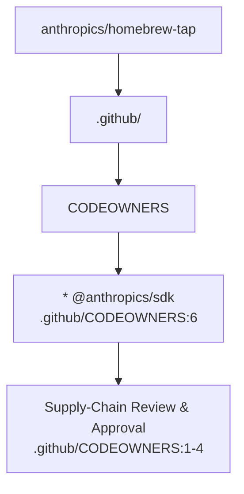

Sources: [.github/CODEOWNERS:1-6]()

---

# Page: The ant Cask Definition

# The ant Cask Definition

<details>
<summary>Relevant source files</summary>

The following files were used as context for generating this wiki page:

- [Casks/ant.rb](Casks/ant.rb)

</details>


The purpose of this page is to provide a high-level architectural overview of `Casks/ant.rb`, the Homebrew cask definition file for the `ant` CLI tool [Casks/ant.rb:1-43](). This document outlines the core structural blocks of the cask, including metadata stanzas, platform conditional blocks, artifact installations, and version pinning, while delegating detailed breakdowns to the child pages.

## Overview of `Casks/ant.rb` Structure

The `Casks/ant.rb` file is a standard Homebrew Ruby DSL cask definition that instructs the `brew` client on how to download, verify, and install the `ant` CLI across supported operating systems and CPU architectures [Casks/ant.rb:2-43](). At the root level, the cask defines general metadata such as `name "ant"`, `desc "CLI for the Claude Platform"`, and `homepage "anthropic.com"` [Casks/ant.rb:27-29](). 

The file is strictly governed by automated tooling: line 1 explicitly marks the file as auto-generated by GoReleaser and forbids manual edits [Casks/ant.rb:1-1]().

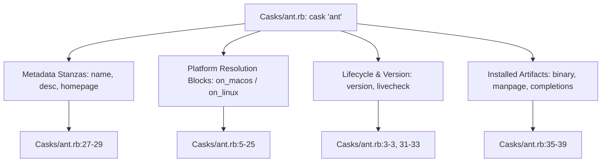
*Sources: Casks/ant.rb:1-43*

---

## 2.1. Platform and Architecture Resolution

The cask resolves target binaries dynamically depending on the host operating system and instruction set architecture [Casks/ant.rb:5-25](). It uses nested `on_macos`/`on_linux` and `on_intel`/`on_arm` blocks to map specific download URLs and cryptographic `sha256` checksums to the correct platform variant [Casks/ant.rb:5-25](). 

For detailed information on how archive formats (`.zip` vs `.tar.gz`) and platform-specific URLs are structured, see [Platform and Architecture Resolution](#2.1).

*Sources: Casks/ant.rb:5-25*

---

## 2.2. Installed Artifacts and Shell Completions

Once the appropriate platform archive is downloaded and verified, Homebrew unpacks it and installs the associated workspace components [Casks/ant.rb:35-39](). The cask specifies a primary executable via the `binary` stanza, documentation via `manpage`, and autocompletion scripts for three major shells (`bash`, `fish`, and `zsh`) [Casks/ant.rb:35-39](). Notably, the file omits a `zap` stanza because the CLI does not generate persistent state or configuration files requiring automated cleanup [Casks/ant.rb:41-41]().

For detailed information on individual file paths and cleanup behaviors, see [Installed Artifacts and Shell Completions](#2.2).

*Sources: Casks/ant.rb:35-42*

---

## 2.3. Versioning and livecheck

The version of the `ant` cask is statically pinned to a release string (e.g., `version "1.42.0"`) [Casks/ant.rb:3-3](). Because updates are managed via automated upstream publishing workflows, native Homebrew version checking is disabled via a `livecheck` block containing `skip "Auto-generated on release."` [Casks/ant.rb:31-33](). 

For detailed information on the GoReleaser contract and version synchronization, see [Versioning and livecheck](#2.3).

*Sources: Casks/ant.rb:1-3, Casks/ant.rb:31-33*

---

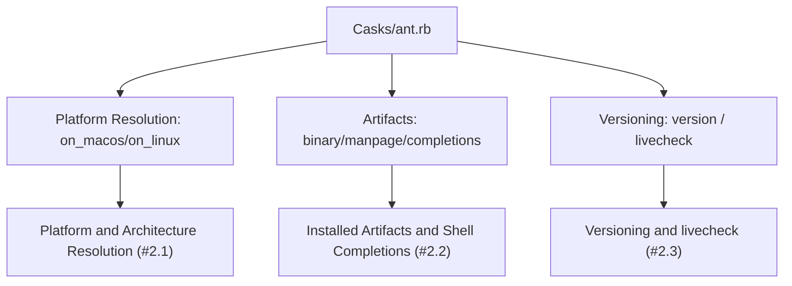
*Sources: Casks/ant.rb:1-43*

---

# Page: Platform and Architecture Resolution

# Platform and Architecture Resolution

<details>
<summary>Relevant source files</summary>

The following files were used as context for generating this wiki page:

- [Casks/ant.rb](Casks/ant.rb)

</details>


## Purpose and Scope

This page details how the `ant` Homebrew cask (`Casks/ant.rb`) resolves the host operating system and CPU architecture to fetch, verify, and extract the correct binary distribution from the upstream `anthropics/anthropic-cli` GitHub Releases repository. It covers the Homebrew DSL conditional blocks (`on_macos`, `on_linux`, `on_intel`, `on_arm`), archive format variations, and cryptographic checksum validation.

Sources: [Casks/ant.rb:1-43]()

---

## Platform and Architecture Resolution Flow

The following diagram illustrates how Homebrew evaluates the host environment against the conditional blocks defined in the cask file, mapping user systems to specific code execution paths.

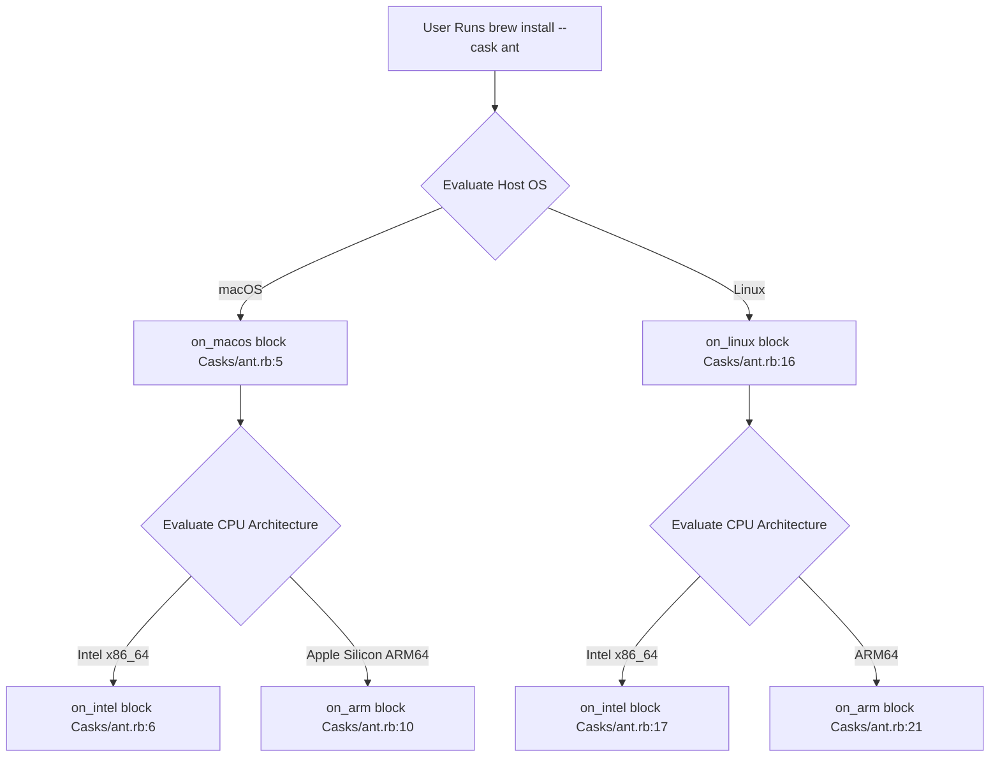

Sources: [Casks/ant.rb:5-25]()

---

## Conditional DSL Blocks

Homebrew casks use Ruby DSL helper methods to restrict stanzas to specific operating systems and hardware architectures. In `Casks/ant.rb`, the configuration is wrapped in nested conditional blocks to ensure target isolation.

### Operating System Blocks
* `on_macos`: Executes the enclosed block when the host operating system is macOS [Casks/ant.rb:5-14]().
* `on_linux`: Executes the enclosed block when the host operating system is Linux [Casks/ant.rb:16-25]().

### Architecture Blocks
Nested within each OS block are architecture specifiers:
* `on_intel`: Matches `x86_64` / `amd64` processors [Casks/ant.rb:6,17]().
* `on_arm`: Matches `arm64` / Apple Silicon processors [Casks/ant.rb:10,21]().

Sources: [Casks/ant.rb:5-25]()

---

## Artifact Mapping and Checksum Resolution Matrix

Depending on the resolved platform and architecture combination, Homebrew assigns a specific download URL pattern and a corresponding `sha256` checksum string.

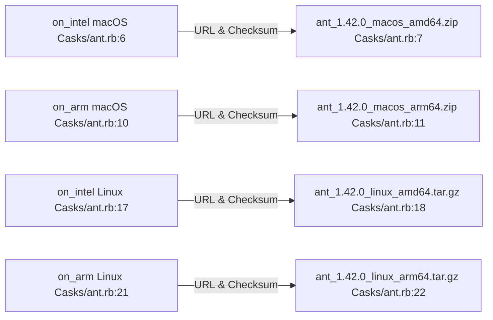

Sources: [Casks/ant.rb:6-24]()

### Download URLs and Archive Formats

The release binaries are hosted on GitHub Releases under `anthropics/anthropic-cli`. The URL incorporates the interpolated `version` variable [Casks/ant.rb:3]():

| Platform | Architecture | Archive Format | URL Pattern Example |
| :--- | :--- | :--- | :--- |
| macOS | Intel (`amd64`) | `.zip` [Casks/ant.rb:7]() | `https://github.com/anthropics/anthropic-cli/releases/download/v1.42.0/ant_1.42.0_macos_amd64.zip` [Casks/ant.rb:7]() |
| macOS | ARM (`arm64`) | `.zip` [Casks/ant.rb:11]() | `https://github.com/anthropics/anthropic-cli/releases/download/v1.42.0/ant_1.42.0_macos_arm64.zip` [Casks/ant.rb:11]() |
| Linux | Intel (`amd64`) | `.tar.gz` [Casks/ant.rb:18]() | `https://github.com/anthropics/anthropic-cli/releases/download/v1.42.0/ant_1.42.0_linux_amd64.tar.gz` [Casks/ant.rb:18]() |
| Linux | ARM (`arm64`) | `.tar.gz` [Casks/ant.rb:22]() | `https://github.com/anthropics/anthropic-cli/releases/download/v1.42.0/ant_1.42.0_linux_arm64.tar.gz` [Casks/ant.rb:22]() |

Sources: [Casks/ant.rb:3-24]()

---

## Cryptographic Checksums (sha256)

To guarantee binary integrity and supply-chain security, each download stanza pairs with a hardcoded `sha256` checksum directive. Homebrew verifies the downloaded archive against this hash before proceeding with extraction and artifact linking.

* **macOS Intel Checksum**: `c0082b29f289c44ad6c810fb6bcc0b1739447dd49c3d4f4fe71ce2539ae386fe` [Casks/ant.rb:8]()
* **macOS ARM Checksum**: `4746a4bf44625849ac69e267f34548f41c287666a8705d631cdfe8c2e44b8ae4` [Casks/ant.rb:12]()
* **Linux Intel Checksum**: `f048cb6b274cff5c67b4fec6f9d96c5f4e7edbb32e4ff5b6d4eea20862827c9a` [Casks/ant.rb:19]()
* **Linux ARM Checksum**: `31f18f0b1eda4c2c4fe2b822b5ef8f362672304b01e922e6cbb427297452e45e` [Casks/ant.rb:23]()

Sources: [Casks/ant.rb:8-24]()

---

# Page: Installed Artifacts and Shell Completions

# Installed Artifacts and Shell Completions

<details>
<summary>Relevant source files</summary>

The following files were used as context for generating this wiki page:

- [Casks/ant.rb](Casks/ant.rb)

</details>


This section details the specific artifact stanzas declared within `Casks/ant.rb` [Casks/ant.rb:1-43](), which instruct Homebrew on how to symlink and position binaries, manual pages, and shell completion scripts upon installation. It also examines the rationale behind the omission of a `zap` uninstallation stanza.

Sources: [Casks/ant.rb:1-43]()

---

## Artifact Mapping and Stanzas

When Homebrew processes the `ant` cask, it extracts the downloaded archive and evaluates the artifact stanzas. These stanzas map files from the extracted archive root or relative subpaths into Homebrew's prefix hierarchy (e.g., bin, share/man, and shell completion directories).

The following diagram bridges the natural language concept of installed components to the exact Ruby stanzas defined in the cask file:

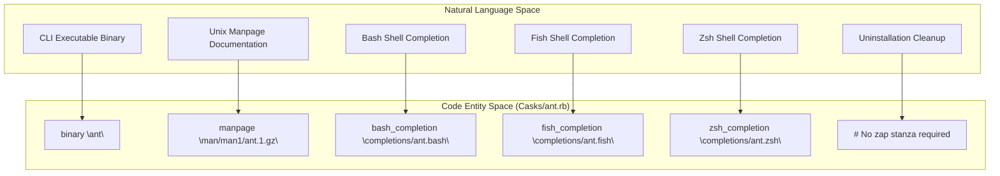

Sources: [Casks/ant.rb:35-42]()

---

## Binary and Manpage Configuration

The core executable and its corresponding system manual page are declared via the `binary` and `manpage` DSL methods:

* **Binary Stanza**: `binary "ant"` [Casks/ant.rb:35-35]() tells Homebrew to take the extracted `ant` executable and symlink it into Homebrew's global binary directory, making it directly accessible in the user's `PATH`.
* **Manpage Stanza**: `manpage "man/man1/ant.1.gz"` [Casks/ant.rb:36-36]() specifies the pre-compressed manpage located within the archive layout, ensuring it is linked into the system man path so that `man ant` functions correctly.

Sources: [Casks/ant.rb:35-36]()

---

## Shell Completions

To support command-line auto-completion across major shells, the cask defines three completion stanzas:

```ruby
  bash_completion "completions/ant.bash"
  fish_completion "completions/ant.fish"
  zsh_completion "completions/ant.zsh"
```
* **Bash**: `bash_completion` [Casks/ant.rb:37-37]() links `completions/ant.bash` to Homebrew's bash completion directories.
* **Fish**: `fish_completion` [Casks/ant.rb:38-38]() links `completions/ant.fish` to the Fish functions/completions path.
* **Zsh**: `zsh_completion` [Casks/ant.rb:39-39]() links `completions/ant.zsh` to the Zsh function path (commonly `_ant`).

The data flow for how GoReleaser bundles these artifacts and how Homebrew installs them is illustrated below:

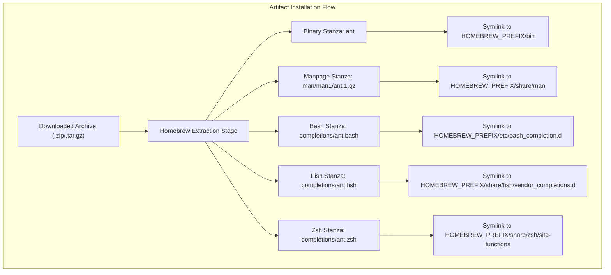

Sources: [Casks/ant.rb:35-39]()

---

## Absence of the Zap Stanza

The cask explicitly contains the comment:
```ruby
  # No zap stanza required
```
[Casks/ant.rb:41-41]()

In Homebrew Cask development, a `zap` stanza provides aggressive, state-removing uninstallation instructions (such as deleting configuration directories, local databases, or cached files in `~/Library/Application Support/`). Because the `ant` CLI operates without storing persistent state, configuration files, or local caches outside of standard transient process execution, a `zap` block is unnecessary. Standard `brew uninstall ant` removal of the symlinked binary, manpage, and completion files is fully sufficient to clean up the installation.

Sources: [Casks/ant.rb:41-42]()

---

# Page: Versioning and livecheck

# Versioning and livecheck

<details>
<summary>Relevant source files</summary>

The following files were used as context for generating this wiki page:

- [Casks/ant.rb](Casks/ant.rb)

</details>


## Purpose and Scope
This page details the versioning mechanics, livecheck omission strategy, and the strict immutability contract enforced on the Homebrew cask definition file `[Casks/ant.rb:1-43]()`. It explains how static version pinning replaces dynamic runtime checks to align with upstream release pipelines.

Sources: `[Casks/ant.rb:1-43]()`

---

## Version Pinning Mechanics
The version of the `ant` CLI is statically pinned within `[Casks/ant.rb:3-3]()` using a explicit string assignment. This version string serves as a single source of truth for all architecture-specific download URLs and checksum validations across macOS and Linux platforms `[Casks/ant.rb:5-25]()`.

When GoReleaser runs during an upstream release, it interpolates the tag version directly into the `version` stanza and propagates it to all artifact URL strings (e.g., `v#{version}`) `[Casks/ant.rb:7-22]()`.

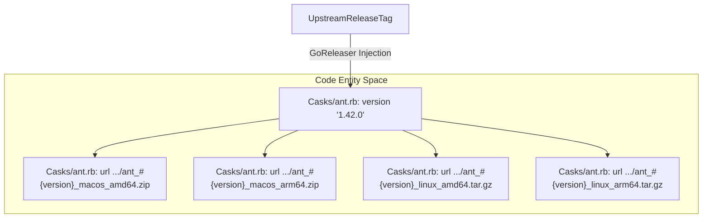
*Title: Version Pinning and URL Interpolation Data Flow*

Sources: `[Casks/ant.rb:3-25]()`

---

## Livecheck Skipping Strategy
Homebrew utilizes a feature called `livecheck` to scan upstream repositories for newer versions independently of tap updates. However, in `[Casks/ant.rb:31-33]()`, `livecheck` is explicitly configured to skip automated checks.

```ruby
  livecheck do
    skip "Auto-generated on release."
  end
```
*(Source: `[Casks/ant.rb:31-33]()`)*

### Rationale for Skipping Livecheck
1. **Automation Boundary**: The tap does not manage its own releases; it is strictly an output target of the `anthropics/anthropic-cli` publishing pipeline. 
2. **Race Condition Prevention**: If Homebrew's `livecheck` queried GitHub independently, it might flag new GitHub tags before GoReleaser has successfully regenerated and pushed the updated `[Casks/ant.rb:1-43]()` file, leading to checksum mismatches or deployment desynchronization.

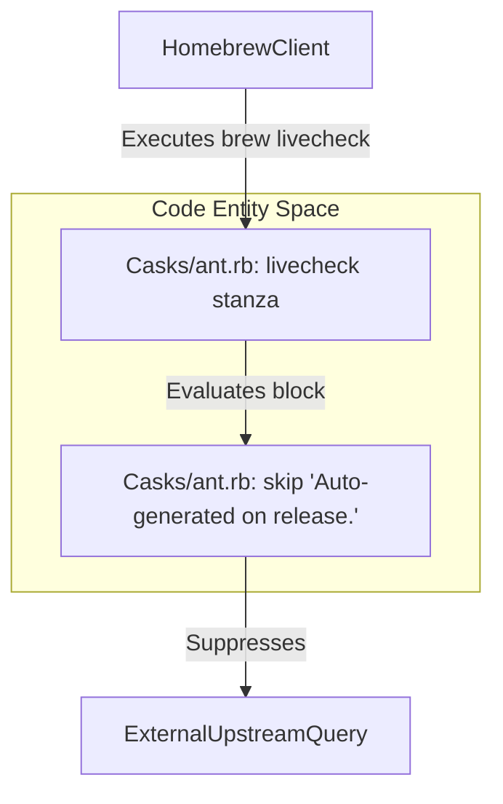
*Title: Livecheck Suppression Architecture*

Sources: `[Casks/ant.rb:31-33]()`, `[Casks/ant.rb:1-43]()`

---

## The GoReleaser "DO NOT EDIT" Contract
The first line of `[Casks/ant.rb:1-1]()` establishes a machine-written and human-restricted contract:

```ruby
# This file was generated by GoReleaser. DO NOT EDIT.
```
*(Source: `[Casks/ant.rb:1-1]()`)*

### Operational Rules of the Contract
* **No Manual Patches**: Developers must never manually edit `[Casks/ant.rb:1-43]()` to bump versions or modify checksums. All changes must flow through the upstream release automation.
* **Overwriting Behavior**: Any manual changes made to `[Casks/ant.rb:1-43]()` will be systematically overwritten the next time GoReleaser triggers a publishing event from `anthropics/anthropic-cli`.

Sources: `[Casks/ant.rb:1-1](), [Casks/ant.rb:1-43]()`

---

# Page: Release Automation and Governance

# Release Automation and Governance

<details>
<summary>Relevant source files</summary>

The following files were used as context for generating this wiki page:

- [.github/CODEOWNERS](.github/CODEOWNERS)
- [Casks/ant.rb](Casks/ant.rb)

</details>


The release automation and governance model for `anthropics/homebrew-tap` ensures that binaries distributed to Homebrew users remain tightly synchronized with upstream releases of the Claude Platform CLI (`anthropic-cli`). Because Homebrew casks execute third-party scripts and install binary artifacts directly onto user systems, the lifecycle of `Casks/ant.rb` is strictly automated via upstream CI tooling [Casks/ant.rb:1-1]() and governed by mandatory code review policies [.github/CODEOWNERS:1-4](). 

This section provides a high-level overview of the publishing workflow and supply-chain governance. For detailed technical breakdowns, see the child pages below:
- **GoReleaser Publishing Flow**: See [GoReleaser Publishing Flow](#3.1)
- **Code Ownership and Supply-Chain Review**: See [Code Ownership and Supply-Chain Review](#3.2)

---

## 3.1. GoReleaser Publishing Flow

The `Casks/ant.rb` file is not hand-written or manually maintained for every release. Instead, it is automatically generated and pushed to this repository by GoReleaser during the release pipeline of the upstream `anthropics/anthropic-cli` project. 

Because of this automation contract, any manual modifications made directly to `Casks/ant.rb` will be overwritten or invalidated the next time an upstream release is cut. The file explicitly warns maintainers of this constraint at its entry point [Casks/ant.rb:1-1]().

For details on how GoReleaser constructs the version pins, multi-platform URLs, and cryptographic `sha256` checksums [Casks/ant.rb:3-25](), see [GoReleaser Publishing Flow](#3.1).

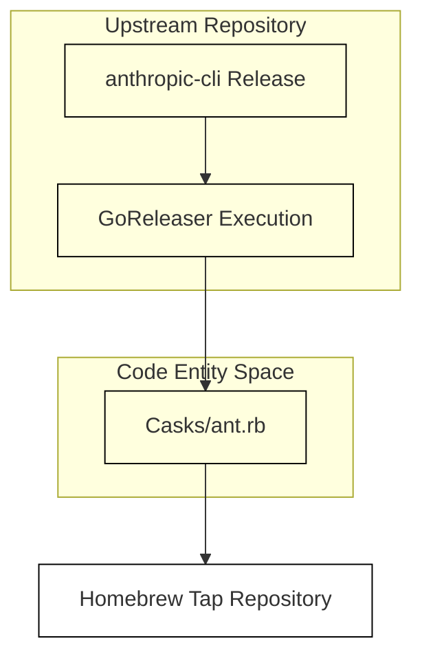
*Figure 3.1: Upstream publishing flow mapping GoReleaser execution to the target cask entity.*

**Sources:** [Casks/ant.rb:1-43](), [.github/CODEOWNERS:1-4]()

---

## 3.2. Code Ownership and Supply-Chain Review

Because Homebrew casks dictate arbitrary code execution and binary installation on end-user machines, changes to the tap represent a critical supply-chain attack surface. To mitigate this risk, global repository governance is enforced via [.github/CODEOWNERS](), which requires explicit approval from the `@anthropics/sdk` team for all pull requests [.github/CODEOWNERS:1-6]().

This security gate ensures that any updates to installation URLs or cryptographic checksums [Casks/ant.rb:7-24]() are reviewed by the same engineering team responsible for gating the upstream releases of `anthropic-cli` [.github/CODEOWNERS:1-4](). 

For a comprehensive analysis of the `.github/CODEOWNERS` configuration and why cryptographic integrity checks matter, see [Code Ownership and Supply-Chain Review](#3.2).

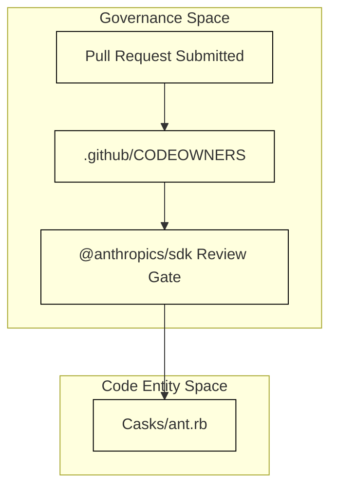
*Figure 3.2: Review workflow mapping pull requests against the `.github/CODEOWNERS` entity rule.*

**Sources:** [Casks/ant.rb:7-24](), [.github/CODEOWNERS:1-6]()

---

# Page: GoReleaser Publishing Flow

# GoReleaser Publishing Flow

<details>
<summary>Relevant source files</summary>

The following files were used as context for generating this wiki page:

- [Casks/ant.rb](Casks/ant.rb)

</details>


## Purpose and Scope

This page details the automated publishing flow driven by GoReleaser for the `anthropics/homebrew-tap` repository. Specifically, it examines how the upstream `anthropics/anthropic-cli` project programmatically generates, updates, and pushes the cask definition (`Casks/ant.rb`), and outlines the operational implications of this automated pipeline on manual maintenance and local edits [Casks/ant.rb:1-1]()].

---

## 1. Upstream Release Pipeline and Cask Generation

The publication of Homebrew cask updates is decoupled from manual pull requests within this repository. Instead, GoReleaser executes within the upstream `anthropics/anthropic-cli` repository release workflow. When a new version tag (e.g., `v1.42.0`) is published upstream, GoReleaser compiles binaries across multiple platforms, computes their cryptographic hashes, and updates the cask file structure.

The generated cask file maps the release version to platform-specific artifacts [Casks/ant.rb:3-25]():
- **macOS Intel (`amd64`) and ARM (`arm64`)**: Downloads zipped packages (`.zip`) from the GitHub release assets [Casks/ant.rb:5-14]().
- **Linux Intel (`amd64`) and ARM (`arm64`)**: Downloads tarball packages (`.tar.gz`) from the GitHub release assets [Casks/ant.rb:16-25]().

The following diagram illustrates the integration between the upstream release pipeline, GoReleaser execution, and the resulting artifact ingestion into `Casks/ant.rb`.

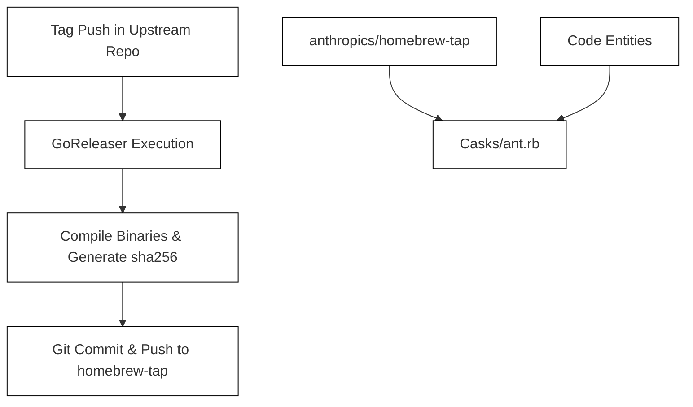
*Figure 1: Upstream publishing flow leading to `Casks/ant.rb` updates.*

Sources: [Casks/ant.rb:1-43]()

---

## 2. The "DO NOT EDIT" Contract

The first line of the cask definition enforces a strict governance constraint: `# This file was generated by GoReleaser. DO NOT EDIT.` [Casks/ant.rb:1-1](). 

Because `Casks/ant.rb` is an automatically synthesized artifact, any manual changes applied directly to this file within `anthropics/homebrew-tap` introduce severe synchronization risks:
1. **Overwritten Changes**: Subsequent upstream releases will execute GoReleaser, overwriting the entire file contents, including any manual version bumps, checksum updates, or stanza additions [Casks/ant.rb:1-43]().
2. **Skipped Livecheck**: The `livecheck` block is explicitly configured to skip automated checks because versioning is entirely bound to the upstream GoReleaser release cycle (`skip "Auto-generated on release."`) [Casks/ant.rb:31-33]().
3. **Checksum Desynchronization**: Manually altering URLs or hashes without a corresponding upstream binary build will cause `brew install --cask ant` to fail due to cryptographic hash mismatches against entries like `sha256 "c0082b29f289c44ad6c810fb6bcc0b1739447dd49c3d4f4fe71ce2539ae386fe"` [Casks/ant.rb:8-8]().

The code entity relationship between the GoReleaser automation engine and the generated cask stanzas is detailed below.

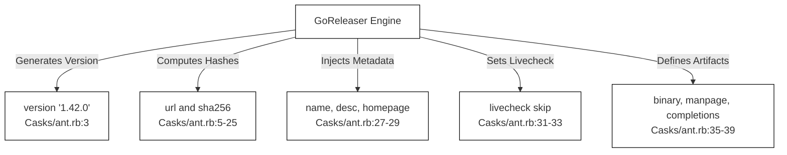
*Figure 2: Mapping GoReleaser output generation to specific stanzas inside `Casks/ant.rb`.*

Sources: [Casks/ant.rb:1-43]()

---

# Page: Code Ownership and Supply-Chain Review

# Code Ownership and Supply-Chain Review

<details>
<summary>Relevant source files</summary>

The following files were used as context for generating this wiki page:

- [.github/CODEOWNERS](.github/CODEOWNERS)

</details>


## Purpose and Scope
This section details the governance and supply-chain security model implemented in the `anthropics/homebrew-tap` repository. Specifically, it examines how the global repository review policy defined in `.github/CODEOWNERS` enforces mandatory oversight by the SDK engineering team for all modifications affecting formula definitions, download URLs, and binary cryptographic checksums [.github/CODEOWNERS:1-7].

Sources:
- [.github/CODEOWNERS:1-6]()

---

## Code Ownership Configuration

The repository utilizes GitHub's native code ownership features to automate review routing and enforce security gates. The configuration resides entirely within the repository root [.github/CODEOWNERS:1-7].

```
.github/
└── CODEOWNERS
```

The configuration uses a single global wildcard rule to ensure that any pull request modifying files within the repository requires explicit approval from the `@anthropics/sdk` GitHub team [.github/CODEOWNERS:6]. 

```text
# Require @anthropics/sdk approval on all changes. The cask formulae here
# control which binaries Homebrew installs (download URL + checksum), so
# changes should be reviewed by the same team that gates the upstream
# release in anthropic-cli.

* @anthropics/sdk
```
*Cited from [.github/CODEOWNERS:1-6]*

### Ownership Routing Flow

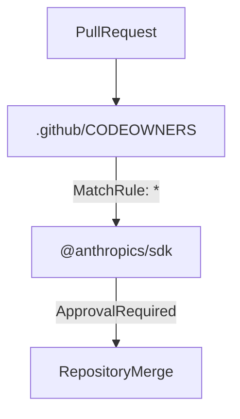
*Sources: [.github/CODEOWNERS:1-6]*

Sources:
- [.github/CODEOWNERS:1-6]()

---

## Supply-Chain Security Rationale

Homebrew taps operate by executing remote instructions and downloading compiled binaries directly onto end-user development environments. Consequently, the files contained within a tap represent a critical supply-chain attack surface.

### Why Checksum and URL Review Matters
1. **Binary Execution Context**: The formulae and casks managed in this repository dictate the exact download locations (`url`) and expected cryptographic integrity hashes (`sha256`) for the `ant` CLI.
2. **Upstream Alignment**: Because the cask definitions dictate which binaries are installed by Homebrew clients, an unauthorized or malicious modification to a download URL or checksum could redirect users to compromised binaries [.github/CODEOWNERS:2-4].
3. **Cross-Team Governance**: By routing all modifications through the `@anthropics/sdk` team — the same engineering group responsible for gating upstream releases in `anthropic-cli` — the repository ensures that automated or manual changes to distribution manifests are tightly synchronized with legitimate software releases [.github/CODEOWNERS:3-4].

### Supply-Chain Trust Verification Flow

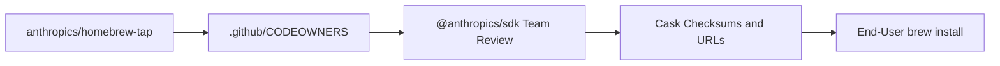
*Sources: [.github/CODEOWNERS:1-6]*

Sources:
- [.github/CODEOWNERS:1-6]()

---

# Page: Glossary

# Glossary

<details>
<summary>Relevant source files</summary>

The following files were used as context for generating this wiki page:

- [.github/CODEOWNERS](.github/CODEOWNERS)
- [Casks/ant.rb](Casks/ant.rb)

</details>


This page provides definitions for the key terminology, data structures, and architectural components used throughout the `anthropics/homebrew-tap` repository. It serves as a technical reference linking high-level Homebrew and release engineering concepts to their concrete implementations within `Casks/ant.rb` and `.github/CODEOWNERS`.

---

## Terminology Reference

### Tap
A Homebrew tap is a third-party Git repository containing custom formula and cask definitions. By running `brew tap anthropics/tap`, users add this repository to their local Homebrew installation, allowing them to install packages not hosted in Homebrew's core repository.

### Cask
A Homebrew Cask is a Ruby-based domain-specific language (DSL) script used to install macOS and Linux binary applications, fonts, and other non-formula software. In this repository, `Casks/ant.rb` defines the installation routine for the `ant` CLI tool [Casks/ant.rb:2-43]().

### Stanza
A stanza is an individual configuration block or command line within a Homebrew Cask DSL file (e.g., `version`, `url`, `sha256`, `binary`, `livecheck`). Stanzas declare the metadata and installation artifacts associated with a package [Casks/ant.rb:3-40]().

### Livecheck
The `livecheck` stanza instructs Homebrew's version-checking engine on how to detect newer upstream versions. In `Casks/ant.rb`, livecheck is explicitly skipped because updates are handled via automated upstream release gating [Casks/ant.rb:31-33]().

### Zap
The `zap` stanza defines uninstallation behavior, cleaning up user data, configuration files, and caches left behind by an application. `Casks/ant.rb` omits a `zap` stanza [Casks/ant.rb:41]().

### SHA256
A cryptographic hash function used to verify the integrity of downloaded release archives. Each platform block in `Casks/ant.rb` specifies a `sha256` checksum string to prevent supply-chain tampering [Casks/ant.rb:8-23]().

### GoReleaser
An open-source release automation tool for Go projects. GoReleaser is responsible for building binaries across platforms, generating the Homebrew cask definition (`Casks/ant.rb`), and pushing updates directly to this tap repository [Casks/ant.rb:1]().

### CODEOWNERS
A GitHub governance mechanism located at `.github/CODEOWNERS` that defines which teams or users must review pull requests affecting specific file paths [.github/CODEOWNERS:1-6]().

### AMD64 / ARM64
Hardware architecture identifiers. `amd64` refers to 64-bit x86 processors (Intel), while `arm64` refers to 64-bit ARM processors (such as Apple Silicon or ARM-based Linux servers) [Casks/ant.rb:5-24]().

### Manpage
Unix manual pages documenting command-line utilities. The cask installs a compressed manual page via the `manpage` stanza [Casks/ant.rb:36]().

### Completions
Shell-specific scripts providing auto-completion for commands and flags. The repository includes shell completion stanzas for `bash`, `fish`, and `zsh` [Casks/ant.rb:37-39]().

### Upstream Release Gating
The automated pipeline policy where releases are built and pushed from the core `anthropics/anthropic-cli` repository, ensuring that only validated artifacts reach the Homebrew tap.

---

## Architectural Mapping

The following diagram bridges the natural language concepts defined above to their exact code entities within `Casks/ant.rb` and `.github/CODEOWNERS`.

```mermaid
graph TD
    sub5["Code Entity Space"]
        CaskFile["Casks/ant.rb"]
        CodeOwners[".github/CODEOWNERS"]
        VersionBlock["version \"1.42.0\"\nCasks/ant.rb:3"]
        PlatformBlocks["on_macos / on_linux\nCasks/ant.rb:5-25"]
        ArtifactBlocks["binary / manpage / completions\nCasks/ant.rb:35-39"]
        LivecheckBlock["livecheck skip\nCasks/ant.rb:31-33"]
        OwnerRule["* @anthropics/sdk\n.github/CODEOWNERS:6"]

    sub6["Natural Language Space"]
        TapConcept["Homebrew Tap"]
        CaskConcept["Cask Definition"]
        StanzaConcept["Stanzas (url, sha256)"]
        SecurityConcept["CODEOWNERS / Supply-Chain"]
        ReleaseConcept["GoReleaser Automation"]

    TapConcept --> CaskFile
    CaskConcept --> CaskFile
    StanzaConcept --> VersionBlock
    StanzaConcept --> PlatformBlocks
    StanzaConcept --> ArtifactBlocks
    StanzaConcept --> LivecheckBlock
    SecurityConcept --> CodeOwners
    SecurityConcept --> OwnerRule
    ReleaseConcept --> CaskFile

    click CaskFile "https://github.com/anthropics/homebrew-tap/blob/main/Casks/ant.rb"
    click CodeOwners "https://github.com/anthropics/homebrew-tap/blob/main/.github/CODEOWNERS"

    style CaskFile stroke:#333,stroke-width:2px
    style CodeOwners stroke:#333,stroke-width:2px
```

Sources: [Casks/ant.rb:1-43](), [.github/CODEOWNERS:1-6]()

---

## Implementation Data Flow

The following sequence diagram illustrates how GoReleaser interacts with `Casks/ant.rb` and how GitHub enforces governance via `.github/CODEOWNERS` when manual edits or automated PRs occur.

```mermaid
sequenceDiagram
    autonumber
    participant Upstream as anthropic-cli
    participant GoReleaser as GoReleaser Engine
    participant TapRepo as homebrew-tap (Casks/ant.rb)
    participant GH as GitHub CODEOWNERS (.github/CODEOWNERS)
    participant Reviewer as @anthropics/sdk

    Upstream->>GoReleaser: Trigger release v1.42.0
    GoReleaser->>GoReleaser: Compute SHA256 checksums
    GoReleaser->>TapRepo: Generate & Push Casks/ant.rb
    Note over TapRepo: Contains version, url, sha256, stanzas
    
    alt Manual PR or Audit
        Reviewer->>GH: Open/Modify pull request
        GH->>GH: Check path rules (* @anthropics/sdk)
        GH->>Reviewer: Require approval before merge
    end
```

Sources: [Casks/ant.rb:1-43](), [.github/CODEOWNERS:1-6]()

---
Sources: [Casks/ant.rb:1-43](), [.github/CODEOWNERS:1-6]()