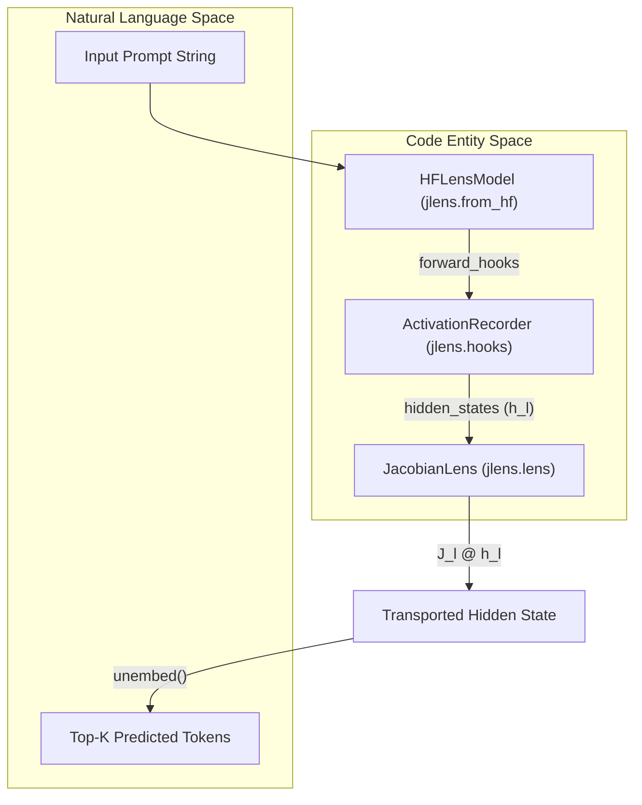
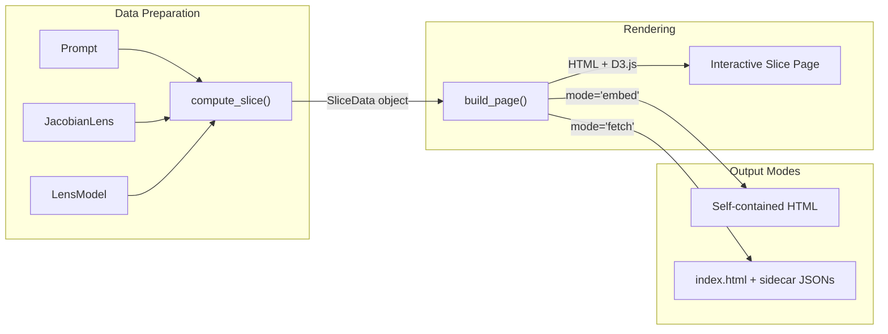

<!-- source: DeepWiki mcp.deepwiki.com · repo anthropics/jacobian-lens · page 1.1 Getting Started · fetched 2026-10-26 -->

# Getting Started

<details>
<summary>Relevant source files</summary>

The following files were used as context for generating this wiki page:

- [README.md](README.md)
- [pyproject.toml](pyproject.toml)
- [uv.lock](uv.lock)
- [walkthrough.ipynb](walkthrough.ipynb)

</details>


This page provides technical instructions for installing the `jlens` library, setting up the development environment, and executing a quick-start workflow. The Jacobian lens is a tool for reading out verbalizable representations from the internal activations of transformer models by transporting residual-stream vectors into the final-layer basis using a pre-computed Jacobian matrix [README.md:8-11]().

## Installation and Dependencies

The project uses a standard Python structure and can be installed via `pip`. It requires Python 3.10 or higher [pyproject.toml:10-12]().

### Core Dependencies
The library relies on the following primary packages:
*   `torch`: Tensor operations and autograd for Jacobian computation.
*   `transformers >= 5.5`: Loading and interfacing with HuggingFace models.
*   `huggingface_hub`: Downloading pre-fitted lens weights.
*   `numpy`: General numerical utilities.

[pyproject.toml:13-17]()

### Environment Setup
You can install the package in editable mode for development:

```bash
pip install -e .
```
[README.md:37-37]()

For contributors, optional development dependencies (including `pytest`, `ruff` for linting, and `datasets` for corpus loading) can be installed:
```bash
pip install -e ".[dev]"
```
[pyproject.toml:23-24]()

## Quick-Start Walkthrough

The repository includes a reference notebook, `walkthrough.ipynb`, which demonstrates the end-to-end pipeline: model loading, lens application, and visualization.

### 1. Loading a Model
The `jlens.from_hf` factory function is used to wrap a standard HuggingFace `AutoModelForCausalLM` into a `LensModel` protocol. This protocol provides a unified interface for the library to interact with different model architectures (Llama, Qwen, etc.) [walkthrough.ipynb:42-42](), [README.md:51-51]().

### 2. Loading a Pre-fitted Lens
The `JacobianLens` class represents the fitted transport matrices $J_l$ for each layer $l$. You can load these from the HuggingFace Hub using `JacobianLens.from_pretrained()` [walkthrough.ipynb:70-70]().

```python
import jlens
from jlens.lens import JacobianLens

# Load lens from a specific repository and file path
lens = JacobianLens.from_pretrained(
    "neuronpedia/jacobian-lens", 
    filename="qwen3.5-4b/jlens/Salesforce-wikitext/Qwen3.5-4B_jacobian_lens_n1000.pt"
)
```
[walkthrough.ipynb:80-82](), [README.md:53-53]()

### 3. Comparing J-Lens and Logit Lens
The `lens.apply()` method performs the transport operation. By setting `use_jacobian=False`, the library performs a "logit lens" baseline (direct unembedding without transport) [walkthrough.ipynb:93-93]().

**Data Flow: Lens Application**

| Step | Entity | Action |
| :--- | :--- | :--- |
| 1 | `LensModel` | Performs forward pass to collect hidden states $h_l$ [walkthrough.ipynb:93-93]() |
| 2 | `JacobianLens` | Multiplies $h_l$ by the stored Jacobian $J_l$ to get transported vector $h'_{final}$ [README.md:16-16]() |
| 3 | `LensModel` | Applies the model's final LayerNorm and Unembedding to $h'_{final}$ [README.md:16-16]() |

**System Logic Diagram**
Title: Logic Flow for `JacobianLens.apply`

Sources: [README.md:47-59](), [walkthrough.ipynb:113-116](), [jlens/lens.py:1-50] (implied by class usage)

### 4. Rendering a Slice Page
The visualization subsystem renders a position-by-layer grid of the model's internal state.

*   **`compute_slice`**: Calculates the top-1 token and rank for every layer and position in the prompt [walkthrough.ipynb:162-170]().
*   **`build_page`**: Generates the HTML/D3 visualization. It supports two modes:
    *   `mode="embed"`: Inlines all data for a self-contained file [walkthrough.ipynb:136-136]().
    *   `mode="fetch"`: Writes sidecar JSON files to an `out_dir` for lazy loading, which is more efficient for long prompts [walkthrough.ipynb:188-188]().

**Visualization Data Flow**
Title: Slice Visualization Pipeline

Sources: [walkthrough.ipynb:150-179](), [walkthrough.ipynb:209-217]()

## Summary Table of Key Functions

| Function/Method | File | Purpose |
| :--- | :--- | :--- |
| `jlens.from_hf()` | `jlens/__init__.py` | Wraps a HuggingFace model for use with the lens [walkthrough.ipynb:59-59](). |
| `JacobianLens.from_pretrained()` | `jlens/lens.py` | Loads transport matrices from the Hub or disk [walkthrough.ipynb:80-82](). |
| `lens.apply()` | `jlens/lens.py` | Runs the lens transport and returns logits [walkthrough.ipynb:113-113](). |
| `jlens.vis.compute_slice()` | `jlens/vis.py` | Pre-calculates the layer x position grid data [walkthrough.ipynb:162-162](). |
| `jlens.vis.build_page()` | `jlens/vis.py` | Renders the interactive D3 visualization [walkthrough.ipynb:171-171](). |

Sources: [walkthrough.ipynb:42-217](), [README.md:42-80]()

---

