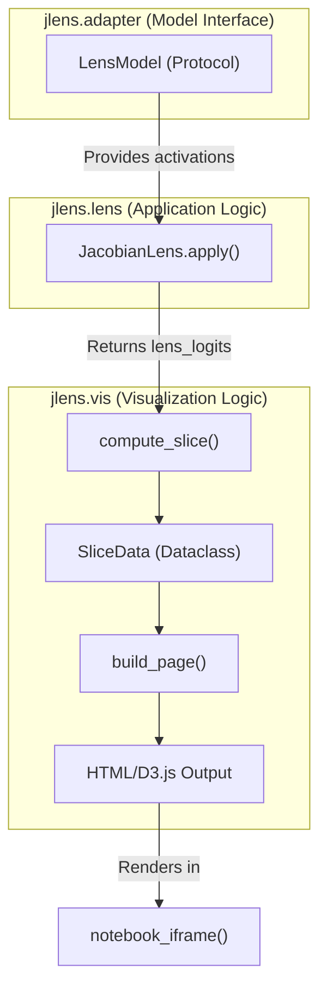
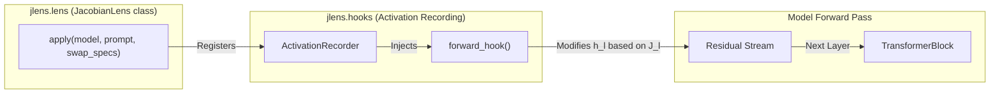

<!-- source: DeepWiki mcp.deepwiki.com · repo anthropics/jacobian-lens · page 1.2 Key Concepts and Terminology · fetched 2026-10-26 -->

# Key Concepts and Terminology

Relevant source files

The following files were used as context for generating this wiki page:

- [README.md](README.md)
- [data/evaluations/README.md](data/evaluations/README.md)
- [data/experiments/README.md](data/experiments/README.md)

The `jacobian-lens` project implements a method for interpreting the internal representations of decoder-only transformer models by observing what an activation is "disposed" to make the model say. This page defines the mathematical and architectural concepts used throughout the codebase.

## Residual Stream and Linear Transport

In a transformer, the **residual stream** $h_l$ at layer $l$ is the sum of all previous layer outputs and the initial embedding. The Jacobian lens operates by linearly transporting a vector from the residual stream at any layer $l$ directly into the final layer's basis $h_L$.

Unlike the "Logit Lens," which applies the unembedding matrix directly to intermediate states $h_l$, the Jacobian lens accounts for the cumulative effect of all subsequent layers $\{l+1, \dots, L\}$ by using a first-order Taylor approximation of the model's remaining forward pass.

### Jacobian Transport
The core operation is defined as:
$$\text{lens}_l(h) = \text{unembed}(J_l \cdot h)$$
Where $J_l$ is the **Jacobian transport matrix**, representing the average input-output gradient across a corpus:
$$J_l = \mathbb{E}[\partial h_L / \partial h_l]$$

This matrix captures the linear relationship between an internal state and the final logit space, effectively "projecting" hidden concepts into verbalizable tokens.

Sources: [README.md:8-17](), [jlens/fitting.py:22-22]()

---

## Logit Lens vs. Jacobian Lens

The repository supports both interpretation methods for comparison.

| Feature | Logit Lens | Jacobian Lens |
| :--- | :--- | :--- |
| **Mechanism** | `unembed(h_l)` | `unembed(J_l @ h_l)` |
| **Assumption** | Intermediate layers share the final logit space. | Intermediate layers must be transported to the final space. |
| **Implementation** | `use_jacobian=False` in `JacobianLens.apply` | `use_jacobian=True` (default) |
| **Fidelity** | Often noisy in early/mid layers. | High fidelity across the "Workspace Band." |

Sources: [jlens/lens.py:114-118](), [README.md:53-59]()

---

## Workspace Band

The **Workspace Band** refers to the contiguous range of mid-network layers where the model's internal representations are most "verbalizable" and stable. 

- **Global Workspace Theory Motivation:** The lens is designed to test the hypothesis that transformer models maintain a "global workspace" where different components (attention heads, MLP blocks) contribute to a shared, language-like representation space.
- **Experimental Usage:** Most evaluations in the `data/evaluations/` and `data/experiments/` directories do not report results for a single layer. Instead, they aggregate "Hits" across the layers within this band.
- **Hit Definition:** A target token is a **Hit** if it appears at rank 1 in the lens readout at *any* (layer, position) within the defined workspace band.

Sources: [data/evaluations/README.md:11-15](), [data/experiments/README.md:9-15]()

---

## Slice Visualization

A **Slice** is the primary visualization tool in the library. It produces a 2D grid where:
- **X-axis:** Token positions in the prompt.
- **Y-axis:** Model layers (from 0 to $L$).
- **Cells:** The top-1 token predicted by the lens at that (position, layer), along with its vocabulary rank.

### Code-to-System Mapping: Visualization Data Flow

The following diagram shows how raw model activations are transformed into the interactive HTML slice visualization.

Sources: [jlens/vis/compute.py:10-25](), [jlens/vis/page.py:15-30](), [jlens/lens.py:90-110]()

---

## Causal Intervention: The "Swap" Operation

Beyond passive observation, the Jacobian lens allows for **Causal Interventions**. Because $J_l$ provides a linear mapping, we can identify the direction in the residual stream corresponding to a specific token $T$ and "swap" it for another token $T'$.

1. **Direction Extraction:** The direction for token $T$ is the $T$-th row of the transposed Jacobian matrix.
2. **Clamping:** In the `JacobianLens.apply` logic, the activation $h_l$ is modified by removing the component of $T$ and adding the component of $T'$.
3. **Behavioral Test:** If swapping the "concept" in the mid-layers changes the model's final output (e.g., changing the bridge entity in a multi-hop reasoning task), it proves the lens is reading a causally relevant representation.

### Code-to-System Mapping: Causal Swap Execution

This diagram illustrates how the `JacobianLens` interacts with the `ActivationRecorder` to perform a swap during a forward pass.

Sources: [jlens/lens.py:90-130](), [jlens/hooks.py:45-60](), [data/experiments/README.md:16-18]()

---

## Terminology Summary Table

| Term | Definition | Code Reference |
| :--- | :--- | :--- |
| **Fitting** | The process of estimating $J_l$ by averaging gradients over a corpus. | `jlens.fit()` in [jlens/fitting.py:145]() |
| **Unembedding** | The final linear layer mapping $h_L$ to vocabulary logits. | `LensModel.unembed` in [jlens/protocol.py:25]() |
| **Cotangent** | The gradient $\partial \mathcal{L} / \partial h_L$ used during the backward pass to compute the Jacobian. | `jacobian_for_prompt()` in [jlens/fitting.py:65]() |
| **Top-K Rank** | The position of a target token in the sorted list of lens-produced logits. | `_ranks_of()` in [jlens/vis/compute.py:110]() |
| **Merge** | Combining $J_l$ matrices fitted on different data slices to improve the estimate. | `JacobianLens.merge()` in [jlens/lens.py:165]() |

Sources: [jlens/protocol.py:10-30](), [jlens/fitting.py:60-80](), [jlens/lens.py:160-180]()

---

