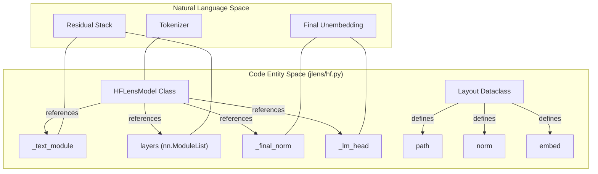
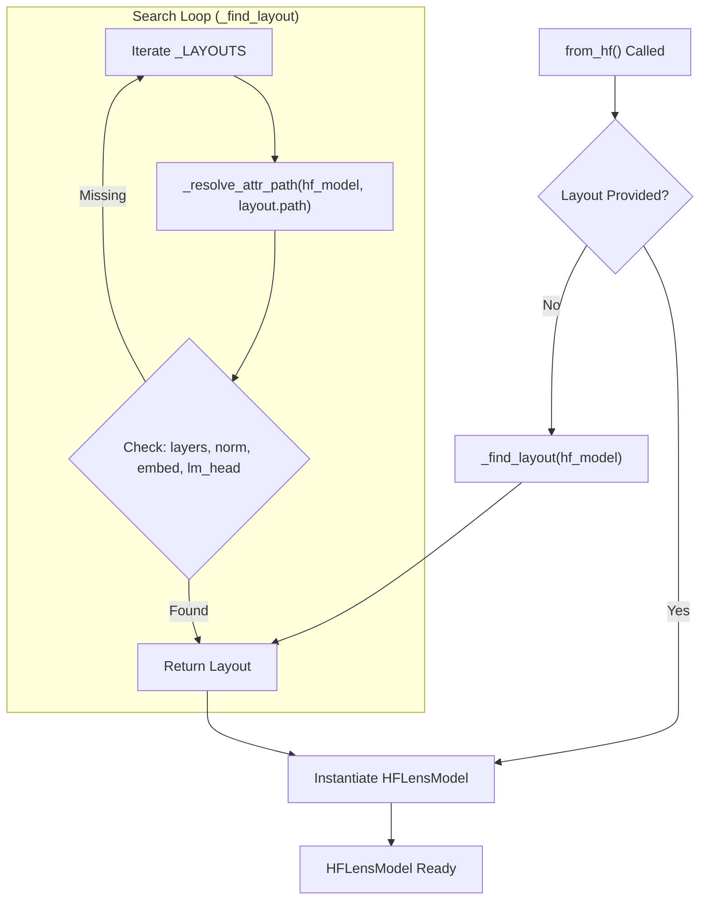

<!-- source: DeepWiki mcp.deepwiki.com · repo anthropics/jacobian-lens · page 2.1 Model Protocol and HuggingFace Adapter · fetched 2026-10-26 -->

# Model Protocol and HuggingFace Adapter

Relevant source files

The following files were used as context for generating this wiki page:

- [jlens/hf.py](jlens/hf.py)
- [jlens/protocol.py](jlens/protocol.py)

This page documents the interface and adapter layers that allow `jlens` to interact with Transformer models. The library is designed to be model-agnostic by defining a formal `LensModel` protocol, while providing a robust `HFLensModel` adapter that automatically detects and wraps common HuggingFace model architectures.

### The LensModel Protocol

The `LensModel` protocol defines the minimal set of attributes and methods required for Jacobian lens fitting and application. Any class satisfying this protocol can be used with the library, enabling support for custom model implementations or non-HuggingFace frameworks.

| Member | Type | Description |
|:---|:---|:---|
| `n_layers` | `int` | Total number of residual blocks/layers. [jlens/protocol.py:32-32]() |
| `d_model` | `int` | The dimensionality of the residual stream. [jlens/protocol.py:33-33]() |
| `layers` | `Sequence[nn.Module]` | An indexable sequence of modules representing the residual blocks. These are the targets for `ActivationRecorder` hooks. [jlens/protocol.py:34-34]() |
| `tokenizer` | `Any` | Must support `decode(token_ids) -> str` for visualization. [jlens/protocol.py:35-35]() |
| `encode()` | `Method` | Converts text to a `[1, seq_len]` tensor on the correct device. [jlens/protocol.py:37-40]() |
| `forward()` | `Method` | Executes the residual stack. Must build an autograd graph through `layers`. [jlens/protocol.py:42-47]() |
| `unembed()` | `Method` | Maps a residual tensor `[..., d_model]` to logits via the final norm and LM head. [jlens/protocol.py:49-52]() |

**Sources:** [jlens/protocol.py:19-53]()

---

### HuggingFace Adapter (`HFLensModel`)

The `HFLensModel` class implements the `LensModel` protocol for models loaded via the HuggingFace `transformers` library. It acts as a non-destructive wrapper, holding references to the original model's submodules without copying parameters.

#### Initialization and Mutation
When an `HFLensModel` is instantiated, it performs several setup steps on the underlying `hf_model`:
1.  **Eval Mode**: Sets `hf_model.eval()` to ensure deterministic behavior (e.g., disabling dropout). [jlens/hf.py:112-112]()
2.  **Grad Disabling**: Sets `requires_grad_(False)` for all parameters. The Jacobian fitting process only requires gradients with respect to activations, not weights. [jlens/hf.py:113-114]()
3.  **BOS Handling**: If `force_bos` is true, it configures the tokenizer to prepend the Beginning-of-Sequence token. [jlens/hf.py:105-110]()
4.  **Per-Layer Compilation**: If `compile=True`, it wraps each individual block in `torch.compile`. This preserves hook boundaries at layer interfaces while optimizing internal block execution. [jlens/hf.py:141-146]()

#### Layout Detection
Because HuggingFace models do not follow a unified attribute naming convention (e.g., Llama uses `model.layers`, while GPT-2 uses `transformer.h`), the adapter uses a `Layout` dataclass to locate internal modules.

**Layout Structure:**
The `Layout` dataclass [jlens/hf.py:30-47]() specifies:
*   `path`: Dotted path to the text decoder (e.g., `"model"`).
*   `layers`: Attribute name for residual blocks (default: `"layers"`).
*   `norm`: Attribute name for the final layer norm (default: `"norm"`).
*   `embed`: Attribute name for input embeddings (default: `"embed_tokens"`).
*   `lm_head`: Attribute name for the unembedding head (default: `"lm_head"`).

**Sources:** [jlens/hf.py:83-174]()

---

### Data Flow and Component Mapping

The following diagram bridges the "Natural Language Space" (how we talk about the model) to the "Code Entity Space" (the specific classes and attributes in `jlens`).

**Component Mapping: Logical Model to Code Entities**

**Sources:** [jlens/hf.py:30-47](), [jlens/hf.py:83-123]()

---

### Auto-Detection Logic

The `from_hf()` factory function automates the creation of an `HFLensModel`. It uses `_find_layout()` to iterate through a list of known architectural patterns (`_LAYOUTS`) until it finds a match where all required attributes exist.

**Supported Model Families:**
The predefined layouts cover a wide range of modern architectures:
*   **Modern Defaults**: Llama, Qwen, Mistral, Gemma, OLMo, StableLM. [jlens/hf.py:54-56]()
*   **Phi**: Detected via `norm="final_layernorm"`. [jlens/hf.py:57-57]()
*   **GPT-2**: Detected via `transformer.h` and `ln_f`. [jlens/hf.py:58-58]()
*   **Pythia/GPT-NeoX**: Detected via `gpt_neox` and `final_layer_norm`. [jlens/hf.py:59-62]()

**Detection Workflow**

**Sources:** [jlens/hf.py:53-81](), [jlens/hf.py:177-203]()

---

### Implementation Details

#### Unembedding with Softcapping
The `unembed` method handles the transformation from residual space to logit space. It includes logic to handle "logit softcapping" found in models like Gemma 2. If `final_logit_softcapping` is present in the model config, the method applies `softcap * tanh(logits / softcap)` after the linear head. [jlens/hf.py:166-174]()

#### Attribute Resolution
The helper function `_resolve_attr_path` uses `functools.reduce` and `getattr` to traverse nested module trees based on the dotted strings provided in a `Layout`. [jlens/hf.py:25-26]()

**Sources:** [jlens/hf.py:25-26](), [jlens/hf.py:128-130](), [jlens/hf.py:172-173]()

---

