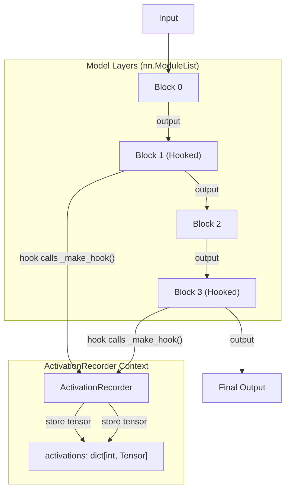
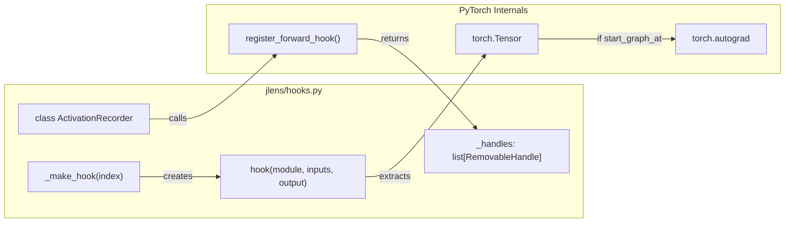

<!-- source: DeepWiki mcp.deepwiki.com · repo anthropics/jacobian-lens · page 2.2 Activation Recording and Hooks · fetched 2026-10-26 -->

# Activation Recording and Hooks

Relevant source files

The following files were used as context for generating this wiki page:

- [jlens/hooks.py](jlens/hooks.py)

The `ActivationRecorder` is a specialized context manager designed to capture the internal state of a Transformer model's residual stream during a forward pass. It serves two primary roles in the `jacobian-lens` library: providing the hidden states required for logit-lens visualization and, crucially, rooting the autograd graph at specific layers to enable efficient Jacobian computation.

## The ActivationRecorder Class

Defined in `jlens/hooks.py`, the `ActivationRecorder` class manages the lifecycle of PyTorch forward hooks. It is designed to be used within a `with` block, ensuring that hooks are automatically registered and subsequently removed to prevent memory leaks or unintended side effects in the model's behavior [jlens/hooks.py:13-29]().

### Key Features
*   **Selective Recording**: It only records activations at user-specified block indices, reducing memory overhead [jlens/hooks.py:34-39]().
*   **Autograd Rooting**: It can mark a specific layer's output as requiring gradients, effectively making that tensor the leaf node for backpropagation [jlens/hooks.py:52-53]().
*   **Tuple Handling**: It automatically detects and unpacks standard HuggingFace return types where a block might return a tuple (e.g., `(hidden_states, key_values)`) instead of a raw tensor [jlens/hooks.py:50-51]().

### Data Flow: Activation Capture
The following diagram illustrates how `ActivationRecorder` intercepts the data flow between residual blocks.

**Diagram: Hook Registration and Data Interception**

Sources: [jlens/hooks.py:43-55](), [jlens/hooks.py:58-69]()

## Implementation Details

### Hook Registration and Cleanup
The `__enter__` method iterates through the requested indices and attaches a hook to each corresponding block in the model's `blocks` sequence [jlens/hooks.py:58-63](). If an error occurs during registration, it immediately removes any successfully attached handles to maintain model integrity [jlens/hooks.py:64-68](). Upon exiting the context via `__exit__`, all handles are removed [jlens/hooks.py:71-74]().

### Rooting the Autograd Graph
A critical feature for Jacobian computation is the `start_graph_at` parameter. When the Jacobian Lens fits a matrix $J_l$, it needs to compute the gradient of the logits with respect to the residual stream at layer $l$. 

By setting `start_graph_at=l`, the `ActivationRecorder` calls `tensor.requires_grad_(True)` on the output of block $l$ [jlens/hooks.py:52-53](). In a scenario where model parameters have `requires_grad=False`, this makes the residual at layer $l$ the "root" of the autograd graph. This optimization ensures that `torch.autograd.grad` only traverses the path from the logits back to layer $l$, rather than all the way to the input embeddings, significantly speeding up the backward pass [jlens/hooks.py:24-28]().

### Component Interaction
The following diagram maps the logical operations of recording to the specific code entities in `jlens/hooks.py`.

**Diagram: Code Entity Mapping for Recording Logic**

Sources: [jlens/hooks.py:13-75]()

## Usage Summary

| Argument | Type | Description |
| :--- | :--- | :--- |
| `blocks` | `Sequence[nn.Module]` | The list of residual blocks (usually `model.layers`). |
| `at` | `Iterable[int]` | Indices of blocks where activations should be captured. |
| `start_graph_at` | `int \| None` | The index where `requires_grad_(True)` is applied to the output. |

The captured tensors are stored in the `activations` dictionary, where keys are the integer indices of the blocks [jlens/hooks.py:43](). Because these tensors are not detached by default, they retain their connection to the autograd graph, making them suitable for subsequent gradient calculations [jlens/hooks.py:18-19]().

Sources: [jlens/hooks.py:13-43]()

---

