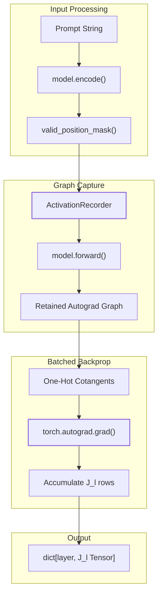
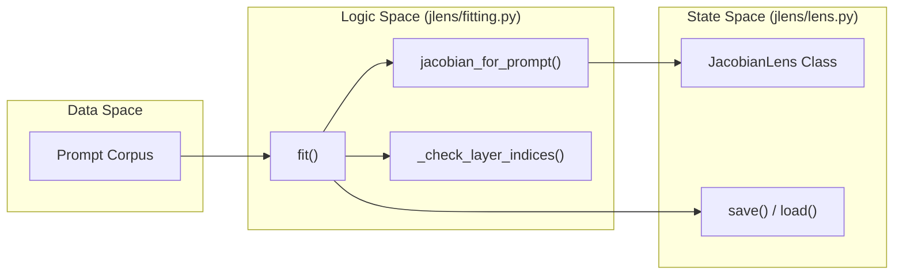

<!-- source: DeepWiki mcp.deepwiki.com · repo anthropics/jacobian-lens · page 2.3 Fitting the Jacobian Lens · fetched 2026-10-26 -->

# Fitting the Jacobian Lens

Relevant source files

The following files were used as context for generating this wiki page:

- [jlens/fitting.py](jlens/fitting.py)

The Jacobian Lens approximates the transformation between an early-layer residual state $h_l$ and the final-layer representation by computing the average input-output Jacobian $J_l$. This allows for a linear "transport" of hidden states into the model's own vocabulary space using its existing unembedding layer [jlens/fitting.py:5-10]().

## Mathematical Estimator

The lens utilizes an estimator for $J_l$ that aggregates gradients across sequence positions. For a given prompt, the Jacobian is computed such that the gradient at source position $p$ is the sum of gradients over all subsequent target positions $p' \geq p$ [jlens/fitting.py:11-14]().

To ensure statistical stability, certain positions are excluded from the average:
*   **Attention Sinks:** The first 16 positions are typically excluded as they exhibit atypical residual statistics [jlens/fitting.py:40-42]().
*   **Final Position:** The last token is excluded because it has no subsequent next-token target to influence [jlens/fitting.py:49-51]().

Sources: [jlens/fitting.py:1-72]()

## Implementation: `jacobian_for_prompt`

The `jacobian_for_prompt()` function computes the $J_l$ matrix for a single prompt using a batched backward pass strategy. This approach is significantly more efficient than a naive per-dimension backpropagation [jlens/fitting.py:100-118]().

### Data Flow and Batching
The function replicates the input prompt `dim_batch` times. It performs one forward pass and retains the autograd graph. Then, it executes approximately `d_model / dim_batch` backward passes. In each backward pass, a "one-hot cotangent" is injected at specific output dimensions across all valid target positions simultaneously [jlens/fitting.py:112-118]().

### Jacobian Computation Diagram
The following diagram illustrates the flow from a prompt string to the resulting Jacobian matrices.

"Jacobian Computation Flow"

Sources: [jlens/fitting.py:100-165](), [jlens/hooks.py:14-30]()

## The `fit()` Function

The `fit()` function manages the estimation of $J_l$ over a corpus of prompts. It computes a running mean of the Jacobians, ensuring that the final lens reflects the model's behavior across a broad distribution of text [jlens/fitting.py:200-215]().

### Key Features
*   **Running Mean:** Jacobians are accumulated and averaged to prevent memory exhaustion from storing per-prompt matrices [jlens/fitting.py:270-275]().
*   **Checkpointing:** The function saves intermediate `JacobianLens` objects to a `checkpoint_path`. This allows for recovery in case of hardware failure or preemption [jlens/fitting.py:254-260]().
*   **Resumption:** If a checkpoint exists, `fit()` will automatically load the existing state and skip prompts that have already been processed [jlens/fitting.py:240-250]().

### System Component Mapping
This diagram maps the high-level fitting logic to the specific code entities involved in the process.

"Fitting System Mapping"

Sources: [jlens/fitting.py:200-280](), [jlens/lens.py:33-50]()

## Parallelization and Merging

The computational cost of fitting a lens is roughly one forward pass and `d_model / dim_batch` backward passes per prompt [jlens/fitting.py:19-20](). To scale this process, the workload can be sharded across multiple GPUs or machines.

1.  **Shard:** Divide the prompt corpus into disjoint slices.
2.  **Fit:** Run `fit()` on each slice independently, producing multiple `.pt` lens files.
3.  **Merge:** Use `JacobianLens.merge()` to combine the resulting lenses into a single global average [jlens/fitting.py:20-21]().

The `merge()` method performs a weighted average based on the number of valid positions processed by each individual lens, ensuring mathematical correctness [jlens/lens.py:167-185]().

### Recommended Parameters
| Parameter | Typical Value | Description |
| :--- | :--- | :--- |
| `dim_batch` | 8 - 32 | Number of Jacobian rows computed per backward pass. Higher values increase VRAM usage [jlens/fitting.py:128-130](). |
| `max_seq_len` | 128 - 512 | Length of prompts. Longer prompts provide more "valid positions" per forward pass [jlens/fitting.py:131](). |
| `skip_first` | 16 | Number of initial tokens to ignore to avoid attention sink artifacts [jlens/fitting.py:42](). |

Sources: [jlens/fitting.py:19-22](), [jlens/fitting.py:106-133](), [jlens/lens.py:167-190]()

---

