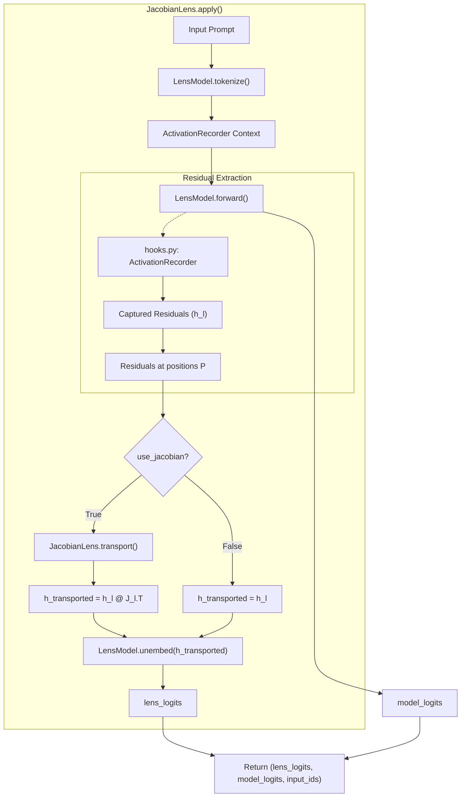
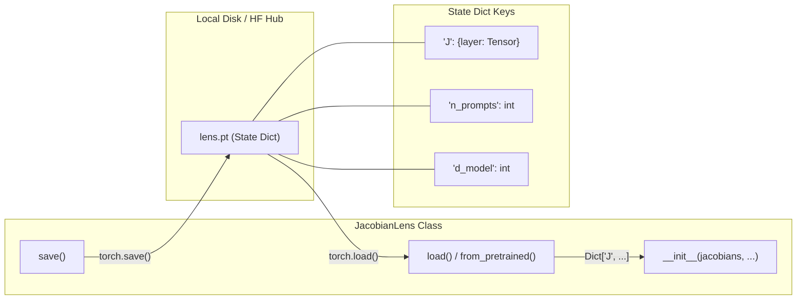

<!-- source: DeepWiki mcp.deepwiki.com · repo anthropics/jacobian-lens · page 2.4 Applying the Lens (`JacobianLens`) · fetched 2026-10-26 -->

# Applying the Lens (`JacobianLens`)

Relevant source files

The following files were used as context for generating this wiki page:

- [jlens/lens.py](jlens/lens.py)

The `JacobianLens` class is the primary interface for using a fitted Jacobian lens to interpret a model's internal representations. It encapsulates the collection of per-layer Jacobian matrices ($J_l$) and provides methods for transforming residual stream activations into the final-layer logit space.

### Purpose and Scope
The `JacobianLens` class serves as the bridge between the training phase (fitting) and the interpretation phase (visualization or evaluation). It supports:
*   **Jacobian Transport**: Linear projection of hidden states from intermediate layers to the final layer basis.
*   **Logit-Lens Baseline**: Optional "vanilla" logit-lens mode where activations are passed directly to the unembedding layer without Jacobian transformation.
*   **Model Integration**: Execution of forward passes on a `LensModel` while capturing internal states via `ActivationRecorder`.
*   **Persistence**: Saving and loading lens weights from disk or the HuggingFace Hub.

---

### The `JacobianLens` Class

The class stores a dictionary of Jacobian matrices, where each key is a layer index and each value is a $[d_{model}, d_{model}]$ tensor representing the mean Jacobian $J_l$ for that layer.

#### Key Attributes
| Attribute | Type | Description |
| :--- | :--- | :--- |
| `jacobians` | `dict[int, Tensor]` | Maps layer indices to their respective $J_l$ matrices. [jlens/lens.py:26-27]() |
| `source_layers` | `list[int]` | A sorted list of layer indices for which Jacobians are available. [jlens/lens.py:28-28]() |
| `n_prompts` | `int` | The number of prompts used to calculate the mean Jacobian (metadata for merging). [jlens/lens.py:29-29]() |
| `d_model` | `int` | The dimensionality of the model's residual stream. [jlens/lens.py:30-30]() |

Sources: `[jlens/lens.py:22-44]()`

---

### Data Flow: Activation Transport and Readout

The core operation of the lens is `transport()`, which implements the linear transformation $h' = h \cdot J_l^T$. The `apply()` method orchestrates the full pipeline: running the model, recording residuals, transporting them, and applying the final unembedding (norm and linear head).

#### System Data Flow Diagram
This diagram illustrates how `JacobianLens.apply` interacts with the `LensModel` and `ActivationRecorder` to produce interpretability data.

Sources: `[jlens/lens.py:135-144]()`, `[jlens/lens.py:146-218]()`, `[jlens/hooks.py:20-64]()`

---

### Key Methods

#### `transport(residual, layer)`
Maps a residual vector from a specific layer into the final-layer basis. It performs a matrix multiplication: `residual @ self.jacobians[layer].T`. This method expects the `residual` tensor to have the shape `[..., d_model]`.
*   **Implementation**: `[jlens/lens.py:135-144]()`

#### `apply(model, prompt, ...)`
The high-level entry point for lens application.
1.  **Tokenization**: Converts the prompt into `input_ids` using `model.tokenize()`. [jlens/lens.py:195-195]()
2.  **Recording**: Uses `ActivationRecorder` to hook into the specified `layers`. [jlens/lens.py:198-198]()
3.  **Inference**: Runs `model.forward(input_ids)`. [jlens/lens.py:199-199]()
4.  **Transport**: For each layer, it retrieves the captured residual $h$, slices it to the requested `positions`, and optionally applies `transport()`. [jlens/lens.py:204-211]()
5.  **Unembedding**: Passes the (transported) residuals through `model.unembed()` to get vocabulary-space logits. [jlens/lens.py:212-212]()

#### `merge(lenses)`
Allows for parallelized fitting. If multiple lenses were fitted on disjoint subsets of a corpus, `merge()` calculates an `n_prompts`-weighted mean of their Jacobian matrices. This is mathematically equivalent to fitting on the combined corpus in a single pass.
*   **Implementation**: `[jlens/lens.py:106-133]()`

---

### Persistence and Loading

`JacobianLens` supports standard PyTorch serialization and integration with the HuggingFace Hub.

| Method | Description |
| :--- | :--- |
| `save(path)` | Saves the lens as a dictionary containing "J", "n_prompts", "source_layers", and "d_model". Defaults to `fp16` to save space. [jlens/lens.py:52-64]() |
| `load(path)` | Loads a lens from a local file. [jlens/lens.py:67-79]() |
| `from_pretrained(name_or_path)` | Loads from a file, a directory, or downloads from a HuggingFace Hub repository using `snapshot_download`. [jlens/lens.py:82-103]() |

#### Code Entity Mapping: Persistence
The following diagram maps the logical storage structure to the code entities responsible for handling them.

Sources: `[jlens/lens.py:52-103]()`

---

### Logit-Lens Baseline

The `JacobianLens` class explicitly supports the **Logit-Lens** baseline by setting `use_jacobian=False` in the `apply()` method. 

*   **Behavior**: When `use_jacobian` is `False`, the `transport()` step is skipped. The raw residual $h_l$ is passed directly to `model.unembed()`. [jlens/lens.py:209-212]()
*   **Utility**: This allows researchers to compare the "Identity" transport (Logit-Lens) against the "Jacobian" transport within the same API, ensuring that improvements in interpretability are attributable to the $J_l$ matrices rather than differences in the unembedding pipeline.

Sources: `[jlens/lens.py:154-154]()`, `[jlens/lens.py:209-212]()`

---

