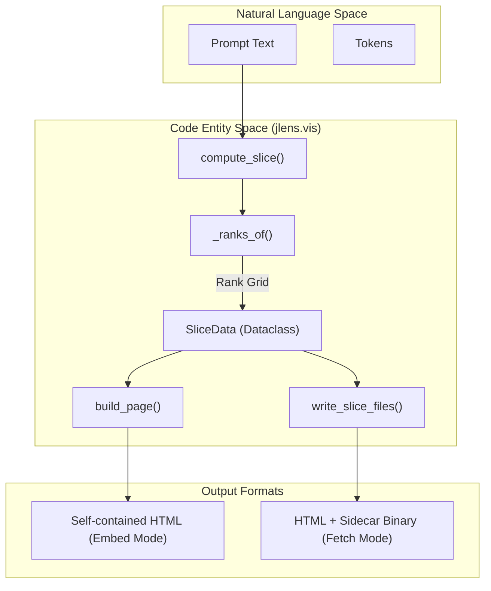
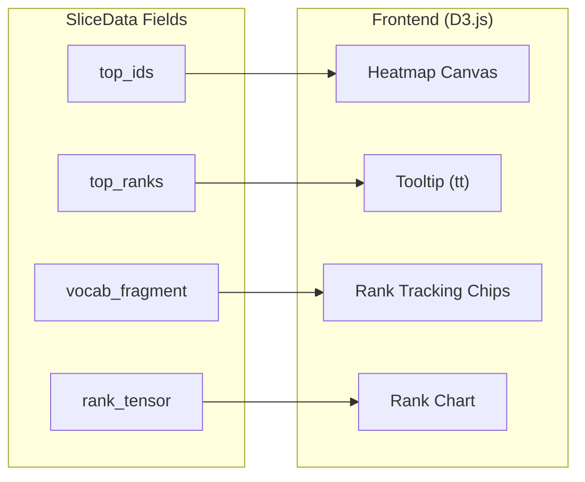

<!-- source: DeepWiki mcp.deepwiki.com · repo anthropics/jacobian-lens · page 2.5 Slice Visualization (`jlens.vis`) · fetched 2026-10-26 -->

# Slice Visualization (`jlens.vis`)

Relevant source files

The following files were used as context for generating this wiki page:

- [assets/qwen_gloss.json.gz](assets/qwen_gloss.json.gz)
- [assets/slice_vis.png](assets/slice_vis.png)
- [jlens/data/slice_vis.html](jlens/data/slice_vis.html)
- [jlens/vis.py](jlens/vis.py)

The `jlens.vis` module provides tools for generating interactive, high-fidelity visualizations of Jacobian lens outputs. It produces a "Slice Visualization"—a grid of position $\times$ layer where each cell displays the top-1 predicted token and its rank. This tool is designed to help researchers identify where specific concepts "ignite" in the model's residual stream and track how those concepts evolve across layers.

## Overview and Data Flow

The visualization pipeline transforms raw model activations and Jacobian matrices into a structured `SliceData` object, which is then rendered as an interactive HTML page using D3.js.

### System Architecture: From Activations to HTML

The following diagram bridges the high-level visualization concepts to the specific code entities responsible for data transformation.

**Visualization Data Pipeline**

Sources: [jlens/vis.py:5-10](), [jlens/vis.py:165-190](), [jlens/vis.py:202-210]()

## Core Functions

### `compute_slice()`
This is the primary entry point for generating visualization data. It performs a forward pass through the `LensModel` while using an `ActivationRecorder` to capture hidden states at specified layers.

*   **Logic**: It applies the `JacobianLens.apply()` method across all positions and layers to compute logits [jlens/vis.py:255-265]().
*   **Final Layer**: It always appends the model's final output layer (using the identity matrix as the Jacobian) to provide a baseline for comparison [jlens/vis.py:230-235]().
*   **Windowing**: Supports a `last_n_tokens` parameter to limit the sequence length for long prompts [jlens/vis.py:215-220]().

Sources: [jlens/vis.py:202-280]()

### `_ranks_of()`
A memory-efficient helper function that calculates the full-vocabulary ranks of target tokens at every position. To avoid OOM errors with large vocabularies, it processes the sequence in chunks (default `chunk_size=256`) [jlens/vis.py:98-125]().

Sources: [jlens/vis.py:98-125]()

### `build_page()` and `notebook_iframe()`
*   **`build_page()`**: Takes a `SliceData` object and returns a string containing the complete HTML/JavaScript for the visualization [jlens/vis.py:440-445]().
*   **`notebook_iframe()`**: A utility for Jupyter environments that wraps the HTML in an `<iframe>` using `srcdoc`. This isolates the D3.js styles and scripts from the notebook's global scope [jlens/vis.py:75-90]().

Sources: [jlens/vis.py:75-90](), [jlens/vis.py:440-470]()

## Page Modes and Deployment

The library supports two modes for distributing the visualization:

| Mode | Description | Use Case |
| :--- | :--- | :--- |
| **Embed** | All data (compressed and base64 encoded) and the D3.js library are inlined into a single `.html` file [jlens/vis.py:46-51](). | Local sharing, single-file reports, and Jupyter notebooks. |
| **Fetch** | Data is stored in sidecar binary files (`slice.bin`, `meta.json`, and `ranks/*.bin`). The HTML fetches these via XHR [jlens/vis.py:8-9](). | Static web hosting, large datasets where inlining is inefficient. |

### `write_slice_files()`
When using "Fetch" mode, this function handles the serialization of `SliceData` into the sidecar directory structure. It exports `top_ids` and `top_ranks` as raw Gzip-compressed `int32` arrays to minimize load times in the browser [jlens/vis.py:483-510]().

Sources: [jlens/vis.py:7-10](), [jlens/vis.py:45-72](), [jlens/vis.py:483-520]()

## Specialized Features

### `qwen_gloss` Alt-token Overlay
For models like Qwen that use specialized tokenization (e.g., bytes for non-ASCII characters), the visualization can ingest a glossary file (`assets/qwen_gloss.json.gz`) to provide human-readable overlays for tokens that would otherwise be unreadable [jlens/vis.py:530-545]().

### `_meaningful_token_mask()`
To reduce visual clutter in the heatmap, this helper creates a boolean mask of the vocabulary. It filters for "word-like" tokens (alphanumeric or common contractions) while hiding special tokens and whitespace-only tokens [jlens/vis.py:131-157]().

Sources: [jlens/vis.py:131-157](), [assets/qwen_gloss.json.gz:1-10]()

## Visualization Components

The interactive HTML interface [jlens/data/slice_vis.html:1-118]() consists of several synchronized views:

1.  **Main Heatmap**: A Position $\times$ Layer grid. Colors represent token identity, and text labels show the top-1 predicted token.
2.  **Rank Tracking**: Users can "pin" specific tokens. The interface then overlays the rank of those pinned tokens across the entire grid.
3.  **Token Detail Panel**: Shows the top-N predictions for the currently selected cell.
4.  **Rank Chart**: A line graph showing the rank evolution of pinned tokens across layers for the selected position.

**UI Entity Mapping**

Sources: [jlens/data/slice_vis.html:112-118](), [jlens/vis.py:165-190]()

---

