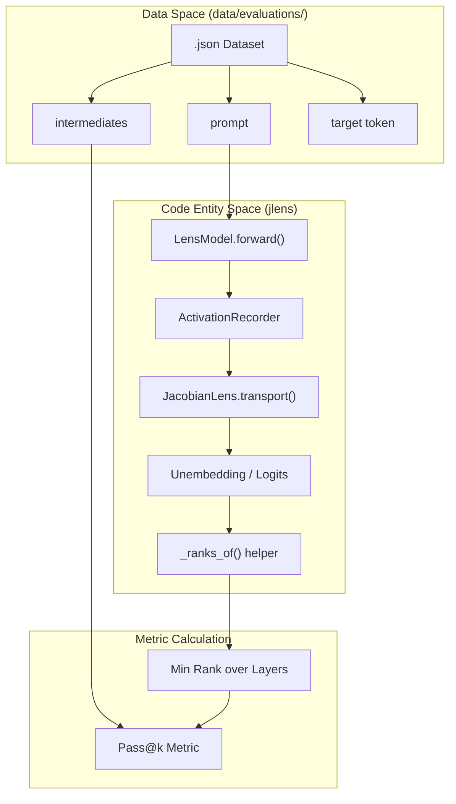
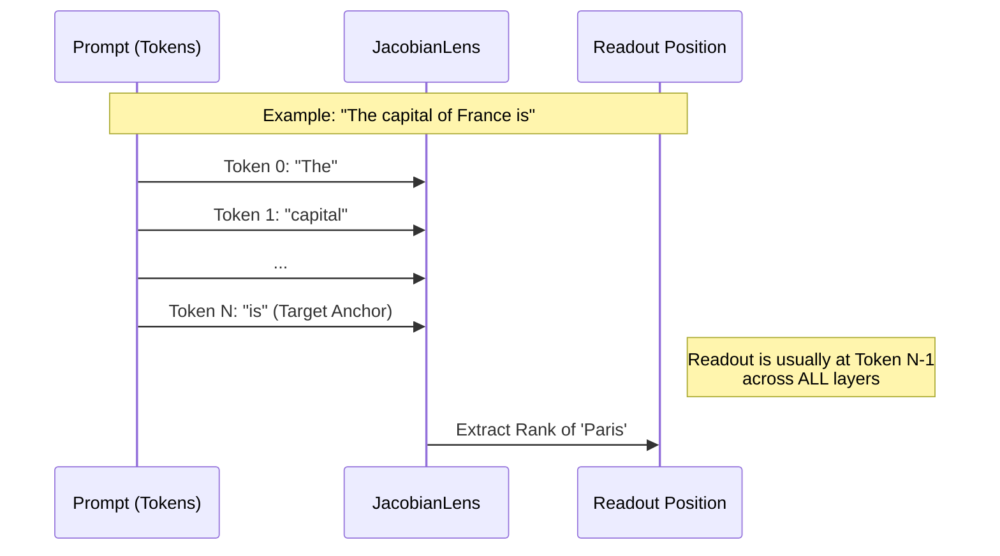

<!-- source: DeepWiki mcp.deepwiki.com · repo anthropics/jacobian-lens · page 3 Evaluation Suite · fetched 2026-10-26 -->

# Evaluation Suite

Relevant source files

The following files were used as context for generating this wiki page:

- [data/evaluations/README.md](data/evaluations/README.md)

The `data/evaluations/` directory contains six benchmark datasets used to quantify the quality of the Jacobian Lens compared to baselines like the Logit Lens. These evaluations measure how effectively a lens can "read out" internal model representations—specifically intermediate reasoning steps, latent concepts, and cross-lingual anchors—that are not yet present in the model's output distribution.

### Shared Evaluation Protocol

All evaluations in this suite follow a standardized scoring protocol to ensure comparability across different prompt distributions and model architectures.

| Concept | Definition |
| :--- | :--- |
| **Lens Readout** | At a specific `(layer, token position)`, the lens returns a ranked list of vocabulary tokens based on the transported hidden state. |
| **Workspace Band** | A contiguous range of mid-network layers where the "Global Workspace" content is most legible. Evaluations typically aggregate results over this band. |
| **Hit** | A target token is considered a *hit* if it appears at rank 1 in the lens readout at any layer or position within the specified band. |
| **Pass@k** | The primary metric: the mean fraction of `intermediates` whose minimum rank across all layers is $\le k$. |

**Sources:** [data/evaluations/README.md:5-15](), [data/evaluations/README.md:26-28]()

### Dataset Structure and Data Flow

The evaluation datasets are stored as JSON files. Each file contains a list of items consisting of a `prompt` (often multi-turn chat format), a set of `intermediates` (the hidden tokens we hope to find), and a `target` (used to identify the readout position).

#### Evaluation System Diagram
This diagram shows how the `jlens` library interacts with the evaluation JSON files to produce a `pass@k` score.

**Sources:** [data/evaluations/README.md:1-57](), [jlens/vis.py:218-245]()

---

### Benchmark Datasets

The suite is divided into six specialized tasks, each targeting a different aspect of model "thinking."

#### 3.1 Multi-hop Reasoning Evaluation
Documents `lens-eval-multihop.json`. This 90-item dataset focuses on two-hop factual queries (e.g., "The capital of the country where the Eiffel Tower is located"). It tests if the lens can extract the first hop (the country) before the model predicts the second hop (the city).
*   **Categories:** Rhyme, etymology, chemistry, n-hop, and positional logic.
*   **For details, see [Multi-hop Reasoning Evaluation](#3.1).**

#### 3.2 Multilingual Evaluation
Documents `lens-eval-multilingual.json`. This evaluates cross-lingual probing across 30+ languages. It uses English-language conceptual anchors as `intermediates` to see if non-English prompts evoke English concepts in the residual stream.
*   **Categories:** Antonyms, colors, sequences, kinship, and arithmetic.
*   **For details, see [Multilingual Evaluation](#3.2).**

#### 3.3 Association, Poetry, Order-of-Operations, and Typo Evaluations
Documents the remaining four specialized datasets:
*   **Association:** Narrative vignettes that evoke a concept (e.g., "noir") without naming it.
*   **Poetry:** Rhyming couplets where the lens must identify the intended rhyme before the final token is generated.
*   **Order-of-Operations:** Arithmetic precedence tasks where intermediate results are read out.
*   **Typo:** Sentence-ending misspellings where the lens is expected to find the corrected spelling.
*   **For details, see [Association, Poetry, Order-of-Operations, and Typo Evaluations](#3.3).**

---

### Readout Positioning Logic

The evaluation logic relies on precise positioning. Because the Jacobian Lens can vary by layer and position, the `target` token in the JSON is used to anchor the readout.

#### Token-to-Layer Readout Mapping

**Sources:** [data/evaluations/README.md:26-28](), [data/evaluations/README.md:50-51](), [data/evaluations/README.md:56-57]()

| Dataset | Readout Position | Metric Focus |
| :--- | :--- | :--- |
| **Multihop** | Token immediately preceding `target` | Intermediate facts |
| **Poetry** | Last newline token (End of Line 1) | Rhyme prediction |
| **Association** | Final prompt token (Closing period) | Latent concept |
| **Typo** | Last tokenizer fragment of misspelling | Error correction |

**Sources:** [data/evaluations/README.md:26-57]()

---

