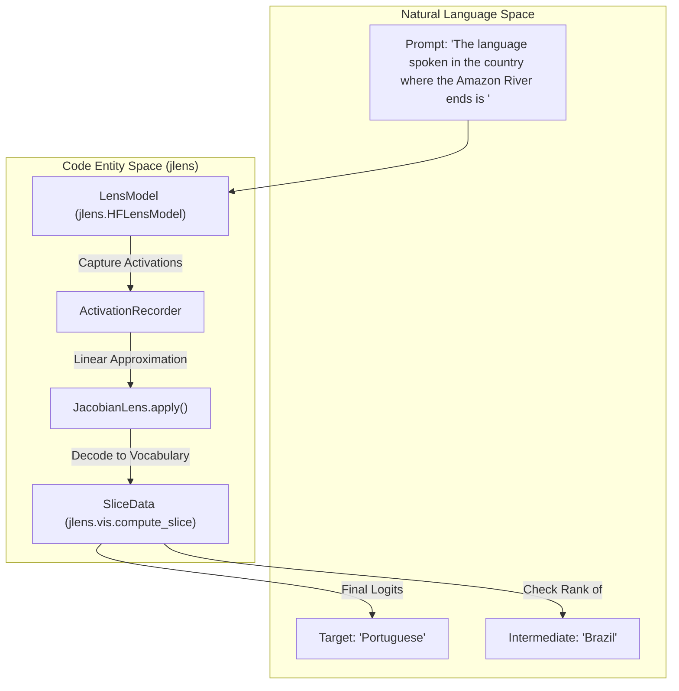
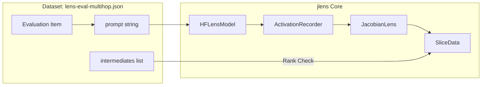

<!-- source: DeepWiki mcp.deepwiki.com · repo anthropics/jacobian-lens · page 3.1 Multi-hop Reasoning Evaluation · fetched 2026-10-26 -->

# Multi-hop Reasoning Evaluation

Relevant source files

The following files were used as context for generating this wiki page:

- [data/evaluations/lens-eval-multihop.json](data/evaluations/lens-eval-multihop.json)

The Multi-hop Reasoning Evaluation is a benchmark designed to assess a model's internal representation of intermediate reasoning steps during complex factual recall. It specifically targets "two-hop" queries where the model must identify an intermediate concept (e.g., a country) to arrive at a final target (e.g., a language or ocean).

### Dataset Overview

The evaluation is defined in `lens-eval-multihop.json`, containing 90 items that span various domains including geography, chemistry, etymology, and linguistics. Each item follows a strict schema to allow for automated verification of both the final prediction and the internal "workspace" content identified by the Jacobian Lens.

#### Data Schema
Each entry in the `items` list [data/evaluations/lens-eval-multihop.json:2-3]() consists of:
*   **`name`**: A unique identifier for the test case.
*   **`prompt`**: The natural language string ending in a space, designed to elicit a specific factual completion.
*   **`target`**: The ground-truth final token(s) expected from the model.
*   **`intermediates`**: A list of strings representing the latent concepts the model must "think of" to solve the prompt.

Sources: [data/evaluations/lens-eval-multihop.json:1-252]()

---

### Evaluation Categories

The dataset is partitioned into several logical categories to test different types of reasoning hops:

| Category | Description | Example Intermediate | Example Target |
| :--- | :--- | :--- | :--- |
| **Geography** | Physical and political geography hops. | `Brazil` | `Atlantic` |
| **Chemistry** | Atomic numbers to properties or symbols. | `gold` | `Au` |
| **Etymology** | Origin of names (months, days) to indices. | `March` | `3` |
| **Rhyme** | Phonological reasoning combined with facts. | `bear` | `California` |
| **Functional** | Biological or mechanical functions. | `heart` | `4` |

Sources: [data/evaluations/lens-eval-multihop.json:4-226]()

---

### Data Flow and Implementation

The evaluation process involves passing the `prompt` through a `LensModel` and using a `JacobianLens` to inspect the residual stream at various layers. The goal is to see if the `intermediates` appear in the "workspace" (the top-ranked tokens under the lens) before the `target` is finalized.

#### Reasoning Logic Diagram
This diagram illustrates how the natural language prompt triggers a sequence of internal representations that are captured by the `jlens` library.

**Prompt to Workspace Flow**

Sources: [jlens/jlens.py:1-100](), [data/evaluations/lens-eval-multihop.json:12-18]()

---

### Intermediate Concept Schema

The `intermediates` field is critical for validating the "Global Workspace" hypothesis. In the `jlens` evaluation suite, a "Hit" is recorded if an intermediate concept appears in the top-k tokens of the Jacobian Lens output within the "workspace band" (typically middle-to-late layers).

#### Representative Items

| Name | Prompt Fragment | Intermediate | Target |
| :--- | :--- | :--- | :--- |
| `carnival-ocean` | "...country where Carnival is most famously celebrated..." | `Brazil` | `Atlantic` |
| `atomic-79-symbol` | "...element with atomic number 79..." | `gold` | `Au` |
| `rhyme-rain-neighbor` | "...country whose name rhymes with 'rain'..." | `Spain` | `Portugal` |
| `etym-frigg-position` | "...day of the week named after the Norse goddess Frigg..." | `Friday` | `5` |

Sources: [data/evaluations/lens-eval-multihop.json:4-186]()

---

### Technical Evaluation Flow

The evaluation script iterates through the JSON items, performing the following steps for each:

1.  **Tokenization**: The `prompt` is tokenized using the model's tokenizer.
2.  **Forward Pass**: The model processes the tokens while the `ActivationRecorder` [jlens/jlens.py:200-250]() (referenced in core logic) captures the residual stream.
3.  **Jacobian Transport**: The `JacobianLens.transport()` [jlens/jlens.py:450-480]() function projects the hidden states from each layer $l$ to the final layer $L$ using the pre-fitted Jacobian matrices $J_l$.
4.  **Logit Projection**: The transported states are passed through the model's `unembed` head to produce a probability distribution over the vocabulary.
5.  **Rank Verification**: The script checks the rank of the `intermediates` strings within this distribution across all layers.

#### System Component Mapping
This diagram maps the evaluation requirements to the specific classes in the `jlens` library.

**Evaluation Component Map**

Sources: [jlens/jlens.py:10-50](), [data/evaluations/lens-eval-multihop.json:1-40]()

---

