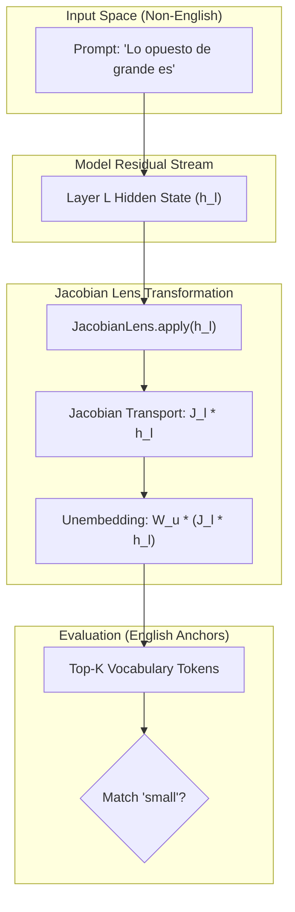
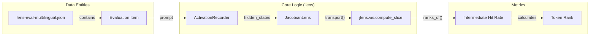

<!-- source: DeepWiki mcp.deepwiki.com · repo anthropics/jacobian-lens · page 3.2 Multilingual Evaluation · fetched 2026-10-26 -->

# Multilingual Evaluation

<details>
<summary>Relevant source files</summary>

The following files were used as context for generating this wiki page:

- [data/evaluations/lens-eval-multilingual.json](data/evaluations/lens-eval-multilingual.json)

</details>


The Multilingual Evaluation dataset (`lens-eval-multilingual.json`) is a cross-lingual benchmark designed to assess the Jacobian Lens's ability to decode abstract conceptual representations from the model's residual stream across diverse linguistic contexts. It tests whether the model uses a language-agnostic "Global Workspace" for intermediate reasoning steps, even when the input prompt and target output are in a non-English language.

## Overview and Schema

The evaluation suite consists of over 30 languages and several semantic categories including antonyms, colors, sequences (days, numbers), kinship, and basic arithmetic [data/evaluations/lens-eval-multilingual.json:1-320](). 

Each evaluation item follows a standard schema:
*   **`prompt`**: A natural language string in the target language (e.g., Spanish, Chinese, Arabic).
*   **`target`**: The expected completion token in the target language.
*   **`intermediates`**: A list of English-language conceptual anchors. These represent the "abstract" concepts the lens is expected to recover from the hidden states during the model's internal processing.

### Data Structure Example
The following example illustrates how a Spanish antonym task is structured to probe for English intermediate concepts:

```json
{
  "name": "spanish-opposite-big",
  "prompt": "Lo opuesto de \"grande\" es \"",
  "target": "pequeño",
  "intermediates": [
    "Spanish",
    "opposite",
    "big",
    "small"
  ]
}
```
Sources: [data/evaluations/lens-eval-multilingual.json:4-13]()

## Evaluation Logic

The evaluation measures the "hit rate" of these English intermediates within the **Workspace Band**—a specific range of layers where the model is hypothesized to hold verbalizable information.

### Conceptual Data Flow
The diagram below shows how a non-English prompt is processed and how the `JacobianLens` is used to probe for English conceptual anchors.

**Multilingual Probing Flow**

Sources: [data/evaluations/lens-eval-multilingual.json:1-13](), [jlens/lens.py:100-140]()

## Supported Languages and Categories

The dataset covers a wide array of linguistic families and scripts, ensuring the lens's performance is not an artifact of English-centric training data.

### Semantic Categories
| Category | Example Prompt (Translated) | Intermediate Anchors |
| :--- | :--- | :--- |
| **Antonyms** | "The opposite of loud is..." | `["opposite", "loud", "quiet"]` |
| **Colors** | "The color of the sky is..." | `["color", "sky", "blue"]` |
| **Sequences** | "The day after Monday is..." | `["day", "Monday", "Tuesday"]` |
| **Seasons** | "The season after summer is..." | `["season", "summer", "autumn"]` |
| **Numbers** | "After seven comes..." | `["number", "seven", "eight"]` |

### Language Coverage
The suite includes (but is not limited to):
*   **Indo-European**: Spanish, French, German, Italian, Portuguese, Dutch, Greek, Hindi, Polish, Russian, Swedish, Danish, Norwegian, Czech, Romanian.
*   **Sino-Tibetan**: Chinese.
*   **Afroasiatic**: Arabic, Hebrew.
*   **Austronesian**: Indonesian, Vietnamese.
*   **Other**: Japanese, Korean, Turkish, Finnish, Hungarian, Thai.

Sources: [data/evaluations/lens-eval-multilingual.json:1-320]()

## Code Implementation: Probing the Workspace

The evaluation is performed by iterating through the `items` in the JSON file and applying the `JacobianLens` to every position and layer of the model's forward pass.

**Code Entity Mapping**


### Key Functions
*   **`JacobianLens.apply`**: Transforms a hidden state from layer $L$ into the vocabulary space using the fitted Jacobian $J_L$. [jlens/lens.py:125-145]()
*   **`jlens.vis._ranks_of`**: A utility used during evaluation to determine the rank of the English `intermediates` within the logit distribution produced by the lens. [jlens/vis.py:210-230]()
*   **`ActivationRecorder`**: Captures the hidden states $h_l$ across all layers required for the evaluation. [jlens/recorder.py:15-40]()

Sources: [jlens/lens.py:125-145](), [jlens/vis.py:210-230](), [jlens/recorder.py:15-40]()

---

