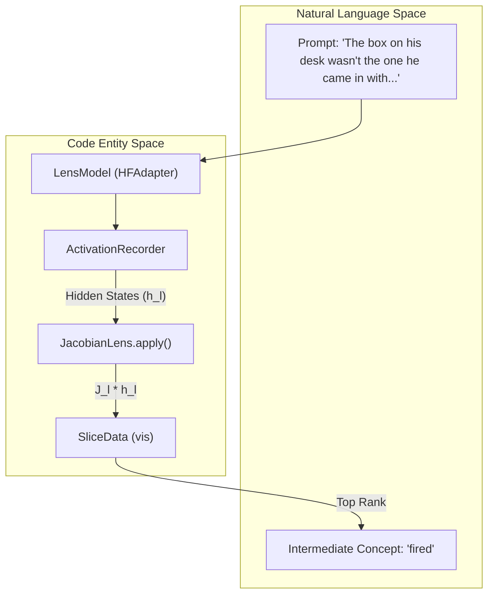
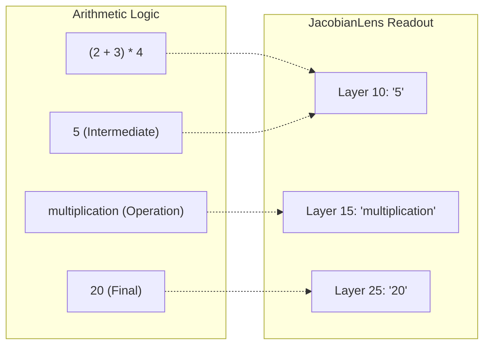

<!-- source: DeepWiki mcp.deepwiki.com · repo anthropics/jacobian-lens · page 3.3 Association, Poetry, Order-of-Operations, and Typo Evaluations · fetched 2026-10-26 -->

# Association, Poetry, Order-of-Operations, and Typo Evaluations

Relevant source files

The following files were used as context for generating this wiki page:

- [data/evaluations/lens-eval-association.json](data/evaluations/lens-eval-association.json)
- [data/evaluations/lens-eval-order-ops.json](data/evaluations/lens-eval-order-ops.json)
- [data/evaluations/lens-eval-poetry.json](data/evaluations/lens-eval-poetry.json)
- [data/evaluations/lens-eval-typo.json](data/evaluations/lens-eval-typo.json)

This page documents the four remaining evaluation datasets used to benchmark the `JacobianLens`. These datasets measure the lens's ability to decode abstract concepts, structural constraints, intermediate computational steps, and error-correction processes from the model's residual stream.

## Dataset Overview

Each evaluation dataset follows a standardized JSON schema consisting of `items`, where each item contains a `prompt` and a list of `intermediates`. The `intermediates` represent the conceptual "ground truth" that the lens is expected to recover from the hidden states within the "workspace band" (typically the middle-to-late layers of the transformer).

| Dataset | File Path | Focus Area |
| :--- | :--- | :--- |
| **Association** | `data/evaluations/lens-eval-association.json` | Implicit narrative-to-concept mapping |
| **Poetry** | `data/evaluations/lens-eval-poetry.json` | Structural rhyming constraints |
| **Order of Ops** | `data/evaluations/lens-eval-order-ops.json` | Arithmetic precedence and sub-results |
| **Typo** | `data/evaluations/lens-eval-typo.json` | Internal correction of misspellings |

Sources: [`data/evaluations/lens-eval-association.json:1-208`](), [`data/evaluations/lens-eval-poetry.json:1-221`](), [`data/evaluations/lens-eval-order-ops.json:1-331`](), [`data/evaluations/lens-eval-typo.json:1-291`]()

---

## 1. Association Evaluation (`lens-eval-association.json`)

The Association dataset tests the lens's ability to extract high-level semantic summaries from narrative descriptions where the target concept is never explicitly mentioned in the prompt.

### Implementation Details
The prompts are "show, don't tell" vignettes. For example, a description of a woman checking her bank balance and putting cereal back is mapped to the intermediate concept "poverty" [`data/evaluations/lens-eval-association.json:25-30`]().

**Data Flow: Narrative to Concept**
The diagram below shows how the `JacobianLens` maps the implicit narrative state to a verbalizable token.

**Association Mapping Logic**

Sources: [`data/evaluations/lens-eval-association.json:39-44`](), [`jlens/lens.py:126-150`]()

---

## 2. Poetry Evaluation (`lens-eval-poetry.json`)

This dataset evaluates whether the lens can detect the "constraint" of a rhyme before the final token is generated. It uses rhyming couplets where the second line is truncated.

### Structure
- **Prompt**: A two-line rhyme where the final word is missing.
- **Intermediates**: The expected rhyming word (e.g., "breath" $\rightarrow$ "death").

For instance, the prompt `"The soldier held his final, rattling breath, / And closed his eyes to greet the face of "` expects the lens to surface `"death"` in the residual stream at the final position [`data/evaluations/lens-eval-poetry.json:4-9`]().

Sources: [`data/evaluations/lens-eval-poetry.json:1-221`]()

---

## 3. Order-of-Operations Evaluation (`lens-eval-order-ops.json`)

The Order-of-Operations dataset measures the lens's ability to track intermediate mathematical results and the operation currently being performed.

### Schema and Intermediate Tracking
Unlike the other datasets, this often includes two distinct types of intermediates:
1. **The Result**: The numerical value of a sub-expression (e.g., in `2 + 3 * 4`, the intermediate is `12`) [`data/evaluations/lens-eval-order-ops.json:41-47`]().
2. **The Operation**: The name of the operation being applied (e.g., `"multiplication"`, `"addition"`) [`data/evaluations/lens-eval-order-ops.json:7-10`]().

**Arithmetic Intermediate Flow**

Sources: [`data/evaluations/lens-eval-order-ops.json:4-11`](), [`data/evaluations/lens-eval-order-ops.json:41-47`]()

---

## 4. Typo Evaluation (`lens-eval-typo.json`)

The Typo dataset evaluates "internal error correction." It provides prompts containing a single misspelled word and checks if the lens identifies the corrected version of that word in the residual stream at the position of the typo.

### Examples
- **Input**: `"The course required that every student learn a second langauge"`
- **Intermediate**: `"language"` [`data/evaluations/lens-eval-typo.json:4-9`]()
- **Input**: `"She typed the name into the box and clicked serach"`
- **Intermediate**: `"search"` [`data/evaluations/lens-eval-typo.json:25-30`]()

This test is critical for demonstrating that the `JacobianLens` captures the model's "denoised" internal representation rather than just the raw input tokens.

Sources: [`data/evaluations/lens-eval-typo.json:1-291`]()

---

## Evaluation Metrics

All four datasets are typically evaluated using the following functions and metrics:

1.  **Pass@k**: Calculated by checking if the `intermediates` appear within the top `k` tokens of the lens output `JacobianLens.apply()` [`jlens/lens.py:126-150`]() for layers within the **Workspace Band** (layers 10-25 for a 32-layer model).
2.  **Position Masking**: Evaluations are performed specifically at the position of the "trigger" (e.g., the typo or the last token of the arithmetic expression) using `valid_position_mask` logic found in the test suite [`tests/test_fitting.py:48-62`]().

Sources: [`jlens/lens.py:126-150`](), [`tests/test_fitting.py:48-62`]()

---

