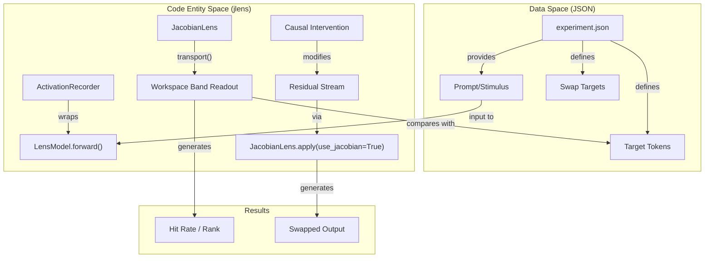
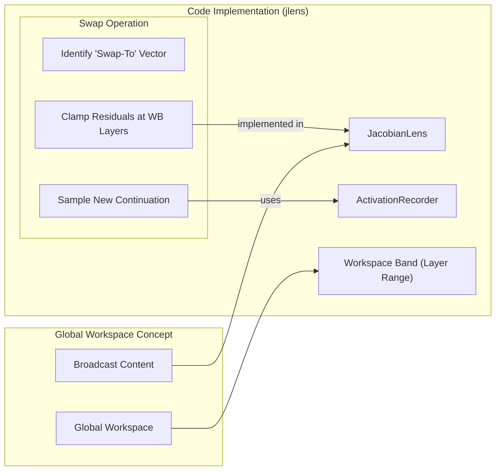

<!-- source: DeepWiki mcp.deepwiki.com · repo anthropics/jacobian-lens · page 4 Global Workspace Experiments · fetched 2026-10-26 -->

# Global Workspace Experiments

Relevant source files

The following files were used as context for generating this wiki page:

- [data/experiments/README.md](data/experiments/README.md)

This page provides an overview of the `data/experiments/` directory, which contains eleven experiment datasets designed to validate the **Global Workspace** hypothesis in Large Language Models. These experiments test whether verbalizable representations—identified via the Jacobian Lens—behave as a centralized "workspace" for reasoning, causal control, and selective attention.

The experiments are categorized into three main groups: causal interventions, capacity/content measurements, and selectivity tests.

## Shared Conventions

Across all experiments, a set of standard definitions and operations are used to interface with the model's internal representations:

*   **Lens Readout**: At any given (layer, token position), the `JacobianLens` returns a ranked list of vocabulary tokens based on the transported residual stream.
*   **Workspace Band**: A contiguous range of mid-network layers where workspace content is most legible. Experiments typically aggregate results over this band rather than individual layers.
*   **Hit**: A target token is considered a "hit" if it appears at rank 1 in the lens readout at any (layer, position) within the defined workspace band.
*   **Swap (Causal Intervention)**: An operation where a specific token's direction in the residual stream is replaced with another token's direction across the workspace band. This is used to test if the lens-identified concept is driving the model's actual output.

| Term | Code / Data Reference | Description |
| :--- | :--- | :--- |
| **Workspace Band** | `data/experiments/README.md` | Mid-network layer range for readout. |
| **Swap** | `data/experiments/README.md` | Clamping a lens coordinate to a new token direction. |
| **Hit** | `data/experiments/README.md` | Lens Rank 1 occurrence within the band. |

**Sources:** [data/experiments/README.md:5-20]()

## Experiment Categories

### Causal Intervention Experiments
These experiments use the **Swap** operation to determine if the representations found by the lens are functionally relevant to the model's computation. By intervening on the "workspace" (the mid-layers), researchers can force the model to change its reasoning path or its final answer.

*   **`probe-swap.json`**: Tests two-hop factual reasoning (e.g., swapping the intermediate "bridge" entity).
*   **`verbal-report.json`**: Swaps category members to see if the model's "one-word answer" follows the intervention.
*   **`flexible-generalization.json`**: Tests if swapping arguments (e.g., France $\rightarrow$ Egypt) generalizes across different function templates.
*   **`top-down-summoning.json`**: Measures how task-specific questions "summon" latent properties into the workspace.

For details, see [Causal Intervention Experiments](#4.1).

**Sources:** [data/experiments/README.md:22-56]()

### Workspace Content and Capacity Experiments
These experiments quantify what information is held in the workspace, how it competes for "broadcast" space, and the limits of its memory.

*   **`directed-modulation.json`**: Tests if instructions to "focus" or "suppress" specific topics change their visibility in the lens.
*   **`dual-task.json`**: Investigates competition between two different covert tasks (e.g., translation vs. logic) within the same layers.
*   **`capacity.json`**: Measures the "bottleneck" by tracking how many items from an 80-word list can be simultaneously recovered by the lens.
*   **`ignition.json`**: Uses embedding interpolation to find the "threshold" at which a concept suddenly appears in the workspace.
*   **`verbal-introspection.json`**: Steers the model with lens directions and asks it to "self-report" what it is thinking.

For details, see [Workspace Content and Capacity Experiments](#4.2).

**Sources:** [data/experiments/README.md:28-33](), [data/experiments/README.md:40-48](), [data/experiments/README.md:70-82]()

### Selectivity Experiments
These experiments test whether the workspace is "selective"—meaning it only holds information relevant to the current task or context, rather than every possible feature of the input.

*   **`selectivity-language.json`**: Compares the hit rate of conceptual labels in the lens during explicit questioning versus neutral continuation across four languages.
*   **`selectivity-linecount.json`**: Checks if the workspace tracks character counts only when the model is specifically instructed to perform a counting task.

For details, see [Selectivity Experiments](#4.3).

**Sources:** [data/experiments/README.md:58-68]()

## System Mapping: From Theory to Code

The following diagrams illustrate how the experimental concepts map to the `jlens` library implementation and the data structures defined in `data/experiments/`.

### Experiment Execution Flow
This diagram shows how a JSON experiment definition is processed by the `JacobianLens` and the `ActivationRecorder`.

**Sources:** [data/experiments/README.md:5-20](), [jlens/lens.py:10-45](), [jlens/model.py:15-30]()

### Workspace Band and Causal Swap Mapping
This diagram bridges the conceptual "Global Workspace" to the specific code implementation of the `Swap` operation.

**Sources:** [data/experiments/README.md:11-18](), [jlens/lens.py:100-150]()

---

