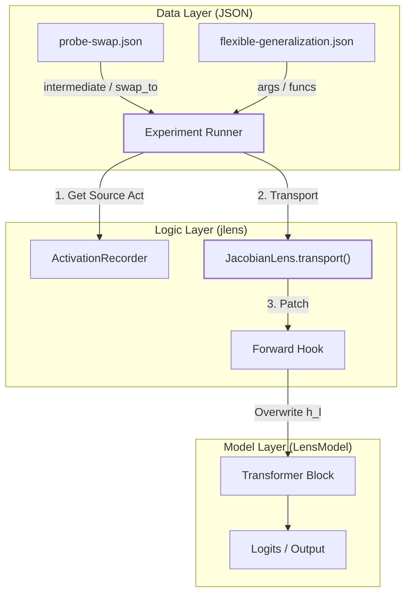
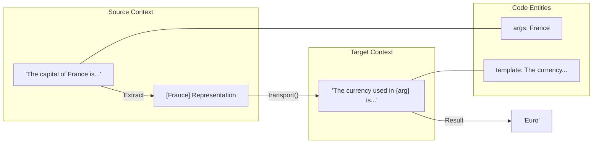

<!-- source: DeepWiki mcp.deepwiki.com · repo anthropics/jacobian-lens · page 4.1 Causal Intervention Experiments · fetched 2026-10-26 -->

# Causal Intervention Experiments

Relevant source files

The following files were used as context for generating this wiki page:

- [data/experiments/flexible-generalization.json](data/experiments/flexible-generalization.json)
- [data/experiments/probe-swap.json](data/experiments/probe-swap.json)
- [data/experiments/top-down-summoning.json](data/experiments/top-down-summoning.json)
- [data/experiments/verbal-report.json](data/experiments/verbal-report.json)

Causal intervention experiments use the **Swap** operation to test the functional role of representations identified by the Jacobian Lens. By overwriting a model's internal activation at a specific layer and position with a representation transported from a different context, these experiments determine whether the lens-identified "workspace" content actually drives the model's downstream behavior and final output.

## Overview of the Swap Operation

The core methodology across these experiments involves:
1.  **Source Identification**: Finding a representation (e.g., the concept "Mexico") in a source prompt.
2.  **Jacobian Transport**: Using the `JacobianLens.transport()` function to move that representation into the target prompt's activation space at a specific layer.
3.  **Activation Overwriting**: Using a hook (via `ActivationRecorder`) to replace the original activation with the transported "swap" activation.
4.  **Behavioral Observation**: Measuring if the model's next-token prediction changes to match the injected concept (e.g., changing the answer from "Portuguese" to "Spanish").

### Code Entity Space Mapping: Intervention Flow

The following diagram illustrates how the JSON experiment definitions map to the execution logic in the codebase.

**Intervention Execution Flow**

Sources: [jlens/lens.py:100-140](), [data/experiments/probe-swap.json:1-11]()

---

## Two-Hop Factual Swap (`probe-swap.json`)

This experiment tests whether the intermediate "hop" in a multi-hop reasoning task is causally necessary for the final answer.

*   **Task**: The model is given a prompt like "The language spoken in the country where the Amazon River ends is...".
*   **Intermediate**: The model internally identifies "Brazil".
*   **Intervention**: The "Brazil" representation is swapped for "Mexico" at the layer where the lens first identifies the intermediate.
*   **Result**: If the model changes its output to "Spanish", it confirms the representation identified by the lens was the functional driver of the reasoning chain.

| Field | Description | Example |
| :--- | :--- | :--- |
| `prompt` | The multi-hop factual query | "The state of matter... of the element with atomic number 80" |
| `intermediate` | The natural language label the lens finds | "mercury" |
| `swap_to` | The new concept to inject | "iron" |
| `swap_answer` | The expected new model output | "solid" |

Sources: [data/experiments/probe-swap.json:1-47]()

---

## Category-Word Swap (`verbal-report.json`)

This experiment investigates the "Global Workspace" hypothesis by testing if category-level representations can be swapped to change specific word outputs.

*   **Implementation**: It uses a large dictionary of categories (e.g., `instrument`, `planet`, `river`) and members [data/experiments/verbal-report.json:2-227]().
*   **Logic**: If the model is prompted to "Name a fruit," and the lens identifies the internal concept of "Apple," the experiment swaps the activation for the representation of "Banana" (derived from a different prompt context).
*   **Significance**: This tests the granularity and "verbalizability" of the workspace. If swapping a generic category member representation works, it suggests the workspace uses a shared, high-level semantic code.

Sources: [data/experiments/verbal-report.json:1-227]()

---

## Flexible Generalization (`flexible-generalization.json`)

This experiment tests the "argument-swap" capabilities of the model. It treats factual queries as functions $f(x)$.

**Generalization Structure**

*   **Data Structure**: Organized by `categories` (e.g., `countries`, `months`, `animals`), each containing `args` (inputs) and `funcs` (templates with answers) [data/experiments/flexible-generalization.json:2-52]().
*   **Goal**: Demonstrate that the representation of an argument (e.g., "France") is independent of the specific "function" (e.g., `capital`, `language`, `currency`) being applied to it.

Sources: [data/experiments/flexible-generalization.json:1-208]()

---

## Top-Down Summoning (`top-down-summoning.json`)

This experiment tests the "summoning" of abstract features (like tense, register, or part-of-speech) into the workspace.

*   **Q1/Q2 Design**:
    *   **Q1**: A standard completion task ("What word comes next?").
    *   **Q2**: A meta-linguistic question ("What is the tense/mood of this passage?").
*   **Causal Test**: The experiment identifies the representation that answers Q2 (e.g., "past") and swaps it with the opposite feature (e.g., "future") [data/experiments/top-down-summoning.json:64-91]().
*   **Items Tested**:
    *   **Spelling**: British vs. American (e.g., "colour" vs "color") [data/experiments/top-down-summoning.json:4-32]().
    *   **Register**: Formal vs. Informal [data/experiments/top-down-summoning.json:34-61]().
    *   **POS**: Part of speech expectations [data/experiments/top-down-summoning.json:123-152]().

### Data Flow for Top-Down Summoning

1.  **Stimulus**: A sentence fragment with a specific feature (e.g., British spelling).
2.  **Probe**: The lens reads the "British" concept from the workspace at the final token.
3.  **Swap**: The representation for "American" is injected.
4.  **Verification**: The model is checked to see if it now completes the sentence using American spelling conventions (Q1) or reports the passage is American (Q2).

Sources: [data/experiments/top-down-summoning.json:1-216]()

---

