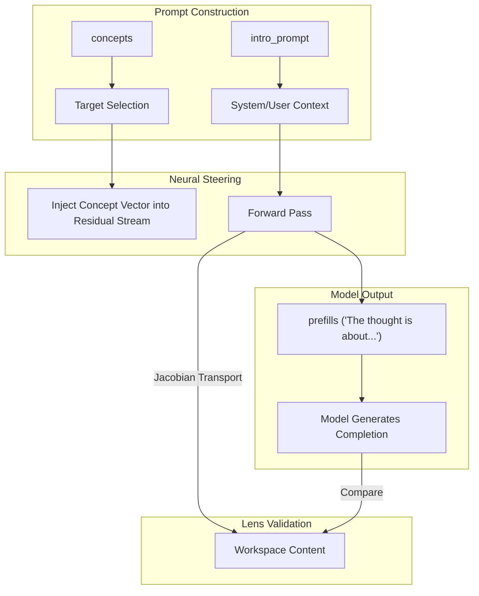
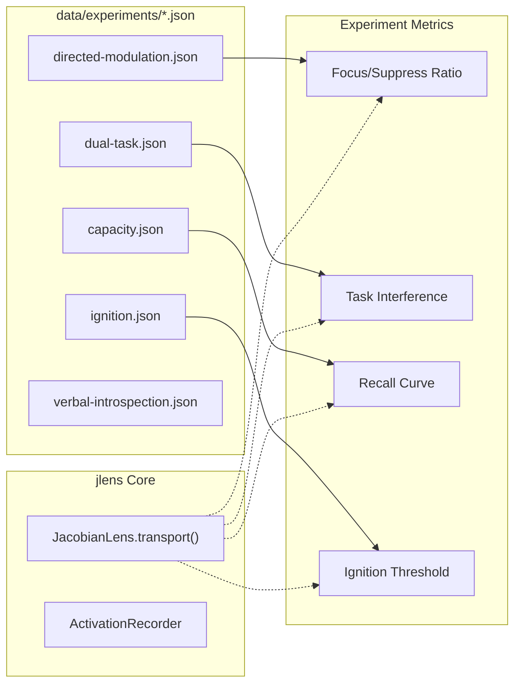

<!-- source: DeepWiki mcp.deepwiki.com · repo anthropics/jacobian-lens · page 4.2 Workspace Content and Capacity Experiments · fetched 2026-10-26 -->

# Workspace Content and Capacity Experiments

Relevant source files

The following files were used as context for generating this wiki page:

- [data/experiments/capacity.json](data/experiments/capacity.json)
- [data/experiments/directed-modulation.json](data/experiments/directed-modulation.json)
- [data/experiments/dual-task.json](data/experiments/dual-task.json)
- [data/experiments/ignition.json](data/experiments/ignition.json)
- [data/experiments/verbal-introspection.json](data/experiments/verbal-introspection.json)

This page documents experiments designed to measure the limits and dynamics of the "workspace" (the mid-to-late residual stream layers where verbalizable information is most accessible). These experiments explore how information is voluntarily focused or suppressed, how tasks compete for workspace capacity, the total volume of information the workspace can hold, and the threshold at which external interventions "ignite" into stable internal representations.

## 1. Voluntary Modulation of Workspace Content

The `directed-modulation.json` experiment investigates whether the model's internal workspace content can be selectively controlled through natural language instructions. It tests the model's ability to "focus on" or "ignore" specific concepts while performing a secondary task (e.g., writing a sentence or solving math).

### Implementation Details
The experiment uses a set of "phrasings" categorized by their intent:
*   **Focus**: Instructions to keep a concept in mind (e.g., "Concentrate on {x}"). [data/experiments/directed-modulation.json:4-27]()
*   **Dismissal/Suppression**: Instructions to ignore or push a concept out of mind (e.g., "{x} is irrelevant", "Don't think about {x}"). [data/experiments/directed-modulation.json:29-92]()
*   **Mention (Control)**: Simply mentioning the concept without explicit instruction (e.g., "{x}."). [data/experiments/directed-modulation.json:94-122]()

The experiment combines these instructions with:
1.  **Carrier Sentences**: Neutral text used to provide a context for the model's "internal thoughts". [data/experiments/directed-modulation.json:130-151]()
2.  **Math Problems**: Tiered difficulty arithmetic used as a distractor or secondary cognitive load. [data/experiments/directed-modulation.json:152-273]()
3.  **Topic Categories**: Specific concepts (e.g., "citrus fruits") used as the target of modulation. [data/experiments/directed-modulation.json:274-293]()

**Sources:** [data/experiments/directed-modulation.json:1-293]()

## 2. Dual-Task Competition

The `dual-task.json` experiment measures competition between two covert tasks for limited workspace resources. It tests if the workspace can simultaneously hold two distinct conceptual categories or a conceptual category alongside a mathematical operation.

### Data Structure and Flow
The experiment defines specific conditions for task prioritization:
*   **Concept-Math**: Conditions include `concept_only`, `math_only`, and ordered variants like `concept_first` or `math_first`. [data/experiments/dual-task.json:3-8]()
*   **Concept-Pairing**: Testing two conceptual categories (e.g., "planets" and "musical instruments") to see if both appear in the workspace band. [data/experiments/dual-task.json:15-56]()

### Workspace Resource Mapping
Each pair in the experiment defines the "target" words that the lens should identify if the task is successfully represented in the workspace. [data/experiments/dual-task.json:57-370]()

| Entity | Description |
| :--- | :--- |
| `concept_words` | List of tokens expected to appear in the workspace for a given task. |
| `base`/`exp`/`sub` | Parameters used to generate math problems associated with that task. |

**Sources:** [data/experiments/dual-task.json:1-370]()

## 3. Capacity Limits (List Recall)

The `capacity.json` experiment pushes the workspace to its limits by requiring the model to track a large list of items. It is designed to find the "breaking point" where the Jacobian Lens can no longer recover the full list of items from the residual stream.

### Implementation
The experiment utilizes large pools of categorized entities:
*   **Families**: Names, Countries, Surnames, Cities. [data/experiments/capacity.json:2-7]()
*   **Pool Sizes**: The dataset includes hundreds of unique tokens per category to prevent memorization artifacts. [data/experiments/capacity.json:18-368]()

The Jacobian Lens is used to probe the residual stream at each token position as the list grows, measuring the "hit rate" of previous list items in the current workspace.

**Sources:** [data/experiments/capacity.json:1-368]()

## 4. Ignition Thresholds

The `ignition.json` experiment investigates the "ignition" phenomenon: the point at which an external stimulus (or an internal intervention) becomes a stable, verbalizable representation in the workspace.

### Embedding Interpolation
The experiment uses `alt_words` and `ctx_templates` to create contexts where the model must process a specific word. [data/experiments/ignition.json:16-75]()
By interpolating between the embedding of a target word (e.g., "France") and a distractor, researchers can find the exact scalar threshold where the Jacobian Lens begins to see the target word in the workspace band.

### Semantic Priming
The experiment also uses `idiom_pairs` (e.g., "bread" and "butter") vs `scrambled_pairs` to see if semantic priming lowers the ignition threshold for the second word in the pair. [data/experiments/ignition.json:98-197]()

**Sources:** [data/experiments/ignition.json:1-197]()

## 5. Verbal Introspection and Steering

The `verbal-introspection.json` experiment combines causal steering with self-reporting. The model is told that an "interpretability researcher" will inject thoughts into its mind and is asked to identify them.

### Data Flow for Introspection

### Key Components
*   **Intro Prompt**: Sets the persona of a model being probed by a researcher. [data/experiments/verbal-introspection.json:2-19]()
*   **Prefills**: Standardized strings to force the model into a reporting mode (e.g., "The thought is about the word \""). [data/experiments/verbal-introspection.json:20-23]()
*   **Concepts**: A diverse list of 100+ surface words (e.g., "lightning", "cinema", "rust") used as targets for injection and identification. [data/experiments/verbal-introspection.json:24-370]()

**Sources:** [data/experiments/verbal-introspection.json:1-370]()

## Code Entity to Experiment Mapping

The following diagram bridges the JSON experiment definitions to the conceptual space of the Jacobian Lens evaluation.

**Sources:** [data/experiments/directed-modulation.json:1-10](), [data/experiments/dual-task.json:1-10](), [data/experiments/capacity.json:1-10](), [data/experiments/ignition.json:1-10](), [data/experiments/verbal-introspection.json:1-10]()

---

