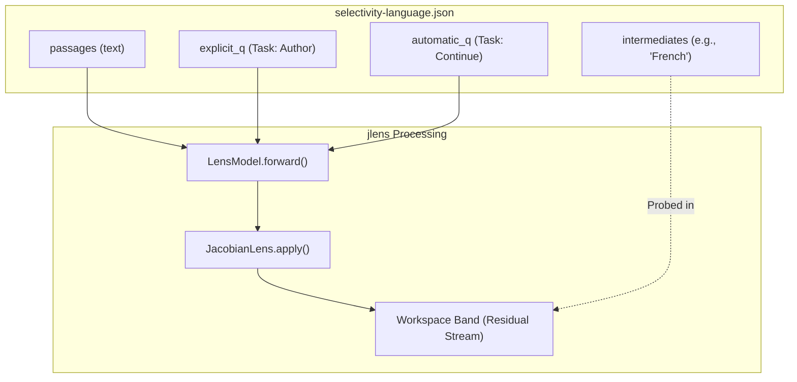
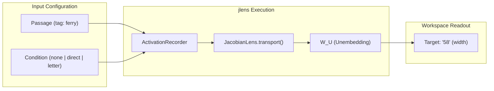

<!-- source: DeepWiki mcp.deepwiki.com · repo anthropics/jacobian-lens · page 4.3 Selectivity Experiments · fetched 2026-10-26 -->

# Selectivity Experiments

Relevant source files

The following files were used as context for generating this wiki page:

- [data/experiments/selectivity-language.json](data/experiments/selectivity-language.json)
- [data/experiments/selectivity-linecount.json](data/experiments/selectivity-linecount.json)

Selectivity experiments investigate whether the contents of the Global Workspace are modulated by the model's current task context. These experiments utilize the `JacobianLens` to observe if specific semantic concepts (like language labels or character counts) appear in the workspace only when they are task-relevant, or if they are automatically computed during standard processing.

## Language Selectivity (`selectivity-language.json`)

The language selectivity experiment compares the visibility of language-related concepts in the workspace under two different instruction regimes: **explicit** (task-relevant) and **automatic** (incidental).

### Implementation and Data Flow
The experiment uses a set of short passages in four languages (French, German, Spanish, and Italian) [data/experiments/selectivity-language.json:7-48](). The model is prompted with two distinct task types:
1.  **Explicit (`explicit_q`)**: The model is asked to name an author who wrote in the same language as the passage [data/experiments/selectivity-language.json:4-4](). This makes the language of the text a task-critical variable.
2.  **Automatic (`automatic_q`)**: The model is asked to simply continue the text [data/experiments/selectivity-language.json:5-5](). In this case, identifying the language is incidental to the completion task.

The `JacobianLens` is used to probe the residual stream for "intermediates"—conceptual anchors such as "French", "France", or "français" [data/experiments/selectivity-language.json:49-74](). The experiment measures the "hit rate" of these intermediates in the workspace band to determine if the model selectively promotes the "Language" concept to the workspace only when the instruction demands it.

### Language Experiment Structure
| Component | Description |
| :--- | :--- |
| **Passages** | 2 examples each for French, German, Spanish, and Italian [data/experiments/selectivity-language.json:7-48](). |
| **Intermediates** | Language names and related entities (e.g., "Italy", "Rome" for Italian) [data/experiments/selectivity-language.json:49-74](). |
| **Targets** | Surnames of famous authors for each language (e.g., "Dante", "Eco") [data/experiments/selectivity-language.json:75-121](). |

### Entity Mapping: Language Selectivity
This diagram shows how the JSON schema maps to the conceptual processing within the `jlens` framework.

**Sources:** [data/experiments/selectivity-language.json:1-122](), [jlens/lens.py:126-155]()

---

## Line-Count Selectivity (`selectivity-linecount.json`)

This experiment tests the model's ability to selectively extract and represent structural metadata (line length) from a text passage. It measures whether the character count of a line is present in the workspace under different levels of instruction "pressure."

### Experimental Conditions
The experiment uses 11 passages of varying lengths (widths ranging from 26 to 62 characters) [data/experiments/selectivity-linecount.json:17-73](). The model's internal representations are evaluated under three conditions:

1.  **None**: No question is asked; the model is given a prefill "The first line has" [data/experiments/selectivity-linecount.json:4-7]().
2.  **Direct**: The model is explicitly asked "How many characters are in the first line?" [data/experiments/selectivity-linecount.json:8-11]().
3.  **Letter**: A more complex task asking for the first letter of the number of characters (e.g., "T" for "Thirty") [data/experiments/selectivity-linecount.json:12-15]().

### Technical Detail
The `JacobianLens` transports the residual stream activations to the vocabulary space. The experiment monitors the workspace for the appearance of the correct integer (the `width` property in the JSON) [data/experiments/selectivity-linecount.json:20-70](). This determines if the model "counts" characters by default or only when prompted to do so.

### Line-Count Data Entities
| Field | Role |
| :--- | :--- |
| `tag` | Identifier for the passage (e.g., "gettysburg", "observatory") [data/experiments/selectivity-linecount.json:19-69](). |
| `width` | The ground-truth character count to be detected by the lens [data/experiments/selectivity-linecount.json:20-70](). |
| `prefill` | The string used to prime the model's output [data/experiments/selectivity-linecount.json:6-14](). |

### Logic Flow: Line-Count Selectivity
This diagram illustrates the flow from instruction condition to the detection of numerical metadata via the Jacobian Lens.

**Sources:** [data/experiments/selectivity-linecount.json:1-73](), [jlens/lens.py:90-124]()

---

## Summary of Findings
These experiments are designed to support the claim that the Global Workspace is **selective**. If the `JacobianLens` reveals the language label or line count in the "Explicit" or "Direct" conditions, but not in the "Automatic" or "None" conditions, it suggests that the model uses its residual stream capacity to represent only the information currently required for the task, rather than performing all possible computations in parallel.

**Sources:**
- [data/experiments/selectivity-language.json:1-122]()
- [data/experiments/selectivity-linecount.json:1-73]()
- [jlens/lens.py:90-155]()

---

