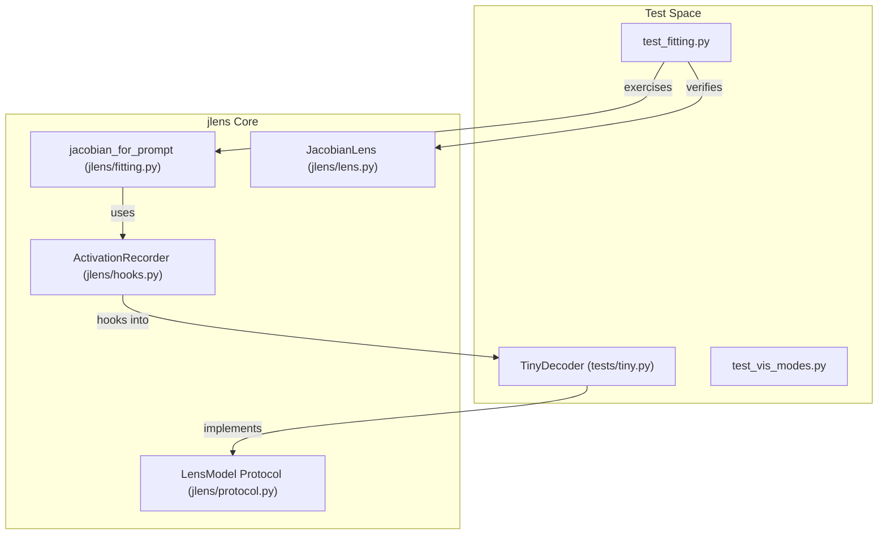
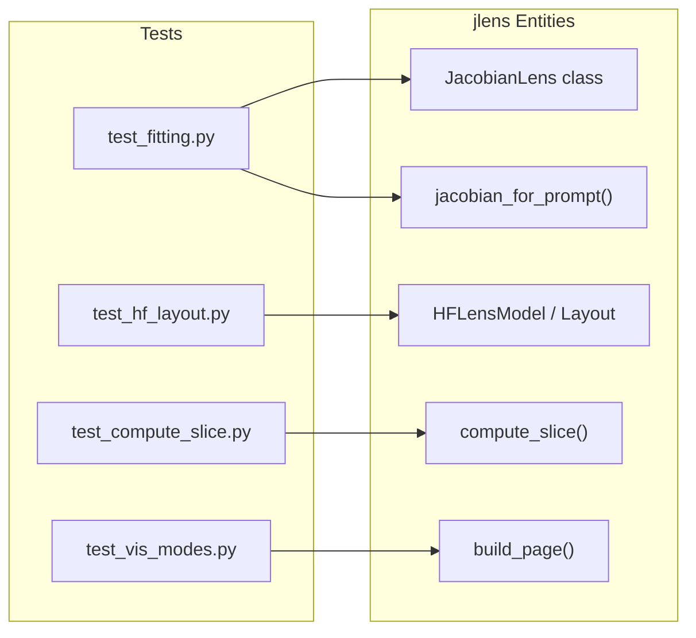

<!-- source: DeepWiki mcp.deepwiki.com · repo anthropics/jacobian-lens · page 5 Testing · fetched 2026-10-26 -->

# Testing

<details>
<summary>Relevant source files</summary>

The following files were used as context for generating this wiki page:

- [tests/__init__.py](tests/__init__.py)
- [tests/tiny.py](tests/tiny.py)

</details>


The `jacobian-lens` test suite is designed to ensure the mathematical correctness of the Jacobian estimation process and the functional integrity of the visualization pipeline. It relies on a lightweight, CPU-only model for fast end-to-end execution, allowing for comprehensive coverage of the `jlens` library without requiring GPU resources or large HuggingFace model downloads.

## The `TinyDecoder` Model

To facilitate rapid testing, the suite utilizes `TinyDecoder`, a minimal implementation of the `LensModel` protocol [tests/tiny.py:5-11](). This model serves as a predictable environment for exercising `jlens.fitting.jacobian_for_prompt` and `jlens.hooks.ActivationRecorder` [tests/tiny.py:7-9]().

### Architectural Properties
`TinyDecoder` mimics the architecture of a standard Transformer decoder but at a fraction of the scale (default `d_model=8`, `n_layers=4`).

| Component | Implementation | Role |
| :--- | :--- | :--- |
| **Residual Block** | `_ResidualBlock` | Implements `h + 0.1 * linear(h)` to maintain a well-conditioned Jacobian [tests/tiny.py:21-30](). |
| **Tokenizer** | `_ByteTokenizer` | A toy tokenizer mapping text to byte-based IDs [tests/tiny.py:32-52](). |
| **Embedding** | `nn.Embedding` | Standard token embedding layer [tests/tiny.py:66-66](). |
| **Unembed** | `lm_head` | Linear projection through a `LayerNorm` [tests/tiny.py:68-69](). |

The small gain (0.1) in the residual blocks ensures that the identity component of the residual stream dominates, which is critical for verifying the property that the Jacobian of the penultimate layer should be approximately the identity matrix (`diag(J) ≈ 1`) [tests/tiny.py:9-11]().

**Sources:**
- [tests/tiny.py:3-11]()
- [tests/tiny.py:21-30]()
- [tests/tiny.py:54-88]()

## System Integration Map

The following diagram illustrates how the test suite entities map to the core `jlens` library components during a typical test run.


**Sources:**
- [tests/tiny.py:5-11]()
- [tests/tiny.py:54-88]()

## Test Organization

The suite is divided into five primary modules covering fitting logic, visualization, and HuggingFace compatibility.

### Fitting and Lens Tests
These tests focus on the mathematical core of the library. They verify that the Jacobian estimation correctly handles prompt masks, batching, and layer indexing.
*   **Key Areas:** `jacobian_for_prompt`, `fit` loop, and `JacobianLens` persistence (save/load/merge).
*   **For details, see [Fitting and Lens Tests](#5.1).**

### Visualization and HF Adapter Tests
These tests ensure that the high-level API for generating interactive visualizations and the auto-detection of third-party model layouts work as expected.
*   **Key Areas:** `compute_slice` end-to-end logic, HTML page rendering (embed vs. fetch modes), and `HFLensModel` layout detection for Llama, Phi, and GPT-2.
*   **For details, see [Visualization and HF Adapter Tests](#5.2).**

## Running the Tests

The test suite is designed to be run with `pytest`. Because the `TinyDecoder` is CPU-only, no special hardware is required.

```bash
# Run all tests
pytest tests/

# Run a specific module
pytest tests/test_fitting.py

# Run tests with verbose output
pytest -v
```

## Code Entity Association

This diagram shows how specific test files target different functional layers of the `jlens` system.


**Sources:**
- [tests/tiny.py:3-11]()
- [tests/tiny.py:54-88]()

---

