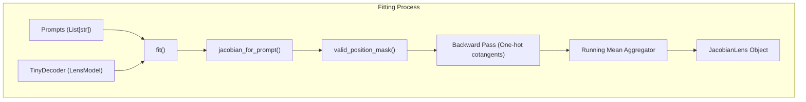
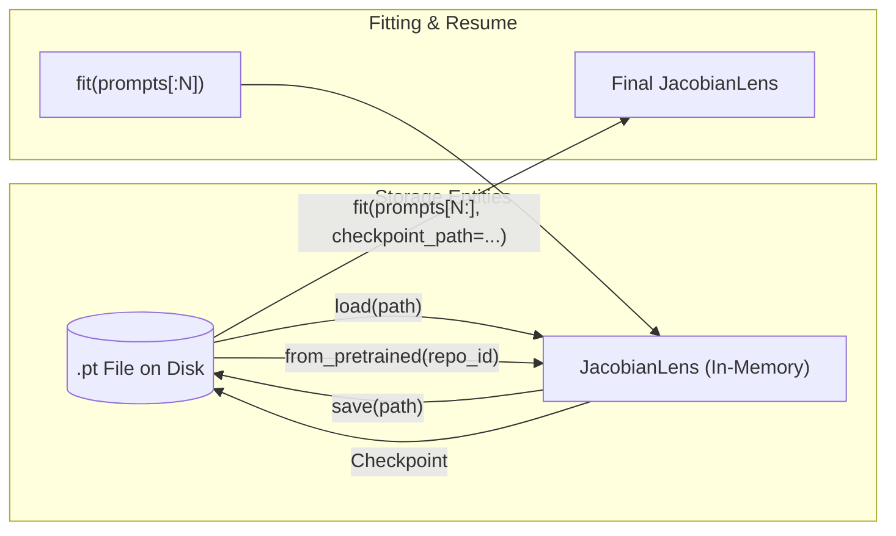

<!-- source: DeepWiki mcp.deepwiki.com · repo anthropics/jacobian-lens · page 5.1 Fitting and Lens Tests · fetched 2026-10-26 -->

# Fitting and Lens Tests

Relevant source files

The following files were used as context for generating this wiki page:

- [tests/test_fitting.py](tests/test_fitting.py)
- [tests/tiny.py](tests/tiny.py)

This page documents the test suite for the Jacobian Lens fitting and application logic, primarily located in `tests/test_fitting.py`. These tests ensure the mathematical correctness of the Jacobian estimator, the robustness of the lens persistence layer, and the reliability of the training loop.

## The TinyDecoder Fixture

To enable fast, deterministic, and CPU-compatible end-to-end testing, the suite uses a mock model called `TinyDecoder`. This model satisfies the `LensModel` protocol without requiring heavy HuggingFace dependencies or GPU resources.

### Implementation Details
*   **Architecture**: A stack of residual blocks where each block $l$ computes $x_{l+1} = x_l + 0.1 \cdot W_l x_l$ [tests/tiny.py:21-30]().
*   **Conditioning**: The $0.1$ multiplier ensures the Jacobian remains well-conditioned, allowing the property $\text{diag}(J) \approx 1$ to hold for late layers [tests/tiny.py:9-11]().
*   **Protocol Compliance**: It implements `n_layers`, `d_model`, `layers`, `tokenizer`, `encode`, `forward`, and `unembed` [tests/tiny.py:54-88]().

### Jacobian Verification Logic
In `test_jacobian_for_prompt_tiny`, the suite verifies the Jacobian transport math by comparing the estimated Jacobian against the analytical expectation. For the penultimate layer $L-2$, the Jacobian $J_{L-2}$ should exactly equal $I + W_{L-1}$ (the weight of the final residual block) because the recorder roots the graph at the source layer [tests/test_fitting.py:44-51]().

**Sources:** [tests/tiny.py:3-11](), [tests/test_fitting.py:27-51]()

## Jacobian Estimation and Fitting

The core fitting logic is tested for correctness in handling sequence positions and gradient computation.

### Position Masking
The `valid_position_mask` function is tested to ensure it correctly excludes:
1.  **Attention Sinks**: The first $N$ tokens (default `skip_first=4`) which often contain outlier activations [tests/test_fitting.py:14-16]().
2.  **Final Token**: The last position in the sequence, which has no "future" context in causal models [tests/test_fitting.py:17-18]().

### Fitting Workflow
The `fit()` function orchestrates the estimation across a corpus. The tests verify that:
*   The resulting `JacobianLens` object contains the correct number of layers and model dimensions [tests/test_fitting.py:58-61]().
*   The estimator correctly aggregates the running mean across multiple prompts [tests/test_fitting.py:58-59]().
*   The `jacobian_for_prompt` function correctly handles `dim_batch` for parallelizing the backward passes of one-hot cotangents [tests/test_fitting.py:37-39]().

### Data Flow: Fitting a Lens
The following diagram traces how `TinyDecoder` and the fitting functions interact to produce a `JacobianLens`.

| Entity | Role in Code |
| :--- | :--- |
| `TinyDecoder` | Mock model satisfying `LensModel` protocol [tests/tiny.py:54]() |
| `jacobian_for_prompt` | Computes $J$ for a single text string [jlens.fitting:jacobian_for_prompt]() |
| `valid_position_mask` | Filters tokens used for the mean estimator [jlens.fitting:valid_position_mask]() |
| `fit` | Aggregates results into a `JacobianLens` instance [jlens.fitting:fit]() |

**Sources:** [tests/test_fitting.py:13-20](), [tests/test_fitting.py:54-61](), [tests/tiny.py:54-88]()

## Lens Operations and Persistence

The `JacobianLens` class manages the lifecycle of fitted matrices, including saving, loading, and merging.

### Save, Load, and Pretrained
Tests verify the round-trip integrity of lens files:
*   **Serialization**: `save()` and `load()` use `torch.save` but are tested for precision loss (e.g., fp16 round-trips) [tests/test_fitting.py:63-71]().
*   **Flexible Loading**: `from_pretrained()` is tested against three scenarios: a direct file path, a directory containing `lens.pt`, and a HuggingFace-style nested subpath [tests/test_fitting.py:109-139]().

### Merging Lenses
`JacobianLens.merge()` allows for distributed fitting. The test `test_merge_weighted_mean` ensures that merging two lenses results in a weighted mean based on the `n_prompts` each lens was trained on [tests/test_fitting.py:141-167]().

### Application and Rejection
The `apply()` method is tested for:
*   **Transport Correctness**: For a linear model like `TinyDecoder`, the transported readout from the final layer should match the model's actual logits [tests/test_fitting.py:83-85]().
*   **Negative Indices**: Support for Python-style negative indexing in the `positions` argument (e.g., `-1` for the last token) [tests/test_fitting.py:87-91]().
*   **Out-of-Range Rejection**: Ensuring `ValueError` is raised if a user requests a layer that wasn't fitted or doesn't exist in the model [tests/test_fitting.py:101-106]().

**Sources:** [tests/test_fitting.py:63-106](), [tests/test_fitting.py:109-139](), [tests/test_fitting.py:141-167]()

## Checkpoint and Resume

The fitting process supports resuming from partial runs to protect against interruptions during large-scale fits.

### Resume Logic
The `test_fit_checkpoint_resume` test validates that:
1.  Running `fit()` on a subset of prompts and saving a checkpoint [tests/test_fitting.py:178-183]().
2.  Resuming `fit()` with the checkpoint and the remaining prompts [tests/test_fitting.py:183-185]().
3.  The final merged Jacobian is identical (within floating point tolerance) to a single-pass fit over the entire corpus [tests/test_fitting.py:185-188]().

### Entity Mapping: Persistence and Resume
This diagram maps the code entities involved in the lifecycle of a `JacobianLens`.

| Code Symbol | Description |
| :--- | :--- |
| `JacobianLens.save` | Serializes state to disk [jlens.lens:JacobianLens.save]() |
| `JacobianLens.load` | Deserializes state from disk [jlens.lens:JacobianLens.load]() |
| `JacobianLens.merge` | Combines multiple lens objects via weighted mean [jlens.lens:JacobianLens.merge]() |
| `fit(checkpoint_path=...)` | Resumes an interrupted fitting session [jlens.fitting:fit]() |

**Sources:** [tests/test_fitting.py:178-188](), [jlens/lens.py:8-12](), [jlens/fitting.py:7-9]()

---

