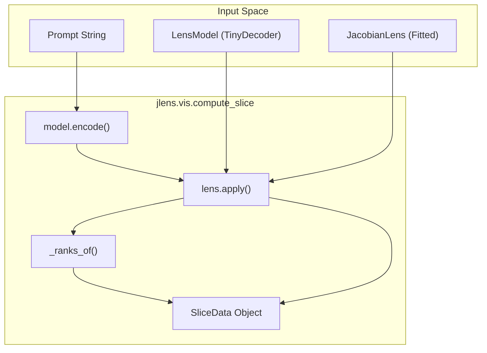
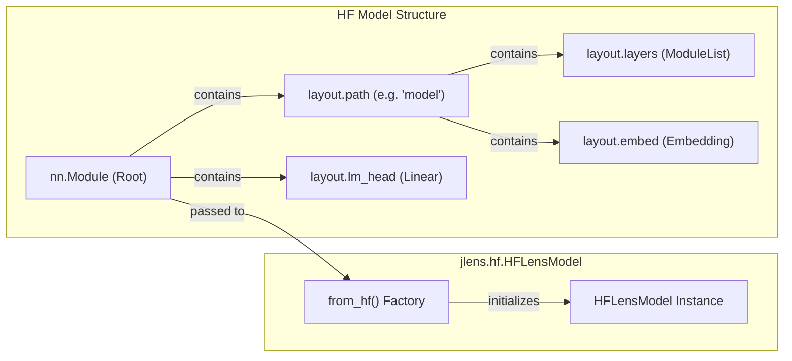

<!-- source: DeepWiki mcp.deepwiki.com · repo anthropics/jacobian-lens · page 5.2 Visualization and HF Adapter Tests · fetched 2026-10-26 -->

# Visualization and HF Adapter Tests

Relevant source files

The following files were used as context for generating this wiki page:

- [tests/test_compute_slice.py](tests/test_compute_slice.py)
- [tests/test_hf_layout.py](tests/test_hf_layout.py)
- [tests/test_ranks_of.py](tests/test_ranks_of.py)
- [tests/test_vis_modes.py](tests/test_vis_modes.py)

This page documents the test suite covering end-to-end visualization pipelines, HuggingFace model layout auto-detection, and optimized rank computation. These tests ensure that the Jacobian Lens can be applied to diverse model architectures and that the resulting interactive visualizations correctly represent the underlying numerical data.

## End-to-End Slice Computation

The `tests/test_compute_slice.py` module validates the full data flow from a fitted lens and a model to a `SliceData` object, which serves as the input for visualization rendering. These tests use the `TinyDecoder` fixture to allow for rapid, CPU-based execution without external dependencies [tests/test_compute_slice.py:16-23]().

### Implementation Details
The test suite verifies several critical behaviors of `jlens.vis.compute_slice`:
*   **Sequence Length Handling**: Ensures that `max_seq_len` correctly truncates the prompt while maintaining alignment between `context_token_ids` and the computed tensors [tests/test_compute_slice.py:37-45]().
*   **Logit Baseline Verification**: Confirms that the final layer in the slice matches the model's own output logits by comparing the `top_ids` in the slice to a direct call of `lens.apply` [tests/test_compute_slice.py:53-59]().
*   **Rank Consistency**: Validates that the `rank_tensor` (which stores the rank of specific tokens across all positions/layers) matches the output of the optimized `_ranks_of` helper [tests/test_compute_slice.py:62-69]().
*   **Windowing**: Tests the `last_n_tokens` parameter, which allows the visualization to focus on the tail of a long prompt while still retaining the full prompt context for the UI [tests/test_compute_slice.py:72-83]().

### Data Flow: Slice Generation
The following diagram illustrates how model activations and Jacobian transport results are packed into the `SliceData` container.

**Slice Computation Data Flow**

Sources: [tests/test_compute_slice.py:37-99](), [jlens/vis.py:14-14]()

---

## Visualization Rendering Modes

The `tests/test_vis_modes.py` suite focuses on the two primary ways the Jacobian Lens renders its interactive HTML interface: **Embed** and **Fetch**.

### Mode Comparison
The tests use synthetic `SliceData` to verify the integrity of the generated files without requiring a model forward pass [tests/test_vis_modes.py:25-44]().

| Feature | `mode="embed"` | `mode="fetch"` |
| :--- | :--- | :--- |
| **Portability** | High (Single HTML file) | Low (Directory of files) |
| **Data Storage** | Base64 encoded in `__BOOTSTRAP__` | Binary `.bin` sidecar files |
| **D3.js Source** | Inlined (fetched during build) | External CDN link |
| **Sidecars** | None | `meta.json`, `slice.bin`, `ranks/*.bin` |

### Key Test Cases
*   **Self-Containment**: In `embed` mode, the test verifies that all tracked token ranks are serialized into a JSON bootstrap dictionary and that the binary data can be round-tripped back to the original NumPy arrays [tests/test_vis_modes.py:47-69]().
*   **Sidecar Integrity**: In `fetch` mode, the test ensures that `write_slice_files` creates the correct directory structure and that the binary `.bin` files (compressed with gzip) match the source tensors [tests/test_vis_modes.py:72-89](), [tests/test_vis_modes.py:102-112]().
*   **Network Resilience**: A mock test ensures that `build_page` raises a `RuntimeError` if it cannot fetch the D3 library when attempting to create an embedded page [tests/test_vis_modes.py:91-99]().

Sources: [tests/test_vis_modes.py:47-112](), [jlens/vis.py:15-16]()

---

## HuggingFace Layout Auto-detection

The `tests/test_hf_layout.py` module validates the `Layout` detection logic used by `jlens.from_hf()`. It uses mock `torch.nn.Module` trees to simulate various model families without loading actual weights.

### Supported Architectures
The tests verify that `_find_layout` can correctly identify the internal structure of the following mock shapes:
*   **Llama/Mistral**: Standard `model` path [tests/test_hf_layout.py:50-50]().
*   **Phi**: Custom normalization attribute (`final_layernorm`) [tests/test_hf_layout.py:52-52]().
*   **GPT-2**: Uses `transformer` root with `h` for layers and `wte` for embeddings [tests/test_hf_layout.py:53-53]().
*   **GPT-NeoX/Pythia**: Uses `gpt_neox` root and specific embedding/head names [tests/test_hf_layout.py:54-57]().

### Mocking Strategy
The `_make_hf_mock` helper builds a minimal `nn.Module` tree that satisfies the `Layout` dataclass requirements, including a `config` object with `num_hidden_layers` and `hidden_size` [tests/test_hf_layout.py:25-44]().

**Layout Mapping to Code Entities**

Sources: [tests/test_hf_layout.py:9-44](), [jlens/hf.py:9-9]()

---

## Optimized Rank Computation

The `tests/test_ranks_of.py` module ensures the correctness of `_ranks_of`, an optimized helper function used to find the rank of specific target tokens within a large vocabulary without performing a full sort of the entire logit tensor.

### Implementation Logic
The tests compare the output of `_ranks_of` against a `_naive_ranks` reference implementation that uses `torch.argsort` on the entire tensor [tests/test_ranks_of.py:10-17]().

### Verified Scenarios
*   **1D Targets**: Computing the rank of a fixed set of tokens across all sequence positions [tests/test_ranks_of.py:19-26]().
*   **2D Targets**: Computing the rank of different tokens for each sequence position (e.g., the rank of the actual "next token" in the prompt) [tests/test_ranks_of.py:28-35]().
*   **Chunking**: The tests iterate through various `chunk_size` values (1, 7, 37, 256) to ensure that the chunked processing logic does not introduce off-by-one errors or boundary condition failures [tests/test_ranks_of.py:23-24]().

Sources: [tests/test_ranks_of.py:7-35](), [jlens/vis.py:14-14]()

---

