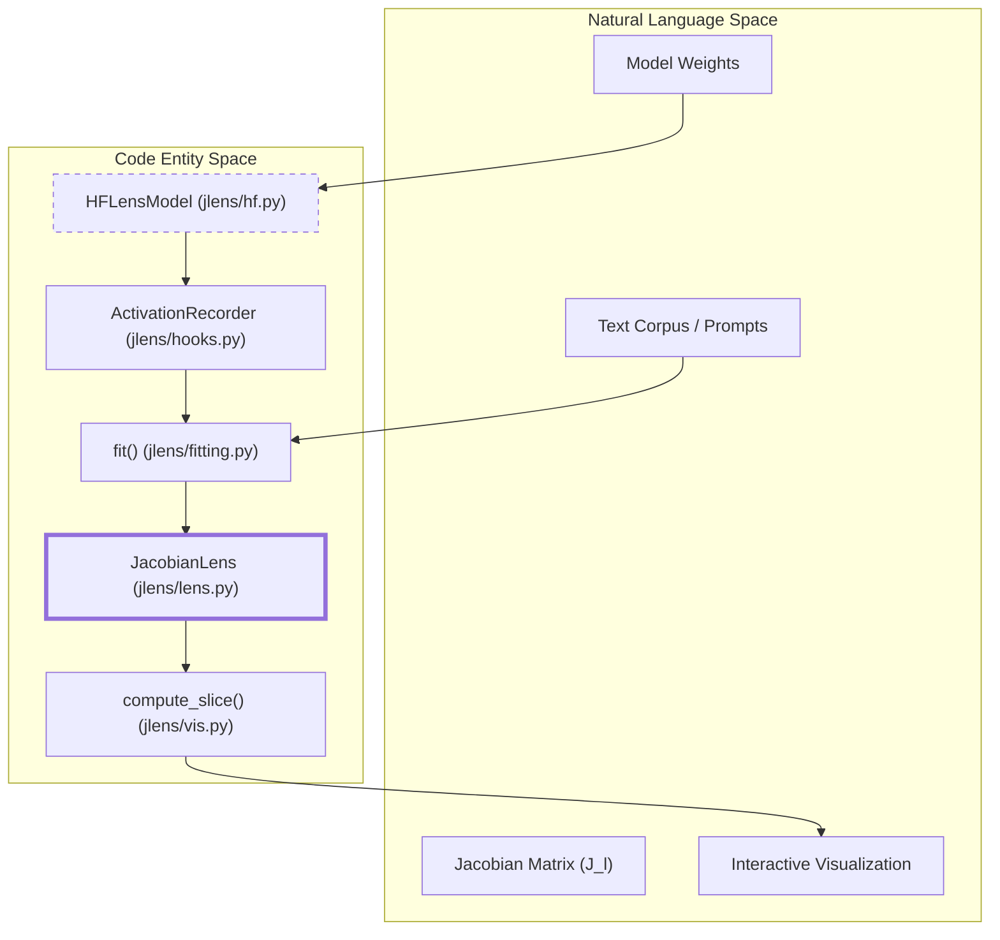
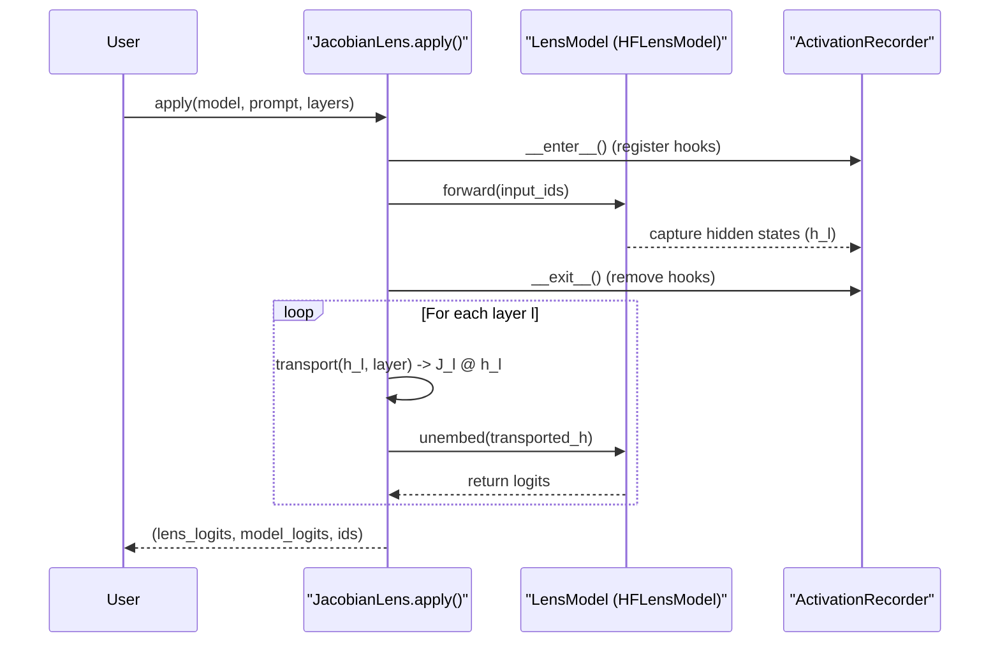

<!-- source: DeepWiki mcp.deepwiki.com · repo anthropics/jacobian-lens · page 6 Glossary · fetched 2026-10-26 -->

# Glossary

Relevant source files

The following files were used as context for generating this wiki page:

- [README.md](README.md)
- [assets/qwen_gloss.json.gz](assets/qwen_gloss.json.gz)
- [data/evaluations/README.md](data/evaluations/README.md)
- [data/experiments/README.md](data/experiments/README.md)
- [jlens/fitting.py](jlens/fitting.py)
- [jlens/hf.py](jlens/hf.py)
- [jlens/hooks.py](jlens/hooks.py)
- [jlens/lens.py](jlens/lens.py)
- [jlens/protocol.py](jlens/protocol.py)
- [jlens/vis.py](jlens/vis.py)

This page defines core terminology, codebase-specific concepts, and domain-specific abbreviations used throughout the `jacobian-lens` repository. It provides a bridge between the mathematical concepts in the companion paper and their concrete implementation in the code.

## Core Concepts

### Jacobian Transport
The fundamental operation of the Jacobian lens. It is a linear transformation that maps a residual stream vector $h_l$ at layer $l$ into the final-layer basis using the average input-output Jacobian $J_l$.
*   **Mathematical Definition**: $lens_l(h) = unembed(J_l @ h)$, where $J_l = E[\partial h_{final} / \partial h_l]$.
*   **Implementation**: Defined in the `transport` method of the `JacobianLens` class [jlens/lens.py:135-144]().
*   **Fitting**: The estimator for $J_l$ is computed by injecting one-hot cotangents at target positions and performing backpropagation [jlens/fitting.py:11-22]().

### Residual Stream
The sequence of hidden states $h_l$ passed between transformer blocks. In this codebase, the residual stream is captured using forward hooks.
*   **Code Entity**: Managed by the `ActivationRecorder` class [jlens/hooks.py:13-29]().
*   **HuggingFace Mapping**: Located within the model's `layers` attribute, typically found via the `Layout` configuration [jlens/hf.py:29-48]().

### Workspace Band
A contiguous range of mid-network layers where verbalizable representations (the "Global Workspace") are most clearly readable.
*   **Usage**: Evaluation metrics and experiments (like `probe-swap` or `verbal-report`) typically report results averaged or aggregated over this band rather than single layers [data/evaluations/README.md:11-13](), [data/experiments/README.md:11-13]().

### Slice
A 2D visualization representing the lens readout across all token positions (x-axis) and all layers (y-axis) for a single prompt.
*   **Data Structure**: Encapsulated in the `SliceData` dataclass [jlens/vis.py:165-186]().
*   **Computation**: Handled by `compute_slice` [jlens/vis.py:200-205]().

---

## Codebase Entities and Data Flow

The following diagram maps the natural language concepts of "Fitting" and "Applying" the lens to the specific classes and functions in the `jlens` package.

### System Architecture and Data Flow

**Sources**: [jlens/hf.py:83-92](), [jlens/fitting.py:200-210](), [jlens/lens.py:22-31](), [jlens/vis.py:200-210]()

---

## Technical Terms and Abbreviations

| Term | Definition | Code Reference |
| :--- | :--- | :--- |
| **`d_model`** | The hidden dimension size of the transformer's residual stream. | [jlens/protocol.py:33-33]() |
| **`dim_batch`** | The number of Jacobian rows computed in a single backward pass to optimize GPU memory. | [jlens/fitting.py:106-106]() |
| **`Hit`** | A success criterion where the target token appears at rank 1 in the lens readout within the workspace band. | [data/evaluations/README.md:14-15]() |
| **`Layout`** | A dataclass defining the attribute paths for submodules (layers, norm, embed) in HuggingFace models. | [jlens/hf.py:29-40]() |
| **`Logit Lens`** | A baseline method that decodes hidden states directly without Jacobian transport ($J = I$). | [jlens/lens.py:168-169]() |
| **`Swap`** | A causal intervention that replaces a token's representation with another's direction at specific layers/positions. | [data/experiments/README.md:16-18]() |
| **`Unembed`** | The operation of applying the final layer norm and LM head to a residual vector to produce vocabulary logits. | [jlens/protocol.py:49-52]() |

---

## Component Interaction: Applying the Lens

This diagram illustrates how a `JacobianLens` interacts with a `LensModel` during the `apply()` process to produce logits.

### Lens Application Sequence

**Sources**: [jlens/lens.py:146-181](), [jlens/hooks.py:58-75](), [jlens/protocol.py:49-52]()

---

## Evaluation Metrics

*   **Pass@k**: The primary metric for lens quality. It is the mean fraction of intermediate tokens whose minimum rank across layers in the workspace band is less than or equal to $k$.
    *   **Source**: [data/evaluations/README.md:26-27]()
*   **Reciprocal Rank Share**: Used in `ignition` experiments to measure the relative strength of two competing concepts (A vs B) in the lens readout.
    *   **Formula**: $1/rank(A) \div (1/rank(A) + 1/rank(B))$.
    *   **Source**: [data/experiments/README.md:74-74]()
*   **Selectivity**: The difference in hit rates for a concept under different task instructions (e.g., explicit vs. automatic report).
    *   **Source**: [data/experiments/README.md:62-62]()