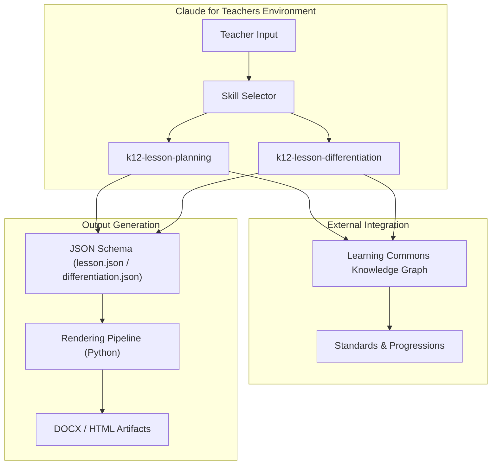
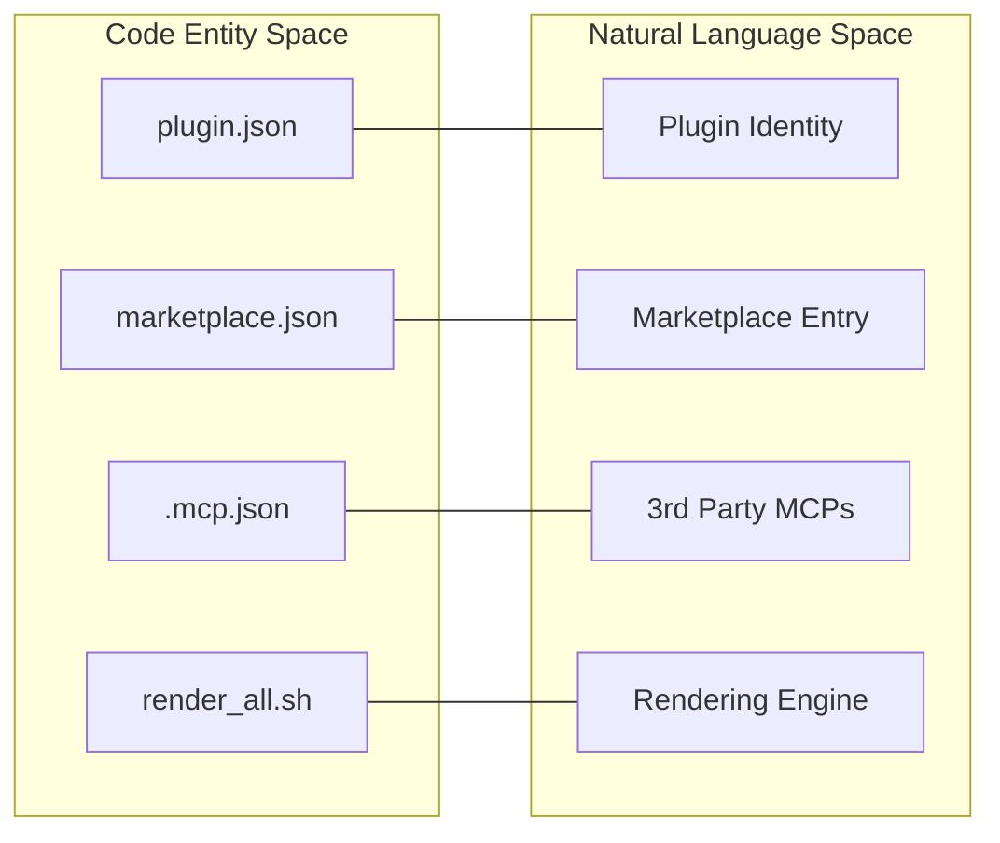

<!-- source: DeepWiki mcp.deepwiki.com · repo anthropics/k12-teacher-skills · page 1 Overview · fetched 2026-10-26 -->

# Overview

Relevant source files

The following files were used as context for generating this wiki page:

- [README.md](README.md)
- [plugin/.claude-plugin/marketplace.json](plugin/.claude-plugin/marketplace.json)
- [plugin/.claude-plugin/plugin.json](plugin/.claude-plugin/plugin.json)
- [plugin/.mcp.json](plugin/.mcp.json)

The `k12-teacher-skills` repository contains the source code, pedagogical frameworks, and evaluation logic for the specialized agent skills integrated into **Claude for Teachers**. These skills are designed to assist educators in creating high-quality, standards-aligned classroom materials using research-backed learning science.

The repository primarily facilitates two core workflows:
1.  **Lesson Planning**: Generating classroom-ready lesson plans from scratch or curriculum prompts.
2.  **Lesson Differentiation**: Adapting existing lessons into tiered versions (Below, At, and Above proficiency) to meet diverse student needs.

## Purpose and Scope

This project bridges the gap between large language models and the specific, rigorous requirements of K-12 education. It leverages the **Learning Commons Knowledge Graph** [README.md:8-10]() to ground AI outputs in academic standards across all 50 U.S. states, ensuring that generated content is not only creative but also pedagogically sound.

The repository includes:
*   **Skill Definitions**: System prompts and execution flows for lesson generation and differentiation.
*   **Pedagogical References**: Subject-specific guidelines for Math, ELA, Science, and Social Studies.
*   **Rendering Engine**: A Python-based pipeline that converts JSON-structured lesson data into professional `.docx` and `.html` artifacts.
*   **Evaluation Framework**: A P/R/O/M (Pedagogy, Rigor, Organization, Mechanics) rubric system for automated and manual quality assurance.

## Core Skills

The repository is organized around two primary skills defined within the `plugin/` directory:

| Skill | Code Identifier | Primary Function |
| :--- | :--- | :--- |
| **Lesson Planning** | `k12-lesson-planning` | Builds standards-aligned plans, including teacher guides and student worksheets. [README.md:5-5]() |
| **Lesson Differentiation** | `k12-lesson-differentiation` | Adapts lessons into three tiers while maintaining core content consistency. [README.md:6-6]() |

### Skill Interaction Logic
Both skills follow a structured lifecycle—often involving a "Draft Offer" phase—where the agent proposes a plan before generating full artifacts. They share a common rendering architecture to ensure visual consistency across all exported documents.

**Skill Orchestration Overview**

*Sources: [README.md:4-10](), [plugin/.claude-plugin/marketplace.json:11-14]()*

## Ecosystem Integration

The skills are bundled as a plugin [plugin/.claude-plugin/plugin.json:1-8]() and include support for third-party **Model Context Protocol (MCP)** servers. These servers allow Claude to interact with popular educational tools such as Canva, MagicSchool, and ASSISTments [plugin/.mcp.json:1-13]().

**System Component Mapping**

*Sources: [plugin/.claude-plugin/plugin.json:1-4](), [plugin/.claude-plugin/marketplace.json:9-17](), [plugin/.mcp.json:2-12]()*

## Getting Started

Depending on your environment, you can access these skills in two ways:

1.  **Claude for Teachers**: No installation is required; these skills are pre-configured for all accounts [README.md:15-16]().
2.  **Local/Claude Code**: You can clone the repository and add the plugin manually to environments like Claude Code using the `claude plugin` CLI [README.md:18-25]().

For detailed setup instructions, including manifest configurations and MCP setup, see **[Getting Started & Installation](#1.1)**.

## Repository Structure

The repository is divided into two main functional areas:
*   `plugin/`: Contains the logic, schemas, and assets for the teacher skills [README.md:29-29]().
*   `evals/`: Contains the P/R/O/M rubrics used to grade the model's pedagogical performance [README.md:30-30]().

For a full breakdown of the directory tree and contribution guidelines, see **[Repository Layout & Contributing](#1.2)**.

---
**Sources:**
* [README.md:1-31]()
* [plugin/.claude-plugin/marketplace.json:1-20]()
* [plugin/.claude-plugin/plugin.json:1-9]()
* [plugin/.mcp.json:1-14]()

---

