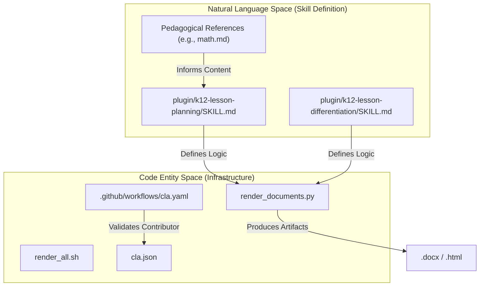
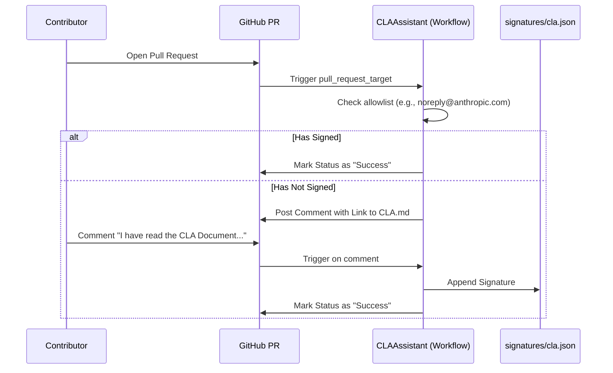

<!-- source: DeepWiki mcp.deepwiki.com · repo anthropics/k12-teacher-skills · page 1.2 Repository Layout & Contributing · fetched 2026-10-26 -->

# Repository Layout & Contributing

Relevant source files

The following files were used as context for generating this wiki page:

- [.github/workflows/cla.yaml](.github/workflows/cla.yaml)
- [.gitignore](.gitignore)
- [CLA.md](CLA.md)
- [CODEOWNERS](CODEOWNERS)
- [CODE_OF_CONDUCT.md](CODE_OF_CONDUCT.md)
- [CONTRIBUTING.md](CONTRIBUTING.md)
- [LICENSE](LICENSE)
- [NOTICE](NOTICE)
- [SECURITY.md](SECURITY.md)

This page details the technical structure of the `k12-teacher-skills` repository, the governance policies for contributors, and the legal framework under which the project is licensed. It is intended for developers looking to extend the skills, fix bugs, or understand the project's operational standards.

## Directory Structure

The repository is organized into distinct functional areas separating the Claude skill definitions, the rendering engine, and the evaluation framework.

| Directory / File | Description |
|:---|:---|
| `plugin/` | Contains the core skill definitions, including `manifest.json`, system prompts (`SKILL.md`), and subject-specific pedagogical reference files. |
| `evals/` | Contains the P/R/O/M (Pedagogy, Rubric, Output, Model) evaluation framework, including CSV-based rubrics for LLM-as-judge scoring. |
| `.github/` | CI/CD configurations, including the automated CLA Assistant and PR workflows. |
| `signatures/` | Storage for signed CLA records (managed by the `cla-signatures` branch). |

### Code Entity Relationship Diagram
The following diagram illustrates how repository files map to the runtime execution and contribution flow.

**Repository Mapping to Skill Execution**

**Sources:** [.github/workflows/cla.yaml:36-38](), [CONTRIBUTING.md:19-21](), [NOTICE:1-5]()

---

## Licensing & Governance

### Apache-2.0 License
The project is licensed under the **Apache License, Version 2.0**. This allows for broad use, modification, and distribution while providing an express grant of patent rights from contributors to users.
* **Copyright:** Held by Anthropic, PBC and Learning Commons [NOTICE:1-5]().
* **Derivative Works:** Must include a copy of the license and prominent notices of modifications [LICENSE:95-99]().

### Contributor License Agreement (CLA)
All individual and corporate contributors must sign a CLA before pull requests can be merged [CONTRIBUTING.md:5-7](). 

**CLA Enforcement Flow**

**Sources:** [.github/workflows/cla.yaml:21-43](), [CONTRIBUTING.md:5-10](), [CLA.md:1-40]()

---

## Contributing Guidelines

### Pull Request Process
1. **Fork & Branch:** Create a branch from `main` [CONTRIBUTING.md:36]().
2. **Implementation:** Follow existing code styles in the `plugin/` and `evals/` directories.
3. **Validation:** Load the modified skill into Claude to verify behavior [CONTRIBUTING.md:25-26]().
4. **Documentation:** Update relevant `.md` files if public APIs or user-facing behaviors change [CONTRIBUTING.md:39]().
5. **Review:** At least one maintainer (as defined in `CODEOWNERS`) must approve the PR [CONTRIBUTING.md:44-46](), [CODEOWNERS:1-2]().

### Code of Conduct
The project adheres to a standard of professional conduct adapted from the Contributor Covenant.
* **Expected Behavior:** Use inclusive language, respect differing viewpoints, and focus on community benefit [CODE_OF_CONDUCT.md:9-14]().
* **Reporting:** Unacceptable behavior should be reported to `support@anthropic.com` [CODE_OF_CONDUCT.md:29]().

**Sources:** [CONTRIBUTING.md:33-46](), [CODEOWNERS:1-2](), [CODE_OF_CONDUCT.md:1-37]()

---

## Security Policy

Security is managed via Anthropic's central security program.
* **Reporting:** Do not open public issues for security vulnerabilities. Instead, use the [HackerOne submission form](https://hackerone.com/4f1f16ba-10d3-4d09-9ecc-c721aad90f24/embedded_submissions/new) [SECURITY.md:13-15]().
* **Bug Bounty:** Validated vulnerabilities may be eligible for the Anthropic Bug Bounty Program [SECURITY.md:17-19]().

**Sources:** [SECURITY.md:1-19]()

---

