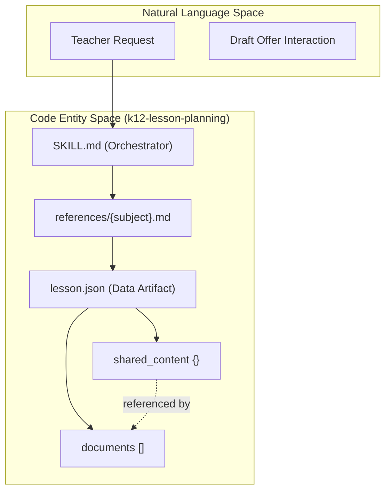
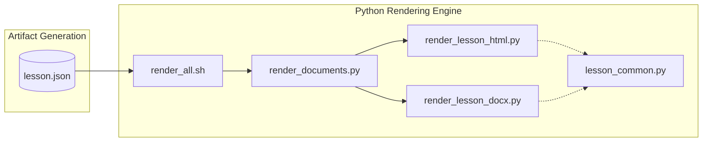

<!-- source: DeepWiki mcp.deepwiki.com · repo anthropics/k12-teacher-skills · page 2 k12-lesson-planning Skill · fetched 2026-10-26 -->

# k12-lesson-planning Skill

Relevant source files

The following files were used as context for generating this wiki page:

- [plugin/skills/k12-lesson-planning/SKILL.md](plugin/skills/k12-lesson-planning/SKILL.md)

The `k12-lesson-planning` skill is a specialized engine designed to produce a teacher-ready instructional package. This package includes a standards-aligned lesson plan, student-facing materials, and a teacher observation template, all delivered as editable Word documents and HTML previews.

The skill operates by transforming a teacher's intent (e.g., "I'm teaching long division to 5th graders") into a structured `lesson.json` artifact, which is then processed by a Python-based rendering pipeline.

Sources: [plugin/skills/k12-lesson-planning/SKILL.md:1-25]()

## Skill Lifecycle and Orchestration

The execution of this skill follows a strict five-step lifecycle managed by `SKILL.md`. This ensures that every lesson is pedagogically sound, grounded in verified standards, and formatted correctly for classroom use.

### The Five-Step Execution Flow

| Step | Name | Description |
| :--- | :--- | :--- |
| **0** | **Route** | Determines the subject (Math, ELA, Science, Social Studies) and loads the corresponding reference file. |
| **1** | **Clarify** | Asks up to two high-priority questions and presents the **Draft Offer**. |
| **2** | **Ground** | Queries the Learning Commons Knowledge Graph (KG) for standards, progressions, and misconceptions. |
| **3** | **Build** | Constructs the lesson content following subject-specific non-negotiables and grade-band arcs. |
| **4** | **Output** | Generates the `lesson.json` and invokes the rendering tools to produce `.docx` and `.html` files. |

For a deep dive into the orchestration logic, subject detection, and the "Draft Offer" interaction pattern, see [Skill Orchestration & Lifecycle](#2.1).

Sources: [plugin/skills/k12-lesson-planning/SKILL.md:44-150]()

## Subject-Specific Pedagogy

The skill does not use a "one size fits all" approach. Instead, it routes the request to one of four subject-specific reference files. These files contain the "DNA" of the lesson, including specific instructional frameworks (like CGI for Math or the C3 Inquiry Arc for Social Studies) and grade-level expectations.

*   **Math:** Focuses on Illustrative Mathematics (IM) structures, CGI problem types, and Standards for Mathematical Practice (SMPs).
*   **ELA:** Rooted in the Science of Reading, grade-band text complexity arcs, and Text-Dependent Questions (TDQs).
*   **Science:** Driven by NGSS Performance Expectations, phenomena-based instruction, and OpenSciEd routines.
*   **Social Studies:** Built around the C3 Framework, inquiry arcs, and state-level standards.

For details on how these pedagogical frameworks are applied, see [Subject-Specific Pedagogy References](#2.2).

Sources: [plugin/skills/k12-lesson-planning/SKILL.md:46-67](), [plugin/skills/k12-lesson-planning/references/math.md:1-20](), [plugin/skills/k12-lesson-planning/references/ela.md:1-20]()

## Data Model: lesson.json

The primary output of the LLM is a single JSON file named `lesson.json`. This file acts as the "source of truth" for the entire lesson package. It uses a **Shared Content Registry** to ensure consistency across the teacher plan and student worksheets.

### Technical Mapping: Intent to Artifacts

The following diagram illustrates how the system transitions from a natural language request to the structured code entities that define the lesson.

**System Entity Mapping**

For the full schema specification, including block types (e.g., `fill_table`, `number_line`) and density rules, see [lesson.json Schema & Output Contract](#2.3).

Sources: [plugin/skills/k12-lesson-planning/output.md:1-50](), [plugin/skills/k12-lesson-planning/example_lesson.json:1-100]()

## The Rendering Pipeline

Once the `lesson.json` is generated, it is passed to a suite of Python scripts that handle the conversion to teacher-deliverable formats. The pipeline ensures that the visual styling is consistent and that the documents are optimized for printing.

**Rendering Pipeline Flow**

### Key Components:
*   `render_documents.py`: The entry point that orchestrates the creation of multiple files from one JSON.
*   `lesson_common.py`: Handles "Shared Content" expansion and print-safety repairs (e.g., fixing table breaks).
*   `render_lesson_docx.py`: Uses `python-docx` and a dispatch table (`_EMITTERS`) to build Word files.

For details on the rendering logic and CSS theming, see [Rendering Pipeline](#2.4).

Sources: [plugin/render_documents.py:1-30](), [plugin/lesson_common.py:1-50](), [plugin/render_lesson_docx.py:1-100]()

---

