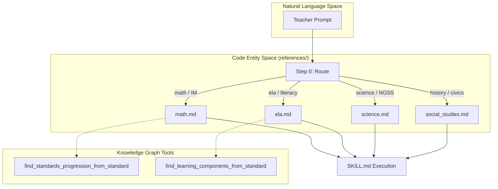
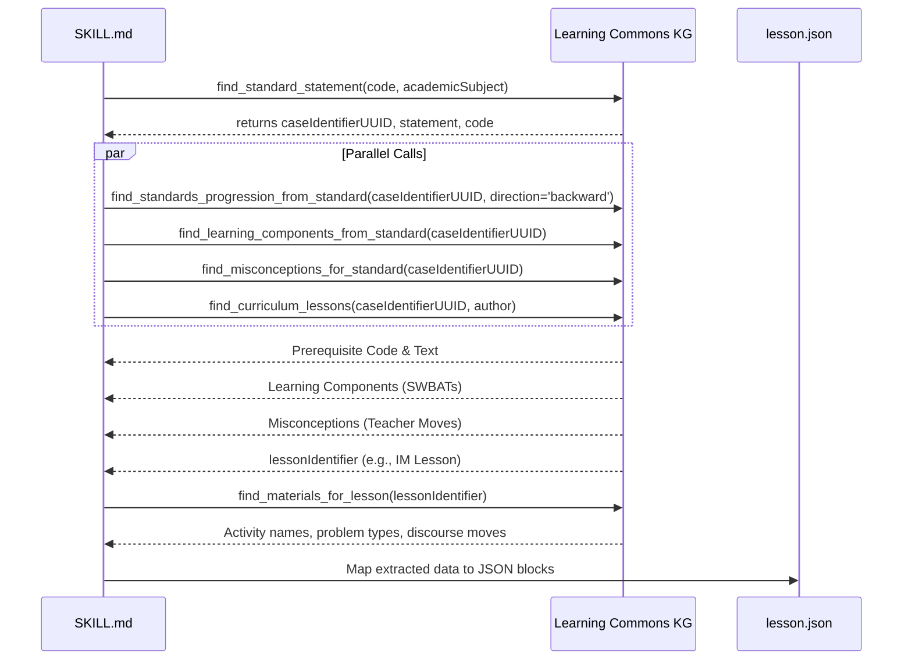

<!-- source: DeepWiki mcp.deepwiki.com · repo anthropics/k12-teacher-skills · page 2.1 Skill Orchestration & Lifecycle · fetched 2026-10-26 -->

# Skill Orchestration & Lifecycle

Relevant source files

The following files were used as context for generating this wiki page:

- [plugin/skills/k12-lesson-planning/SKILL.md](plugin/skills/k12-lesson-planning/SKILL.md)
- [plugin/skills/k12-lesson-planning/references/learning-commons-kg.md](plugin/skills/k12-lesson-planning/references/learning-commons-kg.md)

This page provides a technical deep dive into the execution flow of the `k12-lesson-planning` skill. It covers the state machine governing lesson generation, from initial subject detection to the final delivery of editable artifacts, including the "Draft Offer" interaction pattern and the integration of the Learning Commons Knowledge Graph (KG).

## Five-Step Execution Flow

The `k12-lesson-planning` skill follows a rigid five-step lifecycle defined in `plugin/skills/k12-lesson-planning/SKILL.md`. This flow ensures that every lesson is pedagogically sound, standards-aligned, and respectful of intellectual property.

### 1. Step 0: Route
Before interacting with the teacher, the system performs silent routing based on the prompt and conversation history `[plugin/skills/k12-lesson-planning/SKILL.md:44-78]()`.
*   **Subject Detection:** Determines if the request falls under `math`, `ela`, `science`, or `social_studies` `[plugin/skills/k12-lesson-planning/SKILL.md:46-52]()`.
*   **Reference Loading:** The system **must** read the corresponding reference file (e.g., `references/math.md`) immediately. Failure to load the reference before drafting is a critical failure `[plugin/skills/k12-lesson-planning/SKILL.md:61-65]()`.
*   **Curriculum Detection:** Identifies if a specific curriculum like *Illustrative Mathematics* (IM) or *OpenSciEd* is implied `[plugin/skills/k12-lesson-planning/SKILL.md:69-74]()`.

### 2. Step 1: Clarify
The system asks at most two clarifying questions based on the priority ranking defined in the subject-specific reference file `[plugin/skills/k12-lesson-planning/SKILL.md:81-85]()`. These questions are bundled with the **Draft Offer** to minimize interaction rounds `[plugin/skills/k12-lesson-planning/SKILL.md:87-90]()`.

### 3. Step 2: Ground in Standards
If the Learning Commons Knowledge Graph tools are available, the system performs a sequence of calls to retrieve verbatim standards, prerequisites, and misconceptions `[plugin/skills/k12-lesson-planning/SKILL.md:96-99]()`.
*   **Tool Usage:** Uses `find_standard_statement` to resolve the target standard `[plugin/skills/k12-lesson-planning/references/learning-commons-kg.md:16-19]()`.
*   **Fallback:** If the KG is unavailable, the system proceeds using internal training knowledge and appends a mandatory disclaimer footer `[plugin/skills/k12-lesson-planning/SKILL.md:101-104]()`.

### 4. Step 3: Build
The system generates the lesson content following the "Build" section of the subject reference file `[plugin/skills/k12-lesson-planning/SKILL.md:108-112]()`. This phase is governed by the **Copyright Guardrail**, which prohibits verbatim reproduction of student-facing text from KG curriculum materials `[plugin/skills/k12-lesson-planning/SKILL.md:116-128]()`.

### 5. Step 4: The Draft Offer & Step 5: Output
The system presents a choice to the teacher: a **Fast Draft** (text-only summary) or the **Full Packet** (JSON-backed Word/HTML documents) `[plugin/skills/k12-lesson-planning/SKILL.md:131-150]()`. Once the packet is requested, the system emits the `lesson.json` and triggers the rendering scripts `[plugin/skills/k12-lesson-planning/SKILL.md:160-164]()`.

**Sources:**
* `plugin/skills/k12-lesson-planning/SKILL.md`
* `plugin/skills/k12-lesson-planning/references/learning-commons-kg.md`

---

## Data Flow: Natural Language to Code Entities

The following diagram illustrates how teacher intent is translated into specific code entities and reference files within the repository.

### Intent Routing and Reference Mapping

**Sources:**
* `plugin/skills/k12-lesson-planning/SKILL.md:44-67]()`
* `plugin/skills/k12-lesson-planning/references/learning-commons-kg.md:33-75]()`

---

## The Draft Offer Interaction Pattern

The "Draft Offer" is a critical UX pattern designed to save the teacher time. It allows the teacher to review the "shape" of the lesson before the LLM commits to the high-token-cost generation of multiple documents.

| Component | Description | Code Requirement |
| :--- | :--- | :--- |
| **Question** | Asks if the teacher wants a "Fast Draft" or "Full Packet". | `[plugin/skills/k12-lesson-planning/SKILL.md:138-142]()` |
| **Fast Draft** | A 1-2 paragraph summary of the lesson's arc and the resolved standard. | `[plugin/skills/k12-lesson-planning/SKILL.md:143-145]()` |
| **Full Packet** | Triggers the generation of `lesson.json` and the artifact rendering. | `[plugin/skills/k12-lesson-planning/SKILL.md:146-148]()` |
| **Default** | If the teacher is silent on the offer but answers clarifying questions, the system defaults to the **Full Packet**. | `[plugin/skills/k12-lesson-planning/SKILL.md:154-158]()` |

**Sources:**
* `plugin/skills/k12-lesson-planning/SKILL.md:131-158]()`

---

## Standards Resolution & KG Integration

When the Learning Commons Knowledge Graph is available, the skill executes a specific sequence of tool calls. The `caseIdentifierUUID` acts as the primary key linking the standard to prerequisites and curriculum materials.

### KG Call Sequence & Data Flow

**Sources:**
* `plugin/skills/k12-lesson-planning/references/learning-commons-kg.md:14-50]()`
* `plugin/skills/k12-lesson-planning/SKILL.md:94-106]()`

---

## Revision Lifecycle

After the artifacts are generated, the teacher may request changes. The skill follows a "surgical" revision policy to maintain consistency across the three generated documents (Lesson Plan, Student Materials, Observation Template).

1.  **Implicit vs. Explicit:** If the teacher asks for a change, the system updates the underlying `lesson.json` and re-renders all documents `[plugin/skills/k12-lesson-planning/SKILL.md:167-170]()`.
2.  **Pedagogical Guardrail:** The system must reject revisions that violate subject-specific non-negotiables (e.g., removing the "Exit Ticket" in a Math lesson) `[plugin/skills/k12-lesson-planning/SKILL.md:172-175]()`.
3.  **Consistency:** Any change to the lesson plan (e.g., changing a problem context) must be reflected in the student-facing worksheet and the observation template `[plugin/skills/k12-lesson-planning/SKILL.md:177-179]()`.

**Sources:**
* `plugin/skills/k12-lesson-planning/SKILL.md:167-180]()`

---

