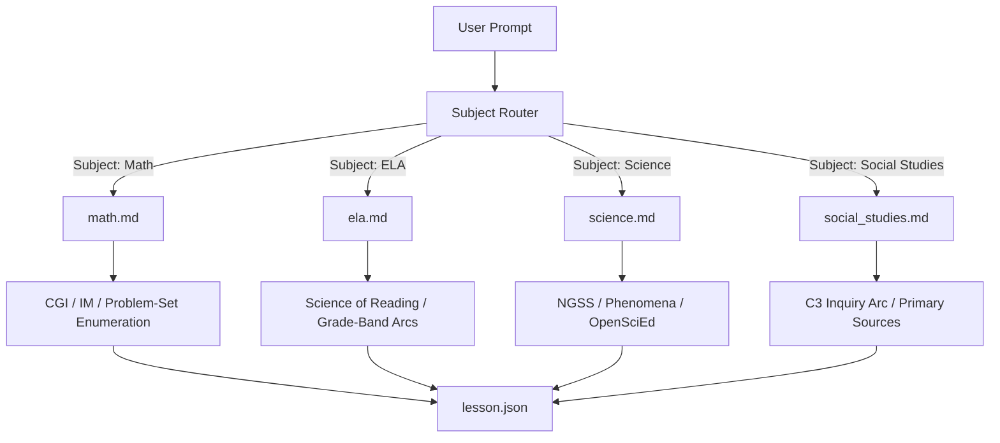
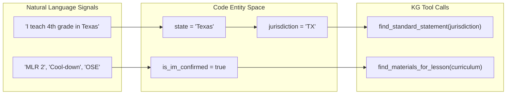

<!-- source: DeepWiki mcp.deepwiki.com · repo anthropics/k12-teacher-skills · page 2.2 Subject-Specific Pedagogy References · fetched 2026-10-26 -->

# Subject-Specific Pedagogy References

Relevant source files

The following files were used as context for generating this wiki page:

- [plugin/skills/k12-lesson-planning/references/ela.md](plugin/skills/k12-lesson-planning/references/ela.md)
- [plugin/skills/k12-lesson-planning/references/math.md](plugin/skills/k12-lesson-planning/references/math.md)
- [plugin/skills/k12-lesson-planning/references/science.md](plugin/skills/k12-lesson-planning/references/science.md)
- [plugin/skills/k12-lesson-planning/references/social_studies.md](plugin/skills/k12-lesson-planning/references/social_studies.md)

This page details the four subject-specific reference files that govern the pedagogical logic, structural requirements, and content standards for the `k12-lesson-planning` skill. These files act as the "pedagogical brain" of the system, ensuring that generated lessons adhere to evidence-based practices such as Cognitively Guided Instruction (CGI) for Math, the Science of Reading for ELA, the C3 Inquiry Arc for Social Studies, and Phenomena-based learning for Science.

## Overview of Reference Loading

When the `k12-lesson-planning` skill is invoked, it first routes the request to a specific subject. Based on this routing, the LLM loads the corresponding reference file from `plugin/skills/k12-lesson-planning/references/`. These files provide instructions for three critical phases:
1.  **Clarify**: Subject-specific signals to look for in the conversation (e.g., state codes, curriculum names).
2.  **Ground**: Instructions for using the Learning Commons Knowledge Graph (KG).
3.  **Build**: The structural blueprints and "non-negotiables" for the lesson artifacts.

### Data Flow: Natural Language to Pedagogical Constraints

The following diagram illustrates how user inputs are mapped to specific pedagogical frameworks defined in the reference files.

**Pedagogical Mapping Flow**

**Sources:** [plugin/skills/k12-lesson-planning/references/math.md:7-10](), [plugin/skills/k12-lesson-planning/references/ela.md:7-10](), [plugin/skills/k12-lesson-planning/references/science.md:7-10](), [plugin/skills/k12-lesson-planning/references/social_studies.md:7-11]()

---

## Mathematics Pedagogy (`math.md`)

The math reference focuses on **problem-based learning** and **structural variety** in problem sets.

### Key Frameworks
*   **Illustrative Mathematics (IM)**: If "IM-confirmed" (via terminology like MLRs or "cool-downs"), the system follows the **Launch → Explore → Discuss → Synthesize → Exit Ticket** arc strictly [plugin/skills/k12-lesson-planning/references/math.md:42-47]().
*   **Cognitively Guided Instruction (CGI)**: For K–2, the system ensures story problems span all four situation types (add-to, take-from, put-together, compare) [plugin/skills/k12-lesson-planning/references/math.md:50]().

### Problem-Set Enumeration
A unique requirement for math is the **enumeration of structural cases**. Before writing problems, the skill must list cases from the "baseline" to the "structurally hardest" (e.g., start-unknown problems or non-proportional linear relationships) [plugin/skills/k12-lesson-planning/references/math.md:57-65]().

**Sources:** [plugin/skills/k12-lesson-planning/references/math.md:16-18](), [plugin/skills/k12-lesson-planning/references/math.md:50-54](), [plugin/skills/k12-lesson-planning/references/math.md:57-65]()

---

## ELA Pedagogy (`ela.md`)

The ELA reference is rooted in the **Science of Reading** and varies significantly by grade band.

### Grade-Band Arcs
| Grade Band | Focus | Core Components |
| :--- | :--- | :--- |
| **K–2** | Foundational Literacy | Phonics (RF) or Comprehension (RL/RI) arcs; Decodable text; No three-cueing [plugin/skills/k12-lesson-planning/references/ela.md:61-110](). |
| **3–5** | Transitional | Close reading of complex text; Text-Dependent Questions (TDQs); Think-Write-Pair-Share [plugin/skills/k12-lesson-planning/references/ela.md:114-128](). |
| **6–12** | Analysis & Argument | Rhetorical analysis; Evidence-based claims; Tier 2/3 vocabulary integration [plugin/skills/k12-lesson-planning/references/ela.md:132-156](). |

### Anchor Texts
The skill distinguishes between **public domain** texts (reproduced in full) and **copyrighted** texts (cited with instructions for the teacher to provide copies) [plugin/skills/k12-lesson-planning/references/ela.md:23-31]().

**Sources:** [plugin/skills/k12-lesson-planning/references/ela.md:17-21](), [plugin/skills/k12-lesson-planning/references/ela.md:23-31](), [plugin/skills/k12-lesson-planning/references/ela.md:61-156]()

---

## Science Pedagogy (`science.md`)

Science lessons are driven by **phenomena** and the **Next Generation Science Standards (NGSS)** 3D learning model.

### Implementation Logic
*   **OpenSciEd (OSE)**: If OSE is detected, the skill uses OSE-specific routines like the "Driving Question Board" and "Consensus Models" [plugin/skills/k12-lesson-planning/references/science.md:46-55]().
*   **Sensemaking**: All lessons must follow an **Investigation before Explanation** sequence. Students gather data through Science and Engineering Practices (SEPs) before the teacher formalizes the disciplinary core ideas (DCIs) [plugin/skills/k12-lesson-planning/references/science.md:77-80]().
*   **CER Framework**: Grades 3–12 utilize the **Claim-Evidence-Reasoning** structure for formative writing [plugin/skills/k12-lesson-planning/references/science.md:91]().

**Sources:** [plugin/skills/k12-lesson-planning/references/science.md:17-18](), [plugin/skills/k12-lesson-planning/references/science.md:46-55](), [plugin/skills/k12-lesson-planning/references/science.md:77-80](), [plugin/skills/k12-lesson-planning/references/science.md:91]()

---

## Social Studies Pedagogy (`social_studies.md`)

Social Studies follows the **C3 Framework Inquiry Arc**, emphasizing primary source analysis.

### Inquiry Components
1.  **Compelling Questions**: Contestable, civically resonant questions (e.g., "Was World War I inevitable?") [plugin/skills/k12-lesson-planning/references/social_studies.md:42-52]().
2.  **Source Set**: Lessons must include at least two primary sources. The skill uses `source_card` blocks to excerpt public domain text or cite visual media [plugin/skills/k12-lesson-planning/references/social_studies.md:90-101]().
3.  **Disciplinary Tools**: Application of concepts from civics, economics, geography, and history [plugin/skills/k12-lesson-planning/references/social_studies.md:15]().

**Sources:** [plugin/skills/k12-lesson-planning/references/social_studies.md:13-17](), [plugin/skills/k12-lesson-planning/references/social_studies.md:42-52](), [plugin/skills/k12-lesson-planning/references/social_studies.md:90-101]()

---

## Technical Implementation & State Detection

All subject references share a common **State Detection** logic. The system scans for state names or specific codes (e.g., TEKS for Texas, SOL for Virginia) to set the `jurisdiction` parameter for Knowledge Graph lookups.

### Signal Processing to Code Entities
The following diagram bridges the natural language signals found in prompts to the code parameters used in the `learning-commons-kg` calls.

**State and Curriculum Detection Logic**

**Sources:** [plugin/skills/k12-lesson-planning/references/math.md:14-16](), [plugin/skills/k12-lesson-planning/references/ela.md:15](), [plugin/skills/k12-lesson-planning/references/science.md:15-17](), [plugin/skills/k12-lesson-planning/references/social_studies.md:29]()

---

