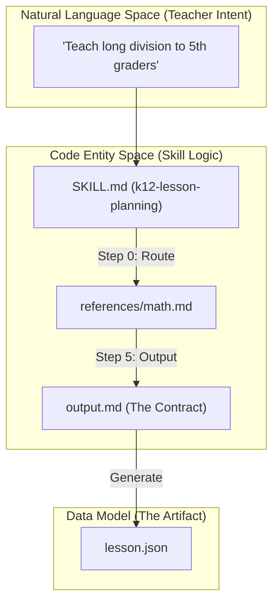
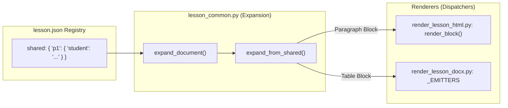

<!-- source: DeepWiki mcp.deepwiki.com · repo anthropics/k12-teacher-skills · page 2.3 lesson.json Schema & Output Contract · fetched 2026-10-26 -->

# lesson.json Schema & Output Contract

<details>
<summary>Relevant source files</summary>

The following files were used as context for generating this wiki page:

- [plugin/skills/k12-lesson-planning/SKILL.md](plugin/skills/k12-lesson-planning/SKILL.md)
- [plugin/skills/k12-lesson-planning/references/example_lesson.json](plugin/skills/k12-lesson-planning/references/example_lesson.json)
- [plugin/skills/k12-lesson-planning/references/output.md](plugin/skills/k12-lesson-planning/references/output.md)

</details>


The `lesson.json` file serves as the intermediate data model and "source of truth" for the `k12-lesson-planning` skill. It decouples the pedagogical generation logic from the final rendering process, ensuring that whether a lesson is viewed as HTML or downloaded as a Word document, the content remains consistent, accessible, and structured according to strict educational standards.

## The Data Model Architecture

The schema uses a "Shared Content Registry" pattern to ensure consistency across multiple documents (e.g., a teacher plan and a student worksheet).

### Shared Content Registry (`shared`)
The `shared` object acts as a central repository for reusable content. Blocks within the `documents` array reference these entries using the `from_shared` block type. This prevents data duplication and ensures that if a math problem is updated in the registry, it updates in both the teacher's "Look-fors" and the student's worksheet [plugin/skills/k12-lesson-planning/references/example_lesson.json:2-179]().

### Documents Array (`documents`)
The `documents[]` array contains the individual artifacts to be rendered. Each document specifies its target audience (teacher or student) and a sequence of sections containing content blocks [plugin/skills/k12-lesson-planning/references/example_lesson.json:180-187]().

### Content Blocks
The system uses a domain-specific vocabulary of blocks to represent instructional content.

| Block Type | Description |
| :--- | :--- |
| `paragraph` | Standard text, limited to 3 sentences [plugin/skills/k12-lesson-planning/references/output.md:18-19](). |
| `callout` | Highlighted boxes for critical teacher moves or student tasks [plugin/skills/k12-lesson-planning/references/output.md:25-29](). |
| `phase_header` | Defines a lesson phase with a title and duration [plugin/skills/k12-lesson-planning/references/example_lesson.json:232-236](). |
| `fill_table` | A table with designated empty cells for student input [plugin/skills/k12-lesson-planning/references/example_lesson.json:344-365](). |
| `workspace` | A dedicated area for student drawing or calculations [plugin/skills/k12-lesson-planning/references/example_lesson.json:366-370](). |
| `number_line` | A visual number line primitive with defined ranges and tick marks. |
| `from_shared` | A pointer to an entry in the `shared` registry [plugin/skills/k12-lesson-planning/references/example_lesson.json:192-195](). |

**Sources:** [plugin/skills/k12-lesson-planning/references/example_lesson.json:1-400](), [plugin/skills/k12-lesson-planning/references/output.md:12-38]()

---

## Output Contract & Density Rules

The `output.md` file defines a "Hard Contract" that the LLM must follow when generating `lesson.json`. These rules are enforced to ensure classroom usability and print safety.

### 1. Structural Density
*   **Prose Limit:** No `paragraph` or `labeled` block may exceed 3 sentences. Longer content must be converted to bullets or tables [plugin/skills/k12-lesson-planning/references/output.md:18-19]().
*   **Table Preference:** Parallel variants (like tiered look-fors or group supports) must use a `table` block rather than sequential paragraphs [plugin/skills/k12-lesson-planning/references/output.md:22-24]().
*   **Bullet Length:** Bullets must be fragments (≤ ~15 words) and never use semicolons to chain clauses [plugin/skills/k12-lesson-planning/references/output.md:21-21]().

### 2. Consistency & Integrity
*   **Materials Agreement:** Every item in the `Materials` list must be used in a phase, and every item used in a phase must be in the list [plugin/skills/k12-lesson-planning/references/output.md:44-45]().
*   **Verbatim Standard:** The curriculum standard is quoted verbatim exactly once (usually in the "At a Glance" section). All other references use the code plus a short gist [plugin/skills/k12-lesson-planning/references/output.md:33-35]().
*   **Classroom Ready:** The lesson must run on common classroom equipment (board, projector) or the pages shipped in the package [plugin/skills/k12-lesson-planning/references/output.md:46-52]().

### 3. Accessibility & Print Safety
*   **B&W Compatibility:** Meaning must never be conveyed by color alone. Students are directed to "the Evidence column," not "the blue box" [plugin/skills/k12-lesson-planning/references/output.md:118-119]().
*   **Writing Space:** Every `workspace` or `fill_in` must be labeled with what belongs there [plugin/skills/k12-lesson-planning/references/output.md:119-120]().

**Sources:** [plugin/skills/k12-lesson-planning/references/output.md:12-121]()

---

## Data Flow: From Intent to Artifact

The following diagram illustrates how the `lesson.json` acts as the bridge between the LLM's pedagogical reasoning and the final rendered files.

### Logic to Entity Mapping
**Title: Natural Language Space to Code Entity Space (Orchestration)**

**Sources:** [plugin/skills/k12-lesson-planning/SKILL.md:44-67](), [plugin/skills/k12-lesson-planning/references/output.md:9-10]()

### Block Dispatching
**Title: JSON Schema to Rendering Dispatch**

**Sources:** [plugin/skills/k12-lesson-planning/references/example_lesson.json:192-195](), [plugin/skills/k12-lesson-planning/SKILL.md:154-162]()

---

## Example Data Structure

A typical `lesson.json` follows this abbreviated structure, ensuring that the student-facing task and the teacher-facing "Look-fors" are synchronized.

```json
{
  "shared": {
    "task_1": {
      "student": "Find the price per bar at each store. Which store wins?",
      "teacher": "Watch for students who only compare the total price ($3.00 vs $3.60)."
    }
  },
  "documents": [
    {
      "id": "student_worksheet",
      "sections": [
        {
          "blocks": [
            { "type": "from_shared", "key": "task_1", "facet": "student" }
          ]
        }
      ]
    },
    {
      "id": "lesson_plan",
      "sections": [
        {
          "heading": "Monitoring",
          "blocks": [
            { "type": "from_shared", "key": "task_1", "facet": "teacher" }
          ]
        }
      ]
    }
  ]
}
```

**Sources:** [plugin/skills/k12-lesson-planning/references/example_lesson.json:56-61](), [plugin/skills/k12-lesson-planning/references/example_lesson.json:192-195]()

---

